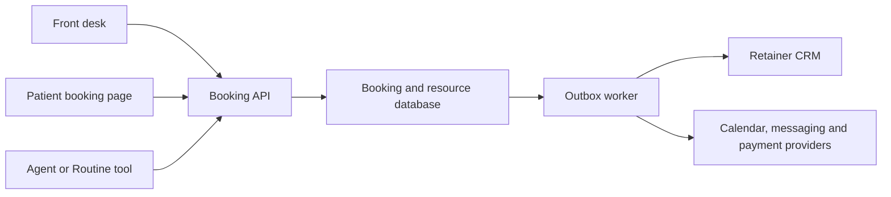

# Clinic booking in Retainer

Feature inventory and implementation assessment, 2026-11-21. Retainer capabilities
were checked against main at `fa4dadc`. Cal.com, RapidOne, Twenty and Macro
are product references. The assessment concerns a booking product Retainer would build and
own. Vendor coverage comes from public documentation.

**Proposed starting point.** Build one booking engine for the front desk,
patient self-booking and agents. Keep the engine's live calendar and resource
reservations in a Retainer-owned standalone app, and project appointments into
Retainer for CRM views, patient history and Routines. The first version should
handle a clinician plus an exclusive resource in one operation. That covers a
dental chair or a longevity clinic's treatment room without starting with the
full set of scheduling policies below.

## What a booking looks like

A patient calls for a 45-minute dental visit. The receptionist finds the
patient, selects the service and branch, and asks for the next available time.
The service needs a qualified dentist and a chair, with ten minutes of chair
turnover. The scheduler offers 10:00 because the dentist is free until 10:45
and the chair is free until 10:55. A patient on the public page asks for the
same time. The booking engine reserves both resources together for the first
successful request and gives the other requester fresh alternatives. If a
later move fails, the original appointment remains booked.

| Surface | What people do there |
| --- | --- |
| Front-desk calendar | See the day by clinician, branch and chair or room. Search for a patient, create or move a visit, mark attendance and fill a cancellation. |
| Patient booking and manage pages | Choose a service and time, answer booking questions, confirm or pay if required, then confirm attendance, move or cancel within policy. |
| Clinic setup | Define services, durations, eligible staff, required rooms or equipment, shifts, breaks, booking rules and who can do what. |
| Patient record and agent | See upcoming visits and prior outcomes. Ask the agent for available times or authorize it to book through the same engine as staff and patients. |
| Exceptions and reporting | Work through waitlist offers, calendar-sync failures, unpaid deposits and conflicting imports. See what happened and who acted. |

## What Retainer already provides

- The Clinic template has an Appointment object with a start time, type, status
  and Patient relation to People. It also adds date of birth and preferred
  channel to People. The web app can list appointments or place them on a
  month calendar. Its calendar drag changes a record's displayed date through
  ordinary record editing. [Clinic template](../../packages/server/src/templates/clinic.ts), [calendar implementation](../../packages/web/src/routes/views/calendar-view.tsx)
- Schema, filters, relations, unique fields, aggregates, assertion history and
  REST/MCP provide CRM storage and access. A unique field protects equality
  of one value. It cannot detect two overlapping intervals or reserve a set of
  resources across several records. Ordinary record writes allow assertion
  review and precedence. [Architecture](../../ARCHITECTURE.md#2-write-rules), [record routes](../../packages/server/src/api/routes/records.ts)
- Standalone installations can contribute reviewed schema and views and connect
  a separately hosted app with their own installation credentials. Their CRM
  grants are workspace-wide within approved scopes. Hosted extension jobs
  support verified webhook ingress, background work and typed tools. Extension
  webhook ingress acknowledges acceptance for processing. Public pages and
  synchronous booking responses can run in the standalone app.
  [Standalone apps](../standalone-apps.md), [extensions](../specs/extensions.md), [extension tools](../specs/extensions-tools.md)
- Routines can react to committed record changes, run on a schedule, or add a
  button to a record. They can call installed tools and write CRM records as
  agents. A relative trigger such as “24 hours before start” is deferred.
  [Routines implementation notes](../specs/routines.md#114-as-built)

## Feature inventory

**Direct** means existing Retainer primitives cover most of the capability.
**Partial** means an existing primitive carries useful work and the booking
product still needs a substantial piece. **New** means the booking logic or
surface needs dedicated code. These ratings describe reuse. A **New** capability
can still fit the standalone app without a platform change.

### Catalog, availability and booking rules

Cal.com covers configurable event types, appointment lengths, schedules,
buffers, notice, slot intervals, limits and multi-host assignment. RapidOne
adds clinic-specific precedents for shift import and equipment occupancy.
[Cal.com feature breakdown](https://cal.com/pricing), [Cal.com booking limits](https://cal.com/docs/api-reference/v2/user-booking-limits), [Cal.com round robin](https://site.cal.com/features/round-robin), [RapidOne 8.1](https://www.rapid-image.com/version-updates-29-04-2026/)

| Feature | Retainer fit | Gap to build |
| --- | --- | --- |
| Service catalog and categories | **Direct.** Schema, selects, relations and views. | Setup UX for durations, service variants, prices, booking channels and active dates. Snapshot the relevant policy on each booking. |
| Branches, rooms, chairs, beds and equipment | **Direct for catalog.** Objects and relations represent inventory. | A resource calendar and occupancy rules for each unit or pool. Store display location separately from what is reserved. |
| Staff eligibility, specialties and referral restrictions | **Partial.** People and relations can represent qualifications. | Staff-to-account mapping, eligibility checks per service and branch, and operational restrictions on what can be selected. |
| Weekly hours, split shifts, breaks and shared schedules | **Partial.** Schema can describe schedules. | Schedule editor, weekly recurrence and calculation of effective working hours per resource and service. |
| Time off, holidays, maintenance and shift overrides | **Partial.** Dated records can describe exceptions. | Block/override precedence, coverage and substitute handling, bulk shift import and alerts when an override affects existing visits. |
| Duration, slot increments and preparation or cleanup | **New.** Record timestamps store results. | Calculate valid starts and distinct occupancy intervals, such as 45 minutes for the dentist and 55 for the chair. |
| Minimum notice, booking horizon and same-day rules | **New.** Settings can store the policy. | Enforce it on reads and at commit. Handle cutoffs in the branch's time zone. |
| Booking quotas and shared limits | **New.** Aggregates help report usage. | Enforce count, time, and upcoming-booking caps across clinicians, services or patients under concurrency. Support explicit, audited policy overrides. |
| Availability search and alternatives | **New.** CRM filters help find appointments. | Intersect shifts and required resource availability, subtract blocks and active reservations, and return feasible alternatives by date, branch or practitioner. Add a staff view that explains why a time is unavailable. |
| Named clinician, first available and patient continuity | **Partial.** Existing relations can carry patient and clinician history. | Choose from eligible clinicians, support requests to keep the current clinician, and define deterministic fallback. |
| Round robin, weights and team routing | **New.** Retainer can store attributes and report workload. | Assign within a pool, with weighting, priorities or load balancing. Pick and commit in the same operation so concurrent requests respect the assignment policy. |
| Collective and mixed assignments | **New.** Relations can describe selected people and tools. | Reserve all required roles together, such as one dentist, any qualified assistant, one chair and a scanner. Support role-specific occupancy intervals. |
| Time zones and daylight saving | **Partial.** Retainer has date-time fields and a workspace time zone. | Compute schedules in each branch's IANA zone, store instants in UTC and render in the viewer's zone. Define handling of skipped and repeated local times. |

### Patient booking and intake

Cal.com documents public links, embeds, private links, booking questions,
routing forms and a distinct reservation API. RapidOne describes controlling
which treatments patients can book through an active treatment plan.
[Cal.com scheduling](https://site.cal.com/scheduling), [Cal.com feature breakdown](https://cal.com/pricing), [Cal.com routing API](https://cal.com/docs/api-reference/v2/routing-forms/calculate-slots-based-on-routing-form-response), [Cal.com reservation API](https://cal.com/docs/api-reference/v2/slots/reserve-a-slot), [RapidOne 8.1](https://www.rapid-image.com/version-updates-29-04-2026/)

| Feature | Retainer fit | Gap to build |
| --- | --- | --- |
| Public booking, private links and embeds | **New.** Standalone installation is the integration path. | Accessible mobile flow, service/branch/provider links, revocable or limited-use links, redirect/return flow, branding, locale and RTL. Expose only bookable times and public labels. |
| Contact verification and patient matching | **Partial.** People, identifiers and merge review exist. | Verify the booker where needed and handle new patients, ambiguous matches, shared phones and guardians or delegates. Keep patient lookup out of the public API response. |
| Booking questions, consent and documents | **Partial.** Schema and file APIs can store approved data. | Conditional intake form, validation, versioned consent evidence and secure uploads. Keep sensitive intake separate from appointment titles and notifications. |
| Routing by booking answers | **Partial.** Service and provider attributes can live in schema. | Synchronous rules route to a branch, service, clinician pool or staff callback. Keep a trace of the rule chosen. Example: new patient with no referral goes to consultation intake. |
| Plan-only and staff-only services | **Partial.** Relations can reference a treatment plan or referral. | Check eligibility at booking time, issue restricted links and support staff-assisted exceptions. |
| Temporary hold during intake or checkout | **New.** Generic uniqueness and idempotency are insufficient for interval holds. | Reserve exact resources with an expiry, release abandoned holds and convert a live hold to a booking atomically. Rate-limit hold creation and extension. |
| Request to book and clinic approval | **Partial.** Status, views and staff follow-up tasks fit. | Pending-state queue, expiry and explicit policy for whether a pending request consumes capacity. Revalidate if approval occurs after a hold expires. |
| Verified self-service management | **New.** Retainer account sessions are workspace-side. | Booking-scoped links or patient authentication, contact verification where appropriate, and permission checks for each move, cancel or attendance response. |
| Spam and booking abuse controls | **New.** Public booking needs its own admission checks. | Rate-limit searches, holds and submissions. Support revocable links, allow/block rules and escalation to staff for suspicious bookings. |
| Booking attribution and abandoned intake | **Partial.** CRM supports leads, sources and follow-up tasks. | Carry campaign or referral attribution into the appointment. Record an incomplete request for outreach only where the clinic has permission to contact the person. |

### Reservation and visit lifecycle

Cal.com's booking API covers create, confirm, decline, reschedule, reassign,
cancel, absence and seat-specific actions. Clinic-specific depth includes
related treatments, cancellations that restore waitlist entries and a
front-desk calendar that shows attendance.
[Cal.com booking API](https://cal.com/docs/api-reference/v2/bookings/create-a-booking), [Cal.com seats](https://cal.com/features/seats), [RapidOne 8.1](https://www.rapid-image.com/version-updates-29-04-2026/), [RapidOne 8.7](https://www.rapid-image.com/version-updates-8-7/)

| Feature | Retainer fit | Gap to build |
| --- | --- | --- |
| Book and enforce no overlaps | **New.** Appointment records can mirror the result. | Transaction over all resource claims with idempotent retry, overlap checks and conflict responses. Use the same command for front desk, public page, API and agent. |
| Move, resize, reassign or change location | **Partial.** Calendar and record edits exist for generic date changes. | Swap old and new resource claims atomically with a version check. Update external invites and invalidate old reminder jobs. Retain the original on conflict. |
| Cancel, decline and cancellation policy | **Partial.** Status and history store outcomes. | Enforce cutoffs, reasons, actor roles and overrides. Release the reservation once, then queue refund, notification and waitlist work. |
| Attendance and visit status | **Direct for display.** Status, filters and tables cover basic tracking. | Define valid transitions for booked, attendance confirmed, arrived, in treatment, completed, cancelled and no-show. Keep attendance confirmation separate from clinic approval and payment. |
| Staff calendar and rapid entry | **Partial.** Generic month view, search and record views exist. | Day/week resource lanes, visible durations, work hours, quick entry, conflict-aware drag/resize, patient search and booking history. |
| Same-day walk-ins and waiting-room queue | **Partial.** Arrival records and views can track status. | Front-desk check-in, queue ordering and room handoff. Reserve walk-in time through the same engine if it uses scheduled capacity. |
| Future appointment waitlist | **Direct for list.** Schema and filters cover service, urgency and time preferences. | Find compatible candidates when capacity opens. Ship a staff shortlist first, with explicit rank and reasons. Link updates to the patient's history. |
| Waitlist offers and automatic backfill | **New.** Routines can notify once a candidate is selected. | Issue and expire offers under a clear priority policy. Either reserve for one patient or let several answers compete through one atomic claim. Prevent inviting or booking someone who already accepted another offer. |
| Group visits and classes | **Partial.** Session and attendee records fit. | Reserve staff and room once, enforce seat capacity under concurrency, support seat-level cancellation and hide attendee identity by default. |
| Repeating visits and treatment series | **Partial.** Related records can track occurrences. | Preview conflicts, choose all-or-none or explicit partial acceptance, and define single/future/all edits. Support provider continuity and weekday patterns. |
| Multiple services in one visit | **New.** Relations can represent sub-visits. | Plan ordered or parallel service segments, gaps and handoffs. Deduplicate shared claims and reserve all segments in one operation. |
| Staff overrides and disruption handling | **Partial.** Actors and history support attribution. | Allow authorized overrides of policies such as notice, and keep hard resource conflicts enforced. Show impacted visits when shifts or rooms close, then reassign or contact patients. |

### Communications, calendars and payments

Cal.com documents calendar conflict inputs, outbound invitations, video,
upfront payments, booking workflows and lifecycle webhooks. These are
separate concerns from the core booking transaction.
[Cal.com scheduling](https://site.cal.com/scheduling), [Cal.com integrations](https://cal.com/pricing), [Cal.com workflows](https://cal.com/workflows), [Cal.com webhook events](https://site.cal.com/features/webhooks)

| Feature | Retainer fit | Gap to build |
| --- | --- | --- |
| Booking, change and cancellation notices | **Partial.** Record-triggered Routines and send tools fit. | Channel integrations, templates, localization and delivery state. Send required confirmations from the booking outbox so each accepted booking has a durable notification intent. |
| Reminders before and follow-ups after visits | **Partial.** Scheduled Routines and provider tools can cover windows and optional follow-up tasks. | Durable appointment-relative jobs for precise timing, reschedule/cancel handling, quiet hours and per-booking/version dedupe. |
| Two-way SMS or WhatsApp confirmation | **Partial.** Webhook verification and extension jobs fit ingestion. | Correlate replies to the right appointment, including phones tied to multiple visits. Route ambiguous replies to staff and call the booking command for confirmed state changes. |
| Calendar invites and conferencing | **Partial.** Provider jobs and tools are available. | Generate and update ICS or provider events using a stable booking reference. Provision video links and ensure patient-sensitive data stays out of shared calendar text. |
| Book now and join immediately | **New.** The app would own the live request. | Check on-duty capacity, atomically reserve the practitioner, then create a call or queue entry. Relevant only if the clinic offers an on-demand service. |
| External calendars as conflict inputs | **Partial.** Connection patterns and webhooks exist. | Connect Google or Microsoft first if required. Maintain busy-only intervals, freshness, incremental sync and resync after provider gaps. Define when stale feeds block self-booking. |
| Two-way calendar sync | **Partial.** Provider connections and durable ingestion can be reused. | Track destination event IDs and versions, suppress echoes, reconcile edits and cancellations. Decide which external edits request a change and which only create busy time. |
| Deposits, full prepayment, pay later and packages | **Partial.** Money fields and provider integrations fit around booking. | Hold capacity through checkout, verify provider callbacks, track payment separately and expire unpaid holds. Define whether existing package credits need a reserved balance. |
| Refunds, late cancellation and no-show charges | **Partial.** Tools and money records cover external calls and tracking. | Provider-side idempotency, policy snapshots, ledger and reconciliation. Handle payment arriving after hold expiry with a refund or explicit staff exception. |
| Prep, follow-up and rebooking | **Direct for CRM tasks.** Routines can react to status and create tasks or send through tools. | Clinic templates, reliable send tools and a booking link or appropriate next-service recommendation. |

### Operations, data and agent access

Cal.com's API and team features provide precedents for booking commands,
staff administration, analytics and integrations. Clinic-specific scope
includes separate reception and clinical access, sensitive intake and
reconciliation when a booking is reflected in several systems.
[Cal.com product overview](https://cal.com/about), [Cal.com feature breakdown](https://cal.com/pricing), [Retainer tenancy](../../ARCHITECTURE.md#72-per-record-access)

| Feature | Retainer fit | Gap to build |
| --- | --- | --- |
| Patient timeline and CRM linkage | **Direct.** Appointment relation, assertion history and events fit. | Stable booking ID and a versioned projection. Decide what staff can edit as ordinary CRM notes or tags and what must go through booking commands. |
| Admin templates and multi-branch defaults | **Partial.** Schema and installation settings cover basic setup. | Shared service templates, branch overrides, configuration versioning, preview and safe rollout to existing appointments. |
| Staff roles, branch isolation and audit | **Partial.** Workspace isolation, membership and write provenance exist. | Enforce receptionist, clinician and manager permissions in the app. App permissions do not narrow generic CRM access. Sensitive fields requiring per-role visibility stay in the app until Retainer can enforce it. Audit who booked, moved, overrode or exported. |
| Availability privacy, retention and deletion | **Partial.** Tenant scoping and CRM deletion mechanisms exist. | Minimize exposed fields, authorize before resolving patient or booking IDs, record access where needed, and coordinate deletion across the scheduling store, CRM projection, queues and providers. |
| Agent, phone and chat booking | **Partial.** Agent/MCP CRM access and Routines provide context. | Expose typed availability, book, move and cancel commands with appropriate authorization, attribution and confirmation. Resolve patients safely and handle stale availability. |
| Booking lifecycle webhooks and external API | **Partial.** REST, record changes and hosted webhook primitives exist. | Define a booking-specific contract, stable event IDs, signed outbound delivery, replay and status. Expose only the booking fields intended for a subscriber. |
| Calendar and funnel analytics | **Partial.** Filters and aggregates cover booked/completed counts and some breakdowns. | Compute utilization against staffed capacity, time-to-appointment, no-shows, lead conversion, waitlist fill, cancellations and provider workload. Add export and dashboards. |
| Import and cutover | **Partial.** Schema creation and CRM record writes can be reused. | Import people, services, shifts and future bookings with stable IDs. Report overlaps, compare totals and define a cutover that prevents two live booking systems from allocating the same resources. |
| Operational recovery | **Partial.** Extension run and Routine history help diagnose background actions. | A clinic-facing queue for stale calendars, retries, projection drift, payments needing attention and undelivered notices. Reconcile by booking ID and version. |

## What Twenty and Macro do

These findings are from the local source checkouts. The comparison covers
code and documentation at the named revisions.

| Product | Booking capability | What applies to Retainer |
| --- | --- | --- |
| **Twenty** · `1dd1c249a` | Imports calendar events and can create a provider event at a supplied time through its API, workflow action or agent tool. The onboarding and getting-started calls use Cal.com for slot lookup and booking. No workspace-owned booking links, availability engine or reservation lifecycle surfaced in this checkout. | Creating and syncing calendar events is useful for invites and CRM history. A clinic still needs its own scheduler for availability, holds and conflict-safe allocations. |
| **Macro** · `be50abb4` | Implements public personal and team booking links, weekly availability and date overrides, connected-calendar busy checks, collective and round-robin hosts, buffers and limits, intake questions, invitations, private cancel/reschedule links, attendance, basic insights and agent tools. Macro Forms can qualify a respondent and hand off to a booking link. | Its scheduling service is a concrete precedent for separating rule evaluation, reservations and calendar-provider operations. The checked implementation reserves people. Clinic scheduling adds rooms, equipment, capacity, waitlist matching and deposits. |

**Macro's reservation design.** PostgreSQL rejects overlapping occupied
ranges for the same host. The service reserves capacity before writing to the
provider and records a durable operation so a retry can recover an uncertain
write. When moving an appointment, it can hold both the old and new times
until the external calendar accepts the move. It also refuses to offer time
when required calendar data is too stale. For Retainer, apply the overlap
rule to every exclusive resource and explicitly choose whether the external
calendar is a projection or must acknowledge a move before the clinic treats
it as final.

Macro's scheduling package excludes booking payments and lifecycle webhooks.
New approval-only links are disabled in this checkout. The Forms handoff
covers a qualification gate. Cal.com's routing API is a separate precedent
for selecting a service or host pool from the answers.

**Source files in the local checkouts.** In Twenty, see
`packages/twenty-server/src/modules/calendar/calendar-event-creation-manager/services/create-calendar-event.service.ts`,
`packages/twenty-front/src/modules/getting-started/utils/fetchCalSlotsOrThrow.ts`
and `packages/twenty-front/src/modules/onboarding/components/BookCallEmbed.tsx`.
In Macro, see `crates/calendar_scheduling/README.md`,
`crates/calendar_scheduling/src/inbound/router.rs`,
`crates/macro_db_client/migrations/20260918164303_calendar_scheduling.sql`
and `apps/docs/product/forms.mdx`.

## How to implement it

### Booking engine and CRM boundary

| Implementation | What it gives us | Main tradeoff |
| --- | --- | --- |
| **Retainer-owned standalone app** | Own public and staff UI, synchronous booking API, transactional reservations and scoped staff permissions. Connect to Retainer through a reviewed standalone installation. | A separate store and runtime need deployment, access control, monitoring, export and deletion. CRM projection is eventually consistent. |
| **First-party booking module in Retainer** | Booking commands and domain tables can share Retainer's database and application context. Makes native calendar actions and transactional CRM projection possible by design. | Requires product API and UI work, deployment changes, and rules that prevent ordinary record edits from bypassing booking commands. Worth revisiting when native editing or shared lifecycle guarantees justify it. |
| **CRM records with extensions and Routines** | Useful for appointment tracking, communications, follow-up and lightweight appointment requests. | Generic CRUD has no atomic interval reservation. Treating a check-then-write Routine as a confirmed booking risks double bookings and incomplete resource allocations. |

In the proposed standalone app, store the service policy version, branch time
zone, booking lifecycle, resource allocations, holds and provider operation
state. Edit scheduling inputs in the booking app so each rule and resource
has one owner. Use Retainer's schema engine for CRM additions, such as
booking ID, end time, branch and outcome. An outbox written with the booking transaction
projects approved data through Retainer's normal APIs using a stable ID and
version-aware retries. Project only what the workspace is authorized to see.
The front-desk calendar and patient confirmations read directly from the
booking service. If projection is delayed or a CRM date is edited by hand,
the app still uses its own booking time. A native CRM action must call the
booking API before it can change any reservation. Until then, use the CRM
appointment as a summary with a link to manage the visit. Treat rejected or
superseded projection writes as reconciliation cases. Keep provider
credentials and the Retainer installation token on the server.
[Standalone installation identity and retries](../standalone-apps.md), [Retainer write rules](../../ARCHITECTURE.md#2-write-rules)

### Transaction and external effects

1. **Find times.** Expand the service into resource requirements with
   variable-length occupancy. Intersect shifts and busy time, and subtract
   reservations. Return candidates with a short lifetime. Recheck all
   constraints when the user selects one.
2. **Hold or book.** In a single Postgres transaction, serialize overlapping
   claims per resource and insert the allocation and booking or hold together.
   For exclusive resources, range exclusion constraints on active claims are
   one option. Use half-open intervals so adjacent appointments can touch when
   buffers allow. Expired holds must be released before conflicting writes,
   with expiry checked inside the same locking protocol. Shared pools and
   seats need a separate locked capacity check. Scope the request key to the
   clinic and operation, retain the outcome and reject reuse with a different
   payload.
3. **Move or cancel.** Check the expected booking version. Replace resource
   claims and advance the version together, or roll back. On cancellation,
   release the claims and retain the cancellation event for audit and to
   drive waitlist and payment work.
4. **Deliver effects.** Commit durable intents for CRM projection, invites,
   notices and provider calls with the booking. Workers retry with a stable
   effect key and ignore stale booking versions when appropriate. Payment and
   calendar providers own their own state. Reconcile ambiguous responses,
   late payments and external calendar edits through explicit policies.
5. **Automate after commit.** Routines can create a prep task, flag a no-show
   for follow-up, or notify staff when a slot opens. When an automation needs
   to reserve capacity, a dedicated booking tool sends it through the same
   commands as staff and the public page.

An external calendar is a source of busy intervals with a freshness limit.
Retainer can guarantee conflict safety for resources governed by its booking
engine. An external event created independently after the last sync can still
conflict. Surface that conflict to staff and give each clinic a policy for
stale feeds.

## Suggested delivery order

1. **Front-desk pilot.** One branch, weekly shifts and exceptions, fixed-length
   service types, one clinician and an optional exclusive chair or room.
   Patient search, day/week calendar, first available, create, move, cancel,
   attendance and a CRM projection. Validate this with a real clinic before
   widening the scheduling rules.
2. **Patient self-booking.** Public links, patient matching or verification,
   short holds, booking confirmation and a manage link. Add one messaging
   channel and durable reminders. Add external busy-time checks to the pilot
   if staff calendars are used to block appointments.
3. **Expand for the target clinic.** Dental clinics are likely to need an
   assistant, chair and room turnover, stacked visits and cancellation
   backfill. Longevity clinics may prioritize a practitioner plus equipment,
   sequential services, recurring treatments and deposits. Validate the
   priorities with clinic operators before choosing among waitlist offers,
   payments, group seats, advanced routing and additional integrations.

Before opening public booking, exercise these cases against real Postgres:
two callers competing for the same clinician and room, overlapping visits
with different start times, a hold expiring during checkout, two requests
for the final seat when seats ship, a failed reschedule retaining the
old slot, duplicate requests and provider callbacks, cancellation racing a
reminder, a move across a daylight-saving change, and a booking projection
retry after a CRM outage. Verify tenant isolation and booking-link access
against another clinic and another patient's booking.
