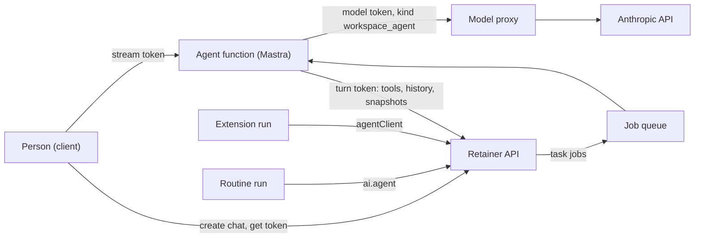

# The workspace agent: spec

Status: **proposed**, 2026-11-25. Nothing here is built. Revised the same
day: the chat comes first, background tasks suspend and resume instead of
waiting inside their run, and Mastra's built-ins are used wherever they fit
(§3). Revised again the same day after a review by two independent
reviewers: their agreed fixes are in the sections they affect, and the
product owner's five decisions on what they left open are D1 to D5 in §2.
§2 lists what is decided.

Builds on [extensions-model-calls.md](extensions-model-calls.md) (the model
proxy, and §11 there, which first described this agent) and
[routines.md](routines.md). Mastra facts are from `@mastra/core` 1.86.0,
`@mastra/memory` 1.41.3, `@mastra/ai-sdk` 1.12.1 and `@mastra/pg` 1.38.0,
read from their bundled docs, type definitions and source on 2026-11-25.

If accepted this spec amends:

- `extensions-model-calls.md` §3.2.1 (a third list of allowed requests, for
  the agent's model token, which has its own claim shape), §3.3 (the agent's
  history is stored; its requests are never captured), §3.4 (`ai_usage` rows
  of kind `workspace_agent` name the session), §3.6 (the `model` function's
  timeout covers agent requests) and §11 (now this spec; two of its
  decisions are refined in §2 here).
- `routines.md` §4.4 and §4.5 (a new SDK call, `retainer.ai.agent`), §6.2 (a
  run can wait for a task), §6.6 (stored session content, waiting runs and
  their tasks), §10 (the "agent with tools" and "long runs and waits" rows)
  and §11.4 (runs that use the agent record their reads).
- `cli.md` §3, §5.2, §9.1 and §11: a chat from the CLI writes, as the agent,
  while the login is elevated (§6.7).
- `accounts-and-access.md`, the workspace purge: it erases the agent's stored
  content before the workspace's rows go (§5.4).
- `ARCHITECTURE.md` §2.1 (`forget` clears stored session content) and §8 (a
  new package and two server modules).
- `FRONTEND.md`, whose "no agent chat" line is already out of date.

The write rules and actor types in `ARCHITECTURE.md` don't change. The agent
writes as an agent, for a person or for a routine or extension (§7).

## 1. The idea on one page

Retainer gets its own agent: a Mastra agent loop that calls the model through
Retainer's model proxy, uses tools (Retainer's own, the web, extension tools)
and keeps its conversation in Retainer.

Two kinds of caller use it:

- **A person, through the chat.** They send a message and watch the agent
  think, call tools and answer, as a stream. This spec builds the chat's
  backend only; the web app's chat screen comes later (§14).
- **Code, through a task.** A routine (`retainer.ai.agent`) or an extension
  (`agentClient`) hands the agent instructions and input and gets back a
  typed answer. The caller's run suspends while the agent works and resumes
  with the answer.

Both are **sessions**: a chat is a session that stays open, a task is a
session that ends with an answer. They share one harness, one store and one
set of tools.

- **One model proxy.** The agent is one more client of the proxy, with a
  model token of its own kind, `workspace_agent` (§7.3). The key, the
  allowed requests and usage stay in one place (§2.1).
- **Callers talk to Retainer, not to the agent.** A person's session, the
  CLI's login or a run's token gets the caller a short credential from
  Retainer's API. The agent function trades it, with a credential of its own
  that callers never see, for a token bound to one turn (§7.3). The agent
  accepts nothing else.
- **Authority comes from the caller.** The agent brings its prompt, its
  model and its harness. Everything it does in Retainer uses the caller's
  access, never more, and its writes are recorded as an agent acting for
  that caller.
- **Mastra for the loop, Retainer for the data.** Mastra runs the loop,
  streams, pauses for approvals and keeps the message history. Its storage
  is Mastra's own Postgres store, `@mastra/pg`, run by Retainer's API on
  Retainer's database; the agent reaches it only through the API (§3.2).



## 2. Decided and proposed

Decided in `extensions-model-calls.md` §11 (2026-11-14), unchanged:

- **Harness: Mastra**, as a library, Apache-2.0 packages only. Nothing from
  `ee/` folders (§3.3).
- **No Anthropic Managed Agents, no Bedrock AgentCore, no Lambda durable
  functions.** Self-hosting runs the same code.
- **Model: the Anthropic API** with Retainer's key, through the model proxy.
- **Hosted: an `agent` Lambda function outside the database VPC.** It
  reaches Retainer only through the API.
- **Harness from the agent, authority from the caller.**

Refined from §11 there (2026-11-25):

- "Mastra's own memory and storage aren't used" becomes: **Mastra's storage
  is `@mastra/pg`, run by Retainer's API.** The data stays in Retainer's
  Postgres, in a `mastra` schema; the agent function reaches it only
  through the API and never holds a database credential (§3.2, decided
  2026-11-25).
- "Each task runs as a series of short jobs, one per step" becomes: **a task
  runs as one job, or a few** if it outlasts one, with each step saved as it
  ends (§9.3). Mastra runs the loop inside a job; splitting it per step would
  mean replacing Mastra's loop.
- "The worker container on Compose" becomes: **an `agent` container of its
  own** (D3 below).

Decided 2026-11-25 by the product owner:

- **The chat first** (§14), backend only.
- **No bounded waiting.** A task's caller doesn't wait inside its run; it
  suspends and resumes (§2.2).
- **Generous limits at first**, tightened from real usage (§10).
- **A task may search the web and write to Retainer** in the same session.
- **Use Mastra's built-ins when they make sense** instead of building our
  own (§3).

Decided 2026-11-25 by the product owner, on what the review left open:

- **D1. No refusal fallbacks.** Agent requests carry no `fallbacks`, and the
  proxy's agent list refuses the field. A refused turn ends as `refused`; a
  refused task ends as `refused`, with no repair turn (§3.4, §12).
- **D2. A hard chat-length limit in PR 1.** Before each request the agent
  function measures it. Past a threshold under the proxy's 6 MiB, or near
  the context limit, the turn ends as `context_limit_reached` and the person
  starts a new chat. Compaction comes later, once Mastra is shown to store
  and replay compaction blocks (§5.5).
- **D3. Self-hosted turns run in their own container.** Chat and task turns
  run in an `agent` Compose container with no database credential and no
  route to Postgres. It reaches Retainer only through the API, like the
  routine runner: the same isolation as hosted (§4.2, §13).
- **D4. Runs that use the agent record their reads.** In a routine whose
  manifest declares `agent`, reads before the `ai.agent` call are recorded
  and replayed until the run passes its last recorded effect; after that,
  reads are live. Recorded reads are CRM content: kept 7 days and erased by
  `forget`. The effect's argument hash stays whole, input included (§9.2).
- **D5. A write whose outcome is unknown isn't replayed.** If PR 1 finds
  Mastra can't save a step before its tools run, a crashed turn or slice
  that may have dispatched a write ends as `outcome_unknown`, with no
  automatic replay (§8.4).

### 2.1 Considered: a second proxy

An agent proxy speaking the Messages API, next to the model proxy, with the
agent behind it. Not chosen: an agent session is asynchronous, keeps state
between turns and runs tools with someone's authority. A request-and-answer
proxy can't express that without exposing the harness or rebuilding a
session API inside it. Making the agent a client of the existing proxy keeps
the key, the allowed requests and usage in one place.

### 2.2 Considered: waiting inside the caller's run

A first draft had the caller poll the task inside its own run, bounded by
the run's 300 seconds. Dropped: it caps tasks at a few minutes, keeps two
functions running while one waits, can't pause for a person's approval, and
would be thrown away once suspend and resume exists.

## 3. Mastra: what we use and what we build

### 3.1 The table

| Need                                 | Decision             | How                                                                                                                                                                 |
| ------------------------------------ | -------------------- | ------------------------------------------------------------------------------------------------------------------------------------------------------------------- |
| The agent loop                       | Built-in             | `Agent` with `stream()` and `generate()`                                                                                                                            |
| Model access                         | Built-in             | Claude Sonnet 5.5 (§3.4) through an `@ai-sdk/anthropic` instance whose base URL is the model proxy, with a `fetch` that gets a model token per request (§10.2)      |
| Anthropic options                    | Built-in             | `providerOptions.anthropic`: adaptive thinking with summaries shown, effort, context management (§3.4). No refusal fallbacks (D1)                                   |
| Message history                      | Built-in             | `Memory` with `savePerStep: true`, stored by `@mastra/pg` behind the API (§3.2). No trimming: the whole thread each turn, up to a hard length limit (§5.5)          |
| Semantic recall                      | Off                  | Retainer has no embeddings (`semanticRecall: false`, no vector store, no embedder)                                                                                  |
| Working memory, observational memory | Off                  | Retainer's own memory (`me`, `workspace`, records) is the memory; the agent uses it through tools                                                                   |
| Thread titles                        | Built-in             | `generateTitle`; its model call goes through the proxy and counts (§10)                                                                                             |
| Streaming to a UI                    | Built-in             | `handleChatStream` from `@mastra/ai-sdk`, UI message version pinned, `sendReasoning: true`. Its parameters are built by the server, never from the request (§6.2)   |
| Approvals                            | Built-in             | `requireApproval` and `requireToolApproval`; the resume is built from the API's approval record, and dispatch checks that record (§6.4)                             |
| Per-request auth                     | Built-in             | `RequestContext`, read by tools; it holds the turn token, which is never persisted (§7.3)                                                                           |
| Step and time limits                 | Built-in             | `maxSteps`, `modelSettings.timeout`, `maxOutputTokens`, a runtime-owned `abortSignal`                                                                               |
| Tool call caps                       | Built on a hook      | `hooks.beforeToolCall` returns `{ proceed: false }` past the cap                                                                                                    |
| Web search                           | Built-in, AI SDK     | Anthropic's `web_search_20260209` as an AI SDK provider tool, with a constant `max_uses`. Not Mastra's `webSearchTool`, which sends the older `web_search_20250305` |
| Web fetch                            | Built-in, AI SDK     | Anthropic's `web_fetch_20260209` as an AI SDK provider tool, with a constant `max_uses`. Not Mastra's `webFetchTool`, which fetches from the agent function (§8)    |
| Retainer tools                       | Ours                 | `createTool` over `@retainer/sdk` (§8)                                                                                                                              |
| Storage                              | Built-in, in the API | `@mastra/pg` (`MemoryPG`, `WorkflowsPG`) runs in Retainer's API; the agent function's store forwards each call to it (§3.2)                                         |
| Resumable streams                    | Off                  | They need a shared PubSub such as Redis. `durable: false`, and the handler keeps consuming when the client leaves; reconnecting reads the saved history (§6.5)      |
| Durable agents                       | Evaluate in PR 2     | Beta. A candidate for long tasks (§9.3)                                                                                                                             |
| Guardrail processors                 | Later                | Built-in processors exist (`PromptInjectionDetector`, `PIIDetector`, `ToolCallFilter`, …); part of the study in §11                                                 |
| Tracing                              | Off                  | Decided 2026-11-25. The saved messages are the trace (§5.3)                                                                                                         |
| Mastra's server, A2A, MCP server     | Not used             | Retainer's API is the only way in                                                                                                                                   |

### 3.2 Storage: `@mastra/pg` behind the API

Mastra's Postgres store, `@mastra/pg` (Apache-2.0), is a database client.
The agent function has no database access by design: it reads untrusted
text (web pages, emails, records anyone could write), so it holds only a
token for its own turn. So the store runs in Retainer's API instead
(decided 2026-11-25):

```
agent function                  Retainer API                     Postgres
Mastra agent ── storage call ─▶ checks the turn token, ─▶      schema "mastra":
(pass-through store)            calls MemoryPG / WorkflowsPG    Mastra's tables
```

- **The agent function's store forwards.** Each call in the two domains the
  agent uses, `memory` (threads and messages) and `workflows` (the snapshots
  behind approvals and suspended runs), goes to the API with the turn token.
- **The API checks, then calls Mastra's store.** It checks the turn's claim,
  and that every ID the call names belongs to the token's session, then
  calls `MemoryPG` or `WorkflowsPG` (§5.2).
- **We write no message or snapshot tables and no SQL for them**, except to
  erase them (§5.4). Mastra's tested store keeps them in its own format, so
  history, approvals and `handleChatStream`'s approval flow work as Mastra
  expects.

Considered: the agent connecting to Postgres itself, inside the VPC behind a
NAT gateway with a role limited to the `mastra` schema. Rejected: the
process that reads untrusted text would hold a database password, and
hosted would pay for a NAT gateway.

### 3.3 Licence: staying free

Checked on 2026-11-25 against `@mastra/core` 1.86.0, its `LICENSE.md`, the
`ee/LICENSE` in `mastra-ai/mastra` and the repository's source tree.

- **The split.** Everything in Mastra is Apache-2.0 except what sits under a
  folder named `ee/`, which is under the Mastra Enterprise Edition License.
  Those features (fine-grained authorization, role-based access, Studio
  sign-in, the agent builder, the editor) may be used for development and
  testing for free; production use needs a written agreement with Mastra and
  a licence key.
- **What we use is all Apache-2.0**: `@mastra/core`'s agent, memory,
  workflows and processors, `@mastra/memory`, `@mastra/ai-sdk`, and
  `@mastra/pg` 1.38.0 in the API. None of the Enterprise features is
  configured: no FGA or RBAC provider, no auth
  provider, no Studio, no editor, no agent builder.
- **One catch.** `@mastra/core` bundles code built from
  `packages/_internals/auth/src/ee/` into its runtime, and the agent loop
  calls one function from it, `requireFGA`, on every tool call. With no FGA
  provider configured it returns at once. Loading it runs nothing else (it
  defines constants). Our reading: running this no-op is not using the
  Enterprise feature (fine-grained authorization), so the licence's
  production-use terms don't apply. `@mastra/pg` loads the same core
  modules in the API, so the guards below cover `packages/server` too. The
  licence lets Mastra designate more code as Enterprise later (its §5.1),
  for future versions only.
- **How we keep it free:**
  - A lint rule refuses imports from any `ee/` path and any Mastra auth,
    FGA, RBAC, editor or agent-builder export.
  - A check runs on every Mastra upgrade: it lists the code from `ee/`
    folders that the modules we load reach, and fails if that list grows
    beyond `requireFGA` and the permission constants, or if either licence
    file changes.
  - **Mastra confirmed this reading in writing** (2026-11-25, in reply to
    a question sent to legal@mastra.ai): the Enterprise licence is needed
    in production only when fine-grained authorization is configured
    (`server.fga` or `studio.fga`); with no FGA provider, `requireFGA`
    returns at once and isn't use of an Enterprise feature, so this setup
    is covered by Apache-2.0 alone, hosted and self-hosted. It depends on
    the features configured, not the packages installed, so `@mastra/pg`
    changes nothing. Code released under Apache-2.0 stays so in the
    versions already released; a later designation applies only to
    versions released after it. The guards above stay, because a later
    version could move more code.
  - **The way out stays short.** The tools, the session API and
    `agent_sessions` are ours. If Mastra's terms change, the loop can move
    to the Anthropic SDK's tool runner (`@anthropic-ai/sdk`, MIT), and the
    chat stream to the AI SDK alone, without changing the API or the
    clients. Stored chats would move out of Mastra's tables with a one-off
    script.
- **Versions** are pinned. Mastra moves fast (core 1.86 on 2026-11-25); the
  storage has a conformance test against Mastra's domain contracts, and an
  upgrade is a PR that runs it, Mastra's migrations (§5.2) and the licence
  check.

### 3.4 The model: Claude Sonnet 5.5

Every agent session runs on **Claude Sonnet 5.5** (`claude-sonnet-5-5`):
chats, tasks, titles and repairs. Callers never choose a model, extensions
included (decided 2026-11-25). Routines' plain `ai.generate` calls keep their
own model (`routines.md` §4.5). What it means for the harness:

- **Thinking** is adaptive and always on (`thinking: { type: "disabled" }`
  is refused on this model). The chat shows it, so the request sets
  `display: "summarized"`; without it the reasoning streams as empty blocks.
  Effort is `medium` for every request, sent explicitly, since the model's
  default is `high` (decided 2026-11-25).
- **Thinking blocks go back unchanged, and history only grows.** On Sonnet
  5.5 a thinking block is valid only in the conversation that produced it,
  and edits to anything before it can invalidate it, the tool definitions
  included. So Mastra's history trimming is off: each turn loads the whole
  thread (§5.5), and a chat's tool list is fixed when it is created (§8.3).
  Anthropic's context management clears old tool results, but a chat still
  has a hard length limit (D2, §5.5). PR 1 checks that Mastra stores and
  replays thinking blocks with their signatures.
- **No forced tool choice.** `tool_choice` `any` and `tool` are refused, so
  a task's typed answer must use native structured output
  (`output_config.format`), not a forced tool. PR 2 checks which one
  Mastra's `structuredOutput` sends.
- **Web tools** are the `20260209` versions, which filter results
  dynamically. PR 1 checks that they pass the proxy without needing a
  `container`. A long server-tool step can stop with `pause_turn`. The AI
  SDK may report that as an ordinary stop, so the agent function reads the
  raw stop reason and, within the limits, continues with the assistant
  content unchanged, or ends the turn as `incomplete`. A paused step is
  never reported as a finished answer.
- **Refusals.** No `fallbacks` (D1). A fallback answer would come from
  another model, and it leaves a `fallback` block that later requests must
  replay in place, which nothing shows Mastra or the AI SDK keep. A refused
  turn ends as `refused`; a refused task ends as `refused`, with no repair
  turn.
- **Output** up to 128K tokens a step; the limit in §10 is lower. Every
  request streams.
- **Caching.** The system prompt and the tool list are stable (§8.3) and
  marked for prompt caching, so long sessions pay for them once.

## 4. Architecture

### 4.1 Vocabulary

| Term         | Meaning                                                                                                  |
| ------------ | -------------------------------------------------------------------------------------------------------- |
| Session      | One agent conversation: a chat or a task                                                                 |
| Chat         | A session a person opens and talks in; stays open until they delete it                                   |
| Task         | A session code opens with instructions, input and an answer shape; ends with the answer                  |
| Caller       | Who the session works for: a person, a routine run or an extension run                                   |
| Turn         | One `stream()` or `generate()` call: from a message (or a resume) to the agent's reply                   |
| Slice        | One job's share of a long task's turn, about 10 minutes (§9.3)                                           |
| Step         | One model call inside a turn, and the tool calls it asks for                                             |
| Turn token   | The credential the agent uses for Retainer: bound to one turn of one session, never more than the caller |
| Stream token | The client's credential: it can start a turn on one chat and nothing else                                |

### 4.2 Where each part runs

| Part                 | Hosted                                                  | Self-hosted Compose                                     |
| -------------------- | ------------------------------------------------------- | ------------------------------------------------------- |
| Session API          | `api` function                                          | Server process                                          |
| Chat turns           | `agent` function, streaming through its function URL    | `agent` container; the server forwards the stream (§13) |
| Task turns           | `agent` function, started by the launcher for a job     | `agent` container, handed each job by the worker        |
| Model proxy          | `model` function (§12 adds a list and a longer timeout) | Server process                                          |
| Web search and fetch | At Anthropic, as server tools                           | Same                                                    |

Neither the `agent` function nor the `agent` container holds a database
credential or has a route to Postgres (D3). They need no network beyond
Retainer's API and the model proxy, because web search and fetch run at
Anthropic. Closing their network to those two origins is possible later, as
for the routine runner (`routines.md` §11.3).

### 4.3 Code layout

- **`packages/agent`** (MIT, like `packages/runner`): the harness. The
  Mastra agent, the base system prompt, Retainer's tools built on
  `@retainer/sdk`, the pass-through store, the chat handler, the task
  driver, and the entry for the self-hosted `agent` container. It imports
  no server code.
- **`packages/server/src/agent-sessions`** (Admin layer, next to
  `routines`): the session API, the storage endpoints over `@mastra/pg`,
  limits, approvals of record. The only server module that imports Mastra;
  a lint rule keeps it so.
- **`packages/server/src/agent-runtime`** (Foundation layer, next to
  `routine-runtime`): minting and checking stream, turn and agent model
  tokens, the turn lease (§6.3), and the erasure of stored session content
  that `forget`, retention and the workspace purge share (§5.4). The erasure
  deletes Mastra's rows with plain SQL and imports no Mastra. `forget`, in
  `privacy`, can't import `agent-sessions`, which is in a higher layer; it
  calls `agent-runtime`.
- `@retainer/extension` gains `agentClient(invocation)`; the routine SDK in
  the runner gains `retainer.ai.agent` (PR 2).
- `packages/cli` gains `retainer agent chat`, a terminal client (§6.7).

Both server modules join the layer list in `ARCHITECTURE.md` §8 and
`scripts/check-layers.mjs`. Core modules may not import either: Retainer's
core still never calls a model.

## 5. Sessions and storage

### 5.1 Tables

Ours, in Drizzle's schema like every other table:

| Table                | Holds                                                                                                                                                                                                  |
| -------------------- | ------------------------------------------------------------------------------------------------------------------------------------------------------------------------------------------------------ |
| `agent_sessions`     | Workspace, kind (`chat` or `task`), caller, person (for a chat), title, status, the pinned tool list (§8.3), limits and use, created, last active                                                      |
| `agent_turns`        | One row per turn: status, claim generation and deadline (§6.3), steps, tokens, tool calls, web searches and fetches, error code, durations, the Mastra run IDs bound to it (§5.2). IDs and counts only |
| `agent_approvals`    | One row per approval request: session, turn, Mastra run, tool call ID, a hash of the arguments, status, who answered, when and what, and when dispatch used it (§6.4)                                  |
| `agent_tool_results` | One row per write tool call: session, tool call ID, a hash of the arguments, and the result, saved in the write's own transaction (§8.4)                                                               |

Mastra's, in the `mastra` schema, created by `@mastra/pg`:

| Table                                                                                    | Holds                                                                                   |
| ---------------------------------------------------------------------------------------- | --------------------------------------------------------------------------------------- |
| `mastra_threads`, `mastra_messages`, `mastra_resources` and the memory domain's others   | The history: the person's messages, the agent's text, reasoning, tool calls and results |
| `mastra_workflow_snapshot` and the workflows domain's run tables (runs, entries, owners) | A paused turn waiting for an approval or a resume, and its run's state                  |

A Mastra thread is a session: the thread ID is the session ID. Its
`resourceId` is `<workspace>:<person>` for a chat and the session ID for a
task, so no resource spans two workspaces or two tasks. Mastra's tables have
no workspace column, so row-level security doesn't cover them. Instead,
only `agent-sessions` touches them, and only for a session it has already
checked; only `agent-runtime`'s erasure deletes from them (§5.4). Only the
`memory` and `workflows` domains exist; the others (traces, scores,
knowledge and the rest) are disabled, so their tables are never created.

### 5.2 The store

- **In the agent function**, `packages/agent` passes Mastra a
  `MastraCompositeStore` with only `memory` and `workflows`, each a
  pass-through that sends the method and its arguments to
  `/v1/agent/runtime/sessions/:id/storage` with the turn token. It drops the
  turn token and any other credential from what it sends (§7.3), and
  answers `supportsConcurrentUpdates()` with `false`: one turn per session
  at a time makes concurrent updates unnecessary (§6.3).
- **In the API**, `agent-sessions` holds a `MemoryPG` and a `WorkflowsPG`
  with `schemaName: "mastra"` and `disableInit: true`. PR 1 lists the calls
  Mastra's agent makes and allows only those. Calls that reach across
  sessions, such as listing a resource's threads, are refused. Before each
  call it checks:
  - the turn token's claim generation is still current (§6.3);
  - every thread, resource and run the arguments name belongs to the
    token's session. A Mastra run ID is bound to the session on
    `agent_turns` before its first use;
  - every message ID is new or already in the session's thread. A new
    message's ID is assigned by the server, in the session's namespace. The
    check and the write are one atomic step, because Mastra's `saveMessages`
    upserts by ID and would move another thread's row into this one;
  - methods that take message IDs alone (`listMessagesById`,
    `updateMessages`, `deleteMessages`) run only when every ID resolves to
    the session.
- **Under the privacy lock.** `forget` takes the workspace's privacy lock
  exclusively; Retainer's writers take it shared in their own transaction
  (`db/tx.ts`). Mastra's store runs its own transactions on its own pool,
  which that lock can't wrap. So each storage mutation takes the shared
  privacy lock at session level (`pg_advisory_lock_shared`) on a dedicated
  connection, re-checks the claim and the session, runs the Mastra call and
  releases the lock once the call has committed. `forget` waits for it, and
  nothing admitted before `forget` lands after it.
- **Its pool and role.** Retainer's server uses postgres.js; `@mastra/pg`
  needs a `pg` pool, so `agent-sessions` opens a small one (two connections
  in the hosted `api` function). It connects as its own role,
  `retainer_mastra`, with `USAGE` and DML on the `mastra` schema only, so a
  bug in Mastra's store can't reach Retainer's tables. `retainer_app` gets
  `DELETE` there, for the erasure (§5.4).
- **Migrations.** At runtime the store runs no DDL. `pnpm db:migrate`, and
  the hosted migration step, run Mastra's `init()` for the two domains with
  the migration role after Drizzle's migrations, then grant the two roles
  above on the tables it created. Drizzle doesn't manage the `mastra`
  schema.

### 5.3 The trace

The saved messages are the trace: each step's reasoning, each tool call with
its input and result, and the answer, in the format the UI will render.
`agent_turns` adds counts and durations. The routine run page, the
extension run list and the chat all read the same messages.

Mastra's own tracing (spans for each run, model call and tool call, sent to
an exporter) stays off (decided 2026-11-25). It mostly repeats the saved
messages, and its spans carry the model's inputs and outputs: one more copy
of CRM data for `forget` and retention to reach, or data sent to an outside
service. If per-step timing is needed later, tracing can be turned on with
a filter that drops every input and output and keeps only types, timings,
tokens and errors.

### 5.4 Retention and `forget`

- **A chat** is kept until its person deletes it. It is private to them:
  admins see that it exists and its usage, not its content.
- **A task's** messages are kept while the task runs, then for 7 days so a
  person can inspect it, then erased (below), the rule for routine run
  results (`routines.md` §6.6).
- **`forget`** erases every session in the workspace, chats and tasks, in
  the same deletion, and fences every running turn, which ends as
  `cancelled` (decided 2026-11-25, the simpler option). Waiting runs and
  their tasks' pending answers go too (§9.2). Retainer doesn't track which
  records a session read, so it can't be narrower (the same reasoning as
  `routines.md` §6.6).
- **One erasure, three callers.** `agent-runtime` holds it, so `forget`,
  the 7-day retention and the hard workspace purge run the same code. It
  deletes by real keys across every table in the `mastra` schema (threads,
  messages, resources, workflow snapshots, workflow runs, run entries, run
  owners), not with `deleteThread` alone, which leaves the workflow rows. It
  also clears `agent_approvals`' arguments and `agent_tool_results`. It runs
  in the caller's transaction under the exclusive privacy lock: the one
  place Retainer writes Mastra's tables itself. A test lists every table in
  the `mastra` schema from `pg_tables` and fails if the erasure misses one,
  so an upgrade that adds or renames a table is caught.
- **The hard purge.** Mastra's tables have no workspace column, so the
  purge's cascade can't reach them. The purge runs the erasure first, under
  the same lock, while the session rows that map threads and runs to the
  workspace still exist, and only then deletes the workspace. Until the
  purge, a deleted workspace keeps its chats, so a restore within the grace
  period brings them back.
- **No other copy.** Mastra's tracing is off (§5.3), and the proxy never
  captures an agent request's payload (§12).
- This is an exception to "nothing the model saw is stored"
  (`extensions-model-calls.md` §3.3): a conversation can't continue without
  its history.

### 5.5 The whole history, and its limit

- **Recall.** Each turn loads the whole thread, with Mastra's documented
  setting for an unlimited history. Not `lastMessages: false`, which turns
  history off; Mastra's default is the last 10 messages. No `messageHistory`
  token budget, and no processor that drops messages. PR 1 checks the exact
  setting against Mastra's source, with a round-trip test across fresh
  instances (§15).
- **The limit (D2).** Anthropic's context management clears old tool
  results at Anthropic, after the proxy has checked the request's size
  (`MAX_REQUEST_BYTES`, 6 MiB), so it doesn't shrink what Retainer sends. A
  chat with many web fetches would pass 6 MiB long before 1M tokens. So
  before each request the agent function measures the serialized request.
  Above 5 MiB, or when the last response used more than 900,000 input
  tokens, the turn ends as `context_limit_reached` and the chat says to
  start a new one. A task ends the same way. Both thresholds are starting
  values, tuned from real chats.
- **Later: compaction.** Server-side compaction (`compact-2026-01-12`,
  already on the proxy's beta list) replaces the limit once a PR shows
  Mastra stores and replays `compaction` blocks.

## 6. The chat

### 6.1 Endpoints

On the API (person's session, or the CLI's login):

```
POST   /v1/agent/chats                 create a chat → { id, agentOrigin }
GET    /v1/agent/chats                 the person's chats
GET    /v1/agent/chats/:id             the chat and its messages (UI message parts)
POST   /v1/agent/chats/:id/token       a stream token, 15 minutes (§7.3)
POST   /v1/agent/chats/:id/cancel      stop a running turn
DELETE /v1/agent/chats/:id             delete the chat
```

On the API, for the agent runtime only (a turn token, or the runtime
credential to claim one, §7.3):

```
POST /v1/agent/runtime/sessions/:id/claim         claim a turn → turn token
POST /v1/agent/runtime/sessions/:id/storage       one Mastra storage call (§5.2)
POST /v1/agent/runtime/sessions/:id/model-token   reserve one model request (§10.2)
POST /v1/agent/runtime/sessions/:id/close         close the turn with its counts
```

Retainer's tools call the API's existing routes, which accept a turn token
for the session's caller (§8.1).

On the agent function (stream token):

```
POST /chats/:id/stream    one turn: a new message, or an approval answer → SSE
```

The request body is one of two shapes, checked strictly:

```
{ "message": { "parts": [{ "type": "text", "text": "…" }] } }
{ "approvalId": "…", "approve": false, "reason": "…" }
```

Anything else is refused with `400`: no history, no message IDs, no
`runId`, `resumeData`, `trigger` or options, and no regenerate. History
comes from storage, and the server assigns the message's ID. The answer is
the AI SDK UI message stream over server-sent events. The web client sends
these shapes through `useChat`'s request hook (PR 3).

### 6.2 A turn

1. The client sends a message, or an approval answer, to
   `/chats/:id/stream` with the stream token.
2. The agent function checks the body (§6.1) and claims the turn: it sends
   the stream token with its runtime credential and gets a turn token
   (§6.3, §7.3). A message while an approval is pending is refused (§6.4).
3. It builds every Mastra parameter itself: the thread and resource from the
   session; `runId` and `resumeData` from the API's approval record; the
   limits, `requireToolApproval`, the instructions and `providerOptions`.
   Nothing from the request body is spread into them: `handleChatStream`
   merges its remaining parameters over the defaults, so a client field
   would override the server's. It calls `handleChatStream` with a pinned
   UI message version, `sendReasoning: true`, a runtime-owned abort signal,
   and a `RequestContext` holding the turn token.
4. Mastra loads the history from storage, the agent function measures the
   request (§5.5), and Mastra calls the model through the proxy, runs tools,
   saves each step as it ends (`savePerStep`) and streams every part:
   reasoning, tool calls, tool results, text.
5. At the end the turn is closed with its counts, under its claim
   generation; a close from an older claim is refused.

### 6.3 One turn at a time

A chat runs at most one turn at a time. A claim is a lease: the turn gets a
new **claim generation** and a **deadline**, the claim time plus 14 minutes
for a chat turn, or about 10 minutes for a task slice (§9.3).

- A claim succeeds when no turn is running, or when the running one is past
  its deadline; that one is closed as `timed_out` first, so a dead
  invocation doesn't leave the chat busy. Otherwise the claim is refused with
  `409 turn_running`.
- Storage calls, tool calls and reservations carry the turn token, and a
  stale generation is refused. A late write from an old invocation can't
  land after a new claim.
- Task slices use the same lease.

Tests send two messages at once and kill an invocation mid-turn (`CLAUDE.md`,
rules described as serialized). Steering a running turn comes later (§6.8).

### 6.4 Approvals

Some tools need a person's yes before they run (§8.2). Mastra's built-in
flow pauses the turn; Retainer keeps the record and checks it:

- The tool has `requireApproval: true`, or the turn's
  `requireToolApproval` function says so.
- Mastra pauses, saves a snapshot through the API, and streams an approval
  request part with the tool and its arguments. The API records the request
  in `agent_approvals`, bound to the session, turn, Mastra run, tool call ID
  and a hash of the arguments. The turn ends.
- The client answers with `{ approvalId, approve, reason? }` (§6.1). It
  never sends a run ID, a tool call ID or resume data: the agent function
  looks them up in the record and builds Mastra's `resumeData` itself, in
  whichever function instance receives the answer. PR 1 checks
  `handleChatStream`'s approval path at the pinned UI message version
  (only its newer versions read approval parts); if it can't resume from
  server-built data, the agent function calls `resumeStream` directly.
- **One claim decides.** The answer is part of the turn's claim, so a
  decision, the 24-hour expiry and a repeated click are serialized: the
  first wins, the others get `409`.
- **Dispatch checks the record.** An extension `write` or `send` call runs
  only against a stored approval for that session, run, tool call ID and
  argument hash, and uses it up. A forged answer or a changed argument finds
  nothing to use.
- **A new message while an approval is pending** is refused with
  `409 approval_pending`. The web client can offer "Decline and send",
  which sends the decline and then the message.
- **Every ending leaves a tool result.** Approved, declined, or expired
  after 24 hours (as declined), the tool's result is in the history before
  the next message is accepted, so no tool call is left without one. Who
  answered, when and what are on the record.

### 6.5 Disconnects and cancel

`durable: false` is set on the Agent. With it, Mastra aborts the run when
the HTTP request ends, so the stream handler owns the turn's abort signal
and keeps consuming Mastra's stream after the client has gone, on both
hosts. A turn always runs to its end and is saved. (The hosted function URL
can't tell that the client has gone anyway, `extensions-model-calls.md`
§3.6.)

A client that comes back reads the chat (`GET /v1/agent/chats/:id`) and
sees the finished turn, or "still running" with what was saved so far.
Joining a turn's live stream again needs Mastra's resumable streams and a
shared PubSub, which is later.

**Cancel.** `POST …/cancel` and `forget` fence the turn in the API (a new
claim generation). From then on its storage calls, tool calls and
reservations get `turn_cancelled`, and the proxy drops its model request
(§12). The runtime aborts within a step and closes the turn as
`cancelled`.

### 6.6 What the agent knows

- A base system prompt: what Retainer is, how to read and write it (the MCP
  server's instructions and `get_guide`), to answer from what it found, and
  to say what it doesn't know.
- The person: their name, the workspace, and their `me` memory through
  `get_context("me")`, as any agent connected for them would.
- It logs what it learns the way any agent does: `get_guide("log_from_chat")`.

### 6.7 The terminal client

`retainer agent chat` in `packages/cli` opens a chat and renders the stream
in the terminal: reasoning dimmed, tool calls and results as short lines,
approvals as a yes or no prompt. It exists so the backend can be used and
tested before the web app has a chat screen.

The CLI login only reads (`cli.md` §3: records stay with MCP), so a chat
from the CLI is **read-only by default**: the agent can search, read
records, read `me` and search the web, but can't write records, log events,
remember facts or call extension tools. After `retainer elevate` in that
workspace it may also write, within the person's role, while the window
lasts (30 minutes by default; decided 2026-11-25). The rules:

- **Access follows the credential that mints the turn**, never where the
  chat was created. A stream token minted from the CLI login carries the
  login ID and its elevation; one minted from the web app carries the
  person's session.
- **Checked at each write.** A Retainer write or an extension call from a
  CLI-minted turn runs only while that login's elevation in that workspace
  is open. It is re-checked in the write's own transaction, under its locks,
  as decisions re-check theirs (`recheckElevation`, `cli.md` §5.1), so a
  window that ends mid-turn stops the next write.
- **Never decisions.** The chat agent never reaches the decision routes of
  `cli.md` §9.1, elevated or not. Its writes are the chat agent's
  (`retainer-agent:<person>`, §7.1), never the person's.
- **The tools don't change.** The chat's tool list is fixed when it is
  created, write tools included (§8.3). Without an open elevation, a write
  tool returns the error result `elevation_required`, and the agent tells
  the person to run `retainer elevate`.

This amends `cli.md`: §3 gains a row (chat with the workspace agent: reads
when logged in, the agent writes when elevated); §5.2's "the CLI writes no
records" gains this exception, writes as the agent and never as the person;
§9.1 lists `/v1/agent/chats` and its sub-routes among the routes a CLI
token reaches; and §11 tests them (§15).

### 6.8 Later: steering

Steering lets a person add to a turn while it runs ("also check their
LinkedIn", "stop, wrong company") instead of waiting for it to end.
Mastra's way, Signals (`sendMessage()` into an active run), reaches a turn
in another process only through a shared PubSub such as Redis, which we
don't run. The same result without it:

- **The API keeps pending input.** A message sent while a turn runs is
  saved on the session as pending, not refused, and the stream shows it at
  once as pending.
- **The running turn picks it up between steps.** A `prepareStep` hook
  asks the API for pending input before each model call and appends it to
  the conversation as the person's message, then marks it taken. The model
  sees it at its next step; nothing interrupts a model call in progress.
- **History still only grows.** The input is appended after the last tool
  results, never inserted earlier, so thinking blocks stay valid (§3.4).
- **Input that arrives after the last step** starts the next turn, like a
  queued follow-up.
- **"Stop"** stays the cancel endpoint (§6.1); steering only adds input.

One extra API call per step. Planned with the web chat screen or after it;
not in PR 1.

## 7. Who the agent acts as

### 7.1 A person's chat

The agent acts for the person the way an app connected through OAuth does
(`auth/oauth-token.ts`):

- **Actor:** type `agent`, ID `retainer-agent:<person>`, named "Retainer
  agent for <name>". Never the person, so model output never outranks
  people's values (write rule 3).
- **Access:** the person's, capped by their role, and taken from the
  credential that minted the turn (§6.7). A person who can only read gets
  an agent that can only read. A turn minted from the CLI writes only while
  that login is elevated.
- **Personal memory:** the chat works for its person, so it can read and
  write their `me` memory, as connected agents can
  (`user-and-workspace-memory.md` §4.3).

### 7.2 A task

As before: a task from a routine writes as the agent naming the routine
(`routines.md` §6.4), and one from an extension as that installation's actor.
The session's tools are a subset of the caller's, and the caller's mode
carries over: in a dry run, writes are reported and extension tools aren't
called (`routines.md` §5.1). No personal memory.

### 7.3 Tokens

- **Stream token** (the client's). Audience `retainer:agent-stream`.
  Claims: workspace, session, person, and how it was minted (the web app's
  session, or the CLI login with its elevation). Minted by `POST …/token`,
  good for 15 minutes. Only the agent's stream endpoint accepts it; storage,
  tools and reservations refuse it. On its own it can start a turn and
  nothing else, so a client holding it can't save messages or call a tool
  directly.
- **Runtime credential.** Proves the caller is the agent runtime. Hosted:
  the `agent` function's IAM identity or a deploy secret, like the
  launcher's. Self-hosted: an internal key shared by the server and the
  `agent` container. Clients never see it.
- **Turn token.** Audience `retainer:agent-turn`. Claims: workspace,
  session, turn, claim generation, caller and the access it was minted
  with. It expires at the turn's deadline (§6.3). The agent function gets it
  at claim by presenting the stream token (for a task, the job) with the
  runtime credential. Storage, tools and reservations accept only turn
  tokens, and the API checks every call against the token and the caller's
  current access, so removing the person, ending an elevation, cancelling
  the run or erasing the workspace stops the agent at once.
- **Model token.** A claim shape of its own: audience
  `retainer:agent-model`, kind `workspace_agent`. An extension's model
  token already has a kind `agent` (`extension-runtime/tokens.ts`), which
  would otherwise match the agent list, or the reverse. Claims: workspace,
  session, turn, claim generation and the turn's remaining web search and
  fetch allowance. Minted per outbound HTTP attempt (§10.2); it expires 15
  seconds before the turn's deadline. Opens model calls only.
- **A task's grant.** A task from a routine run works under its own fenced
  grant, bound to the waiting effect, the routine version and the mode
  (§9.2), since a waiting run holds no token the API would admit.
- **Never persisted.** The turn token travels in the `RequestContext`.
  Mastra snapshots serializable context entries and puts them in spans, so
  the token is held in a non-serializable wrapper, and the pass-through
  store drops credentials from anything it sends. A resumed turn gets a
  fresh token.

## 8. Tools

### 8.1 The tool groups

| Group            | Tools                                                                                                          | Runs where                         | Chat                                          | Task                   |
| ---------------- | -------------------------------------------------------------------------------------------------------------- | ---------------------------------- | --------------------------------------------- | ---------------------- |
| `retainer.read`  | `search`, `query_records`, `get_record`, `get_context`, `get_timeline`, `describe_schema`, `get_event_content` | Agent function, through the API    | Yes                                           | If listed              |
| `retainer.write` | `upsert_record`, `log_event`, `remember`                                                                       | Same                               | Yes                                           | If listed              |
| `web.search`     | Anthropic's `web_search_20260209`, as an AI SDK provider tool                                                  | At Anthropic                       | Yes                                           | If listed              |
| `web.fetch`      | Anthropic's `web_fetch_20260209`, as an AI SDK provider tool                                                   | At Anthropic                       | Yes                                           | If listed              |
| `tools.<name>`   | Extension tools, by their declared effect (`extensions-tools.md`)                                              | Through Retainer, as their own job | `read` yes; `write` and `send` after approval | `read` only, if listed |

- **Retainer's tools match the MCP tools** in name and behaviour, so the
  guides apply as for any agent. Each is a `createTool` that calls the API
  with the turn token from the `RequestContext`. A write happens once, even
  when a step is retried (§8.4).
- **A chat's extension tools** are those installed in the workspace that the
  person's role allows when the chat is created (§8.3).
- **Web fetch at Anthropic, not from the agent function.** Mastra's own
  `webFetchTool` fetches from the process that runs the agent; Anthropic's
  runs at Anthropic and can only open URLs already in the conversation. PR 1
  checks that Anthropic's tool passes through Mastra as a provider tool.
- **Not in this spec:** Anthropic-side MCP servers (`mcp_servers`), code
  execution, files, and a person's own connected accounts such as Gmail
  (the member agent: Mastra's `MCPClient` behind the person's consent).

### 8.2 What needs approval

| Action                             | Chat                                                             | Task                    |
| ---------------------------------- | ---------------------------------------------------------------- | ----------------------- |
| Reads, web                         | No approval                                                      | No approval             |
| Retainer writes                    | No approval: agent rank, history and the review inbox cover them | No approval             |
| Extension `write` and `send` tools | Approval, every call                                             | Not available yet (§11) |

### 8.3 A session's tools are fixed

On Sonnet 5.5 a replayed thinking block is checked against everything
before it, the tool definitions included (§3.4). A chat whose tool list
changed between turns would lose its earlier thinking, or get a `400`.

- **Pinned at creation.** A session's tool definitions and their order are
  fixed when it is created and stored on the session: every tool its caller
  could use there, write tools included, even when a CLI chat starts
  read-only (§6.7). The web tools carry a constant `max_uses` (§10.1).
- **Authority at dispatch.** A tool is never removed to take access away.
  A tool the caller can't use now returns an error result that says why:
  `elevation_required`, `role` or `extension_removed`.
- **New tools reach new sessions.** An extension installed or upgraded, or
  a new Retainer tool, appears in chats created after it.

### 8.4 Writes happen once

A retried step must not repeat a write that has already committed.

- **Checkpoint before dispatch.** The model's response, thinking included,
  and its pending tool calls are saved before any tool runs, so the tool
  call IDs are stable.
- **The write and its result together.** Each Retainer write stores its
  result in `agent_tool_results`, keyed by the session and the saved tool
  call ID, in the write's own transaction. An extension call records its
  job under the same key.
- **Resume before sampling again.** A retried step or slice replays the
  saved response and runs only the calls with no stored result; it doesn't
  ask the model again.
- **PR 1 checks** that Mastra can save a step before its tools run
  (`savePerStep` saves after the step). If it can't (D5), a turn or slice
  that crashed after a write may have been dispatched ends as
  `outcome_unknown`, with no automatic replay.

## 9. Tasks (PR 2)

### 9.1 From a routine

```ts
const { round } = await retainer.ai.agent({
  instructions: 'Find this company\'s latest funding round. Answer null if you are not sure.',
  input: { name: record.name, domain: record.domain },
  tools: ['retainer.read', 'web.search', 'web.fetch'],
  output: { /* JSON schema */ },
});
```

| Field          | Required | Meaning                                                                |
| -------------- | -------- | ---------------------------------------------------------------------- |
| `instructions` | Yes      | What to do. From the approved code, never from record content          |
| `input`        | No       | Data the task works on. Reaches the model as data, not as instructions |
| `tools`        | Yes      | Tool groups the task may use, within the manifest's (§9.4)             |
| `output`       | Yes      | A JSON schema for the answer, passed to Mastra's `structuredOutput`    |
| `limits`       | No       | Lower limits than the defaults (§10)                                   |

Code never names a model; every task runs on Claude Sonnet 5.5 (§3.4).

### 9.2 Suspend and resume

1. **Suspend, in one transaction.** `ai.agent` is an effect (`routines.md`
   §6.2). Its first run records the numbered effect with a hash of its full
   arguments, input included; creates the task with a key made of the run
   and the effect's position; fences the run and parks it as `waiting`; and
   publishes the task's job. There is never a task without a waiting
   parent, or a parent waiting on nothing.
2. **The task's own grant.** The task works under a fenced grant bound to
   that waiting effect, the routine version and the mode (§7.3). The parent's
   run token would be refused, since a waiting run isn't `running`.
3. **Complete, in one transaction.** When the task ends, its answer (or
   error code) is stored on the effect and one fenced resume is queued. A
   task that ends very fast still finds its parent parked, because step 1
   parked it in the same transaction that published the job.
4. **Resume.** The run replays from the top. Recorded effects return their
   saved results, matched by position and the full argument hash, and
   `ai.agent` returns the task's answer (or throws its error code).
5. A retried run that reaches the same effect gets the same task back: the
   key makes creating it idempotent.

**Reads are recorded (D4).** Routines replay effects, not reads
(`routines.md` §11.4), so code before `ai.agent` would read again on
resume, maybe hours later. If a record changed meanwhile, the code would
compute different arguments, and the run would end as `diverged`
(`routines.md` §6.2). Leaving `input` out of the hash wouldn't help: writes
earlier in the run took their arguments from reads too. So in a routine
whose manifest declares `agent`, reads are recorded with the effects and
replayed until the run passes its last recorded effect; after that, reads
are live. Recorded reads are CRM content: kept 7 days with the run's
results and erased by `forget` (decided 2026-11-25).

Rules for waiting runs:

- A waiting run holds its place: new changes to the same record coalesce
  into the next run after it, as they do behind a running one (`routines.md`
  §6.1, coalescing).
- A run expires 24 hours after it starts (`routines.md` §4.6) and then ends
  as `expired`. A task's deadline is the earlier of 24 hours and the
  parent's expiry less a margin, so no answer arrives for a run that has
  already gone.
- A waiting run uses no function and no lease; it is a row.
- **Erasure and cancellation reach waiting runs.** `forget` ends waiting
  runs as `erased`, cancels their tasks and deletes pending answers.
  Today's `eraseRoutineContent` covers running, queued and held runs, not
  waiting ones. Cancelling a run cancels its task.

**From an extension**, the function can't replay, so it returns
`{ wait: taskId }` and ends. When the task finishes, one transaction stores
its answer and queues one fenced child job, which calls the function again
with the answer (`invocation.agentResult`). The extension SDK hides the
plumbing: `agentClient(invocation).start(...)` and an `onAgentResult`
handler in the function's definition.

### 9.3 Running a task

- A task's turn is a job. The agent function runs Mastra's `generate()`
  with the task's instructions, input, tools, `structuredOutput`, limits and
  `savePerStep: true`.
- **Long tasks.** A job claims a slice with the same lease as a chat turn
  (§6.3), with a deadline about 10 minutes into the function's 15, and stops
  the loop there with `onIterationComplete`. The next job claims the next
  slice and continues the same session from its saved history. A crashed
  job's retry resumes from the checkpoint (§8.4), or ends as
  `outcome_unknown` if a write may have been dispatched (D5).
- **Mastra's durable agents** do this checkpointing themselves, on the
  `workflows` store already behind the API. They are in beta and their
  multi-process mode wants a PubSub that redelivers. PR 2 tries them in
  in-process mode first and falls back to the continuation above if they
  don't hold up.
- An answer that fails the schema gets one repair turn; a second failure
  ends the task as `invalid_output`. A refused task ends as `refused`, with
  no repair turn (D1).

### 9.4 Grants and review

- **Routines:** the manifest gains `"agent": { "tools": [...] }`. An
  extension tool listed there must also be in `uses.tools` and declared
  `read`. The review says what the agent can do in plain words: "Uses an
  agent that can read this workspace and search the web. Workspace data it
  reads can appear in its searches and is sent to Anthropic." Adding or
  widening it is a version change that needs approval (`routines.md` §5.3).
  `get_routine_capabilities` reports the agent so the builder can use it;
  the builder prefers `ai.generate` when no lookup is needed.
- **Extensions:** `uses: ['agent']` and the tool groups in the release,
  approved like `model` (`extensions-model-calls.md` §3.1) with the same
  notice.

## 10. Limits and cost

### 10.1 Limits

They start generous on purpose: a routine or a chat that hits a wall in its
first weeks is worse than a few expensive turns. They get tightened from
real usage.

| Limit                                      | Chat (per turn)                | Task (per task)                         | Built on                                |
| ------------------------------------------ | ------------------------------ | --------------------------------------- | --------------------------------------- |
| Steps                                      | 50                             | 100                                     | `maxSteps`                              |
| Output per step                            | 32,000 tokens                  | 32,000 tokens                           | `maxOutputTokens`, the proxy            |
| Tool calls                                 | 200                            | 500                                     | `hooks.beforeToolCall`                  |
| Web searches                               | 30                             | 100                                     | The reservation's running total (§10.2) |
| Web fetches                                | 30                             | 100                                     | The reservation's running total (§10.2) |
| Searches or fetches in one request         | 10 each                        | 10 each                                 | The web tools' constant `max_uses`      |
| Request size                               | 5 MiB, or 900,000 input tokens | Same                                    | The agent function (§5.5)               |
| Time                                       | 14 minutes                     | 24 hours, in slices of about 10 minutes | The turn's deadline (§6.3), §9.3        |
| Tasks per routine run                      | n/a                            | 10                                      | The session API                         |
| Agent model requests per person per day    | 2,000                          | n/a                                     | The reservation (§10.2)                 |
| Agent model requests per workspace per day | 20,000                         | 20,000                                  | The reservation (§10.2)                 |

**Web searches and fetches.** `max_uses` can't follow the turn's remaining
allowance, because changing it changes the tool definitions (§8.3). So it
stays at 10 on every request, and after each response the reservation adds
the response's `server_tool_use` search and fetch counts to the turn's
total, or the task's across its slices. Once a total reaches its cap the
next request is refused and the turn ends as `limit_reached`. A turn can
overshoot a cap by at most one request's allowance.

A task's caller may pass lower limits. Self-hosted operators set the daily
numbers with environment variables. On the hosted service the Anthropic
workspace's monthly spend limit stays the last backstop
(`extensions-model-calls.md` §2). Agent requests don't count toward a
routine's model call caps (`routines.md` §4.6).

### 10.2 Reserved per model request

The Anthropic provider instance is created with a `fetch` of our own. Before
each outbound HTTP attempt to the proxy, it asks the API for a model token
with the turn token. In one atomic step the API checks the claim
generation, counts the request against the session's, the person's and the
workspace's limits and the turn's web totals (§10.1), and returns a model
token (§7.3), or refuses it, and the turn ends as `limit_reached`. A retried
attempt reserves again. This is the routine reservation (`routines.md` §6.3)
moved to where every model request passes, including Mastra's own (titles,
repairs).

The model token isn't single-use yet: within its life it could be sent
twice. Only the agent function holds it, as only the runner holds a routine
model token today, so the limits cap reservations. Single-use consumption
in the proxy's admission comes later.

### 10.3 Usage

`ai_usage` rows from the agent have `kind: 'workspace_agent'` and carry the
session and its caller: the person, or the routine and run, or the
installation and job. An extension's own model token already writes
`kind: 'agent'` there. A routine's or an extension's cost includes its
tasks. Web search and fetch counts are in the stored `usage` object already.

## 11. Hidden instructions

A model call with no tools can only answer. An agent reads private data,
reads text an outsider wrote (a web page, an email) and acts. Together those
are how data leaks: hidden instructions in a page steer the agent into
sending workspace data out.

- **In the chat, a person approves every outward action** (§8.2). They see
  the tool and its arguments before it runs, and the call runs only against
  that recorded approval (§6.4).
- **In a task, there are no outward actions yet.** Extension `write` and
  `send` tools stay with the caller's code, which acts on the answer.
  Allowing them needs approvals for routines (a run suspends until an admin
  answers), which suspend and resume makes possible, after the study
  `routines.md` §10 leaves for later.
- **Retainer writes stay inside the workspace**, at agent rank.
- **Web search is still a channel.** A query can carry workspace data out.
  The review says so (§9.4).
- **Mastra's guardrail processors** (`PromptInjectionDetector` and others)
  are candidates for that study. They call a model on every message, so they
  cost and slow each turn; not on by default.

## 12. Changes to the model proxy

A third list of allowed requests, for the agent's model token (audience
`retainer:agent-model`, kind `workspace_agent`, §7.3), next to the
extension and routine lists (`model/allowlist.ts`). An extension's model
token of kind `agent` keeps the extension list.

| Field                                                                                                                     | Allowed                                                                                                                                                     |
| ------------------------------------------------------------------------------------------------------------------------- | ----------------------------------------------------------------------------------------------------------------------------------------------------------- |
| `model`                                                                                                                   | `claude-sonnet-5-5` only                                                                                                                                    |
| `max_tokens`                                                                                                              | At most the output limit (§10)                                                                                                                              |
| `messages`, `system`, `stream`, `stop_sequences`, `metadata`, `output_config`, `cache_control`, `thinking`, `tool_choice` | As for extensions                                                                                                                                           |
| `tools`                                                                                                                   | Custom tools of any name, and server tools whose type is on a list: `web_search_20260209` and `web_fetch_20260209`. `max_uses` at most the constant (§10.1) |
| `context_management`                                                                                                      | Yes, with its beta flag                                                                                                                                     |
| `fallbacks`                                                                                                               | No (D1), nor its beta flag                                                                                                                                  |
| `mcp_servers`, anything else                                                                                              | No                                                                                                                                                          |

- **Timeouts.** Today the proxy aborts its upstream request at 330 seconds
  (`UPSTREAM_TIMEOUT_MS`), which covers a handler's 300-second deadline. An
  agent request can rightly run longer. The chain: a turn's deadline is its
  claim plus 14 minutes (a slice's, about 10); every model token for it
  expires 15 seconds before that; for agent tokens the proxy aborts upstream
  at the token's expiry, or as soon as the turn is cancelled, instead of at
  330 seconds. The hosted `model` function's timeout becomes 900 seconds,
  which always covers a token minted after the claim, and its writer lease
  covers the request through its usage report. Extension and routine
  tokens keep 300 seconds.
- **No payload capture.** `model/capture.ts` captures by workspace before it
  looks at the owner's kind. Agent requests are never captured, even with
  workspace-wide capture on, and the proxy refuses a report that carries a
  payload for the `workspace_agent` kind. Usage and metadata are kept.
- A new server tool version is a server change with a test, like a new beta
  flag (`extensions-model-calls.md` §3.2.1). The proxy still runs no tools
  itself. Usage reports carry the session from the token.

## 13. Hosted and self-hosted

- **Hosted.** The `agent` function runs outside the VPC with a function URL
  that streams (like `model`), reserved concurrency, and a 15-minute
  timeout. The function URL accepts only stream tokens and allows the web
  app's origin (CORS); the function claims turns with its runtime
  credential (§7.3). The launcher starts it for task jobs. Infrastructure is
  in `retainer-cloud`.
- **Self-hosted (D3).** Chat and task turns run in an `agent` container,
  the same code as the hosted function. It has no `DATABASE_URL` and no
  route to Postgres, and reaches Retainer only through the API, like the
  routine runner. The server forwards `/v1/agent/chats/:id/stream` (stream
  token) to it, so the web app keeps one origin, and the worker hands it
  task jobs. Both prove themselves to each other with the internal key.
  `RETAINER_ROLE=all` doesn't run agent turns.

## 14. Delivery

| PR                                 | What ships                                                                                                                                                                                                                                                                                                                                                                                                                                                                                                                                                                                                                                                                                                        |
| ---------------------------------- | ----------------------------------------------------------------------------------------------------------------------------------------------------------------------------------------------------------------------------------------------------------------------------------------------------------------------------------------------------------------------------------------------------------------------------------------------------------------------------------------------------------------------------------------------------------------------------------------------------------------------------------------------------------------------------------------------------------------- |
| **1. Agent core and chat backend** | The proxy's agent list, claim shape, timeouts and capture exclusion; `ai_usage` session columns; `agent-sessions` and `agent-runtime` (stream, turn and model tokens, the turn lease, the shared erasure for `forget`, retention and the workspace purge); `@mastra/pg` behind the session API, with the `retainer_mastra` role and its migration step; `packages/agent` with the pass-through store, pinned tools, Retainer's tools, web tools, approvals of record and the step checkpoint; the chat endpoints and stream; limits, reservations and the chat-length limit; the hosted `agent` function (`retainer-cloud`) and the self-hosted `agent` container; `retainer agent chat` and the `cli.md` changes |
| **2. Tasks**                       | `retainer.ai.agent` with atomic suspend and completion, task grants and recorded reads; `agentClient` with `onAgentResult`; manifest grants and review notices; the task driver, with durable agents tried first                                                                                                                                                                                                                                                                                                                                                                                                                                                                                                  |
| **3. Web chat screen**             | The chat UI on `useChat`, "Decline and send", the avatar's modes, the trace on the routine run page                                                                                                                                                                                                                                                                                                                                                                                                                                                                                                                                                                                                               |

Then: approvals for routines, extension `write` and `send` tools in tasks,
the member agent with a person's connections, compaction instead of the
chat-length limit, single-use model tokens, joining a running turn's stream
again, and steering a running turn (§6.8).

## 15. Tests

Unit tests for each module; integration tests against real Postgres for
everything that touches it. "Concurrent" marks the rules described as
serialized, atomic or idempotent (`CLAUDE.md`). Among them:

**The store**

- The store, the pass-through and the API side together, passes a
  conformance suite against Mastra's `memory` and `workflows` domain
  contracts on real Postgres, run on each Mastra upgrade.
- A storage call naming another session's thread, resource or run is
  refused, within a workspace and across workspaces. A Mastra run ID not
  bound to the session is refused.
- **Concurrent:** two sessions, in one workspace and in two, save a message
  with the same ID at once. One wins and no row moves to another thread.
- `listMessagesById`, `updateMessages` and `deleteMessages` with any ID
  outside the session are refused.
- The `retainer_mastra` role reaches only the `mastra` schema; the grants
  are checked after `init()`.
- History round-trips across fresh instances, thinking blocks and their
  signatures included: a 40-step chat and a long all-text chat load whole.
- A request past either threshold ends as `context_limit_reached`.

**Tokens and access**

- The stream token is refused by storage, tools and reservations: a client
  holding it can't save a message or call an extension `send` tool.
- A claim without the runtime credential is refused.
- A turn token can't reach another session, call a tool the caller can't,
  write at a higher rank, or read another person's `me`.
- Removing a person, ending an elevation, cancelling a run or erasing the
  workspace stops the turn token at once.
- A stream request with history, message IDs, `runId`, `resumeData`,
  options or a regenerate is refused with `400`.
- An extension's `agent` model token is refused by the agent list, and an
  agent model token by the extension list.

**Turns and approvals**

- **Concurrent:** two messages to one chat.
- An invocation dies mid-turn: a new claim succeeds after the deadline, the
  old turn ends as `timed_out`, and a late write from the old invocation is
  refused.
- On both hosts, a client that disconnects leaves the turn running to its
  end and saved; a cancel ends it as `cancelled` within a step.
- **Concurrent:** an approval's decision, its expiry and a repeated click;
  one wins.
- A new message while an approval is pending gets `409 approval_pending`.
  After an approval, a decline and an expiry, the history has the tool's
  result.
- A forged approval, or one with changed arguments, dispatches nothing; an
  approval is used once.
- An approval answered in a different function instance resumes the turn.
- A CLI chat writes only while its login is elevated in that workspace; a
  window that ends mid-turn refuses the next write; the chat agent is
  refused on every decision route; its actor is `retainer-agent:<person>`.
  These join `cli.md` §11's route tests.
- A chat that spans an elevation and an extension install sends a
  byte-identical tools block on every turn.

**Writes**

- A crash after a write commits and before the history is saved: the retry
  doesn't repeat the write.
- **Concurrent:** two retry workers on one pending tool call make one write.
- If PR 1 takes D5's path: a crashed turn whose write may have been
  dispatched ends as `outcome_unknown`.

**Limits and the proxy**

- **Concurrent:** many model requests reserving against the same person's
  and workspace's limits.
- Search and fetch counts add up across requests and slices; the next
  request is refused at the cap, and overshoot is at most one request's
  allowance.
- A fake upstream that returns `pause_turn`: the turn continues or ends as
  `incomplete`, never as a finished answer.
- A slow agent stream past 330 seconds completes; the proxy ends it at the
  token's expiry and on cancel; extension and routine requests still stop
  at 300 seconds.
- The proxy refuses, with an agent token, `mcp_servers`, `fallbacks`, an
  unlisted server tool type, a larger `max_uses`, another model and a larger
  `max_tokens`.
- A refused turn ends as `refused`; a refused task ends as `refused` with no
  repair turn.
- With workspace-wide capture on, no agent payload is captured, and a late
  report with a payload after `forget` stores nothing.
- No token appears in Mastra's tables or in logs.

**Erasure**

- **Concurrent:** a storage save racing `forget`. A save admitted before
  `forget` commits before it; nothing lands after.
- `forget` erases every table in the `mastra` schema: the test lists them
  from `pg_tables`. It also cancels running turns, ends waiting runs and
  deletes pending task answers.
- The hard purge of one workspace erases its Mastra rows and leaves another
  workspace's.
- The 7-day retention erases a task's workflow rows, not only its thread.

**Tasks (PR 2)**

- **Concurrent:** two retries of a routine run reaching the same
  `ai.agent` create one task.
- A task that finishes before its parent could have been parked resumes the
  parent once.
- A task works under its own grant while the parent waits.
- A run whose record changed during the wait replays its recorded reads and
  doesn't end as `diverged`.
- A task's deadline falls before its parent's expiry.
- A dry run's task makes no write and calls no extension tool.

## 16. Prior art

| Source   | Where                                                                                                                                                                                              | Taken                                                                                                                                                                                                            |
| -------- | -------------------------------------------------------------------------------------------------------------------------------------------------------------------------------------------------- | ---------------------------------------------------------------------------------------------------------------------------------------------------------------------------------------------------------------- |
| Twenty   | `packages/twenty-server/src/modules/workflow/workflow-executor/workflow-actions/ai-agent/` at `1dd1c249a`                                                                                          | A one-shot Generate step beside a conversing Agent step. The agent step returns a wait and resumes the workflow by callback (§9.2). Actions are proposed to a person, who approves, edits or rejects them (§6.4) |
| Twenty   | `packages/twenty-server/src/engine/metadata-modules/ai/ai-agent-execution/services/`                                                                                                               | The agent runs with the caller's permissions (`agent-caller-conversation.service.ts`)                                                                                                                            |
| Macro    | `crates/routine_program/src/model.rs` (`AgentStep`)                                                                                                                                                | A routine step hands work to an agent; writes are attributed to the agent acting for the owner                                                                                                                   |
| Mastra   | `@mastra/core` 1.86.0 docs: `docs-agents-human-in-the-loop.md`, `docs-storage.md`, `docs-agents-resumable-streams.md`, `docs-harness-durable-agents.md`; `@mastra/ai-sdk` 1.12.1 `chat-route.d.ts` | §3                                                                                                                                                                                                               |
| Retainer | `packages/server/src/auth/oauth-token.ts`                                                                                                                                                          | The actor and personal-memory rules for an agent acting for a person (§7.1)                                                                                                                                      |

## 17. Open questions

None. What a PR must prove is written where it applies, as "PR 1 checks"
or "PR 2 checks":

- thinking blocks and their signatures round-trip through Mastra (§3.4);
- the web tools pass the proxy without a `container` (§3.4), and through
  Mastra as provider tools (§8.1);
- the storage calls Mastra's agent makes (§5.2);
- the setting that loads the whole thread (§5.5);
- `handleChatStream`'s approval path at the pinned version (§6.4);
- saving a step before its tools run, with D5 if not (§8.4);
- which structured output Mastra's `structuredOutput` sends (§3.4), and
  whether durable agents hold up (§9.3), both in PR 2.

Answered 2026-11-25:

- Model: Claude Sonnet 5.5 for every session, effort `medium`; extensions
  don't choose (§3.4).
- Chats from the CLI: read-only, and the agent writes while that login is
  elevated, checked at each write, never on decision routes (§6.7).
- `forget`: deletes every session in the workspace (§5.4).
- Storage: `@mastra/pg`, run by the API, never by the agent function (§3.2).
- Licence: free as long as no Enterprise feature is configured; Mastra
  confirmed in writing, and the guards in §3.3 stay.
- Web and Retainer writes in one session: yes.
- Limits: generous at first, tightened from real usage (§10).
- Waiting: suspend and resume, no polling (§2.2).
- Order: the chat backend first, then tasks, then the web chat screen (§14).
- Refusal fallbacks: none for agent requests (D1, §3.4).
- Long chats: a hard length limit in PR 1, compaction later (D2, §5.5).
- Self-hosted turns: in their own container, without database access (D3,
  §13).
- Reads in routines that use the agent: recorded and replayed (D4, §9.2).
- A write whose outcome is unknown after a crash: no automatic replay (D5,
  §8.4).
