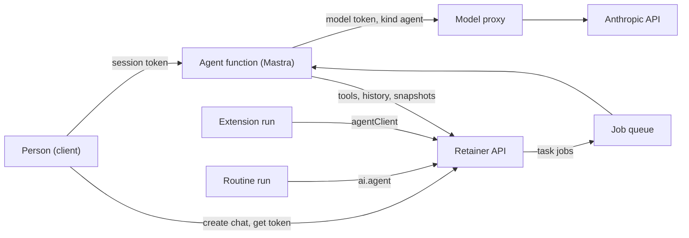

# The workspace agent: spec

Status: **proposed**, 2026-11-25. Nothing here is built. Revised the same
day: the chat comes first, background tasks suspend and resume instead of
waiting inside their run, and Mastra's built-ins are used wherever they fit
(§3). §2 lists what is decided.

Builds on [extensions-model-calls.md](extensions-model-calls.md) (the model
proxy, and §11 there, which first described this agent) and
[routines.md](routines.md). Mastra facts are from `@mastra/core` 1.86.0,
`@mastra/memory` 1.41.3 and `@mastra/ai-sdk` 1.12.1, read from their bundled
docs and type definitions on 2026-11-25.

If accepted this spec amends:

- `extensions-model-calls.md` §3.2.1 (a third list of allowed requests, for
  the agent's model token), §3.4 (`ai_usage` rows name the session) and §11
  (now this spec; two of its decisions are refined in §2 here).
- `routines.md` §4.4 and §4.5 (a new SDK call, `retainer.ai.agent`), §6.2 (a
  run can wait for a task), §6.6 (stored session content) and §10 (the
  "agent with tools" and "long runs and waits" rows).
- `ARCHITECTURE.md` §2.1 (`forget` clears stored session content) and §8 (a
  new package and two server modules).
- `FRONTEND.md`, whose "no agent chat" line is already out of date.

The write rules and actor types in `ARCHITECTURE.md` don't change. The agent
writes as an agent, for a person or for a routine or extension (§7).

## 1. The idea on one page

Retainer gets its own agent: a Mastra agent loop that calls the model through
Retainer's model proxy, uses tools (Retainer's own, the web, extension tools)
and keeps its conversation in Retainer.

Two kinds of caller use it:

- **A person, through the chat.** They send a message and watch the agent
  think, call tools and answer, as a stream. This spec builds the chat's
  backend only; the web app's chat screen comes later (§14).
- **Code, through a task.** A routine (`retainer.ai.agent`) or an extension
  (`agentClient`) hands the agent instructions and input and gets back a
  typed answer. The caller's run suspends while the agent works and resumes
  with the answer.

Both are **sessions**: a chat is a session that stays open, a task is a
session that ends with an answer. They share one harness, one store and one
set of tools.

- **One model proxy.** The agent is one more client of the proxy, with a
  model token of kind `agent`. The key, the allowed requests and usage stay
  in one place (§2.1).
- **Callers talk to Retainer, not to the agent.** A person's session or a
  run's token gets the caller a session token from Retainer's API. The agent
  accepts nothing else.
- **Authority comes from the caller.** The agent brings its prompt, its
  model and its harness. Everything it does in Retainer uses the caller's
  access, never more, and its writes are recorded as an agent acting for
  that caller.
- **Mastra for the loop, Retainer for the data.** Mastra runs the loop,
  streams, pauses for approvals and keeps the message history. Its storage
  is Mastra's own Postgres store, `@mastra/pg`, run by Retainer's API on
  Retainer's database; the agent reaches it only through the API (§3.2).



## 2. Decided and proposed

Decided in `extensions-model-calls.md` §11 (2026-11-14), unchanged:

- **Harness: Mastra**, as a library, Apache-2.0 packages only. Nothing from
  `ee/` folders (§3.3).
- **No Anthropic Managed Agents, no Bedrock AgentCore, no Lambda durable
  functions.** Self-hosting runs the same code.
- **Model: the Anthropic API** with Retainer's key, through the model proxy.
- **Hosted: an `agent` Lambda function outside the database VPC**; the
  worker container on Compose. It reaches Retainer only through the API.
- **Harness from the agent, authority from the caller.**

Refined from §11 there (2026-11-25):

- "Mastra's own memory and storage aren't used" becomes: **Mastra's storage
  is `@mastra/pg`, run by Retainer's API.** The data stays in Retainer's
  Postgres, in a `mastra` schema; the agent function reaches it only
  through the API and never holds a database credential (§3.2, decided
  2026-11-25).
- "Each task runs as a series of short jobs, one per step" becomes: **a task
  runs as one job, or a few** if it outlasts one, with each step saved as it
  ends (§9.3). Mastra runs the loop inside a job; splitting it per step would
  mean replacing Mastra's loop.

Decided 2026-11-25 by the product owner:

- **The chat first** (§14), backend only.
- **No bounded waiting.** A task's caller doesn't wait inside its run; it
  suspends and resumes (§2.2).
- **Generous limits at first**, tightened from real usage (§10).
- **A task may search the web and write to Retainer** in the same session.
- **Use Mastra's built-ins when they make sense** instead of building our
  own (§3).

### 2.1 Considered: a second proxy

An agent proxy speaking the Messages API, next to the model proxy, with the
agent behind it. Not chosen: an agent session is asynchronous, keeps state
between turns and runs tools with someone's authority. A request-and-answer
proxy can't express that without exposing the harness or rebuilding a
session API inside it. Making the agent a client of the existing proxy keeps
the key, the allowed requests and usage in one place.

### 2.2 Considered: waiting inside the caller's run

A first draft had the caller poll the task inside its own run, bounded by
the run's 300 seconds. Dropped: it caps tasks at a few minutes, keeps two
functions running while one waits, can't pause for a person's approval, and
would be thrown away once suspend and resume exists.

## 3. Mastra: what we use and what we build

### 3.1 The table

| Need                                 | Decision             | How                                                                                                                                                            |
| ------------------------------------ | -------------------- | -------------------------------------------------------------------------------------------------------------------------------------------------------------- |
| The agent loop                       | Built-in             | `Agent` with `stream()` and `generate()`                                                                                                                       |
| Model access                         | Built-in             | Claude Sonnet 5.5 (§3.4) through an `@ai-sdk/anthropic` instance whose base URL is the model proxy, with a `fetch` that gets a model token per request (§10.2) |
| Anthropic options                    | Built-in             | `providerOptions.anthropic`: adaptive thinking with summaries shown, effort, context management, refusal fallbacks (§3.4)                                      |
| Message history                      | Built-in             | `Memory` with `savePerStep: true`, stored by `@mastra/pg` behind the API (§3.2). No trimming: whole history each turn (§3.4)                                   |
| Semantic recall                      | Off                  | Retainer has no embeddings (`semanticRecall: false`, no vector store, no embedder)                                                                             |
| Working memory, observational memory | Off                  | Retainer's own memory (`me`, `workspace`, records) is the memory; the agent uses it through tools                                                              |
| Thread titles                        | Built-in             | `generateTitle`; its model call goes through the proxy and counts (§10)                                                                                        |
| Streaming to a UI                    | Built-in             | `handleChatStream` from `@mastra/ai-sdk`: the AI SDK UI message stream that `useChat` reads, with `sendReasoning: true`                                        |
| Approvals                            | Built-in             | `requireApproval` and `requireToolApproval`, resumed with `resumeStream`; paused runs saved by `@mastra/pg` behind the API (§6.4)                              |
| Per-request auth                     | Built-in             | `RequestContext`, read by tools; the token is never persisted (§7.3)                                                                                           |
| Step and time limits                 | Built-in             | `maxSteps`, `modelSettings.timeout`, `maxOutputTokens`, `abortSignal`                                                                                          |
| Tool call caps                       | Built on a hook      | `hooks.beforeToolCall` returns `{ proceed: false }` past the cap                                                                                               |
| Web search                           | Built-in, AI SDK     | Anthropic's `web_search_20260209` as an AI SDK provider tool. Not Mastra's `webSearchTool`, which sends the older `web_search_20250305`                        |
| Web fetch                            | Built-in, AI SDK     | Anthropic's `web_fetch_20260209` as an AI SDK provider tool. Not Mastra's `webFetchTool`, which fetches from the agent function (§8)                           |
| Retainer tools                       | Ours                 | `createTool` over `@retainer/sdk` (§8)                                                                                                                         |
| Storage                              | Built-in, in the API | `@mastra/pg` (`MemoryPG`, `WorkflowsPG`) runs in Retainer's API; the agent function's store forwards each call to it (§3.2)                                    |
| Resumable streams                    | Off                  | They need a shared PubSub such as Redis. `durable: false`; reconnecting reads the saved history (§6.5)                                                         |
| Durable agents                       | Evaluate in PR 2     | Beta. A candidate for long tasks (§9.3)                                                                                                                        |
| Guardrail processors                 | Later                | Built-in processors exist (`PromptInjectionDetector`, `PIIDetector`, `ToolCallFilter`, …); part of the study in §11                                            |
| Tracing                              | Off for now          | The saved messages are the trace (§5.3). A custom exporter can send spans to Retainer later                                                                    |
| Mastra's server, A2A, MCP server     | Not used             | Retainer's API is the only way in                                                                                                                              |

### 3.2 Storage: `@mastra/pg` behind the API

Mastra's Postgres store, `@mastra/pg` (Apache-2.0), is a database client.
The agent function has no database access by design: it reads untrusted
text (web pages, emails, records anyone could write), so it holds only a
token for its own session. So the store runs in Retainer's API instead
(decided 2026-11-25):

```
agent function                  Retainer API                     Postgres
Mastra agent ── storage call ─▶ checks the session token, ─▶   schema "mastra":
(pass-through store)            calls MemoryPG / WorkflowsPG    Mastra's tables
```

- **The agent function's store forwards.** Each call in the two domains the
  agent uses, `memory` (threads and messages) and `workflows` (the snapshots
  behind approvals and suspended runs), goes to the API with the session
  token.
- **The API checks, then calls Mastra's store.** It checks that the thread
  or run belongs to the token's session and calls `MemoryPG` or
  `WorkflowsPG`.
- **We write no message or snapshot tables and no SQL for them.** Mastra's
  tested store keeps them in its own format, so history, approvals and
  `handleChatStream`'s approval flow work as Mastra expects.

Considered: the agent connecting to Postgres itself, inside the VPC behind a
NAT gateway with a role limited to the `mastra` schema. Rejected: the
process that reads untrusted text would hold a database password, and
hosted would pay for a NAT gateway.

### 3.3 Licence: staying free

Checked on 2026-11-25 against `@mastra/core` 1.86.0, its `LICENSE.md`, the
`ee/LICENSE` in `mastra-ai/mastra` and the repository's source tree.

- **The split.** Everything in Mastra is Apache-2.0 except what sits under a
  folder named `ee/`, which is under the Mastra Enterprise Edition License.
  Those features (fine-grained authorization, role-based access, Studio
  sign-in, the agent builder, the editor) may be used for development and
  testing for free; production use needs a written agreement with Mastra and
  a licence key.
- **What we use is all Apache-2.0**: `@mastra/core`'s agent, memory,
  workflows and processors, `@mastra/memory`, `@mastra/ai-sdk`, and
  `@mastra/pg` 1.38.0 in the API. None of the Enterprise features is
  configured: no FGA or RBAC provider, no auth
  provider, no Studio, no editor, no agent builder.
- **One catch.** `@mastra/core` bundles code built from
  `packages/_internals/auth/src/ee/` into its runtime, and the agent loop
  calls one function from it, `requireFGA`, on every tool call. With no FGA
  provider configured it returns at once. Loading it runs nothing else (it
  defines constants). Our reading: running this no-op is not using the
  Enterprise feature (fine-grained authorization), so the licence's
  production-use terms don't apply. `@mastra/pg` loads the same core
  modules in the API, so the guards below cover `packages/server` too. The
  licence lets Mastra designate more code as Enterprise later (its §5.1),
  for future versions only.
- **How we keep it free:**
  - A lint rule refuses imports from any `ee/` path and any Mastra auth,
    FGA, RBAC, editor or agent-builder export.
  - A check runs on every Mastra upgrade: it lists the code from `ee/`
    folders that the modules we load reach, and fails if that list grows
    beyond `requireFGA` and the permission constants, or if either licence
    file changes.
  - We asked Mastra (legal@mastra.ai) to confirm our reading in writing
    on 2026-11-25. Until they answer, we work on our reading (decided
    2026-11-25); the work doesn't wait for the reply. If they disagree, we
    take the way out below.
  - **The way out stays short.** The tools, the session API and
    `agent_sessions` are ours. If Mastra's terms change, the loop can move
    to the Anthropic SDK's tool runner (`@anthropic-ai/sdk`, MIT), and the
    chat stream to the AI SDK alone, without changing the API or the
    clients. Stored chats would move out of Mastra's tables with a one-off
    script.
- **Versions** are pinned. Mastra moves fast (core 1.86 on 2026-11-25); the
  storage has a conformance test against Mastra's domain contracts, and an
  upgrade is a PR that runs it, Mastra's migrations (§5.2) and the licence
  check.

### 3.4 The model: Claude Sonnet 5.5

Every agent session runs on **Claude Sonnet 5.5** (`claude-sonnet-5-5`):
chats, tasks, titles and repairs. Callers never choose a model, extensions
included (decided 2026-11-25). Routines' plain `ai.generate` calls keep their
own model (`routines.md` §4.5). What it means for the harness:

- **Thinking** is adaptive and always on (`thinking: { type: "disabled" }`
  is refused on this model). The chat shows it, so the request sets
  `display: "summarized"`; without it the reasoning streams as empty blocks.
  Effort is `medium` for every request (decided 2026-11-25).
- **Thinking blocks go back unchanged, and history only grows.** On Sonnet
  5.5 a thinking block is valid only in the conversation that produced it,
  and edits to earlier history can invalidate it. So Mastra's history
  trimming (`lastMessages`) is off: each turn sends the session's whole
  history, and long chats stay within the 1M context through Anthropic's
  context management (clearing old tool results). PR 1 checks that Mastra
  stores and replays thinking blocks with their signatures.
- **No forced tool choice.** `tool_choice` `any` and `tool` are refused, so
  a task's typed answer must use native structured output
  (`output_config.format`), not a forced tool. PR 2 checks which one
  Mastra's `structuredOutput` sends.
- **Web tools** are the `20260209` versions, which filter results
  dynamically. PR 1 checks that they pass the proxy without needing a
  `container`.
- **Refusals.** Requests carry `fallbacks: "default"` (beta
  `server-side-fallback-2026-07-01`, already allowed by the proxy), so a
  declined request is retried on a fallback model. A turn that is still
  refused ends as `refused`.
- **Output** up to 128K tokens a step; the limit in §10 is lower. Every
  request streams.
- **Caching.** The system prompt and the tool list are stable and marked
  for prompt caching, so long sessions pay for them once.

## 4. Architecture

### 4.1 Vocabulary

| Term          | Meaning                                                                                      |
| ------------- | -------------------------------------------------------------------------------------------- |
| Session       | One agent conversation: a chat or a task                                                     |
| Chat          | A session a person opens and talks in; stays open until they delete it                       |
| Task          | A session code opens with instructions, input and an answer shape; ends with the answer      |
| Caller        | Who the session works for: a person, a routine run or an extension run                       |
| Turn          | One `stream()` or `generate()` call: from a message (or a resume) to the agent's reply       |
| Step          | One model call inside a turn, and the tool calls it asks for                                 |
| Session token | The credential the agent uses for Retainer: bound to one session, never more than the caller |

### 4.2 Where each part runs

| Part                 | Hosted                                               | Self-hosted Compose |
| -------------------- | ---------------------------------------------------- | ------------------- |
| Session API          | `api` function                                       | Server process      |
| Chat turns           | `agent` function, streaming through its function URL | Server process      |
| Task turns           | `agent` function, started by the launcher for a job  | Worker container    |
| Model proxy          | `model` function (§12 adds a list)                   | Server process      |
| Web search and fetch | At Anthropic, as server tools                        | Same                |

The agent function needs no network beyond Retainer's API and the model
proxy, because web search and fetch run at Anthropic. Closing its network to
those two origins is possible later, as for the routine runner
(`routines.md` §11.3).

### 4.3 Code layout

- **`packages/agent`** (MIT, like `packages/runner`): the harness. The
  Mastra agent, the base system prompt, Retainer's tools built on
  `@retainer/sdk`, the pass-through store, the chat handler and the task
  driver. It imports no server code.
- **`packages/server/src/agent-sessions`** (Admin layer, next to
  `routines`): the session API, the storage endpoints over `@mastra/pg`,
  limits, approvals of record, `forget`. The only server module that
  imports Mastra; a lint rule keeps it so.
- **`packages/server/src/agent-runtime`** (Foundation layer, next to
  `routine-runtime`): minting and checking session tokens and agent model
  tokens.
- `@retainer/extension` gains `agentClient(invocation)`; the routine SDK in
  the runner gains `retainer.ai.agent` (PR 2).
- `packages/cli` gains `retainer agent chat`, a terminal client (§6.7).

Both server modules join the layer list in `ARCHITECTURE.md` §8 and
`scripts/check-layers.mjs`. Core modules may not import either: Retainer's
core still never calls a model.

## 5. Sessions and storage

### 5.1 Tables

Ours, in Drizzle's schema like every other table:

| Table            | Holds                                                                                                                          |
| ---------------- | ------------------------------------------------------------------------------------------------------------------------------ |
| `agent_sessions` | Workspace, kind (`chat` or `task`), caller, person (for a chat), title, status, limits and use, created, last active           |
| `agent_turns`    | One row per turn: status, steps, tokens, tool calls, error code, durations, the Mastra run IDs it started. IDs and counts only |

Mastra's, in the `mastra` schema, created by `@mastra/pg`:

| Table                                                              | Holds                                                                                   |
| ------------------------------------------------------------------ | --------------------------------------------------------------------------------------- |
| `mastra_threads`, `mastra_messages` and the memory domain's others | The history: the person's messages, the agent's text, reasoning, tool calls and results |
| `mastra_workflow_snapshot`                                         | A paused turn waiting for an approval or a resume                                       |

A Mastra thread is a session: the thread ID is the session ID, and its
`resourceId` is the person for a chat and the caller for a task. Mastra's
tables have no workspace column, so row-level security doesn't cover them.
Instead, only `agent-sessions` touches them, and only for a session it has
already checked. Only the `memory` and `workflows` domains exist; the
others (traces, scores, knowledge and the rest) are disabled, so their
tables are never created.

### 5.2 The store

- **In the agent function**, `packages/agent` passes Mastra a
  `MastraCompositeStore` with only `memory` and `workflows`, each a
  pass-through that sends the method and its arguments to
  `…/runtime/sessions/:id/storage` with the session token. It drops the
  session token and any other credential from what it sends (§7.3), and
  answers `supportsConcurrentUpdates()` with `false`: one turn per session
  at a time makes concurrent updates unnecessary (§6.3).
- **In the API**, `agent-sessions` holds a `MemoryPG` and a `WorkflowsPG`
  with `schemaName: "mastra"` and `disableInit: true`. Before each call it
  checks that every thread, resource and run the arguments name belongs to
  the token's session. Calls that reach across sessions, such as listing a
  resource's threads, are refused. PR 1 lists the calls Mastra's agent makes
  and allows only those.
- **Its pool.** Retainer's server uses postgres.js; `@mastra/pg` needs a
  `pg` pool, so `agent-sessions` opens a small one (two connections in the
  hosted `api` function) with the same role.
- **Migrations.** At runtime the store runs no DDL. `pnpm db:migrate`, and
  the hosted migration step, run Mastra's `init()` for the two domains with
  the migration role after Drizzle's migrations. Drizzle doesn't manage the
  `mastra` schema.

### 5.3 The trace

The saved messages are the trace: each step's reasoning, each tool call with
its input and result, and the answer, in the format the UI will render.
`agent_turns` adds counts and durations. The routine run page, the
extension run list and the chat all read the same messages. Mastra's own
tracing stays off (§3.1).

### 5.4 Retention and `forget`

- **A chat** is kept until its person deletes it. It is private to them:
  admins see that it exists and its usage, not its content.
- **A task's** messages are kept while the task runs, then for 7 days so a
  person can inspect it, then deleted through `MemoryPG.deleteThread`, the
  rule for routine run results (`routines.md` §6.6).
- **`forget`** deletes every session in the workspace, chats and tasks,
  with their threads, messages and snapshots, in the same deletion, and
  fences every running turn, which ends as `cancelled` (decided 2026-11-25,
  the simpler option). To stay in the same transaction, `forget` deletes
  Mastra's rows by thread ID with plain SQL, the one place Retainer writes
  Mastra's tables itself; a test fails if an upgrade renames them. Retainer
  doesn't track which records a session read, so it can't be narrower (the
  same reasoning as `routines.md` §6.6).
- This is an exception to "nothing the model saw is stored"
  (`extensions-model-calls.md` §3.3): a conversation can't continue without
  its history.

## 6. The chat

### 6.1 Endpoints

On the API (person's session, or the CLI's login):

```
POST   /v1/agent/chats                 create a chat → { id, agentOrigin }
GET    /v1/agent/chats                 the person's chats
GET    /v1/agent/chats/:id             the chat and its messages (UI message parts)
POST   /v1/agent/chats/:id/token       a session token for the stream, 15 minutes
POST   /v1/agent/chats/:id/cancel      stop a running turn
DELETE /v1/agent/chats/:id             delete the chat
```

On the agent function (session token):

```
POST /chats/:id/stream    one turn: the new message, or approval answers → SSE
```

The stream endpoint takes the AI SDK UI request `useChat` sends, with only
the newest message (history comes from storage), and answers with the AI SDK
UI message stream over server-sent events.

### 6.2 A turn

1. The client sends the message to `/chats/:id/stream` with the session
   token.
2. The agent function claims the turn (§6.3), builds a `RequestContext` with
   the session token, and calls `handleChatStream` with `sendReasoning:
   true`, `durable: false` and the session's limits (§10).
3. Mastra loads the history from storage, calls the model through the proxy,
   runs tools, saves each step as it ends (`savePerStep`) and streams every
   part: reasoning, tool calls, tool results, text.
4. At the end the turn row is closed with its counts.

### 6.3 One turn at a time

A chat runs at most one turn at a time. Claiming a turn is a row lock in the
API; a second message while a turn runs is refused with `409 turn_running`.
A test sends two messages at once (`CLAUDE.md`, rules described as
serialized).

### 6.4 Approvals

Some tools need a person's yes before they run (§8.2). Mastra's built-in
flow does it:

- The tool has `requireApproval: true`, or the turn's
  `requireToolApproval` function says so.
- Mastra pauses, saves a snapshot through the API, and streams an
  approval request part with the tool and its arguments. The turn ends.
- The client sends the answer (approve, or decline with a reason) to the
  same stream endpoint. `handleChatStream` reads it and resumes the paused
  run, in whichever function instance receives it.
- Approvals are recorded on the turn: who answered, when and what. A paused
  turn expires after 24 hours as declined.

### 6.5 Disconnects

The hosted function URL can't tell that the client has gone
(`extensions-model-calls.md` §3.6), and `durable: false` doesn't stop the
loop either: a turn always runs to its end and is saved. A client that comes
back reads the chat (`GET /v1/agent/chats/:id`) and sees the finished turn,
or "still running" with what was saved so far. Joining a turn's live stream
again needs Mastra's resumable streams and a shared PubSub, which is later.

### 6.6 What the agent knows

- A base system prompt: what Retainer is, how to read and write it (the MCP
  server's instructions and `get_guide`), to answer from what it found, and
  to say what it doesn't know.
- The person: their name, the workspace, and their `me` memory through
  `get_context("me")`, as any agent connected for them would.
- It logs what it learns the way any agent does: `get_guide("log_from_chat")`.

### 6.7 The terminal client

`retainer agent chat` in `packages/cli` opens a chat and renders the stream
in the terminal: reasoning dimmed, tool calls and results as short lines,
approvals as a yes or no prompt. It exists so the backend can be used and
tested before the web app has a chat screen.

The CLI login only reads (`cli.md` §3: records stay with MCP), so a chat
from the CLI is **read-only by default**: the agent can search, read
records, read `me` and search the web, but can't write records, log events,
remember facts or call extension tools. After `retainer elevate` in that
workspace it gets the person's full role for the window (30 minutes by
default), the CLI's existing way to act for the person (decided
2026-11-25). Its writes are still the chat agent's (§7.1), never the
person's. The session token's tools are set from the access at each
renewal, so the window's end takes the write tools away.

## 7. Authority

### 7.1 A person's chat

The agent acts for the person the way an app connected through OAuth does
(`auth/oauth-token.ts`):

- **Actor:** type `agent`, ID `retainer-agent:<person>`, named "Retainer
  agent for <name>". Never the person, so model output never outranks
  people's values (write rule 3).
- **Access:** the person's, capped by their role. A person who can only read
  gets an agent that can only read. A chat from the CLI reads only, unless
  the person ran `retainer elevate` (§6.7).
- **Personal memory:** the chat works for its person, so it can read and
  write their `me` memory, as connected agents can
  (`user-and-workspace-memory.md` §4.3).

### 7.2 A task

As before: a task from a routine writes as the agent naming the routine
(`routines.md` §6.4), and one from an extension as that installation's actor.
The session's tools are a subset of the caller's, and the caller's mode
carries over: in a dry run, writes are reported and extension tools aren't
called (`routines.md` §5.1). No personal memory.

### 7.3 Tokens

- **Session token.** Audience `retainer:agent-session`. Claims: workspace,
  session, caller, and the tools the session may use. Minted by the API: for
  a chat from the person's session (15 minutes, renewed by the client), for a
  task when the job starts (until the job's deadline). The API checks every
  call against both the token and the caller's current access, so removing
  the person, cancelling the run or erasing the workspace stops the agent at
  once.
- **Model token.** Kind `agent`, minted per model request (§10.2). Opens
  model calls only.
- **Never persisted.** The session token travels in the `RequestContext`.
  Mastra snapshots serializable context entries and puts them in spans, so
  the token is held in a non-serializable wrapper, and the pass-through
  store drops credentials from anything it sends. A resumed turn gets a
  fresh token.

## 8. Tools

### 8.1 The tool groups

| Group            | Tools                                                                                                          | Runs where                         | Chat                                          | Task                   |
| ---------------- | -------------------------------------------------------------------------------------------------------------- | ---------------------------------- | --------------------------------------------- | ---------------------- |
| `retainer.read`  | `search`, `query_records`, `get_record`, `get_context`, `get_timeline`, `describe_schema`, `get_event_content` | Agent function, through the API    | Yes                                           | If listed              |
| `retainer.write` | `upsert_record`, `log_event`, `remember`                                                                       | Same                               | Yes                                           | If listed              |
| `web.search`     | `webSearchTool` (Anthropic's web search)                                                                       | At Anthropic                       | Yes                                           | If listed              |
| `web.fetch`      | Anthropic's web fetch, as a provider tool                                                                      | At Anthropic                       | Yes                                           | If listed              |
| `tools.<name>`   | Extension tools, by their declared effect (`extensions-tools.md`)                                              | Through Retainer, as their own job | `read` yes; `write` and `send` after approval | `read` only, if listed |

- **Retainer's tools match the MCP tools** in name and behaviour, so the
  guides apply as for any agent. Each is a `createTool` that calls the API
  with the session token from the `RequestContext`. Writes carry an
  idempotency key made of the session and Mastra's tool call ID, so a
  retried step doesn't write twice.
- **A chat's extension tools** are those installed in the workspace that the
  person's role allows.
- **Web fetch at Anthropic, not from the agent function.** Mastra's own
  `webFetchTool` fetches from the process that runs the agent; Anthropic's
  runs at Anthropic and can only open URLs already in the conversation. PR 1
  confirms that Anthropic's tool passes through Mastra as a provider tool.
- **Not in this spec:** Anthropic-side MCP servers (`mcp_servers`), code
  execution, files, and a person's own connected accounts such as Gmail
  (the member agent: Mastra's `MCPClient` behind the person's consent).

### 8.2 What needs approval

| Action                             | Chat                                                             | Task                    |
| ---------------------------------- | ---------------------------------------------------------------- | ----------------------- |
| Reads, web                         | No approval                                                      | No approval             |
| Retainer writes                    | No approval: agent rank, history and the review inbox cover them | No approval             |
| Extension `write` and `send` tools | Approval, every call                                             | Not available yet (§11) |

## 9. Tasks (PR 2)

### 9.1 From a routine

```ts
const { round } = await retainer.ai.agent({
  instructions: 'Find this company\'s latest funding round. Answer null if you are not sure.',
  input: { name: record.name, domain: record.domain },
  tools: ['retainer.read', 'web.search', 'web.fetch'],
  output: { /* JSON schema */ },
});
```

| Field          | Required | Meaning                                                                |
| -------------- | -------- | ---------------------------------------------------------------------- |
| `instructions` | Yes      | What to do. From the approved code, never from record content          |
| `input`        | No       | Data the task works on. Reaches the model as data, not as instructions |
| `tools`        | Yes      | Tool groups the task may use, within the manifest's (§9.4)             |
| `output`       | Yes      | A JSON schema for the answer, passed to Mastra's `structuredOutput`    |
| `limits`       | No       | Lower limits than the defaults (§10)                                   |

Code never names a model; every task runs on Claude Sonnet 5.5 (§3.4).

### 9.2 Suspend and resume

1. `ai.agent` is an effect (`routines.md` §6.2). Its first run creates the
   task with a key made of the run and the effect's position, queues it, and
   ends the run as `waiting`.
2. When the task ends, a job starts the run again. The code replays from the
   top; recorded effects return their saved results, and `ai.agent` returns
   the task's answer (or throws its error code).
3. A retried run that reaches the same effect gets the same task back: the
   key makes creating it idempotent.

Rules for waiting runs:

- A waiting run holds its place: new changes to the same record coalesce
  into the next run after it, as they do behind a running one (`routines.md`
  §6.1, coalescing).
- A run waits at most 24 hours, then ends as `expired`.
- A waiting run uses no function and no lease; it is a row.

**From an extension**, the function can't replay, so it returns
`{ wait: taskId }` and ends; when the task finishes, a child job calls the
function again with the task's answer (`invocation.agentResult`). The
extension SDK hides the plumbing: `agentClient(invocation).start(...)` and an
`onAgentResult` handler in the function's definition.

### 9.3 Running a task

- A task's turn is a job. The agent function runs Mastra's `generate()`
  with the task's instructions, input, tools, `structuredOutput`, limits and
  `savePerStep: true`.
- **Long tasks.** A job stops the loop at a time slice (about 10 minutes of
  the function's 15) with `onIterationComplete`. The next job continues the
  same session from its saved history. A crashed job's retry does the same,
  and the idempotency keys keep writes from repeating.
- **Mastra's durable agents** do this checkpointing themselves, on the
  `workflows` store already behind the API. They are in beta and their
  multi-process mode wants a PubSub that redelivers. PR 2 tries them in
  in-process mode first and falls back to the continuation above if they
  don't hold up.
- An answer that fails the schema gets one repair turn; a second failure
  ends the task as `invalid_output`.

### 9.4 Grants and review

- **Routines:** the manifest gains `"agent": { "tools": [...] }`. An
  extension tool listed there must also be in `uses.tools` and declared
  `read`. The review says what the agent can do in plain words: "Uses an
  agent that can read this workspace and search the web. Workspace data it
  reads can appear in its searches and is sent to Anthropic." Adding or
  widening it is a version change that needs approval (`routines.md` §5.3).
  `get_routine_capabilities` reports the agent so the builder can use it;
  the builder prefers `ai.generate` when no lookup is needed.
- **Extensions:** `uses: ['agent']` and the tool groups in the release,
  approved like `model` (`extensions-model-calls.md` §3.1) with the same
  notice.

## 10. Limits and cost

### 10.1 Limits

They start generous on purpose: a routine or a chat that hits a wall in its
first weeks is worse than a few expensive turns. They get tightened from
real usage.

| Limit                                      | Chat (per turn) | Task (per task)                         | Built on                      |
| ------------------------------------------ | --------------- | --------------------------------------- | ----------------------------- |
| Steps                                      | 50              | 100                                     | `maxSteps`                    |
| Output per step                            | 32,000 tokens   | 32,000 tokens                           | `maxOutputTokens`, the proxy  |
| Tool calls                                 | 200             | 500                                     | `hooks.beforeToolCall`        |
| Web searches                               | 30              | 100                                     | The search tool's `max_uses`  |
| Time                                       | 14 minutes      | 24 hours, in slices of about 10 minutes | `modelSettings.timeout`, §9.3 |
| Tasks per routine run                      | n/a             | 10                                      | The session API               |
| Agent model requests per person per day    | 2,000           | n/a                                     | The reservation (§10.2)       |
| Agent model requests per workspace per day | 20,000          | 20,000                                  | The reservation (§10.2)       |

A task's caller may pass lower limits. Self-hosted operators set the daily
numbers with environment variables. On the hosted service the Anthropic
workspace's monthly spend limit stays the last backstop
(`extensions-model-calls.md` §2). Agent requests don't count toward a
routine's model call caps (`routines.md` §4.6).

### 10.2 Reserved per model request

The Anthropic provider instance is created with a `fetch` of our own. Before
each request to the proxy, it asks the API for a model token with the
session token. In one atomic step the API counts the request against the
session's, the person's and the workspace's limits and returns a token good
for one request, or refuses it, and the turn ends as `limit_reached`. This is
the routine reservation (`routines.md` §6.3) moved to where every model
request passes, including Mastra's own (titles, repairs).

### 10.3 Usage

`ai_usage` rows from the agent have `kind: 'agent'` and carry the session
and its caller: the person, or the routine and run, or the installation and
job. A routine's or an extension's cost includes its tasks. Web search counts
are in the stored `usage` object already.

## 11. Hidden instructions

A model call with no tools can only answer. An agent reads private data,
reads text an outsider wrote (a web page, an email) and acts. Together those
are how data leaks: hidden instructions in a page steer the agent into
sending workspace data out.

- **In the chat, a person approves every outward action** (§8.2). They see
  the tool and its arguments before it runs.
- **In a task, there are no outward actions yet.** Extension `write` and
  `send` tools stay with the caller's code, which acts on the answer.
  Allowing them needs approvals for routines (a run suspends until an admin
  answers), which suspend and resume makes possible, after the study
  `routines.md` §10 leaves for later.
- **Retainer writes stay inside the workspace**, at agent rank.
- **Web search is still a channel.** A query can carry workspace data out.
  The review says so (§9.4).
- **Mastra's guardrail processors** (`PromptInjectionDetector` and others)
  are candidates for that study. They call a model on every message, so they
  cost and slow each turn; not on by default.

## 12. Changes to the model proxy

A third list of allowed requests, for a model token of kind `agent`, next to
the extension and routine lists (`model/allowlist.ts`):

| Field                                                                                                                     | Allowed                                                                                                                                                    |
| ------------------------------------------------------------------------------------------------------------------------- | ---------------------------------------------------------------------------------------------------------------------------------------------------------- |
| `model`                                                                                                                   | `claude-sonnet-5-5` only                                                                                                                                   |
| `max_tokens`                                                                                                              | At most the output limit (§10)                                                                                                                             |
| `messages`, `system`, `stream`, `stop_sequences`, `metadata`, `output_config`, `cache_control`, `thinking`, `tool_choice` | As for extensions                                                                                                                                          |
| `tools`                                                                                                                   | Custom tools of any name, and server tools whose type is on a list: `web_search_20260209` and `web_fetch_20260209`. `max_uses` at most the turn's searches |
| `fallbacks`                                                                                                               | `"default"`, with its beta flag (§3.4)                                                                                                                     |
| `context_management`                                                                                                      | Yes, with its beta flag                                                                                                                                    |
| `mcp_servers`, anything else                                                                                              | No                                                                                                                                                         |

A new server tool version is a server change with a test, like a new beta
flag (`extensions-model-calls.md` §3.2.1). The proxy still runs no tools
itself. Usage reports carry the session from the token.

## 13. Hosted and self-hosted

- **Hosted.** The `agent` function runs outside the VPC with a function URL
  that streams (like `model`), reserved concurrency, and a 15-minute
  timeout. The function URL accepts only session tokens and allows the web
  app's origin (CORS). The launcher starts it for task jobs. Infrastructure
  is in `retainer-cloud`.
- **Self-hosted.** The server process serves the chat stream at
  `/v1/agent/runtime/chats/:id/stream`, and the worker runs task jobs.
  `RETAINER_ROLE=all` includes both.

## 14. Delivery

| PR                                 | What ships                                                                                                                                                                                                                                                                                                                                                                               |
| ---------------------------------- | ---------------------------------------------------------------------------------------------------------------------------------------------------------------------------------------------------------------------------------------------------------------------------------------------------------------------------------------------------------------------------------------- |
| **1. Agent core and chat backend** | The proxy's agent list; `ai_usage` session columns; `agent-sessions` and `agent-runtime`; `@mastra/pg` behind the session API, with its migration step; `packages/agent` with the pass-through store, Retainer's tools, web tools and approvals; the chat endpoints and stream; limits and reservations; `forget`; the hosted `agent` function (`retainer-cloud`); `retainer agent chat` |
| **2. Tasks**                       | `retainer.ai.agent` with waiting runs; `agentClient` with `onAgentResult`; manifest grants and review notices; the task driver, with durable agents tried first                                                                                                                                                                                                                          |
| **3. Web chat screen**             | The chat UI on `useChat`, the avatar's modes, the trace on the routine run page                                                                                                                                                                                                                                                                                                          |

Then: approvals for routines, extension `write` and `send` tools in tasks,
the member agent with a person's connections, and joining a running turn's
stream again.

## 15. Tests

Unit tests for each module; integration tests against real Postgres for
everything that touches it. Among them:

- **The store**, the pass-through and the API side together, passes a
  conformance suite against Mastra's `memory` and `workflows` domain
  contracts on real Postgres, run on each Mastra upgrade.
- A storage call naming another session's thread, resource or run is
  refused, within a workspace and across workspaces.
- A session token can't reach another session, call a tool the caller
  can't, write at a higher rank, or read another person's `me`.
- Removing a person, cancelling a run or erasing the workspace stops the
  session's token at once.
- **Concurrent:** two messages to one chat; many model requests reserving
  against the same person's and workspace's limits; two retries of a routine
  run reaching the same `ai.agent`.
- An approval answered in a different function instance resumes the turn.
- A retried step doesn't repeat a Retainer write.
- No token appears in Mastra's tables or in logs.
- The proxy refuses `mcp_servers`, an unlisted server tool type, another
  model and a larger `max_tokens` with an agent token.
- `forget` clears session content, Mastra's rows included, and cancels
  running turns.
- A dry run's task makes no write and calls no extension tool.

## 16. Prior art

| Source   | Where                                                                                                                                                                                              | Taken                                                                                                                                                                                                            |
| -------- | -------------------------------------------------------------------------------------------------------------------------------------------------------------------------------------------------- | ---------------------------------------------------------------------------------------------------------------------------------------------------------------------------------------------------------------- |
| Twenty   | `packages/twenty-server/src/modules/workflow/workflow-executor/workflow-actions/ai-agent/` at `1dd1c249a`                                                                                          | A one-shot Generate step beside a conversing Agent step. The agent step returns a wait and resumes the workflow by callback (§9.2). Actions are proposed to a person, who approves, edits or rejects them (§6.4) |
| Twenty   | `packages/twenty-server/src/engine/metadata-modules/ai/ai-agent-execution/services/`                                                                                                               | The agent runs with the caller's permissions (`agent-caller-conversation.service.ts`)                                                                                                                            |
| Macro    | `crates/routine_program/src/model.rs` (`AgentStep`)                                                                                                                                                | A routine step hands work to an agent; writes are attributed to the agent acting for the owner                                                                                                                   |
| Mastra   | `@mastra/core` 1.86.0 docs: `docs-agents-human-in-the-loop.md`, `docs-storage.md`, `docs-agents-resumable-streams.md`, `docs-harness-durable-agents.md`; `@mastra/ai-sdk` 1.12.1 `chat-route.d.ts` | §3                                                                                                                                                                                                               |
| Retainer | `packages/server/src/auth/oauth-token.ts`                                                                                                                                                          | The actor and personal-memory rules for an agent acting for a person (§7.1)                                                                                                                                      |

## 17. Open questions

1. **Mastra's reply** to our licence question (sent 2026-11-25, §3.3).
   Until it comes, we work on our reading; the work doesn't wait.

Answered 2026-11-25:

- Model: Claude Sonnet 5.5 for every session, effort `medium`; extensions
  don't choose (§3.4).
- Chats from the CLI: read-only, with the person's full role after
  `retainer elevate` (§6.7).
- `forget`: deletes every session in the workspace (§5.4).
- Storage: `@mastra/pg`, run by the API, never by the agent function (§3.2).
- Licence: checked; free as long as no Enterprise feature is configured,
  with the guards in §3.3. The no-op `requireFGA` call is treated as not
  using an Enterprise feature until Mastra says otherwise.
- Web and Retainer writes in one session: yes.
- Limits: generous at first, tightened from real usage (§10).
- Waiting: suspend and resume, no polling (§2.2).
- Order: the chat backend first, then tasks, then the web chat screen (§14).
