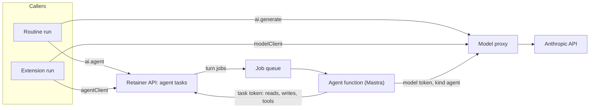
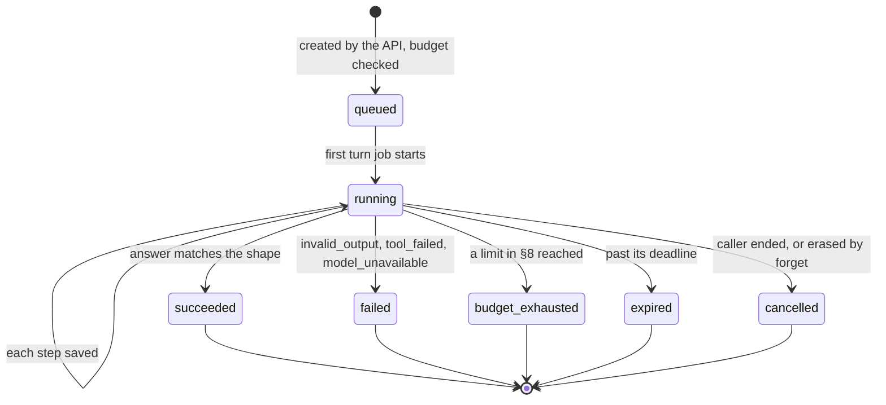

# The workspace agent: spec

Status: **proposed**, 2026-11-25. Nothing here is built.

Builds on [extensions-model-calls.md](extensions-model-calls.md) (the model
proxy, and §11, which first described this agent) and
[routines.md](routines.md). The decisions recorded in §11 there still stand
(§2). This spec adds the rest: how a caller hands the agent a task, which
tools the agent gets, whose authority it acts with, how it is bounded and how
it changes the proxy.

If accepted this spec amends:

- `extensions-model-calls.md` §3.2.1 (a third list of allowed requests, for
  the agent's model token), §3.4 (`ai_usage` rows name the task) and §11
  (now this spec).
- `routines.md` §4.4 and §4.5 (a new SDK call, `retainer.ai.agent`), §6.6
  (the agent's stored task state) and §10 (the "agent with tools" row).
- `ARCHITECTURE.md` §2.1 (`forget` clears stored task state) and §8 (a new
  package and two server modules).

The write rules and actor types in `ARCHITECTURE.md` don't change. The
agent writes as its caller (§6).

## 1. The idea on one page

Today a routine or an extension can make a **model call**: one request and
one answer, through the model proxy. Routine code calls `retainer.ai.generate`;
extension code uses the Anthropic SDK through `modelClient`. A routine's model
call has no tools (`routines.md` §4.5).

This spec adds a second way to use a model: hand a **task** to Retainer's
agent. The agent is a loop built with Mastra. It calls the model through the
same proxy, uses tools (reads Retainer, searches the web, calls extension
tools), and returns a typed answer.

- **Two calls, side by side.** `ai.generate` stays as it is: cheap, fast and
  bounded. `ai.agent` is for open-ended work that needs to look things up.
  Most routine steps ("is this email a complaint?") never need the agent.
- **One model proxy.** The agent is one more client of the proxy, with a
  model token of kind `agent`. The key, the allowed requests and usage stay
  in one place.
- **Callers talk to Retainer, not to the agent.** A caller creates a task
  through Retainer's API. The API checks the caller, records the task and
  queues it. The agent function only takes work from the queue.
- **Authority comes from the caller.** The agent brings its prompt and its
  harness. Every read, write and tool call it makes uses a task token that
  can do no more than the caller could. Its writes are recorded as the
  caller's.
- **Read first, act in code.** In the first version the agent can read
  Retainer, search the web and call extension tools that only read. Tools
  that write outside Retainer or send something stay with the caller's code,
  which acts on the agent's answer (§9).



## 2. Decided and proposed

Decided in `extensions-model-calls.md` §11 (2026-11-14), unchanged here:

- **Harness: Mastra**, as a library, Apache-2.0 core only. No code from `ee/`.
  Mastra's own memory and storage aren't used: Retainer is the memory, and
  task state is saved through Retainer's API.
- **No Anthropic Managed Agents, no Bedrock AgentCore, no Lambda durable
  functions.** Self-hosting runs the same code.
- **Model: the Anthropic API** with Retainer's key, through the model proxy,
  with a model token of kind `agent`.
- **Hosted: an `agent` Lambda function outside the database VPC**, like
  extension functions; the worker container on Compose. It reaches Retainer
  only through the API.
- **Tasks as jobs**, one short job per step, with state saved after each.
- **Harness from the agent, authority from the run.**
- **Workspace agent first.** A person's own agent, with their Gmail, is
  later (`uses: ['memberAgent']`).

Proposed here:

| Topic                  | Proposal                                                         | Section |
| ---------------------- | ---------------------------------------------------------------- | ------- |
| Where the agent sits   | A client of the one model proxy, not a second proxy              | §2.1    |
| How callers reach it   | A task API on Retainer; `retainer.ai.agent` and `agentClient`    | §4      |
| Tools                  | Retainer reads and writes, web search and fetch, `read` tools    | §4.2    |
| Waiting for the answer | Bounded inside the caller's run first; suspend and resume later  | §5.4    |
| Authority              | A task token that is the caller's access, narrowed               | §6      |
| Grants                 | `uses.agent` on routines, `uses: ['agent']` on extensions        | §7      |
| Budgets                | Turns, tool calls, searches and time per task, reserved per turn | §8      |
| Hidden instructions    | No outward-acting tools in a task in v1                          | §9      |
| Stored state           | Kept while the task runs and 7 days after, removed by `forget`   | §10     |
| Proxy                  | A list of allowed requests for kind `agent`                      | §11     |

### 2.1 Considered: a second proxy

An agent proxy speaking the Messages API, next to the model proxy, with the
agent behind it. Not chosen: an agent task is asynchronous, keeps state
between turns and runs tools with someone's authority. A request-and-answer
proxy can't express that without exposing the harness or rebuilding a task
API inside it. Making the agent a client of the existing proxy keeps the key,
the allowed requests and usage in one place.

## 3. Architecture

### 3.1 Vocabulary

| Term       | Meaning                                                                                      |
| ---------- | -------------------------------------------------------------------------------------------- |
| Caller     | What created the task: a routine run or an extension run. Later a person in the web app chat |
| Task       | One piece of work handed to the agent: instructions, input, tools, an answer shape, a budget |
| Turn       | One model call in a task, and the tool calls it asks for                                     |
| Step       | A turn or a tool call. Each step is one job and is saved when it ends                        |
| Task token | The credential the agent uses for Retainer: bound to one task, never more than the caller    |
| Trace      | The record of a task's steps that a person can inspect                                       |

### 3.2 Where each part runs

| Part                 | Hosted                                      | Self-hosted Compose        |
| -------------------- | ------------------------------------------- | -------------------------- |
| Task API             | `api` function                              | Server process             |
| Turn and tool jobs   | Postgres job queue, started by the launcher | Same                       |
| Agent harness        | `agent` Lambda, outside the VPC             | Worker container           |
| Model proxy          | `model` Lambda (unchanged, §11 adds a list) | Server process (unchanged) |
| Web search and fetch | Anthropic's server tools, run at Anthropic  | Same                       |

The agent function needs no network of its own beyond Retainer's API and the
model proxy: web search and fetch run at Anthropic (§4.2). Closing the hosted
function's network to those two origins is possible later, as for the
routine runner (`routines.md` §11.3).

### 3.3 Code layout

- **`packages/agent`** (MIT, like `packages/runner`): the harness. Mastra,
  the base system prompt, tool definitions built on `@retainer/sdk`, and the
  step loop. It imports no server code: it reaches Retainer over HTTP with the
  task token.
- **`packages/server/src/agent-tasks`** (Admin layer, next to `routines`):
  the task API, task and step tables, budgets, `forget`.
- **`packages/server/src/agent-runtime`** (Foundation layer, next to
  `routine-runtime`): minting and checking task tokens and agent model
  tokens.
- `@retainer/extension` gains `agentClient(invocation)`; the routine SDK in
  the runner gains `retainer.ai.agent`.

Both new server modules join the layer list in `ARCHITECTURE.md` §8 and
`scripts/check-layers.mjs`. Core modules may not import either: Retainer's
core still never calls a model.

## 4. A task

### 4.1 Shape

From a routine:

```ts
const { round } = await retainer.ai.agent({
  instructions: 'Find this company\'s latest funding round. Use the web. Answer null if you are not sure.',
  input: { name: record.name, domain: record.domain },
  tools: ['retainer.read', 'web.search', 'web.fetch'],
  output: {
    type: 'object',
    properties: {
      round: {
        type: ['object', 'null'],
        properties: {
          stage: { type: 'string' },
          amountUsd: { type: 'number' },
          announcedOn: { type: 'string', format: 'date' },
          sourceUrl: { type: 'string' },
        },
        required: ['stage', 'sourceUrl'],
      },
    },
    required: ['round'],
  },
  budget: { turns: 8, webSearches: 4 },
});
```

From an extension:

```ts
import { agentClient } from '@retainer/extension';

const agent = agentClient(invocation);
const answer = await agent.run({ instructions, input, tools, output, budget });
```

| Field          | Required | Meaning                                                                  |
| -------------- | -------- | ------------------------------------------------------------------------ |
| `instructions` | Yes      | What to do. From the caller's approved code, never from record content   |
| `input`        | No       | Data the task works on. Reaches the model as data, not as instructions   |
| `tools`        | Yes      | Tool groups or names the task may use (§4.2). Empty means the model only |
| `output`       | Yes      | A JSON schema for the answer                                             |
| `budget`       | No       | Lower limits than the defaults (§8). Never higher than the maximums      |

The call returns the answer, already checked against `output`. A failed task
throws with its code (§5.1). Code never names a model: the operator sets the
agent's model, as for routine model calls.

### 4.2 Tools

| Group            | Tools                                                                                                          | Runs where                                          | Default |
| ---------------- | -------------------------------------------------------------------------------------------------------------- | --------------------------------------------------- | ------- |
| `retainer.read`  | `search`, `query_records`, `get_record`, `get_context`, `get_timeline`, `describe_schema`, `get_event_content` | Agent function, through the API with the task token | Off     |
| `retainer.write` | `upsert_record`, `log_event`, `remember`                                                                       | Same                                                | Off     |
| `web.search`     | Anthropic's web search server tool                                                                             | At Anthropic, through the proxy                     | Off     |
| `web.fetch`      | Anthropic's web fetch server tool                                                                              | At Anthropic, through the proxy                     | Off     |
| `tools.<name>`   | An extension tool the caller may call, declared `read` (`extensions-tools.md`)                                 | Through Retainer, as its own job                    | Off     |

- **A task's tools are a subset of the caller's.** A routine's task can use
  only tools its manifest lists (§7); an extension's, only what its grant
  allows. The task can narrow the caller's access, never widen it.
- **Retainer's tools match the MCP tools** in name and behaviour, so the base
  prompt and the guides (`get_guide`) apply as they do for any agent.
  Personal memory (`me`) is never readable, as for routines.
- **Web search and fetch run at Anthropic** as server tools, so the agent
  function never fetches a page itself. A task may pass `allowedDomains` or
  `blockedDomains`, which the proxy forwards to the tool.
- **Not in the first version:** extension tools declared `write` or `send`
  (§9), Anthropic-side MCP servers (`mcp_servers`), code execution, files,
  and a person's connected accounts (the member agent, later).

### 4.3 The prompt

- The agent brings a base system prompt: how to use Retainer's tools, to
  answer only from what it found, to say null rather than guess, and to cite
  sources in the answer when the shape has a place for them.
- The caller's `instructions` follow it. The caller can't replace the base
  prompt.
- `input` goes in its own message, marked as data. Text in it is never
  treated as instructions, though a model can still be steered by it (§9).

### 4.4 The answer

The agent's last turn must produce output matching `output` (structured
output through `output_config`). An answer that fails the schema gets one
repair turn inside the budget; a second failure ends the task as
`invalid_output`.

## 5. Running a task

### 5.1 Lifecycle



### 5.2 Steps as jobs

- Each turn is a job. The agent function loads the task's saved state, asks
  the API for a model token for this turn (which reserves its budget, §8),
  calls the model through the proxy and saves the result.
- Each client tool call the model asks for (Retainer tools, extension tools)
  is its own step, saved when it ends. Server tools (web) run inside the
  turn at Anthropic.
- **A retried step does nothing twice.** Every step has a key made of the
  task and its position, as routine effects do (`routines.md` §6.2). A
  Retainer write is recorded with its key in the same transaction. A turn
  found as started with no result is sent again: it costs money and changes
  nothing. An extension tool call is sent again with the same key, and
  whether its outside effect repeats depends on the tool, as for routines.
- Jobs have the queue's leases, retries and at-least-once delivery. One step
  of a task runs at a time.

### 5.3 Long tasks

The agent's model token may send `context_management`, so Anthropic trims old
tool results and thinking as the conversation grows. The saved state is what
the agent sent, so a resumed turn sends the same history.

### 5.4 Waiting for the answer

A routine run and an extension run each end within 300 seconds. A task may
need longer. Two ways for the caller to wait:

1. **Bounded (first version).** `ai.agent` creates the task with a deadline
   inside the caller's own: the caller's time left minus 20 seconds. The SDK
   asks the API for the task's status every 2 seconds until it ends
   (polling). Long polling, where the API holds the request open until the
   task ends, was not chosen: on the hosted service each held request keeps
   an `api` function busy doing nothing. A task past its deadline ends as `expired`,
   and the call throws `agent_timeout`. This covers lookups of a few searches
   and reads. Both the caller and the agent function run while it waits.
2. **Suspend and resume (later).** `ai.agent` ends the caller's run as
   `waiting`, with the task recorded as an effect at its position. When the
   task ends, a job starts the run again. The run replays its code; recorded
   effects return their saved results (`routines.md` §6.2), and the agent
   call returns the task's answer. An extension's run ends with the task's
   ID, and a child job resumes the function with the answer
   (`extensions-model-calls.md` §11). Twenty's workflows do the same: an
   agent step returns a wait, and the agent's run resumes the workflow
   (§15).

The first version is built so the second needs no change to the task API:
creating a task is a recorded effect with a key, so a retried routine run
gets the same task back instead of starting another. A retry that finds its
task still running waits for it.

## 6. Authority

- **The task token.** Minted by the API when it creates the task. Audience
  `retainer:agent-task`, so the API refuses it everywhere a run token or a
  model token is expected, and the reverse. Claims: workspace, task, the
  caller (routine, version and run, or installation, release, function and
  job) and the tools the task may use. It expires with the task.
- **Its access is the caller's, narrowed.** The API checks every call the
  agent makes against both the task's tools and the caller's current access.
  If the caller's run is fenced, cancelled or erased, the task's token stops
  working with it.
- **Writes are the caller's.** A task from a routine writes as an agent
  naming the routine (`routines.md` §6.4). A task from an extension writes as
  that installation's actor. Each write also records the task, so history
  can show "written by routine X, through the agent".
- **Never more rank than the caller.** The agent gets no actor type of its
  own and no rank of its own.
- **Dry runs and test runs.** A task inherits its caller's mode
  (`routines.md` §5.1). In a dry run, Retainer writes are reported, not made,
  and extension tools are not called; reads, web and model calls happen and
  count.
- **Model tokens.** The agent function asks the API for a model token before
  each turn, with the task token. The model token has `kind: 'agent'` and
  names the task and the caller. It opens model calls only, as today.

## 7. Grants and review

**Routines.** The manifest gains an `agent` entry:

```json
"uses": {
  "tools": ["exa-enrichment.lookup_company"],
  "model": true,
  "agent": { "tools": ["retainer.read", "web.search", "web.fetch"] }
}
```

- `agent.tools` lists what any of the routine's tasks may use. An extension
  tool listed there must also be in `uses.tools`.
- The review says, in plain words, what the agent can do: "Uses an agent
  that can read this workspace and search the web. Workspace data it reads
  can appear in its searches and is sent to Anthropic."
- Adding or widening `agent` is a version change that needs approval
  (`routines.md` §5.3).
- `get_routine_capabilities` reports whether the agent is available and its
  limits, so the builder knows. The builder prefers `ai.generate` and uses
  `ai.agent` only when the routine must look something up.

**Extensions.** A function declares `uses: ['agent']`, and its agent tool
groups, in the release. An admin approves it like `model`
(`extensions-model-calls.md` §3.1), with a notice in the same plain words.

## 8. Budgets and cost

Every task has limits. A caller may pass lower ones. They start generous on
purpose (decided 2026-11-25): a routine that hits a wall in its first weeks
is worse than a few expensive tasks, and the numbers get tightened from real
usage, not guessed in advance.

| Limit                             | Default                       | Maximum                    | Why                                               |
| --------------------------------- | ----------------------------- | -------------------------- | ------------------------------------------------- |
| Turns                             | 25                            | 100                        | Bounds model calls per task                       |
| Output per turn                   | 8,192                         | 32,000                     | Room for thinking and long answers                |
| Client tool calls                 | 100                           | 500                        | Bounds load on Retainer and on extension tools    |
| Web searches                      | 20                            | 100                        | Each search has its own price                     |
| Web fetches                       | 20                            | 100                        | Bounds pages read into the context                |
| Time                              | Caller's time left minus 20 s | 15 min, once resume exists | §5.4                                              |
| Tasks per routine run             | 10                            | 10                         | One run can't fan out without end                 |
| Agent turns per workspace per day | 10,000                        | Set by the operator        | A safety net against a runaway loop, not a budget |

- **Reserved before each turn, not counted after it.** As for routine model
  calls (`routines.md` §6.3), the API reserves each turn in one atomic step
  against the task's turns and the workspace's daily agent turns, and only
  then returns a model token. Agent turns don't count toward a routine's
  model call caps (`routines.md` §4.6), so a routine that uses the agent
  doesn't run out of `ai.generate` calls. Web searches are reserved with the turn, up to the
  task's remaining searches, which the proxy passes as the tool's `max_uses`.
- Extensions have no workspace spend cap today
  (`extensions-model-calls.md` §2). Their tasks are bounded per task only,
  until one is added.
- **Usage.** `ai_usage` rows from the agent have `kind: 'agent'` and carry the
  task and its caller, so a routine's or an extension's cost includes its
  tasks. Web search counts are in the stored `usage` object already.
- Self-hosted operators can change the maximums and the daily turns with
  environment variables, as with `RETAINER_ROUTINE_MODEL_CALLS_PER_DAY`. On
  the hosted service, the Anthropic workspace's monthly spend limit stays the
  last backstop (`extensions-model-calls.md` §2).

## 9. Hidden instructions

A model call with no tools can only return an answer. An agent can read
private data, read text an outsider wrote (a web page, an email) and act.
Together those are the way data leaks: hidden instructions in a page steer
the agent into sending workspace data somewhere. `routines.md` §10 leaves the
full study of this risk for later; the agent can't wait for it, so the first
version limits the parts it can:

1. **No outward-acting tools in a task.** Extension tools declared `write`
   or `send` are not available to the agent. The caller's code reads the
   agent's answer and decides what to send, as it does after `ai.generate`.
2. **Retainer writes stay inside the workspace**, at agent rank, citing the
   task. A person's values are never replaced (`routines.md` §6.4). A task
   may search the web and write to Retainer in the same run (decided
   2026-11-25).
3. **Web search is still a channel.** A search query can carry workspace
   data out. The review says so (§7). Callers that need tighter limits pass
   `allowedDomains`. Anthropic's web fetch only fetches URLs already present
   in the conversation, so the model can't build a URL that carries data;
   phase 1 confirms this against the current tool version.
4. **The trace shows what happened** (§10), so a person can see which pages
   a task read and which tools it called.

Allowing `write` and `send` tools in tasks waits for the study in
`routines.md` §10. Twenty's answer is an approval step: its agent proposes a
tool call and a person approves, edits or rejects it (§15). That is the
likely shape, and it needs suspend and resume (§5.4) first.

## 10. Stored state and the trace

| Table              | Holds                                                                                               |
| ------------------ | --------------------------------------------------------------------------------------------------- |
| `agent_tasks`      | Workspace, caller, status, tools, budget and what was used, deadline, error code, created and ended |
| `agent_task_steps` | Position, kind (turn or tool), tool name, state, duration, tokens, error code                       |
| `agent_task_state` | The messages sent and received and each tool's input and result, so the next step can continue      |

- `agent_tasks` and `agent_task_steps` hold IDs, names, counts and codes,
  never content.
- `agent_task_state` holds copied content. It is kept while the task runs,
  then for 7 days so a person can inspect the task, then deleted, the same
  rule as routine run results (`routines.md` §6.6).
- **`forget`** deletes all stored task state in the workspace in the same
  deletion, and fences every running task, which then ends as `cancelled`.
  This is an exception to "nothing the model saw is stored"
  (`extensions-model-calls.md` §3.3): the agent can't continue a task
  without its history.
- **The trace.** The routine run page and the extension run list link to
  the task: each turn, each tool called with its input and result while the
  content is kept, the pages searched and fetched, and the tokens used.

## 11. Changes to the model proxy

A third list of allowed requests, for a model token of kind `agent`, next to
the extension list and the routine list (`model/allowlist.ts`):

| Field                                                                                          | Allowed                                                                                                                                                            |
| ---------------------------------------------------------------------------------------------- | ------------------------------------------------------------------------------------------------------------------------------------------------------------------ |
| `model`                                                                                        | The operator's agent model only                                                                                                                                    |
| `max_tokens`                                                                                   | At most the task's output limit (§8)                                                                                                                               |
| `messages`, `system`, `stream`, `stop_sequences`, `metadata`, `output_config`, `cache_control` | As for extensions                                                                                                                                                  |
| `thinking`                                                                                     | Yes                                                                                                                                                                |
| `tools`                                                                                        | Custom tools of any name, and server tools whose type is on a list: the current web search and web fetch versions. `max_uses` at most the turn's reserved searches |
| `tool_choice`                                                                                  | Yes                                                                                                                                                                |
| `context_management`                                                                           | Yes, with its beta flag                                                                                                                                            |
| `mcp_servers`                                                                                  | No. Connections, when they come, go through the harness's MCP client                                                                                               |
| Anything else                                                                                  | No                                                                                                                                                                 |

- A new server tool type is a server change with a test, like a new beta
  flag (`extensions-model-calls.md` §3.2.1).
- The proxy still runs no tools itself. Custom tools are only definitions;
  the agent function runs them.
- Usage reports carry the task from the token's claims (§8).

## 12. Callers

- **Routines**: `retainer.ai.agent`, recorded as an effect (§5.4), allowed by
  the manifest (§7).
- **Extensions**: `agentClient(invocation).run(...)`, allowed by the grant.
- **Later: the chat in the web app.** A person's session becomes a third
  kind of caller, with the person's access and the person as the actor. It
  needs suspend and resume and the member agent. Out of scope here, but the
  task API and the task token don't assume the caller is a run.

## 13. Delivery

Proposed as three PRs:

1. **The agent, for routines.** The proxy's agent list and `ai_usage` task
   columns; the task API, tables and tokens; `packages/agent` with Retainer
   reads and writes and web tools; bounded waiting; the trace;
   `retainer.ai.agent`, the manifest entry, the review notice and the
   builder's capabilities; the hosted `agent` function (`retainer-cloud`).
2. **Extensions.** `agentClient`, `uses: ['agent']` and its approval notice,
   and `read` extension tools in tasks.
3. **Suspend and resume.** Waiting runs, resumed by the task's end, for both
   callers, and the time limit beyond the caller's run.

`write` and `send` tools in tasks, approval steps and the member agent follow
the study of hidden instructions.

## 14. Tests

Unit tests for each module, and integration tests against real Postgres for
everything that touches the database. Among them:

- A task's token can't call a tool the caller can't, write at a higher rank,
  or read `me`.
- A fenced or erased caller run stops its task's token at once.
- **Budget reservations run concurrently**: many turns reserving at once
  never pass the task's limits or the day's agent turns.
- A retried turn job doesn't repeat a Retainer write; a retried routine run
  reattaches to its task instead of creating another.
- A task past its deadline ends as `expired`, and the caller gets
  `agent_timeout`.
- The proxy refuses `mcp_servers`, an unlisted server tool type, another
  model and a larger `max_tokens` with an agent token, and refuses an agent
  token's request on the routine list and the reverse.
- `forget` deletes task state and cancels running tasks.
- A dry run's task makes no write and calls no extension tool.

## 15. Prior art

| Product | Where                                                                                                     | Taken                                                                                                                                                                                                                          |
| ------- | --------------------------------------------------------------------------------------------------------- | ------------------------------------------------------------------------------------------------------------------------------------------------------------------------------------------------------------------------------ |
| Twenty  | `packages/twenty-server/src/modules/workflow/workflow-executor/workflow-actions/ai-agent/` at `1dd1c249a` | Two kinds of AI step, a one-shot Generate step and an Agent step. The agent step returns a wait and resumes the workflow by callback (§5.4). Tools that act are proposed to a person, who approves, edits or rejects them (§9) |
| Twenty  | `packages/twenty-server/src/engine/metadata-modules/ai/ai-agent-execution/services/`                      | The agent runs with the caller's permissions (`agent-caller-conversation.service.ts`), in turns with suspension and settlement services                                                                                        |
| Macro   | `crates/routine_program/src/model.rs` (`AgentStep`)                                                       | A routine step hands work to an agent, with the apps the routine needs; writes are attributed to the agent acting for the owner                                                                                                |

## 16. Open questions

1. **Model choice for extensions.** The operator (whoever runs the server and
   holds the model key: Retainer on the hosted service, the company running
   Compose when self-hosted) sets the agent's model. Extensions choose their
   own model for plain model calls (`extensions-model-calls.md` §2). Should
   an extension's task name one from an allowed list, with the operator's as
   the default, or always use the operator's? Proposed: an allowed list,
   since extensions own their logic.

Answered 2026-11-25:

- **Web and Retainer writes in one task:** yes (§9).
- **The limits in §8:** generous at first, tightened from real usage.
- **How the caller waits in v1:** polling every 2 seconds (§5.4).
