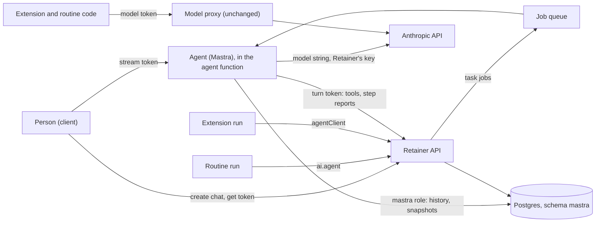

# The workspace agent: spec

Status: **proposed**, 2026-11-25. Nothing here is built. Revised the same
day: the chat comes first, background tasks suspend and resume instead of
waiting inside their run, and Mastra's built-ins are used wherever they fit
(§3). Revised again the same day after a review by two independent
reviewers: their agreed fixes are in the sections they affect, and the
product owner's five decisions on what they left open are D1 to D5 in §2.
Revised a third time the same day: the agent runs inside the model proxy
(D6), and a second review round's fixes are in place. Later that day:
soft limits (D7), D4 and D5 relaxed to accept a rare `diverged` run and
a rare repeated write, prompt caching designed (§3.5) and the length check
dropped (D2). A third review round's fixes to those changes are in place
(2026-11-26). The same day the product owner decided that the agent
stores its own history with a `mastra`-only database role (D8), runs in
its own function and calls Anthropic directly, leaving the model proxy
untouched (D6, revised), and that `forget` doesn't reach agent sessions.
§2 lists what is decided.

Builds on [extensions-model-calls.md](extensions-model-calls.md) (the model
proxy, and §11 there, which first described this agent) and
[routines.md](routines.md). Mastra facts are from `@mastra/core` 1.86.0,
`@mastra/memory` 1.41.3, `@mastra/ai-sdk` 1.12.1 and `@mastra/pg` 1.38.0,
read from their bundled docs, type definitions and source on 2026-11-25.
AI SDK facts are from `@ai-sdk/anthropic` 4.0.109, read on 2026-11-26.

If accepted this spec amends:

- `extensions-model-calls.md` §3.4 (`ai_usage` rows of kind
  `workspace_agent` name the session) and §11 (now this spec; its
  decisions are refined in §2 here). The model proxy itself doesn't
  change.
- `routines.md` §4.4 and §4.5 (a new SDK call, `retainer.ai.agent`), §6.2 (a
  run can wait for a task), §6.5 (a task's writes and tool jobs keep its
  run's cause chain), §6.6 (stored session content, waiting runs and their
  tasks), §10 (the "agent with tools" and "long runs and waits" rows) and
  §11.4 (a run that waits for a task may end as `diverged`). An extension tool
  job started by a routine's task is admitted while its run waits (§9.2).
- `cli.md` §3, §5.2, §9.1 and §11: a chat from the CLI writes, as the agent,
  while the login is elevated (§6.7).
- `accounts-and-access.md`, the workspace purge: it locks and rechecks the
  workspace, then erases the agent's stored content in the transaction that
  deletes the workspace (§5.4).
- `ARCHITECTURE.md` §2.1 (`forget` doesn't reach agent sessions, §5.4)
  and §8 (a new package, two server modules, and the `agent` function,
  which connects to the `mastra` schema with a role of its own, D8).
- `FRONTEND.md`, whose "no agent chat" line is already out of date.

The write rules and actor types in `ARCHITECTURE.md` don't change. The agent
writes as an agent, for a person or for a routine or extension (§7).

## 1. The idea on one page

Retainer gets its own agent: a Mastra agent loop that calls Anthropic with
Retainer's key, uses tools (Retainer's own, the web, extension tools) and
keeps its conversation in Retainer's database.

Two kinds of caller use it:

- **A person, through the chat.** They send a message and watch the agent
  think, call tools and answer, as a stream. This spec builds the chat's
  backend only; the web app's chat screen comes later (§14).
- **Code, through a task.** A routine (`retainer.ai.agent`) or an extension
  (`agentClient`) hands the agent instructions and input and gets back a
  typed answer. The caller's run suspends while the agent works and resumes
  with the answer.

Both are **sessions**: a chat is a session that stays open, a task is a
session that ends with an answer. They share one harness, one store and one
set of tools.

- **The agent runs in its own function** (D6). Hosted, it is the `agent`
  function; self-hosted, the `agent` container. Mastra calls Anthropic
  directly, by its model string. The model proxy, which serves extension
  and routine model calls, doesn't change (§12).
- **Callers talk to Retainer, not to the agent.** A person's session, the
  CLI's login or a run's token gets the caller a short credential from
  Retainer's API. The agent runtime trades it, with a credential of its own
  that callers never see, for a token bound to one turn (§7.3). The agent
  accepts nothing else.
- **Authority comes from the caller.** The agent brings its prompt, its
  model and its harness. Everything it does in Retainer uses the caller's
  access, never more, and its writes are recorded as an agent acting for
  that caller.
- **Mastra for the loop, Retainer for the data.** Mastra runs the loop,
  streams, pauses for approvals and keeps the message history. Its storage
  is Mastra's own Postgres store, `@mastra/pg`, on Retainer's database. The
  agent runtime runs it itself, with a database role that reaches the
  `mastra` schema and nothing else (D8, §3.2). All CRM data stays behind
  Retainer's API, reached through tools.



## 2. Decided and proposed

Decided in `extensions-model-calls.md` §11 (2026-11-14), unchanged:

- **Harness: Mastra**, as a library, Apache-2.0 packages only. Nothing from
  `ee/` folders (§3.3).
- **No Anthropic Managed Agents, no Bedrock AgentCore, no Lambda durable
  functions.** Self-hosting runs the same code.
- **Model: the Anthropic API** with Retainer's key. Revised by D6: the
  agent calls it directly, not through the model proxy.
- **Hosted: outside the database VPC.** Revised by D8: the `agent`
  function runs in the VPC to reach its own store, and reaches Retainer's
  data only through the API.
- **Harness from the agent, authority from the caller.**

Refined from §11 there (2026-11-25):

- "Mastra's own memory and storage aren't used" becomes: **Mastra's storage
  is `@mastra/pg`, run by the agent runtime** with a `mastra`-only role
  (D8). The data stays in Retainer's Postgres, in a `mastra` schema (§3.2).
- "Each task runs as a series of short jobs, one per step" becomes: **a task
  runs as one job, or a few** if it outlasts one, with each step saved as it
  ends (§9.3). Mastra runs the loop inside a job; splitting it per step would
  mean replacing Mastra's loop.
- "An `agent` Lambda function" stays: **the agent runs in its own `agent`
  function** (D6 below), with no model token and no proxy hop.
- "The worker container on Compose" becomes: **an `agent` container of its
  own** (D3 below).

Decided 2026-11-25 by the product owner:

- **The chat first** (§14), backend only.
- **No bounded waiting.** A task's caller doesn't wait inside its run; it
  suspends and resumes (§2.2).
- **Generous limits at first**, tightened from real usage (§10).
- **A task may search the web and write to Retainer** in the same session.
- **Use Mastra's built-ins when they make sense** instead of building our
  own (§3).

Decided 2026-11-25 by the product owner, on what the review left open:

- **D1. No refusal fallbacks.** Agent requests carry no `fallbacks`. A
  refused turn ends as `refused`; a refused task ends as `refused`, with no
  repair turn (§3.4).
- **D2. No length check before sending (revised 2026-11-25).** Chats are
  assumed to stay under the 1M-token context. If Anthropic refuses a
  request as too long or too large, or stops a response at the context
  window, the turn ends as `context_limit_reached` and the person starts a
  new chat (or as `incomplete`, where the raw stop reason isn't available,
  §3.4). Compaction is set aside (§5.5).
- **D3. Self-hosted turns run in their own container (revised by D8).**
  Chat and task turns run in an `agent` Compose container. Its only
  database credential is the `mastra`-only role (D8); it has no other
  database access and reaches Retainer's data only through the API, like
  the routine runner: the same isolation as hosted (§4.2, §13).
- **D4. Reads aren't recorded (relaxed 2026-11-25).** A routine that waits
  for a task replays from the top on resume, with live reads, as every
  routine does. If data it read before `ai.agent` changed during the wait,
  whether the run, its task or someone else changed it, and the replayed
  effect's operation or argument hash differs, the run ends as `diverged`
  and the task's answer is dropped. A run that returns before the effect
  succeeds, with its answer noted as unused. A later independent trigger
  starts fresh; a change made by the run or its task triggers none. The
  effect's argument hash stays whole, input included (§9.2). Code that
  takes its input from the trigger snapshot avoids it, and recording reads
  would store CRM content for each run.
- **D5. A crashed step is sampled again (relaxed 2026-11-25).** A task
  slice that dies mid-step resumes from the last saved step and asks the
  model again. A dead chat turn isn't retried; the person's next message
  continues from the saved steps (§8.4). A Retainer write the dead step
  already made may be made a second time; Retainer's writes are mostly safe to repeat (an upsert by
  identity, an assertion of the same value), and a repeated fact or event
  is acceptable. An extension `write` or `send` call still needs its
  one-use approval, which makes one job keyed by the tool call ID; the job
  is delivered at least once with that key, as every tool job is, and the
  tool must honour it (§6.4, §8.4).

Decided 2026-11-25 by the product owner, after the second review round:

- **D6. The agent runs in its own function, and calls Anthropic directly
  (revised 2026-11-26).** Hosted, the `agent` function, with a function URL
  for the chat stream; self-hosted, the `agent` container (D3). Mastra's
  model string, `anthropic/claude-sonnet-5-5`, with the key from
  `ANTHROPIC_API_KEY`: no provider instance of our own and no custom
  `fetch`. Thinking, effort and caching are set in the agent's
  `providerOptions.anthropic`. The provider version is the one Mastra
  bundles (accepted). The model proxy stays exactly as it is, for
  extension and routine calls. The key lives in the process that runs the
  agent (accepted). §2.1 has what this replaced.
- **D7. Soft limits.** Usage is counted after each step, and a turn stops
  before its next step once it is over a limit; no reservation before a
  request (§10.2). Overshoot is at most one step per turn, and the
  Anthropic monthly spend limit is the backstop.

Decided 2026-11-26 by the product owner:

- **D8. The agent runtime stores its own history.** It runs `@mastra/pg`
  itself and connects to Postgres directly, as `retainer_mastra`: a login
  role with `USAGE` and DML on the `mastra` schema and nothing else. Every
  read and write of CRM data stays a tool call through Retainer's API. This
  replaces "`@mastra/pg` behind the API; the agent never holds a database
  credential", and part of D3. Hosted, the `agent` function runs in the
  VPC (§13). The risk is accepted: a compromised agent process can read
  and write every workspace's chats and task sessions, because the
  `mastra` schema has no workspace column and the role is shared, but
  nothing else in the database.
- **`forget` doesn't reach agent sessions.** Agent content goes only by its
  own lifecycle: a person deleting a chat, a task's 7-day retention and
  the hard workspace purge (§5.4). Accepted: content from a forgotten
  record can stay in a chat until its person deletes it.

### 2.1 Considered: the agent inside the model proxy

The 2026-11-25 draft ran the agent inside the model proxy: one `model`
function for both, with the agent's requests taking the proxy's own code
path in-process through a `fetch` of ours, under a list of allowed requests
of its own. Dropped (D6, revised 2026-11-26) to keep the proxy untouched:
it needed an agent list, beta and size rules, a longer timeout chain and
its own metering path, and an agent bug could affect extension and routine
calls.

Also considered earlier: the agent as one more client of the proxy, with a
model token for every request and an HTTP hop; and an agent proxy that
speaks the Messages API. Not chosen: the first adds a token kind and a hop
for no gain once the agent holds the key, and the second can't express a
session that keeps state and runs tools with someone's authority.

### 2.2 Considered: waiting inside the caller's run

A first draft had the caller poll the task inside its own run, bounded by
the run's 300 seconds. Dropped: it caps tasks at a few minutes, keeps two
functions running while one waits, can't pause for a person's approval, and
would be thrown away once suspend and resume exists.

## 3. Mastra: what we use and what we build

### 3.1 The table

| Need                                 | Decision         | How                                                                                                                                                                                                                     |
| ------------------------------------ | ---------------- | ----------------------------------------------------------------------------------------------------------------------------------------------------------------------------------------------------------------------- |
| The agent loop                       | Built-in         | `Agent` with `stream()`, for chats and tasks alike; the runtime reads its full stream (§3.4)                                                                                                                            |
| Model access                         | Built-in         | Mastra's model string `anthropic/claude-sonnet-5-5` (§3.4), the key from `ANTHROPIC_API_KEY`; no provider instance or `fetch` of our own (D6)                                                                           |
| Anthropic options                    | Built-in         | `providerOptions.anthropic`: adaptive thinking with summaries shown, effort, caching (§3.4, §3.5). No refusal fallbacks (D1), no context management, which would edit history (§3.5)                                    |
| Message history                      | Built-in         | `Memory` with `savePerStep: true`, stored by `@mastra/pg` in the agent runtime (§3.2). No trimming: `lastMessages: Number.MAX_SAFE_INTEGER` (§5.5). The person's message is saved before the first model request (§6.2) |
| Semantic recall                      | Off              | Retainer has no embeddings (`semanticRecall: false`, no vector store, no embedder)                                                                                                                                      |
| Working memory, observational memory | Off              | Retainer's own memory (`me`, `workspace`, records) is the memory; the agent uses it through tools                                                                                                                       |
| Thread titles                        | Ours             | The first 80 characters of the first message's text. No model call                                                                                                                                                      |
| Streaming to a UI                    | Built-in         | `handleChatStream` from `@mastra/ai-sdk`, UI message version pinned, `sendReasoning: true`. Its parameters are built by the server, never from the request (§6.2)                                                       |
| Approvals                            | Built-in         | `requireApproval` and `requireToolApproval`; the resume is built from the API's approval record, and dispatch checks that record (§6.4)                                                                                 |
| Per-request auth                     | Built-in         | `RequestContext`, read by tools; it holds the turn token, which is never persisted (§7.3)                                                                                                                               |
| Step and time limits                 | Built-in         | `maxSteps` (a task's remaining steps, §10.1), `modelSettings.timeout`, `maxOutputTokens`, an `abortSignal` the runtime owns (§6.5)                                                                                      |
| Tool call caps                       | Built on a hook  | `hooks.beforeToolCall` returns `{ proceed: false }` past the cap                                                                                                                                                        |
| Web search                           | Built-in, AI SDK | Anthropic's `web_search_20260209` as an AI SDK provider tool, with a constant `max_uses`. Not Mastra's `webSearchTool`, which sends the older `web_search_20250305`                                                     |
| Web fetch                            | Built-in, AI SDK | Anthropic's `web_fetch_20260209` as an AI SDK provider tool, with a constant `max_uses`. Not Mastra's `webFetchTool`, which fetches from the agent runtime (§8)                                                         |
| Retainer tools                       | Ours             | `createTool` over `@retainer/sdk` (§8)                                                                                                                                                                                  |
| Storage                              | Built-in         | `@mastra/pg` (`MemoryPG`, `WorkflowsPG`) runs in the agent runtime, as the `mastra`-only role `retainer_mastra` (D8, §3.2)                                                                                              |
| Resumable streams                    | Off              | They need a shared PubSub such as Redis. `durable: false`, and the handler keeps consuming when the client leaves; reconnecting reads the saved history (§6.5)                                                          |
| Durable agents                       | Evaluate in PR 2 | Beta. A candidate for long tasks (§9.3)                                                                                                                                                                                 |
| Guardrail processors                 | Later            | Built-in processors exist (`PromptInjectionDetector`, `PIIDetector`, `ToolCallFilter`, …); part of the study in §11                                                                                                     |
| Tracing                              | Off              | Decided 2026-11-25. The saved messages are the trace (§5.3)                                                                                                                                                             |
| Logging                              | Replaced         | Mastra's logger is set to one that logs codes and metadata only (§5.3)                                                                                                                                                  |
| Mastra's server, A2A, MCP server     | Not used         | Retainer's API is the only way in                                                                                                                                                                                       |

### 3.2 Storage: `@mastra/pg` in the agent runtime (D8)

Mastra's Postgres store, `@mastra/pg` (Apache-2.0), is a database client.
The agent runtime runs it itself and connects to Postgres directly, as a
role that reaches the `mastra` schema and nothing else (decided 2026-11-26,
D8). Every read and write of CRM data stays a tool call through Retainer's
API (§8.1).

```
agent runtime                                         Postgres
Mastra agent ── MemoryPG / WorkflowsPG ───────────▶  schema "mastra": Mastra's tables
             ── tools, step reports (turn token) ────▶ Retainer API ─▶ everything else
```

- **The role.** `retainer_mastra` is a login role, with its own password or
  IAM authentication: `USAGE` and DML on the `mastra` schema, no grants on
  `public`, and no membership in `retainer_app` or the owner role (§5.2).
- **The runtime builds every ID.** The thread, resource and run IDs come
  from the claim, server-side, never from the client (§5.2). Nothing
  checks each storage call any more: isolation between sessions rests on
  the runtime's code. That is part of D8's accepted risk.
- **We write no message or snapshot tables and no SQL for them**, except to
  erase them (§5.4). Mastra's tested store
  keeps them in its own format, so history, approvals and
  `handleChatStream`'s approval flow work as Mastra expects.

**The accepted risk (D8).** The process that reads untrusted text (web
pages, emails, records anyone could write) now holds a database password.
A compromised agent process can read and write every workspace's chats and
task sessions, because the `mastra` schema has no workspace column and the
role is shared. It can reach nothing else in the database.

Considered first: `@mastra/pg` behind the API, with a pass-through store in
the runtime that sent each storage call to the API with the turn token, and
the API checking every ID. It kept every database credential out of the
agent's process. Replaced by D8.

### 3.3 Licence: staying free

Checked on 2026-11-25 against `@mastra/core` 1.86.0, its `LICENSE.md`, the
`ee/LICENSE` in `mastra-ai/mastra` and the repository's source tree.

- **The split.** Everything in Mastra is Apache-2.0 except what sits under a
  folder named `ee/`, which is under the Mastra Enterprise Edition License.
  Those features (fine-grained authorization, role-based access, Studio
  sign-in, the agent builder, the editor) may be used for development and
  testing for free; production use needs a written agreement with Mastra and
  a licence key.
- **What we use is all Apache-2.0**: `@mastra/core`'s agent, memory,
  workflows and processors, `@mastra/memory`, `@mastra/ai-sdk`, and
  `@mastra/pg` 1.38.0 in the API. None of the Enterprise features is
  configured: no FGA or RBAC provider, no auth
  provider, no Studio, no editor, no agent builder.
- **One catch.** `@mastra/core` bundles code built from
  `packages/_internals/auth/src/ee/` into its runtime, and the agent loop
  calls one function from it, `requireFGA`, on every tool call. With no FGA
  provider configured it returns at once. Loading it runs nothing else (it
  defines constants). Our reading: running this no-op is not using the
  Enterprise feature (fine-grained authorization), so the licence's
  production-use terms don't apply. `@mastra/pg` loads the same core
  modules in the API, so the guards below cover `packages/server` too. The
  licence lets Mastra designate more code as Enterprise later (its §5.1),
  for future versions only.
- **How we keep it free:**
  - A lint rule refuses imports from any `ee/` path and any Mastra auth,
    FGA, RBAC, editor or agent-builder export.
  - A check runs on every Mastra upgrade: it lists the code from `ee/`
    folders that the modules we load reach, and fails if that list grows
    beyond `requireFGA` and the permission constants, or if either licence
    file changes.
  - **Mastra confirmed this reading in writing** (2026-11-25, in reply to
    a question sent to legal@mastra.ai): the Enterprise licence is needed
    in production only when fine-grained authorization is configured
    (`server.fga` or `studio.fga`); with no FGA provider, `requireFGA`
    returns at once and isn't use of an Enterprise feature, so this setup
    is covered by Apache-2.0 alone, hosted and self-hosted. It depends on
    the features configured, not the packages installed, so `@mastra/pg`
    changes nothing. Code released under Apache-2.0 stays so in the
    versions already released; a later designation applies only to
    versions released after it. The guards above stay, because a later
    version could move more code.
  - **The way out stays short.** The tools, the session API and
    `agent_sessions` are ours. If Mastra's terms change, the loop can move
    to the Anthropic SDK's tool runner (`@anthropic-ai/sdk`, MIT), and the
    chat stream to the AI SDK alone, without changing the API or the
    clients. Stored chats would move out of Mastra's tables with a one-off
    script.
- **Versions** are pinned. Mastra moves fast (core 1.86 on 2026-11-25); the
  storage has a conformance test against Mastra's domain contracts, and an
  upgrade is a PR that runs it, Mastra's migrations (§5.2) and the licence
  check.

### 3.4 The model: Claude Sonnet 5.5

Every agent session runs on **Claude Sonnet 5.5** (`claude-sonnet-5-5`):
chats, tasks and repairs. Callers never choose a model, extensions
included (decided 2026-11-25). Routines' plain `ai.generate` calls keep their
own model (`routines.md` §4.5). What it means for the harness:

- **Thinking** is adaptive and always on (`thinking: { type: "disabled" }`
  is refused on this model). The chat shows it, so the request sets
  `display: "summarized"`; without it the reasoning streams as empty blocks.
  Effort is `medium` for every request, sent explicitly, since the model's
  default is `high` (decided 2026-11-25).
- **Thinking blocks go back unchanged, and history only grows.** On Sonnet
  5.5 a thinking block is valid only in the conversation that produced it,
  and edits to anything before it can invalidate it, the tool definitions
  included. So Mastra's history trimming is off: each turn loads the whole
  thread (§5.5), and a chat's tool list is fixed when it is created (§8.3).
  The same rule keeps the prompt cache warm (§3.5). PR 1 checks that
  Mastra stores and replays thinking blocks with their signatures.
- **No forced tool choice.** `tool_choice` `any` and `tool` are refused, so
  a task's typed answer must use native structured output
  (`output_config.format`), not a forced tool. PR 2 checks which one
  Mastra's `structuredOutput` sends.
- **Web tools** are the `20260209` versions, which filter results
  dynamically. PR 1 checks that they work without a `container`. A long
  server-tool step can stop with `pause_turn`.
- **Stop reasons.** The AI SDK maps `pause_turn` to an ordinary stop, and
  `max_tokens` and `model_context_window_exceeded` both to `length`.
  `onStepFinish` sees only that mapped reason, but Mastra's full stream
  carries the raw one on each step's finish (`stepResult.rawReason`). So
  every turn, chat or task, runs on `stream()`, and the runtime reads the
  full stream itself before it hands it to the client or returns a task's
  answer. Before it marks a turn done or tries a schema repair (§9.3):
  `pause_turn` continues within the limits (or ends the turn as
  `incomplete`), `model_context_window_exceeded` ends the turn or task as
  `context_limit_reached` (D2, §5.5), and `max_tokens` as `incomplete`.
  PR 1 checks each path; where the raw reason is missing, any `length`
  finish ends the turn as `incomplete`. A cut answer is never reported as
  finished. (`generate()` isn't used: it sends an unstreamed request and
  reports `pause_turn` as an ordinary stop.)
- **Refusals.** No `fallbacks` (D1). A fallback answer would come from
  another model, and it leaves a `fallback` block that later requests must
  replay in place, which nothing shows Mastra or the AI SDK keep. A refused
  turn ends as `refused`; a refused task ends as `refused`, with no repair
  turn.
- **Output** up to 128K tokens a step; the limit in §10 is lower. Every
  request streams.
- **Caching** is designed in §3.5.

### 3.5 Prompt caching

Every step of a turn resends the whole chat, so caching decides most of the
cost: on Sonnet 5.5 a cache read costs 0.05 of the input price. The cache
matches the request's prefix byte for byte, in the order tools, system,
messages, and a change anywhere invalidates everything after it.

- **A stable prefix.**
  - **Tools** are pinned per session, in a fixed order (§8.3), and
    serialized deterministically: the same schemas give the same bytes.
  - **The system prompt** is static text: no date, no person, no
    workspace ID, no flags. A chat's is the base prompt. A task's is the
    base prompt plus the caller's instructions as a second system block
    (§9.1). Either is stored on `agent_sessions` when the session is
    created, next to the pinned tools, and passed as Mastra's
    `instructions` on every turn, never a call's `system` or `context`
    option. A thinking block is checked against the system prompt too
    (§3.4), so a build that changes the base prompt gives it to new
    sessions only.
  - **What varies per chat** (the person, the workspace's name and schema
    summary, today's date) goes in the first user message and never
    changes. A task's `input` goes in its first user message, delimited
    and labelled as data.
  - **The date moves on by appending.** When a turn starts on a later date
    than the last one the chat recorded, the claim gives the runtime a
    short "Today is …" text part, appended to that turn's user message.
    These server-added parts carry a marker, so the chat read endpoint
    (§6.1) and the stream show only what the person wrote.
  - **History only grows** (§3.4). Nothing is injected into a request and
    removed from the next. A change mid-chat (an elevation, a removed
    extension) shows up as a tool's error result (§8.3).
- **Two breakpoints.** A 1-hour `cache_control` on the last system block
  (the system message's `providerOptions.anthropic.cacheControl`), so the
  tools and system prompt stay cached between a person's replies. And
  Anthropic's automatic caching for the conversation (the provider's
  top-level `cacheControl` option, 5 minutes): each step reads the
  previous step's prefix and writes its own. The 1-hour entry comes first,
  as Anthropic requires. A step that adds more than 20 blocks (several web
  searches and a cited answer) can push the previous entry out of
  Anthropic's lookback and miss once; accepted, and PR 1 measures it.
- **Between turns** the conversation tail stays on 5 minutes: a reply
  within 5 minutes reads the whole chat from cache; a later one rewrites
  the tail once. PR 1 measures the gap between turns and moves the tail to
  1 hour if most replies come later.
- **Measured** as each step's total cache reads and writes, which the
  step report records (§10.2). A step's total includes the reads of its
  own server-tool rounds, so it shows reuse but doesn't prove it alone.
  PR 1's acceptance: from the second step of a chat on, the cache reads
  are at least the previous step's input, apart from the accepted misses;
  and a test diffs consecutive request bodies and finds them identical up
  to the appended turn.

## 4. Architecture

### 4.1 Vocabulary

| Term          | Meaning                                                                                                  |
| ------------- | -------------------------------------------------------------------------------------------------------- |
| Session       | One agent conversation: a chat or a task                                                                 |
| Chat          | A session a person opens and talks in; stays open until they delete it                                   |
| Task          | A session code opens with instructions, input and an answer shape; ends with the answer                  |
| Caller        | Who the session works for: a person, a routine run or an extension run                                   |
| Turn          | One `stream()` call: from a message (or a resume) to the agent's reply                                   |
| Slice         | One job's share of a long task's turn; it hands off after about 10 minutes (§9.3)                        |
| Step          | One model call inside a turn, and the tool calls it asks for                                             |
| Agent runtime | The code that runs turns: the `agent` function hosted, the `agent` container self-hosted (D6)            |
| Turn token    | The credential the agent uses for Retainer: bound to one turn of one session, never more than the caller |
| Stream token  | The client's credential: it can start a turn on one chat and nothing else                                |

### 4.2 Where each part runs

| Part                                | Hosted                                                  | Self-hosted Compose                                     |
| ----------------------------------- | ------------------------------------------------------- | ------------------------------------------------------- |
| Session API                         | `api` function                                          | Server process                                          |
| Chat turns                          | `agent` function, streaming through its function URL    | `agent` container; the server forwards the stream (§13) |
| Task turns                          | `agent` function, started by the launcher for a job     | `agent` container, handed each job by the worker        |
| The agent's model calls             | From the `agent` function to Anthropic                  | From the `agent` container to Anthropic                 |
| The agent's store (`mastra` schema) | `agent` function, in the VPC, as `retainer_mastra` (D8) | `agent` container, as `retainer_mastra` (D8)            |
| Model proxy                         | `model` function, unchanged                             | Server process, unchanged                               |
| Web search and fetch                | At Anthropic, as server tools                           | Same                                                    |

The `agent` function and container hold one database credential, the
`mastra`-only role (D8), and the Anthropic key (D6). They need no network
beyond Postgres, Retainer's API and Anthropic, because web search and fetch
run at Anthropic.

### 4.3 Code layout

- **`packages/agent`** (MIT, like `packages/runner`): the harness. The
  Mastra agent, the base system prompt, Retainer's tools built on
  `@retainer/sdk`, the Mastra store (`@mastra/pg`), the chat handler and
  the task driver. It imports no server code: the host passes it the
  `mastra` role's connection (D8).
- **The `agent` entry** (`packages/server/src/lambda/agent.ts` hosted,
  `RETAINER_ROLE=agent` self-hosted) serves the chat stream and task jobs
  by running `packages/agent`. It runs no migrations and opens no pool but
  the `mastra` role's: today's server start opens the owner pool before it
  branches on the role, and the image's command runs migrations, so the
  container overrides both.
- **`packages/server/src/agent-sessions`** (Admin layer, next to
  `routines`): the session API, the chat read endpoints over its own
  `@mastra/pg` instance (reads only), limits, approvals of record, step
  reports and the retention sweep. With `packages/agent` the only code that
  loads Mastra; a lint rule keeps it so.
- **`packages/server/src/agent-runtime`** (Foundation layer, next to
  `routine-runtime`): minting and checking stream and turn tokens, the turn
  lease (§6.3), and the erasure of stored session content that chat
  delete, retention and the workspace purge share (§5.4). The erasure
  calls one SQL function and imports no Mastra.
- `@retainer/extension` gains `agentClient(invocation)`; the routine SDK in
  the runner gains `retainer.ai.agent` (PR 2).
- `packages/cli` gains `retainer agent chat`, a terminal client (§6.7).

Both server modules join the layer list in `ARCHITECTURE.md` §8 and
`scripts/check-layers.mjs`. Core imports nothing of the agent: `forget`
doesn't reach agent sessions (§5.4). Retainer's core still never calls a
model.

## 5. Sessions and storage

### 5.1 Tables

Ours, in Drizzle's schema like every other table:

| Table             | Holds                                                                                                                                                                                                                                       |
| ----------------- | ------------------------------------------------------------------------------------------------------------------------------------------------------------------------------------------------------------------------------------------- |
| `agent_sessions`  | Workspace, kind (`chat` or `task`), caller, person (for a chat), title, status, the pinned tool list (§8.3) and system blocks (§3.5), the last date sent (§3.5), limits and use (a task's steps across slices, §10.1), created, last active |
| `agent_turns`     | One row per turn: status, claim generation and deadline (§6.3), steps, tokens, tool calls, web searches and fetches, error code, durations, the Mastra run IDs the claim issued (§5.2). IDs and counts only                                 |
| `agent_approvals` | One row per approval request: session, turn, Mastra run, tool call ID, a hash of the arguments, status, who answered, when and what, and when dispatch used it (§6.4)                                                                       |

Mastra's, in the `mastra` schema, created by `@mastra/pg`:

| Table                                                                                    | Holds                                                                                   |
| ---------------------------------------------------------------------------------------- | --------------------------------------------------------------------------------------- |
| `mastra_threads`, `mastra_messages`, `mastra_resources` and the memory domain's others   | The history: the person's messages, the agent's text, reasoning, tool calls and results |
| `mastra_workflow_snapshot` and the workflows domain's run tables (runs, entries, owners) | A paused turn waiting for an approval or a resume, and its run's state                  |

A Mastra thread is a session: the thread ID and the `resourceId` are both
the session ID, for chats and tasks alike, so every Mastra row belongs to
one session and erasing a session leaves the others whole. Nothing uses
memory across chats. Mastra's tables have
no workspace column, so row-level security doesn't cover them. Instead,
only the agent runtime writes them, through Mastra's store (§5.2);
`agent-sessions` reads them for the chat read endpoints; only
`agent-runtime`'s erasure deletes from them (§5.4). Only the
`memory` and `workflows` domains exist; the others (traces, scores,
knowledge and the rest) are disabled, so their tables are never created.

### 5.2 The store

- **In the agent runtime** (D8), `packages/agent` gives Mastra a
  `MastraCompositeStore` with `disableInit: true` and only two domains:
  `memory`, a `MemoryPG`, and `workflows`, a `WorkflowsPG`, each with
  `schemaName: "mastra"`. `disableInit` is set on the composite store,
  which is where Mastra reads it. They share a small `pg` pool (one or two
  connections per instance) that connects as `retainer_mastra`. Hosted,
  the `agent` function's reserved concurrency bounds the number of
  connections.
- **IDs come from the claim.** The thread and the resource are the
  session ID (§5.1), and the claim issues the Mastra run ID
  and records it on `agent_turns`, so the erasure can find the run's rows.
  The runtime takes none of them from the client. Isolation between
  sessions rests on the runtime's code, as D8 accepts.
- **One writer per session.** A storage write carries no claim
  generation, so nothing in the database refuses a stale one. Instead,
  after a cancel a new claim on that session is refused with
  `409 turn_stopping` until the old runtime has closed its turn or its
  deadline plus the grace has passed (§6.3). The runtime keeps its side:
  every store operation has a timeout that ends by the deadline plus the
  grace, it stops saving at that point, and it sends its close only after
  its pending saves finish. So steps from two turns don't interleave. A
  hung runtime that writes later anyway is the accepted remainder (D8).
- **API writes check the generation** in their own transaction: a tool
  write, an extension job's enqueue, a step report and a close. One that
  passed its check just before a cancel commits like one that finished
  just before it (accepted).
- **The role.** `retainer_mastra` is a login role, with its own password or
  IAM authentication. It has `USAGE` and DML on the `mastra` schema, no
  grants on `public`, and no membership in `retainer_app` or the owner
  role, so neither a bug in Mastra's store nor a compromised runtime can
  reach Retainer's tables. The API's own store, for the chat read
  endpoints, is built the same way (`disableInit: true`), connects as the
  same role and only reads.
- **Erasure's access.** No role but `retainer_mastra` gets grants on
  `mastra`. The erasure (§5.4) is one `security definer` function,
  `retainer_erase_agent_content(workspace, sessions)`, owned by a role that
  can read the session mapping and delete in `mastra`. `sessions` is null
  for the whole workspace (the purge) or a list of session IDs (chat delete,
  retention), each checked to belong to that workspace. A second function,
  `retainer_sweep_agent_orphans()`, deletes rows whose thread or run maps to
  no session (§5.4). `retainer_app` (chat delete, retention) and the control
  role (the purge) may execute them, and only them, like the existing
  `retainer_*` functions such as `retainer_routine_admin`.
- **Migrations.** At runtime neither store runs DDL. `pnpm db:migrate`, and
  the hosted migration step, run Mastra's `init()` for the two domains with
  the migration role after Drizzle's migrations, then grant
  `retainer_mastra` on the tables it created and recreate the erasure
  function. Drizzle doesn't manage the `mastra` schema.

### 5.3 The trace

The saved messages are the trace: each step's reasoning, each tool call with
its input and result, and the answer, in the format the UI will render.
`agent_turns` adds counts and durations. The routine run page, the
extension run list and the chat all read the same messages.

Mastra's own tracing (spans for each run, model call and tool call, sent to
an exporter) stays off (decided 2026-11-25). It mostly repeats the saved
messages, and its spans carry the model's inputs and outputs: one more copy
of CRM data for chat delete and retention to reach, or data sent to an outside
service. If per-step timing is needed later, tracing can be turned on with
a filter that drops every input and output and keeps only types, timings,
tokens and errors.

**Logs carry no content.** Mastra's errors carry request values and
response bodies, and its default logger writes them, where deleting a chat
can't reach them. So the agent runtime sets Mastra's logger to one that
logs codes and metadata only.

### 5.4 Retention and deletion

- **A chat** is kept until its person deletes it. It is private to them:
  admins see that it exists and its usage, not its content. Deleting a
  chat cancels a running turn, then erases the session.
- **A task's** messages are kept while the task runs, then for 7 days so a
  person can inspect it, then erased (below) by its session ID alone, the
  rule for routine run results (`routines.md` §6.6).
- **`forget` doesn't reach agent sessions** (decided 2026-11-26). Agent
  content goes only by its own lifecycle: chat delete, task retention and
  the hard workspace purge. Content from a forgotten record can stay in a
  chat until its person deletes it (accepted).
- **One erasure, three callers.** `agent-runtime` holds it, so chat delete,
  the 7-day retention and the hard workspace purge run the same code. It
  deletes by real keys across every table in the `mastra` schema (threads,
  messages, resources, workflow snapshots, workflow runs, run entries, run
  owners), not with `deleteThread` alone, which leaves the workflow rows,
  and clears `agent_approvals`' arguments. It runs through the `security
  definer` function of §5.2: the one place Retainer's own code writes
  Mastra's tables. A test lists every table in the `mastra` schema from
  `pg_tables` and fails if the erasure misses one.
- **Orphans are swept.** A turn that was mid-step when its chat was deleted
  may still save that step after the erasure. The daily retention sweep
  also deletes Mastra rows whose thread is no longer a session, or whose
  run is no longer on `agent_turns`. Accepted: such a step can survive at
  most a day.
- **The hard purge.** Mastra's tables have no workspace column, so the
  purge's cascade can't reach them. The purge erases them in the same
  transaction that deletes the workspace, in this order: take the privacy
  lock exclusively; lock the workspace row (`for update`) and recheck that
  it is still due and its extension cleanup is done; run the erasure while
  the session rows that map threads and runs to the workspace still exist;
  delete the workspace. If the delete affects no row, the transaction rolls
  back, erasure included. A restore updates the same row, so it and the
  purge serialize in either order: a restore that wins leaves the chats
  intact, and a purge that wins leaves nothing to restore. Until the purge,
  a deleted workspace keeps its chats.
- **No other copy.** Mastra's tracing is off and its logger carries no
  content (§5.3), and the agent's calls don't pass through the model
  proxy, so nothing captures them.
- This is an exception to "nothing the model saw is stored"
  (`extensions-model-calls.md` §3.3): a conversation can't continue without
  its history.

### 5.5 The whole history, and its limit

- **Recall.** Each turn loads the whole thread:
  `lastMessages: Number.MAX_SAFE_INTEGER`, the setting Mastra's memory
  reference documents for "all messages with no limit". Not
  `lastMessages: false`, which turns history off; the default is the last
  10 messages. No `messageHistory` token budget, and no processor that drops
  messages. The round-trip test across fresh instances (§15) holds it.
- **The limit (D2).** There is no check before sending, and the agent
  calls Anthropic directly, so the proxy's 6 MB limit doesn't apply. The
  turn ends as `context_limit_reached`, and the chat says to start a new
  one, when Anthropic refuses the request as too long (HTTP 400,
  `prompt is too long`) or too large (HTTP 413), or stops the response at
  the context window (§3.4). A task ends the same way.
- **Later: compaction.** Set aside for now. Server-side compaction would
  let a chat run past the context, once Mastra is shown to store and
  replay `compaction` blocks.

## 6. The chat

### 6.1 Endpoints

On the API (person's session, or the CLI's login):

```
POST   /v1/agent/chats                 create a chat → { id, agentOrigin }
GET    /v1/agent/chats                 the person's chats
GET    /v1/agent/chats/:id             the chat and its messages (UI message parts, server-added parts dropped, §3.5)
POST   /v1/agent/chats/:id/token       a stream token, 15 minutes (§7.3)
POST   /v1/agent/chats/:id/cancel      stop a running turn
DELETE /v1/agent/chats/:id             delete the chat
```

On the API, for the agent runtime only (a turn token, or the runtime
credential to claim one, §7.3):

```
POST /v1/agent/runtime/sessions/:id/claim          claim a turn → turn token, run ID, any date part (checks limits, takes the lease, §6.2, §10.2)
POST /v1/agent/runtime/sessions/:id/tools/:name    one Retainer or extension tool call (§8.1)
POST /v1/agent/runtime/sessions/:id/report         report one step's usage → continue or stop (§10.2)
GET  /v1/agent/runtime/sessions/:id/turn           the turn's state, to notice a cancel (§6.5)
POST /v1/agent/runtime/sessions/:id/close          close the turn with its counts, and any pending approval (§6.4)
```

These are the only routes that accept a turn token. Every other route
refuses it, so a turn can't reach a REST route its tools don't grant, such
as deleting a record or a decision route.

On the agent runtime (stream token):

```
POST /chats/:id/stream    one turn: a new message, or an approval answer → SSE
```

The request body is one of two shapes, checked strictly:

```
{ "message": { "parts": [{ "type": "text", "text": "…" }] } }
{ "approvalId": "…", "approve": false, "reason": "…" }
```

Anything else is refused with `400`: no history, no message IDs, no
`runId`, `resumeData`, `trigger` or options, and no regenerate. History
comes from Mastra's store, and the agent runtime assigns the message's
ID. The answer is
the AI SDK UI message stream over server-sent events. The web client sends
these shapes through `useChat`'s request hook (PR 3).

### 6.2 A turn

1. The client sends a message, or an approval answer, to
   `/chats/:id/stream` with the stream token.
2. The agent runtime checks the body (§6.1) and claims the turn: it sends
   the stream token with its runtime credential and gets a turn token, the
   run ID and any date part (§3.5, §6.3, §7.3). A message while an
   approval is pending is refused (§6.4). The runtime then saves the
   person's message to Mastra's store, with its own ID and any date part,
   before any model request; on the session's first turn it creates the
   thread first, since the store refuses a message for a missing thread.
   The stream shows the message as received only after that save, so a
   runtime that dies during the first request doesn't lose it (D8). A
   crash before the save loses a message that was never acknowledged, and
   the person sends it again. Mastra is given the same message with that
   ID, and its later save finds it already stored.
3. It builds every Mastra parameter itself: the thread and resource from the
   session; `runId` and `resumeData` from the API's approval record; the
   limits, `requireToolApproval`, the instructions and `providerOptions`.
   Nothing from the request body is spread into them: `handleChatStream`
   merges its remaining parameters over the defaults, so a client field
   would override the server's. It calls `handleChatStream` with a pinned
   UI message version, `sendReasoning: true`, a runtime-owned abort signal,
   an `onStepFinish` that reports each step and a `prepareStep` that waits
   for that report's answer before the next request (§10.2), and a
   `RequestContext` holding the turn token. It reads Mastra's full stream
   before the UI projection, for the raw stop reasons (§3.4); PR 1 checks
   that `handleChatStream` allows that, or the runtime calls `stream()`
   and `@mastra/ai-sdk`'s converter itself.
4. Mastra loads the history from its store, calls Anthropic (D6), runs
   tools, saves each step as it ends (`savePerStep`) and streams every
   part: reasoning, tool calls, tool results, text.
5. At the end the turn is closed with its counts, under its claim
   generation; a close from an older claim is refused.

### 6.3 One turn at a time

A chat runs at most one turn at a time. A claim is a lease: the turn gets a
new **claim generation** and a **deadline**: the claim time plus 14
minutes, for a chat turn and a task slice alike (a slice hands off earlier,
§9.3). It is never later than the invocation's remaining time less 30
seconds for its final writes, or than a task's own expiry, so a claim made
late in an invocation gets a shorter turn.

- A claim succeeds when no turn is running, or when the running one is past
  its deadline plus the grace; that one is closed as `timed_out` first, so
  a dead invocation doesn't leave the chat busy. Otherwise the claim is
  refused with `409 turn_running`. A dead chat turn isn't retried: the
  person's message is already saved (§6.2), and their next message
  continues from the saved steps (§8.4).
- **After a cancel, the old runtime stops first.** The runtime writes
  Mastra's store directly (D8), so the API can't refuse a stale storage
  write. Until the cancelled turn's runtime has closed it, or its deadline
  plus the grace has passed, a new claim on that session is refused with
  `409 turn_stopping`. The runtime sees the cancel within 5 seconds
  (§6.5). A cancelled turn's last step may still be saved before it stops;
  the next turn starts after it, so steps never interleave.
- Tool calls and step reports carry the turn token, and a stale
  generation is refused. A late tool write from an old invocation can't
  land after a new claim.
- The turn's state is the API's. A turn the API ends itself (cancelled,
  timed out) is closed by the API. The old runtime's own close changes
  nothing but recording that it has stopped, which ends `turn_stopping`.
- **Finishing after the deadline.** For 60 seconds past its deadline, a
  turn token may still close its own turn and hand a slice off (§9.3), for
  that exact claim only, and only if no newer claim exists. It makes no
  tool or model call, and the runtime may still save its last step to
  Mastra's store, until the deadline plus the grace (§5.2).
- **Late step reports always count.** A step report is the one exception
  to the generation check: one from an older claim, even after a newer
  claim, is accepted with that claim's turn token, deduplicated by step
  ID, counted against the logical task and the day, and answered `stop`.
  It never touches the newer claim. A stale close, handoff or tool call is
  still refused. A turn whose runtime
  never finishes is closed as `timed_out` by the next claim or the sweep.
- Task slices use the same lease.

Tests send two messages at once and kill an invocation mid-turn (`CLAUDE.md`,
rules described as serialized). Steering a running turn comes later (§6.8).

### 6.4 Approvals

Some tools need a person's yes before they run (§8.2). Mastra's built-in
flow pauses the turn; Retainer keeps the record and checks it:

- The tool has `requireApproval: true`, or the turn's
  `requireToolApproval` function says so.
- Mastra pauses, saves a snapshot to its store, and emits an approval
  request with the tool and its arguments. The turn ends there, and its
  close (§6.1) carries the request: the API stores it in
  `agent_approvals`, bound to the session, turn, Mastra run, tool call ID
  and a hash of the arguments. The runtime ends the stream only after the
  close; an answer that comes before it gets `409 turn_running`, and the
  client retries.
- **A runtime that dies before the close** leaves a tool call with no
  result and no record. Mastra leaves such a call out of later requests by
  default (`filterIncompleteToolCalls`), so the chat goes on, and the
  person asks again if they still want it.
- The client answers with `{ approvalId, approve, reason? }` (§6.1). It
  never sends a run ID, a tool call ID or resume data: the agent runtime
  looks them up in the record and builds Mastra's `resumeData` itself, in
  whichever function instance receives the answer. PR 1 checks
  `handleChatStream`'s approval path at the pinned UI message version
  (only its newer versions read approval parts); if it can't resume from
  server-built data, the agent runtime calls `resumeStream` directly.
- **One claim decides.** The answer is part of the turn's claim, so a
  decision, the 24-hour expiry and a repeated click are serialized: the
  first wins, the others get `409`.
- **Dispatch checks the record.** An extension `write` or `send` call runs
  only against a stored approval for that session, run, tool call ID and
  argument hash, and uses it up. A forged answer or a changed argument finds
  nothing to use. Using the approval and recording the extension job,
  deduplicated by tool call ID, are one transaction: there is never a used
  approval without its job, or a job without its approval. One approval
  makes one job. The job is delivered at least once with the tool call ID
  as its key, as every tool job is, and the tool must honour that key
  (`extensions-tools.md`).
- **A decision survives a crash.** A decided approval whose tool result
  isn't in the history yet keeps the chat closed to new messages. The API
  queues a recovery job (§13) under a new claim, which records the result
  before the chat opens: the job's result if a job was recorded; otherwise
  the dispatch (approved) or the declined result; and if neither can be
  done, a terminal error result. A message sent meanwhile gets `409
  approval_pending`.
- **Limits never block a decision.** The claim for an approval answer, a
  recovery job or an expiry job is never refused for limits (§10.2). If a
  limit is spent, the claim answers `stop`: the turn records the tool
  result (the recorded job's result, the dispatch of an approved call,
  which is no model request, or the declined result) and ends as
  `limit_reached` before any model request. So the chat reopens.
- **A new message while an approval is pending** is refused with
  `409 approval_pending`. The web client can offer "Decline and send",
  which sends the decline and then the message. At a spent limit the
  decline is still recorded, and the message gets `limit_reached`.
- **Every ending leaves a tool result.** Approved, declined, or expired
  after 24 hours (as declined), the tool's result is in the history before
  the next message is accepted, so no tool call is left without one. Who
  answered, when and what are on the record.

### 6.5 Disconnects and cancel

`durable: false` is set on the Agent. With it, Mastra aborts the run when
the HTTP request ends, so the stream handler owns the turn's abort signal
and keeps consuming Mastra's stream after the client has gone, on both
hosts. A turn always runs to its end and is saved. (The hosted function URL
can't tell that the client has gone anyway, `extensions-model-calls.md`
§3.6.)

A client that comes back reads the chat (`GET /v1/agent/chats/:id`) and
sees the finished turn, or "still running" with what was saved so far.
Joining a turn's live stream again needs Mastra's resumable streams and a
shared PubSub, which is later.

**Cancel.** `POST …/cancel`, and deleting the chat, fence the turn in the
API (a new claim generation) and record it as `cancelled` there and then.
From then on its tool calls get `turn_cancelled`. A step already under way
can still report its usage, which counts, and the answer is `stop`
(§10.2). A new claim gets `turn_stopping` until the runtime has stopped
(§6.3).

- **The runtime aborts.** It passes its own `AbortSignal` to `stream()`,
  and aborts it on a refused tool call, a `stop`, or what
  the poll sees. Aborting ends the request in flight and starts no new
  step.
- **The runtime polls.** A model request can stream for minutes without
  calling the API. So for the whole turn the runtime asks the API for the
  turn's state every 5 seconds (`GET …/turn`, with a 2-second timeout). On
  `cancelled`, `timed_out` or a stale generation it aborts, and closes; the
  close only records that it has stopped (§6.3). A failed or slow poll
  changes nothing: the next one tries again, and the deadline still bounds
  the request.
- **A request can start before the abort.** A cancel lands at most 5
  seconds before the poll sees it, and a step may start in between; it is
  aborted when the poll sees the cancel (accepted).

### 6.6 What the agent knows

- A base system prompt: what Retainer is, how to read and write it (the MCP
  server's instructions and `get_guide`), to answer from what it found, and
  to say what it doesn't know.
- The person: their name, the workspace, and their `me` memory through
  `get_context("me")`, as any agent connected for them would.
- It logs what it learns the way any agent does: `get_guide("log_from_chat")`.

### 6.7 The terminal client

`retainer agent chat` in `packages/cli` opens a chat and renders the stream
in the terminal: reasoning dimmed, tool calls and results as short lines,
approvals as a yes or no prompt. It exists so the backend can be used and
tested before the web app has a chat screen.

The CLI login only reads (`cli.md` §3: records stay with MCP), so a chat
from the CLI is **read-only by default**: the agent can search, read
records, read `me` and search the web, but can't write records, log events,
remember facts or call extension tools. After `retainer elevate` in that
workspace it may also write, within the person's role, while the window
lasts (30 minutes by default; decided 2026-11-25). The rules:

- **Access follows the credential that mints the turn**, never where the
  chat was created. A stream token minted from the CLI login carries the
  login ID and its elevation; one minted from the web app carries the
  person's session.
- **Checked at each write.** A Retainer write or an extension call from a
  CLI-minted turn runs only while that login's elevation in that workspace
  is open. It is re-checked in the write's own transaction, under its locks,
  as decisions re-check theirs (`recheckElevation`, `cli.md` §5.1), so a
  window that ends mid-turn stops the next write.
- **Never decisions.** The chat agent never reaches the decision routes of
  `cli.md` §9.1, elevated or not. Its writes are the chat agent's
  (`retainer-agent:<person>`, §7.1), never the person's.
- **The tools don't change.** The chat's tool list is fixed when it is
  created, write tools included (§8.3). Without an open elevation, a write
  tool returns the error result `elevation_required`, and the agent tells
  the person to run `retainer elevate`.

This amends `cli.md`: §3 gains a row (chat with the workspace agent: reads
when logged in, the agent writes when elevated); §5.2's "the CLI writes no
records" gains this exception, writes as the agent and never as the person;
§9.1 lists `/v1/agent/chats` and its sub-routes among the routes a CLI
token reaches; and §11 tests them (§15).

### 6.8 Later: steering

Steering lets a person add to a turn while it runs ("also check their
LinkedIn", "stop, wrong company") instead of waiting for it to end.
Mastra's way, Signals (`sendMessage()` into an active run), reaches a turn
in another process only through a shared PubSub such as Redis, which we
don't run. The same result without it:

- **The API keeps pending input.** A message sent while a turn runs is
  saved on the session as pending, not refused, and the stream shows it at
  once as pending.
- **The running turn picks it up between steps.** A `prepareStep` hook
  asks the API for pending input before each model call and appends it to
  the conversation as the person's message, then marks it taken. The model
  sees it at its next step; nothing interrupts a model call in progress.
- **History still only grows.** The input is appended after the last tool
  results, never inserted earlier, so thinking blocks stay valid (§3.4).
- **Input that arrives after the last step** starts the next turn, like a
  queued follow-up.
- **"Stop"** stays the cancel endpoint (§6.1); steering only adds input.

One extra API call per step. Planned with the web chat screen or after it;
not in PR 1.

## 7. Who the agent acts as

### 7.1 A person's chat

The agent acts for the person the way an app connected through OAuth does
(`auth/oauth-token.ts`):

- **Actor:** type `agent`, ID `retainer-agent:<person>`, named "Retainer
  agent for <name>". Never the person, so model output never outranks
  people's values (write rule 3).
- **Access:** the person's, capped by their role, and taken from the
  credential that minted the turn (§6.7). A person who can only read gets
  an agent that can only read. A turn minted from the CLI writes only while
  that login is elevated.
- **Personal memory:** the chat works for its person, so it can read and
  write their `me` memory, as connected agents can
  (`user-and-workspace-memory.md` §4.3).

### 7.2 A task

As before: a task from a routine writes as the agent naming the routine
(`routines.md` §6.4), and one from an extension as that installation's actor.
The session's tools are a subset of the caller's, and the caller's mode
carries over: in a dry run, writes are reported and extension tools aren't
called (`routines.md` §5.1). No personal memory.

**The cause chain carries over.** The task's grant holds its parent,
server-side: the routine run, or the extension installation and job. Its
Retainer writes and the tool jobs it starts take their cause, writer origin
and hop count from that parent, by the rules that already apply to the
routine or installation. So a task's write never triggers its own routine
(`routines.md` §6.5), and a chain through a task still stops at 8 hops.

### 7.3 Tokens

Three credentials for Retainer's API, and one database role (D8).
Extension and routine model tokens are unchanged and never open anything
of the agent's.

- **Stream token** (the client's). Audience `retainer:agent-stream`. Claims:
  workspace, session, person, and how it was minted (the web app's session,
  or the CLI login with its elevation). Minted by `POST …/token`, good for
  15 minutes. Only the agent's stream endpoint accepts it; the runtime
  routes refuse it. On its own it can start a turn and
  nothing else, so a client holding it can't save messages or call a tool
  directly.
- **Runtime credential.** Proves the caller is the agent runtime: a
  secret shared by the API and the `agent` function (hosted) or the
  `agent` container (self-hosted). Clients never see it.
- **Turn token.** Audience `retainer:agent-turn`. Claims: workspace,
  session, turn, claim generation, caller and the access it was minted
  with. It expires at the turn's deadline (§6.3), but for a 60-second grace
  to finish (§6.3). The agent runtime gets it at claim by presenting, with
  the runtime credential, the stream token or an API-owned job: a task
  slice, or a chat's approval recovery or expiry, bound to its pending
  decision and the generation it replaces. Only the runtime routes of
  §6.1 accept it (default deny), and the API checks every call against the
  token and the caller's current access, so removing the person, ending an
  elevation, cancelling the run or deleting the workspace stops the
  agent's calls to Retainer at once. Its own writes to Mastra's store stop
  when the runtime notices (§6.5).
- **A task's grant** travels in its turn token. A task from a routine run
  works under a fenced grant of its own, bound to the waiting effect, the
  routine version and the mode (§9.2), since a waiting run holds no token
  the API would admit.
- **No model token for the agent.** It calls Anthropic with the key
  itself (D6). `workspace_agent` is only an `ai_usage` kind (§10.3).
- **Never persisted.** The turn token travels in the `RequestContext`.
  Mastra snapshots serializable context entries and puts them in spans, so
  the token is held in a non-serializable wrapper, and the runtime puts no
  credential in anything Mastra saves. A resumed turn gets a fresh token.
- **The `mastra` role's password** (D8) and the Anthropic key (D6) live in
  the runtime's environment, never in a token, a `RequestContext` or
  Mastra's store.

## 8. Tools

### 8.1 The tool groups

| Group            | Tools                                                                                                          | Runs where                         | Chat                                          | Task                   |
| ---------------- | -------------------------------------------------------------------------------------------------------------- | ---------------------------------- | --------------------------------------------- | ---------------------- |
| `retainer.read`  | `search`, `query_records`, `get_record`, `get_context`, `get_timeline`, `describe_schema`, `get_event_content` | Agent runtime, through the API     | Yes                                           | If listed              |
| `retainer.write` | `upsert_record`, `log_event`, `remember`                                                                       | Same                               | Yes                                           | If listed              |
| `web.search`     | Anthropic's `web_search_20260209`, as an AI SDK provider tool                                                  | At Anthropic                       | Yes                                           | If listed              |
| `web.fetch`      | Anthropic's `web_fetch_20260209`, as an AI SDK provider tool                                                   | At Anthropic                       | Yes                                           | If listed              |
| `tools.<name>`   | Extension tools, by their declared effect (`extensions-tools.md`)                                              | Through Retainer, as their own job | `read` yes; `write` and `send` after approval | `read` only, if listed |

- **Retainer's tools match the MCP tools** in name and behaviour, so the
  guides apply as for any agent. Each is a `createTool` that calls the
  runtime's tool endpoint (`…/tools/:name`, §6.1) with the turn token from
  the `RequestContext`. The API runs the same service as the MCP tool, for
  the tools in the session's pinned list only, under the caller's current
  access. The turn token reaches no other route. A crashed step is sampled
  again and a Retainer write may repeat (§8.4).
- **A chat's extension tools** are those installed in the workspace that the
  person's role allows when the chat is created (§8.3).
- **Web fetch at Anthropic, not from the agent runtime.** Mastra's own
  `webFetchTool` fetches from the process that runs the agent; Anthropic's
  runs at Anthropic and can only open URLs already in the conversation. PR 1
  checks that Anthropic's tool passes through Mastra as a provider tool.
- **Not in this spec:** Anthropic-side MCP servers (`mcp_servers`), code
  execution, files, and a person's own connected accounts such as Gmail
  (the member agent: Mastra's `MCPClient` behind the person's consent).

### 8.2 What needs approval

| Action                             | Chat                                                             | Task                    |
| ---------------------------------- | ---------------------------------------------------------------- | ----------------------- |
| Reads, web                         | No approval                                                      | No approval             |
| Retainer writes                    | No approval: agent rank, history and the review inbox cover them | No approval             |
| Extension `write` and `send` tools | Approval, every call                                             | Not available yet (§11) |

### 8.3 A session's tools are fixed

On Sonnet 5.5 a replayed thinking block is checked against everything
before it, the tool definitions included (§3.4). A chat whose tool list
changed between turns would lose its earlier thinking, or get a `400`.

- **Pinned at creation.** A session's tool definitions and their order are
  fixed when it is created and stored on the session: every tool its caller
  could use there, write tools included, even when a CLI chat starts
  read-only (§6.7). The web tools carry a constant `max_uses` (§10.1).
- **Authority at dispatch.** A tool is never removed to take access away.
  A tool the caller can't use now returns an error result that says why:
  `elevation_required`, `role` or `extension_removed`.
- **New tools reach new sessions.** An extension installed or upgraded, or
  a new Retainer tool, appears in chats created after it.
- **Later: tools added mid-chat.** Sonnet 5.5 accepts `tool_addition` and
  `tool_removal` blocks in an appended system message (beta
  `mid-conversation-tool-changes-2026-07-01`), which change the tools
  without invalidating earlier thinking. Once Mastra or the AI SDK can send
  them, a new extension can reach existing chats.

### 8.4 A crashed step runs again (D5)

Mastra saves each step after it ends (`savePerStep`), and the person's
message is saved before the first model request (§6.2). What happens after
a crash depends on the session:

- **A task slice** that dies mid-step is resumed by the next slice from the
  last saved step, which samples the step again (§9.3). Its tool calls may
  differ and may repeat.
- **A chat turn** isn't retried. The next claim or the sweep closes it as
  `timed_out`, and the person's next message continues from the saved
  steps; the model then samples afresh from there.

What may repeat:

- **Retainer writes may repeat.** An upsert that matches by identity lands
  as the same claim. A `log_event` with the same identity, type, time and
  initial values returns the same event; a retry may still add participant
  and `about` links. A resampled `remember`, an upsert with no identity
  value, or an event without an external ID may be written twice (D5). No
  per-call result table, no checkpoint before dispatch.
- **Extension writes and sends need a new approval.** They run only against
  a one-use approval, and using it and recording the job are one
  transaction keyed by the tool call ID (§6.4). A resampled step has new
  tool call IDs, so it asks for approval again rather than reusing the old
  one. One approval makes one job; the job itself is delivered at least
  once with its key, and the tool must honour the key (§6.4).

## 9. Tasks (PR 2)

### 9.1 From a routine

```ts
const { round } = await retainer.ai.agent({
  instructions: 'Find this company\'s latest funding round. Answer null if you are not sure.',
  input: { name: record.name, domain: record.domain },
  tools: ['retainer.read', 'web.search', 'web.fetch'],
  output: { /* JSON schema */ },
});
```

| Field          | Required | Meaning                                                                                                                    |
| -------------- | -------- | -------------------------------------------------------------------------------------------------------------------------- |
| `instructions` | Yes      | What to do. From the approved code, never from record content. Sent as a second system block, pinned on the session (§3.5) |
| `input`        | No       | Data the task works on. Reaches the model in the first user message, delimited and labelled as data, not as instructions   |
| `tools`        | Yes      | Tool groups the task may use, within the manifest's (§9.4)                                                                 |
| `output`       | Yes      | A JSON schema for the answer, passed to Mastra's `structuredOutput`                                                        |
| `limits`       | No       | Lower limits than the defaults (§10)                                                                                       |

Code never names a model; every task runs on Claude Sonnet 5.5 (§3.4).

### 9.2 Suspend and resume

1. **Suspend, in one transaction.** `ai.agent` is an effect (`routines.md`
   §6.2). Its first run records the numbered effect with a hash of its full
   arguments, input included; creates the task with a key made of the run
   and the effect's position; fences the run and parks it as `waiting`; and
   publishes the task's job. There is never a task without a waiting
   parent, or a parent waiting on nothing.
2. **The task's own grant.** The task works under a fenced grant bound to
   that waiting effect, the routine version and the mode (§7.3). The parent's
   run token would be refused, since a waiting run isn't `running`. The same
   holds for the extension `read` tools the task may call: today a tool
   job's claim refuses a routine caller whose run isn't `running`
   (`extension-runtime/queue.ts`). A tool job started by a task is instead
   admitted against the task's grant, checked against that exact waiting
   effect. Ordinary routine tool calls keep today's check. The grant
   carries the parent run, so the task's writes and jobs keep its cause
   chain (§7.2).
3. **Complete, in one transaction.** When the task ends, its answer (or
   error code) is stored on the effect and one fenced resume is queued. A
   task that ends very fast still finds its parent parked, because step 1
   parked it in the same transaction that published the job.
4. **Resume.** The run replays from the top. Recorded effects return their
   saved results, matched by position and the full argument hash, and
   `ai.agent` returns the task's answer (or throws its error code).
5. A retried run that reaches the same effect gets the same task back: the
   key makes creating it idempotent.

**Reads are live (D4).** Routines replay effects, not reads
(`routines.md` §11.4), so code before `ai.agent` reads again on resume,
maybe hours later. If data it read changed meanwhile, the code may
compute different arguments or take another branch. When a replayed
effect's operation or argument hash then differs at its position, the run
ends as `diverged` (`routines.md` §6.2) and the task's answer is dropped;
a branch that returns before the effect succeeds (below). The change can
come from anyone, the run and its task included:

- **The task changes what the run read.** The task updates the record whose
  fields the run read for its `input`.
- **The run changes what it read.** It writes before `ai.agent`, depending
  on a read made before the write: on resume the read sees the write, the
  branch differs and the position no longer matches.
- **Someone else changes it** during the wait.

A later independent trigger starts fresh. A change made by the run or its
task triggers none (`routines.md` §6.5), so nothing redoes that work. So
code before `ai.agent` should take its input from the trigger snapshot
(`routines.md` §11.4, which replays unchanged) and not read what the run or
its task writes. The routine builder's guidance says so. A waiting run
that ends `diverged` is shown on the routine's runs page as needing
attention. This is accepted: recording reads would keep CRM content per
run.

**An early return is not a divergence.** A resumed run whose fresh reads
lead it to return before it reaches the answered effect completes normally:
it skips or repeats no write. Its unused answer is cleared like any stored
result, and the run page notes "agent answer unused".

Rules for waiting runs:

- A waiting run holds its place: new changes to the same record coalesce
  into the next run after it, as they do behind a running one (`routines.md`
  §6.1, coalescing).
- A run expires 24 hours after it starts (`routines.md` §4.6) and then ends
  as `expired`. A task's deadline is the earlier of 24 hours and the
  parent's expiry less a margin, so no answer arrives for a run that has
  already gone.
- A waiting run uses no function and no lease; it is a row.
- **Erasure and cancellation reach waiting runs.** `forget` ends waiting
  runs as `erased` and deletes their pending answers, as it does for
  other routine runs (today's `eraseRoutineContent` covers running,
  queued and held runs, not waiting ones). It leaves their tasks alone
  (§5.4): a task's answer then finds no waiting run and is dropped.
  Cancelling a run cancels its task.

**From an extension**, the function can't replay, so it returns
`{ wait: taskId }` and ends. `agentClient(invocation).start(...)` only
stages the task: nothing runs yet. When Retainer accepts the function's
`{ wait }` outcome, one transaction fences and parks the invocation and
publishes the staged task's job, so a fast task can't finish before its
caller waits. A staged task whose invocation ends without `{ wait }` is
dropped. When the task finishes, one transaction stores its answer and
queues one fenced child job, which calls the function again with the
answer (`invocation.agentResult`); a duplicate completion finds the effect
already answered and queues nothing. Cancelling a waiting invocation
cancels its task. The extension SDK hides the plumbing: `start` and an
`onAgentResult` handler in the function's definition.

### 9.3 Running a task

- A task's turn is a job. The agent runtime runs Mastra's `stream()` with
  the task's instructions, input, tools, `structuredOutput`, limits and
  `savePerStep: true`, and reads the full stream to its end, raw stop
  reasons included (§3.4), before it takes the answer.
- **Long tasks.** A job claims a slice with the same lease as a chat turn
  (§6.3): a hard deadline 14 minutes after the claim, inside the
  function's 15. Mastra's `onIterationComplete` runs only after a step
  completes, so it can't stop a step in flight. Instead the slice has a
  **handoff point** about 10 minutes in: no new step starts after it, and
  the step in flight, which may run until the hard deadline, finishes
  first. Then one transaction closes the slice under its claim, with its
  last step saved (§8.4), and queues the next slice's job; a duplicate
  delivery of that job, or a late handoff or close from the old slice,
  finds a stale claim and does nothing. A late step report from the old
  slice still counts, against the task and the day (§10.2).
- **Counts carry across slices.** The task's steps and tool calls are
  counted by the API across its slices (§10.1). Each slice's `maxSteps` is
  the task's remaining steps, from the claim.
- **A slice cut at its deadline** ends as `slice_interrupted`, not as an
  ordinary failure. Its handoff runs in the 60-second grace (§6.3); if it
  never comes, the sweep closes the slice as `timed_out` and queues the
  next one, which resumes the same way. The next slice resumes from the
  last saved step and samples the cut step again (D5, §8.4).
- **Mastra's durable agents** do this checkpointing themselves, on the
  `workflows` store the runtime already uses (§5.2). They are in beta and
  their multi-process mode wants a PubSub that redelivers. PR 2 tries them
  in in-process mode first and falls back to the continuation above if they
  don't hold up.
- An answer that fails the schema gets one repair turn; a second failure
  ends the task as `invalid_output`. A refused task ends as `refused`, with
  no repair turn (D1). The stop reason is read first (§3.4): an answer
  cut by `max_tokens` or the context window ends the task as `incomplete`
  or `context_limit_reached`, with no repair turn.

### 9.4 Grants and review

- **Routines:** the manifest gains `"agent": { "tools": [...] }`. An
  extension tool listed there must also be in `uses.tools` and declared
  `read`. The review says what the agent can do in plain words: "Uses an
  agent that can read this workspace and search the web. Workspace data it
  reads can appear in its searches and is sent to Anthropic." Adding or
  widening it is a version change that needs approval (`routines.md` §5.3).
  `get_routine_capabilities` reports the agent so the builder can use it;
  the builder prefers `ai.generate` when no lookup is needed.
- **Extensions:** `uses: ['agent']` and the tool groups in the release,
  approved like `model` (`extensions-model-calls.md` §3.1) with the same
  notice.

## 10. Limits and cost

### 10.1 Limits

They start generous on purpose: a routine or a chat that hits a wall in its
first weeks is worse than a few expensive turns. They get tightened from
real usage.

| Limit                              | Chat (per turn)      | Task (per task)                                          | Built on                                                                     |
| ---------------------------------- | -------------------- | -------------------------------------------------------- | ---------------------------------------------------------------------------- |
| Steps                              | 50                   | 100                                                      | `maxSteps`; a task's counted by the API across slices                        |
| Output per step                    | 32,000 tokens        | 32,000 tokens                                            | `maxOutputTokens`                                                            |
| Tool calls                         | 200                  | 500                                                      | `hooks.beforeToolCall`; a task's counted by the tools endpoint across slices |
| Web searches                       | 30                   | 100                                                      | Counted from each step's usage (§10.2)                                       |
| Web fetches                        | 30                   | 100                                                      | Counted from each step's usage (§10.2)                                       |
| Searches or fetches in one request | 10 each              | 10 each                                                  | The web tools' constant `max_uses`                                           |
| Request size                       | The 1M-token context | Same                                                     | Anthropic's refusal or context stop ends the turn (§5.5)                     |
| Time                               | 14 minutes           | 24 hours, in slices that hand off after about 10 minutes | The turn's deadline (§6.3), §9.3                                             |
| Tasks per routine run              | n/a                  | 10                                                       | The session API                                                              |
| Agent steps per person per day     | 2,000                | n/a                                                      | Checked at claim, counted from step reports (§10.2)                          |
| Agent steps per workspace per day  | 20,000               | 20,000                                                   | Checked at claim, counted from step reports (§10.2)                          |

**Web searches and fetches.** `max_uses` can't follow the turn's remaining
allowance, because changing it changes the tool definitions (§8.3). So it
stays at 10 on every request, and both web tools must carry it: Anthropic
sets no default cap for web fetch, so the agent's web tools always set it
(§8.3).

- **Counted after each step.** Each step's report adds the
  `server_tool_use` counts from its usage to the turn's totals (the
  task's, across its slices). If they are missing, the step counts as the
  full 10 of each web tool it carried; a task without `web.fetch` is never
  counted for fetches.
- **The bound.** `prepareStep` waits for the last report's answer before
  the next request (§10.2), so a turn can pass a cap by at most one step's
  allowance (10).

**A task's steps and tool calls** are counted by the API, across its
slices, so a task cut into slices still stops at its totals:

- **Steps.** Each step report counts one step of the task. The report
  answers `stop` at the task's step total, and each slice's `maxSteps` is
  the remaining count from its claim (§9.3).
- **Tool calls.** The tools endpoint (§6.1) counts the task's tool calls
  atomically, parallel calls included. Past the total it returns a
  terminal error result, and the turn ends as `limit_reached`.

A task's caller may pass lower limits. Self-hosted operators set the daily
numbers with environment variables. On the hosted service the Anthropic
workspace's monthly spend limit stays the last backstop
(`extensions-model-calls.md` §2). Agent requests don't count toward a
routine's model call caps (`routines.md` §4.6).

### 10.2 Counted after each step

Decided 2026-11-25 (D7): limits are soft. Usage is counted after each
step, and the turn stops before its next step once it is over; there is no
reservation before a request. The limits are generous anyway, and the
Anthropic workspace's monthly spend limit stays the hard backstop.

- **At claim** (§6.3), the API checks the person's and the workspace's day
  and the turn's or task's totals, and refuses the turn as `limit_reached`
  if one is already spent. An approval answer, a recovery job and an
  expiry job are never refused for limits; their claim answers `stop`
  instead, so the turn records the tool result and sends no model request
  (§6.4).
- **After each step**, Mastra's `onStepFinish` sends the step's usage to
  `…/report` with the turn token and a step ID. One transaction adds the
  counts (§10.1), writes `ai_usage` and answers `continue` or `stop`; a
  repeated step ID changes nothing.
- **The report gates the next request.** Mastra awaits `onStepFinish` in
  its output consumer, not before its next model call, so the next
  step's `prepareStep` waits for the report's answer. On `stop` the
  runtime aborts (§6.5) and the turn ends as `limit_reached` before its
  next request. A finished answer on the last allowed step still stands.
- **What a step counts.** From the step's usage: input
  `inputTokens − cachedInputTokens − cacheCreationInputTokens` (the AI
  SDK's `inputTokens` already includes cache reads and writes), cache
  reads `cachedInputTokens`, cache writes `cacheCreationInputTokens`,
  output `outputTokens`, and web searches and fetches from
  `providerMetadata.anthropic.usage.server_tool_use`. A zero stays zero;
  the full web allowance (§10.1) is charged only when a finished step's
  counts are missing. A step that failed (`onStepFinish` with an error and
  empty usage) isn't reported.
- **Retries.** The Agent sets `maxRetries: 0`, so the AI SDK retries
  nothing unseen. A request that fails ends the turn with an error, and
  the person's next message continues from the saved steps.
- **Not counted** (accepted): a request that fails or is aborted before
  its step ends. A report for a step that ended before a cancel, the
  deadline or a newer claim still counts (§6.3).
- **If the report can't be made**, the runtime retries it briefly; if it
  still fails, the turn ends rather than start another step uncounted.
- **The turn's lease.** The claim also takes a hosted writer lease, once
  for the whole turn, bound to the `agent` function's build and the claim
  generation. It carries no `effect`, and it expires at its `until`: the
  turn's deadline plus the grace, within `acquire_writer`'s cap. The
  runtime's close releases it.

Turns running at the same time can each pass the person's or workspace's
day by at most one step. This replaces the routine-style reservation
(`routines.md` §6.3) for the agent; routines and extensions keep theirs.

### 10.3 Usage

`ai_usage` rows from the agent have `kind: 'workspace_agent'` and carry the
session and its caller: the person, or the routine and run, or the
installation and job. An extension's own model token already writes
`kind: 'agent'` there. A routine's or an extension's cost includes its
tasks. Web search and fetch counts are in the stored `usage` object already.

## 11. Hidden instructions

A model call with no tools can only answer. An agent reads private data,
reads text an outsider wrote (a web page, an email) and acts. Together those
are how data leaks: hidden instructions in a page steer the agent into
sending workspace data out.

- **In the chat, a person approves every outward action** (§8.2). They see
  the tool and its arguments before it runs, and the call runs only against
  that recorded approval (§6.4).
- **In a task, there are no outward actions yet.** Extension `write` and
  `send` tools stay with the caller's code, which acts on the answer.
  Allowing them needs approvals for routines (a run suspends until an admin
  answers), which suspend and resume makes possible, after the study
  `routines.md` §10 leaves for later.
- **Retainer writes stay inside the workspace**, at agent rank.
- **Web search is still a channel.** A query can carry workspace data out.
  The review says so (§9.4).
- **Mastra's guardrail processors** (`PromptInjectionDetector` and others)
  are candidates for that study. They call a model on every message, so they
  cost and slow each turn; not on by default.

## 12. The model proxy

Unchanged (D6). It keeps serving extension and routine model calls as
today. The agent doesn't use it: it calls Anthropic directly, with the
request shape set in its own code. That code holds what a proxy list
would have checked: the one model, no `fallbacks` (D1), no
`context_management` (§3.5), and the web tools' constant `max_uses`
(§10.1). Its beta flags are the ones Mastra's bundled AI SDK sends.

## 13. Hosted and self-hosted

- **Hosted (D6, D8).** The `agent` function runs the agent, with a
  streaming function URL for the chat stream, which allows the web app's
  origin (CORS), a 900-second timeout and memory sized for the agent. It
  runs in the VPC to reach its own store: private subnets whose only
  route out is the existing NAT gateway (one zone, accepted in D8), and a
  security group that allows Postgres to the database and nothing else
  inside the VPC. It holds the `retainer_mastra` password, the Anthropic
  key and the runtime credential, and no other database credential. The
  launcher starts it for API-owned jobs (task slices, approval recoveries
  and expiries) with its native Lambda payload, authenticated with the
  launcher's credential; this ships in PR 1, for approval recovery. Its
  deadline is bounded by the invocation's remaining time (§6.3).
  Infrastructure is in `retainer-cloud`.
- **Streaming from inside the VPC.** AWS notes a limit on response
  streaming for functions in a VPC. PR 1 proves, on the hosted stack, that
  the public function URL delivers separate SSE chunks before the turn
  ends while the function is attached to the VPC and reaches Postgres as
  `retainer_mastra`. If AWS buffers or refuses that, the chat stream goes
  through AWS's documented streaming invocation (`InvokeWithResponseStream`)
  of the `agent` function instead; the model proxy stays untouched.
- **Accepted (D6, D8).** The Anthropic key and the `mastra` role's
  password live in the process that reads untrusted text (§3.2).
- **Self-hosted (D3, D6, D8).** Chat and task turns run in an `agent`
  container, the same code as the hosted function. Its `DATABASE_URL` is
  for `retainer_mastra` only, and it joins the database's network for that.
  It has no other database credential and reaches Retainer's data only
  through the API, like the routine runner. It holds the Anthropic key and
  calls Anthropic directly. The server forwards
  `/v1/agent/chats/:id/stream` (stream token) to it without buffering, so
  the web app keeps one origin, and keeps the upstream turn running when
  the client detaches; the worker hands it API-owned jobs (task slices,
  approval recoveries and expiries). Both prove themselves to each other
  with the runtime credential. `RETAINER_ROLE=all` doesn't run agent
  turns.

## 14. Delivery

| PR                                 | What ships                                                                                                                                                                                                                                                                                                                                                                                                                                                                                                                                                                                                                                                                                                                                                                                                                                                                                                                                                                                                                                                                                                              |
| ---------------------------------- | ----------------------------------------------------------------------------------------------------------------------------------------------------------------------------------------------------------------------------------------------------------------------------------------------------------------------------------------------------------------------------------------------------------------------------------------------------------------------------------------------------------------------------------------------------------------------------------------------------------------------------------------------------------------------------------------------------------------------------------------------------------------------------------------------------------------------------------------------------------------------------------------------------------------------------------------------------------------------------------------------------------------------------------------------------------------------------------------------------------------------- |
| **1. Agent core and chat backend** | The `agent` function and its entry (D6): Mastra's model string with thinking, effort and the two cache breakpoints, stop reasons, step reports from `onStepFinish` and their answer; `ai_usage` session columns; `agent-sessions` and `agent-runtime` (stream and turn tokens, the turn lease and `turn_stopping`, the runtime routes, the shared erasure for chat delete, retention and the workspace purge, and the orphan sweep); the `retainer_mastra` login role, the erasure function and the migration step; the API's read-only `@mastra/pg` for the chat read endpoints; `packages/agent` with `@mastra/pg` as the `mastra` role (D8), the person's message saved before the first request, pinned tools and system blocks, Retainer's tools, web tools, approvals of record and their recovery, with the internal job entry on both hosts, and Mastra's logger set; the chat endpoints and stream; limits counted from step reports; the hosted `agent` function in the VPC (`retainer-cloud`), and the self-hosted `agent` container on the database network; `retainer agent chat` and the `cli.md` changes |
| **2. Tasks**                       | `retainer.ai.agent` with atomic suspend and completion, task grants (tool jobs and the cause chain included), the runs page's "needs attention" and "agent answer unused"; `agentClient` with staged tasks and `onAgentResult`; manifest grants and review notices; the task driver with slice handoff and task-wide step and tool-call counts, with durable agents tried first                                                                                                                                                                                                                                                                                                                                                                                                                                                                                                                                                                                                                                                                                                                                         |
| **3. Web chat screen**             | The chat UI on `useChat`, "Decline and send", the avatar's modes, the trace on the routine run page                                                                                                                                                                                                                                                                                                                                                                                                                                                                                                                                                                                                                                                                                                                                                                                                                                                                                                                                                                                                                     |

Then: approvals for routines, extension `write` and `send` tools in tasks,
the member agent with a person's connections, compaction (§5.5),
joining a running turn's stream again, and steering a running turn (§6.8).

## 15. Tests

Unit tests for each module; integration tests against real Postgres for
everything that touches it. "Concurrent" marks the rules described as
serialized, atomic or idempotent (`CLAUDE.md`). Among them:

**The store**

- The store, as `retainer_mastra`, passes a conformance suite against
  Mastra's `memory` and `workflows` domain contracts on real Postgres, run
  on each Mastra upgrade.
- The `retainer_mastra` role can't read or write any table in `public`, is
  a member of no other role, and reaches the `mastra` schema; the grants
  are checked after `init()`. The runtime and the API's read store start
  up as that role and run no DDL (`disableInit` on the composite store).
- The agent runtime's environment has no database credential but the
  `mastra` role's, on both hosts.
- History round-trips across fresh instances, thinking blocks and their
  signatures included: a 40-step chat and a long all-text chat load whole.
- A fake upstream that answers HTTP 400 `prompt is too long` or HTTP 413,
  or a stream that stops with `model_context_window_exceeded`: the turn,
  and a task, end as `context_limit_reached` (or `incomplete`, where the
  raw reason is missing, §3.4). One that stops with `max_tokens` or
  `pause_turn` past the limits: they end as `incomplete`, never as a
  finished answer, and a task gets no repair turn. A `pause_turn` within
  the limits continues. Run for a chat and for a task, both on `stream()`
  with the raw reason read from the full stream.
- Caching: consecutive request bodies in a turn and across turns are
  identical up to the appended content, `cache_control` markers aside; the
  system blocks have no per-chat bytes; the request carries the 1-hour
  breakpoint on the system prompt and the top-level automatic caching.
- A session created before a change to the base prompt sends its original
  system blocks after it; a session created after sends the new ones.
- A task's request carries its instructions as a second system block and
  its `input` in the first user message, marked as data.
- The date: a chat's first message on a new day gets one "Today is …"
  part, later messages that day get none, and the request bytes stay
  identical up to the appended turn. The chat read endpoint and the stream
  show none of the server-added parts.

**Tokens and access**

- The stream token is refused by every runtime route: a client holding it
  can't report usage or call an extension `send` tool.
- A claim without the runtime credential is refused.
- A turn token can't reach another session, call a tool the caller can't,
  write at a higher rank, or read another person's `me`.
- Removing a person, ending an elevation, cancelling a run or deleting the
  workspace stops the turn token at once.
- A stream request with history, message IDs, `runId`, `resumeData`,
  options or a regenerate is refused with `400`.
- With a writable turn token: deleting a record, a decision route and any
  other REST route are refused; an approved write tool through the tool
  endpoint works.
- An extension's model token of kind `agent` reaches no agent route; a
  stream token or turn token is refused by the model proxy.

**Turns and approvals**

- **Concurrent:** two messages to one chat.
- An invocation dies mid-turn: a new claim succeeds after the deadline
  plus the grace, the old turn ends as `timed_out`, and a late tool write
  from the old invocation is refused.
- An invocation killed during the first model request of a new chat: the
  thread exists, the person's message is in the history, and their next
  message gets a normal turn.
- A Mastra save slower than the grace: the runtime abandons it at the
  deadline plus the grace and closes after its pending saves; a new claim
  after that point finds no step of the old turn landing among its own.
- On both hosts, a client that disconnects leaves the turn running to its
  end and saved; a cancel ends it as `cancelled` within a step.
- Hosted, PR 1: the chat stream from the VPC-attached `agent` function
  arrives as separate SSE chunks before the turn ends (§13).
- A cancel while the model stream is silent: the API records `cancelled` at
  once, the runtime notices within 5 seconds and aborts the request, and
  its own close only records that it stopped.
- A cancel, then an immediate new message: it gets `409 turn_stopping`.
  After the old runtime closes, or its deadline plus the grace, the new
  turn runs, and the history has no interleaved steps.
- A runtime killed after an approval's snapshot and before its close: the
  person's next message gets a normal turn, and the request sent to
  Anthropic has no result-less tool call.
- An approval answer sent before the turn's close gets `409 turn_running`;
  sent after it, it resumes the turn.
- A poll that times out, and one that finds the turn cancelled: the first
  changes nothing, the second aborts the request. A `turn_cancelled` from a
  tool call ends the turn; Mastra doesn't continue past it.
- A claim made late in an invocation gets a shorter deadline. A cut exactly at
  the deadline still hands off or closes within the grace; a finalizer that
  never comes leaves a `timed_out` the next claim or the sweep resolves.
- **Concurrent:** an approval's decision, its expiry and a repeated click;
  one wins.
- A new message while an approval is pending gets `409 approval_pending`.
  After an approval, a decline and an expiry, the history has the tool's
  result.
- A forged approval, or one with changed arguments, dispatches nothing; an
  approval is used once.
- An approval answered in a different function instance resumes the turn.
- With the day spent: an approval decision, a recovery job and an expiry
  each put the tool result in the history and reopen the chat, and send no
  model request. "Decline and send" records the decline and refuses the
  message with `limit_reached`.
- **Concurrent:** a recovery job's claim racing a new message's claim: the
  recovery wins or the message gets `409 approval_pending`; the result is
  always in the history before a new message is accepted.
- A crash right after a decision, and a crash while dispatching: the chat
  stays closed to new messages until a recovery job records the result
  (the job's, the decline, or a terminal error), with no client connected,
  on both hosts; an approval is never used without its job.
- A CLI chat writes only while its login is elevated in that workspace; a
  window that ends mid-turn refuses the next write; the chat agent is
  refused on every decision route; its actor is `retainer-agent:<person>`.
  These join `cli.md` §11's route tests.
- A chat that spans an elevation and an extension install sends a
  byte-identical tools block on every turn.

**Writes**

- A task slice that dies mid-step: the next slice resumes from the last
  saved step and samples again.
- An approved extension job whose worker dies is delivered again with the
  same key, and never makes a second job.
- **Concurrent:** two retry workers on one session: one wins the claim.

**Limits**

- **Concurrent:** many turns of one person and workspace report at once;
  each passes the day's limit by at most one step.
- **Concurrent:** two reports with the same step ID: the step counts once.
- With a slow report answering `stop`, the fake upstream receives no
  further request, for a chat and for a task; a finished answer on the
  last allowed step stands.
- Step usage maps to the right columns: 40 uncached, 500 read and 20
  written in (`inputTokens` 560) are stored as 40, 500 and 20; zero web
  counts stay zero; a failed step's callback reports nothing.
- Search and fetch counts add up across steps and slices; the report
  answers `stop` at the cap. A report with missing counts counts the full
  allowance; a report that can't be made ends the turn.
- A search-only task with a low fetch cap and missing usage is never
  stopped on fetches.
- A step report that arrives just after a cancel or the deadline, and one
  sent after a newer claim replaced its turn, counts once, against the
  task and the day, answers `stop`, and leaves the newer claim alone.
- The turn's lease: after a hard death, a deploy proceeds once the lease's
  `until` passes, with no operator step.
- The real provider, driven through Mastra with every tool group, with and
  without `structuredOutput`, is accepted by a recorded Anthropic
  response; rerun on every Mastra upgrade.
- A refused turn ends as `refused`; a refused task ends as `refused` with no
  repair turn.
- No token, not the Anthropic key and not the `mastra` role's password
  appears in Mastra's tables or in logs.
- Sentinel content in a successful tool call and in a normal provider
  failure appears in no log line.
- A new chat's title is the start of its first message; no model call
  makes it.

**Erasure**

- Deleting a chat erases every table in the `mastra` schema for it,
  resource row included: the test lists them from `pg_tables`, and another
  chat of the same person stays whole.
- A chat deleted while its turn is mid-step, with the step saved after the
  erasure: after the next sweep, nothing of the chat is left.
- `forget` leaves agent sessions as they are, and ends a waiting run as
  `erased` with its pending answer deleted.
- The hard purge of one workspace erases its Mastra rows and leaves another
  workspace's.
- **Concurrent:** a restore racing the purge, in both orders. A restore
  that wins keeps every chat; a purge that wins removes everything; never a
  restored workspace without its chats.
- Chat delete and retention run as `retainer_app` and the purge as the
  control role, both through the erasure function, with no direct grants
  on `mastra`.
- The 7-day retention erases a task's workflow rows, not only its thread,
  and erases one expired task while a live task and a chat in the same
  workspace stay whole.

**Tasks (PR 2)**

- **Concurrent:** two retries of a routine run reaching the same
  `ai.agent` create one task.
- A task that finishes before its parent could have been parked resumes the
  parent once, for a routine and for an extension (whose task is staged
  until its `{ wait }` is accepted).
- Duplicate completion deliveries resume the parent once; cancelling a
  waiting parent cancels its task; both caller types.
- A task works under its own grant while the parent waits, extension
  `read` tool jobs included; an ordinary routine tool job for a waiting run
  is still refused.
- A slice whose step is cut at the deadline ends as `slice_interrupted` and
  the next slice resumes from the last saved step; a duplicate delivery of
  the next slice's job, and a late handoff or close from the old slice,
  change nothing. A late step report from the old slice counts once.
- A task cut into three slices stops at its step total. Parallel tool calls
  at the tool-call cap: none past it runs.
- A task that writes the record its run read for its `input`: the run ends
  as `diverged` and is flagged on the runs page, and no new run starts.
- A resumed run that returns before the answered effect succeeds; its
  answer is cleared and the run page notes "agent answer unused".
- A task's write never triggers its parent routine, and tool jobs it starts
  keep the 8-hop limit.
- A task's deadline falls before its parent's expiry.
- A dry run's task makes no write and calls no extension tool.

## 16. Prior art

| Source   | Where                                                                                                                                                                                              | Taken                                                                                                                                                                                                            |
| -------- | -------------------------------------------------------------------------------------------------------------------------------------------------------------------------------------------------- | ---------------------------------------------------------------------------------------------------------------------------------------------------------------------------------------------------------------- |
| Twenty   | `packages/twenty-server/src/modules/workflow/workflow-executor/workflow-actions/ai-agent/` at `1dd1c249a`                                                                                          | A one-shot Generate step beside a conversing Agent step. The agent step returns a wait and resumes the workflow by callback (§9.2). Actions are proposed to a person, who approves, edits or rejects them (§6.4) |
| Twenty   | `packages/twenty-server/src/engine/metadata-modules/ai/ai-agent-execution/services/`                                                                                                               | The agent runs with the caller's permissions (`agent-caller-conversation.service.ts`)                                                                                                                            |
| Macro    | `crates/routine_program/src/model.rs` (`AgentStep`)                                                                                                                                                | A routine step hands work to an agent; writes are attributed to the agent acting for the owner                                                                                                                   |
| Mastra   | `@mastra/core` 1.86.0 docs: `docs-agents-human-in-the-loop.md`, `docs-storage.md`, `docs-agents-resumable-streams.md`, `docs-harness-durable-agents.md`; `@mastra/ai-sdk` 1.12.1 `chat-route.d.ts` | §3                                                                                                                                                                                                               |
| Retainer | `packages/server/src/auth/oauth-token.ts`                                                                                                                                                          | The actor and personal-memory rules for an agent acting for a person (§7.1)                                                                                                                                      |

## 17. Open questions

None. What a PR must prove is written where it applies, as "PR 1 checks"
or "PR 2 checks":

- thinking blocks and their signatures round-trip through Mastra (§3.4);
- the web tools work without a `container` (§3.4), and through Mastra as
  provider tools (§8.1);
- that the raw stop reason reaches the full stream on every path, and
  whether `handleChatStream` lets the runtime read that stream (§3.4,
  §6.2);
- that the VPC-attached function URL streams, or the fallback (§13);
- which `mastra` tables Mastra's agent writes, and the columns that map
  each row to its session, for the erasure and the sweep (§5.4);
- `handleChatStream`'s approval path at the pinned version (§6.4);
- the cache read on each step against the previous step's input, the
  misses after long steps, and the gap between a chat's turns, which
  decides the tail's TTL (§3.5);
- which structured output Mastra's `structuredOutput` sends (§3.4), and
  whether durable agents hold up (§9.3), both in PR 2.

Answered 2026-11-25:

- Model: Claude Sonnet 5.5 for every session, effort `medium`; extensions
  don't choose (§3.4).
- Chats from the CLI: read-only, and the agent writes while that login is
  elevated, checked at each write, never on decision routes (§6.7).
- `forget`: doesn't reach agent sessions; content from a forgotten record
  can stay in a chat until its person deletes it (decided 2026-11-26,
  §5.4).
- Storage: `@mastra/pg`, run by the agent runtime as a `mastra`-only login
  role; the hosted `agent` function runs in the VPC (D8, decided
  2026-11-26, §3.2, §5.2, §13).
- Licence: free as long as no Enterprise feature is configured; Mastra
  confirmed in writing, and the guards in §3.3 stay.
- Web and Retainer writes in one session: yes.
- Limits: generous at first, tightened from real usage (§10).
- Waiting: suspend and resume, no polling (§2.2).
- Order: the chat backend first, then tasks, then the web chat screen (§14).
- Refusal fallbacks: none for agent requests (D1, §3.4).
- Long chats: no check before sending; Anthropic's refusal, or its stop at
  the context window, ends the turn as `context_limit_reached`; compaction
  set aside (D2, §5.5).
- Caching: static system blocks pinned per session, a 1-hour breakpoint
  after them and automatic caching for the conversation (§3.5).
- Self-hosted turns: in their own container, with only the `mastra` role
  (D3, revised by D8, §13).
- Reads in routines that use the agent: live; a `diverged` run is
  accepted and flagged, and code takes its input from the trigger snapshot
  to avoid it (D4, relaxed, §9.2).
- A crashed step: a task slice samples it again, a chat continues with the
  next message; a Retainer write may repeat (D5, relaxed, §8.4).
- Where the agent runs: its own `agent` function hosted and the `agent`
  container self-hosted, calling Anthropic directly with the key in its
  process; the model proxy is untouched (D6, revised 2026-11-26, §2.1,
  §13).
- Limits: soft, counted after each step (D7, §10.2).
- Redis: none, hosted or self-hosted. A hosted Redis service would be an
  extra subprocessor; resumable streams and Mastra's steering wait (§6.5,
  §6.8).
