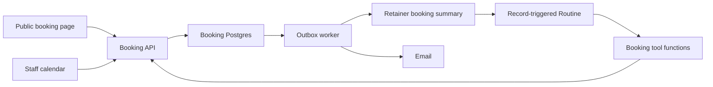

# Booking extension

Status: proposal. This spec defines one general-purpose Booking extension for
Retainer. V1 covers staff scheduling and public self-booking. V2 expands the
same booking model and adds integrations.
Implementation plan: [booking-implementation.md](booking-implementation.md).

## 1. Architecture

Booking is a first-party [standalone extension](../standalone-apps.md) with
its own web app, API, Postgres database and background worker. It owns booking
types, availability rules, reservations, and the public and staff experiences.
Retainer owns People and CRM records. Booking writes a summary through the
reviewed installation grant so Retainer users can see bookings on contact
records and Routines can react to them.

Staff never sign in to Booking separately. Installing Booking adds a
Bookings link to Retainer's sidebar, and opening it signs the person in to
Booking with their Retainer account. Guests use Booking's public pages and
never need an account.

The booking database is authoritative for times, assignments and status.
Staff and guests use the same reservation commands. In Retainer the summary
is read-only, apart from its Person link. Retainer's views can display it,
but a person cannot edit or drag its times there. A staff link opens the live
booking for changes. This keeps a CRM edit from silently diverging from the
reservation (section 5).

This spec uses Booking-owned resource schedules. A shared Calendar primitive
can be introduced independently. Booking writes to Retainer through the
standalone REST grant, using `@retainer/sdk`. [Routines](routines.md) react to
the summary through `record` triggers. Booking's release also includes small
hosted [tool functions](extensions-tools.md) that call Booking's API
([extensions.md](extensions.md) §8), so Routines can find slots, book, move and
cancel (section 4). Like the
other first-party extensions, Booking lives in this repository as an MIT
package, `packages/booking`. Its service depends only on `@retainer/sdk`
and `@retainer/shared`. The five tool functions are thin HTTP calls compiled
into `packages/runner` with the other first-party functions, because hosted
functions run only from the reviewed runner build. Both sides import one
request and response contract from `@retainer/shared`, so they cannot drift.
None of it imports server code.

## 2. V1 experience

| Surface | Must-have behavior |
| --- | --- |
| Workspace setup | A Retainer admin connects the workspace, sets a time zone, creates resources, and defines when they can be booked. The owner can preview and publish each booking type or pause new public bookings. |
| Staff calendar | Day and week views with resource and booking-type filters. Staff can see hours and blocks, find a slot, book for a guest, reschedule or cancel, and view the booking's history. |
| Public booking page | One shareable URL per published booking type, such as `/book/acme/intro-call`. Show the duration, time zone and available starts. Collect name and email. Confirm immediately if all required resources are still available. Offer refreshed alternatives on conflict. |
| Guest confirmation and management | Show confirmation after commit and email the time and a private link. From that link a guest can view, move or cancel their booking within policy. Staff can manage it separately. Guests can book without Retainer accounts. |
| Retainer contact record | Show the booking summary and a link to open it in Booking. A Retainer user links the summary to a Person, or corrects or clears that link, on the summary itself. Unlinked bookings stay visible in both apps. |
| Delivery and sync status | Staff can see confirmation emails and CRM writes that need attention and retry a failed delivery. |

Each workspace can publish several links. Booking types can share resources.
A 30-minute intro call can use any one eligible host. A room hire can book a
room on its own. A dental visit can claim a dentist and chair together. A
second public page for the same chair cannot sell an overlapping slot.

## 3. V1 model and rules

| Entity | Minimum contract |
| --- | --- |
| Booking workspace | Stable internal ID, public slug, IANA time zone, staff membership, and one binding to an approved Retainer workspace and installation. |
| Resource | A host, room, or asset, with a stable ID and independent occupancy. A host may have a staff account. A physical resource can be booked without a host. |
| Resource schedule | Weekly working windows, dated replacements or closures, and manual blocks. V1 uses the workspace time zone for all resource schedules. |
| Booking type | Stable ID and public slug, title, fixed duration, slot interval, and a list of requirements. Each requirement has a stable role ID and names a resource or an eligible pool. V1 allows one or two. A type also sets buffers, minimum notice, booking horizon and guest change cutoff. |
| Booking | Stable ID, monotonic version, confirmed, cancelled or deleted state, guest contact details, scheduled interval, its allocation, and policy snapshot. |
| Allocation | Stable ID and the claims that hold capacity for one scheduled interval. Only the allocation's owner releases or replaces its claims. In V1 the owner is always its booking, and each booking has exactly one allocation. |
| Resource claim | Belongs to an allocation. Records the role ID it fills, the resource, and the occupied interval including buffers. Exclusive across all booking types in the workspace. |
| Booking event | One row per mutation, written in its transaction: event ID, booking ID, version, time, kind (`booked`, `moved`, `cancelled`, `deleted`), actor (`staff`, `guest`, `retainer` or `system`, with an ID), reason, and the interval and resource IDs after the change. A `retainer` actor's ID is the tool call ID. A `deleted` event holds no contact details. Staff history and the outbox read it, and the previous values come from the event before. |

The allocation keeps capacity separate from the guest's booking. A V2 group
session shares one allocation across many bookings, and a V2 hold owns an
allocation until checkout converts it, without releasing its claims. Role IDs
keep each assignment tied to its requirement when V2 adds larger role
combinations or per-segment claims.

- A dated replacement takes precedence over weekly hours. A closure or
  manual block removes capacity. A candidate fits only when each required
  resource is working and free for its own occupied interval. When several
  assignments fit, prefer the configured resource order and use a stable
  tie-breaker. The requirements must resolve to distinct resources.
- Store instants in UTC. Generate slots in the workspace zone and show the
  displayed time zone on every guest screen and email. V1 skips ambiguous
  or nonexistent local start times at daylight-saving transitions.
- Public availability enforces minimum notice and the booking horizon.
  Guest moves and cancellations enforce the cutoff on the current booking.
  Snapshot the guest change policy and duration when the booking is made. A
  move keeps the duration and checks current hours, resource eligibility,
  buffers, and availability.
- Staff can book or move outside notice and horizon with an audit reason.
  All channels enforce working hours and hard capacity. Staff can edit
  schedules explicitly when the clinic or business changes its hours.
  Show existing bookings affected by closure or schedule edits. Preserve
  those bookings and let staff move or cancel them. The change blocks
  conflicting new reservations from its commit onward.
- Pausing a type closes its public page to new bookings. Existing guest
  links keep view and cancellation access. A guest can reschedule only
  when the type accepts bookings, with staff handling exceptions.
- V1 books at form submission. The selected slot is a candidate while the
  guest enters their details. Expiring holds arrive in V2 for flows such as
  payment or longer intake.

## 4. V1 API and consistency

The app exposes the same domain operations to the staff and public surfaces,
with authorization and response fields appropriate to each caller.

| Operation | Behavior |
| --- | --- |
| `findSlots` | Given the booking type and a bounded date range, return start times and the display zone. The public response carries candidate times and public labels. |
| `book` | Accept a start, guest details and a request key. Re-evaluate policy under the current configuration and select eligible resource assignments. Confirm all claims together. Return the saved booking or a conflict that lets the caller refresh availability. |
| `moveBooking` | Accept a booking ID, expected version, new start and request key. Replace old claims and advance the version in one transaction. On conflict, retain the original booking. |
| `cancelBooking` | Accept a booking ID, expected version and request key. Release its claims and write the cancellation once. A retry with the same key returns the prior result. |
| `getBooking` | Return the live booking. Guest access is scoped to one booking. Staff access is scoped to their Booking workspace. |
| `deleteBooking` | Staff only. Accept a booking ID, expected version and request key. Release its claims, cancel pending guest notices, erase guest details and write a `deleted` event. |

Retainer callers reach the same operations through five tools in Booking's
release. Each is a hosted function that calls Booking's API with the address
and key in the installation's generated secret. The `booking_` prefix keeps the
names unique in a workspace, where two tools with one name are both
unavailable.

| Tool | Effect | Calls |
| --- | --- | --- |
| `booking_find_slots` | `read` | `findSlots` |
| `booking_get` | `read` | `getBooking` |
| `booking_create` | `send` | `book` |
| `booking_move` | `send` | `moveBooking` |
| `booking_cancel` | `send` | `cancelBooking` |

The three changing tools are `send` because they act outside Retainer: they
change Booking and email the guest. The tool call ID becomes the request key,
so a retried call returns the first result. It is also the ID of the
`retainer` actor Booking records; Retainer's run log names the Routine behind
it. A Routine reads the live booking and its version with `booking_get`, then
passes that version to `booking_move` or `booking_cancel`. Change results
return the new version, and a stale version returns the current booking. Tool
calls follow the guest policy (notice, horizon and change cutoff), because no
staff member is present to give an audit reason. While the binding is
disconnected, Booking refuses tool calls with `booking_not_connected`. It
treats any `401` from Retainer as a disconnect, so a reconnect whose
callback was lost stops tool calls until the reconnect completes.

Booking mutations and configuration edits share one lock order:

1. Guard the booking type and its eligibility configuration.
2. Lock the selected resources in ID order, including the old ones on a move.
3. Recheck hours, blocks and claims under those locks. If the selection no
   longer fits, retry selection in a fresh transaction.

Schedule and block edits take the same resource locks. Type and eligibility
edits take the same configuration lock. Postgres enforces exclusive time
claims with half-open ranges and an overlap constraint keyed by workspace
and resource. That constraint is the final guard, including for overlapping
candidates with different start times. Cancelled claims leave the active
set, and a move replaces claims inside its transaction.

Scope request keys to workspace, authorized caller or public session, and
operation. Store the request digest and a reference to the result (booking
ID, version and outcome) with the transaction. A replay renders the response
from the current booking, so a deleted booking replays as deleted and no
stored result keeps guest details.
Reject same-key requests with a different payload. An authorized retry with
the same key receives the durable result. Stale edit versions return the
current authorized state for refresh rather than overwriting someone else's
change.

Each successful mutation writes its booking event and outbox work in the
same transaction. A confirmation email or CRM outage can delay those
effects while Booking continues to treat the reservation as confirmed.

- **Guest notices.** Key each notice by event ID and notice type. A move
  replaces a pending notice about the old time. A cancellation replaces any
  pending confirmation or move notice. A deletion cancels every pending
  notice. Nothing else cancels guest mail.
  Booking sends guest email through Resend from our domain, with the
  business's address as reply-to. Each send passes the notice key as
  Resend's idempotency key, so a retry after an unclear outcome sends
  nothing twice.
- **CRM summary.** Keep at most one CRM job per booking. Each run writes
  the booking's current state, so queued changes coalesce:
  1. Read the summary's `updatedAt` from Retainer first, then the booking's
     current snapshot. Reading in this order keeps an older snapshot from
     landing after a newer one.
  2. If no summary exists, create it. The create is create-only, and the
     unique `bookingId` refuses a second record. After a refused or
     unanswered create, start again from step 1.
  3. Otherwise upsert by `bookingId` with `expectedUpdatedAt` from step 1.
     Retainer checks it under the record lock, so a delayed older request
     is refused with `412 stale_write`. On a `412`, repeat both reads.
  4. Send the tool call ID behind each event the write covers as
     `Retainer-Caused-By`, so a Routine cannot trigger itself through
     Booking.
  5. Mark outbox items done only up to the booking version actually
     written.

  A `deleted` event soft-deletes the summary through the same job. If an
  earlier create's outcome is unknown, the job concludes there is no summary
  only after that request's deadline has passed, so a late create cannot
  outlive the delete. `expectedUpdatedAt` needs Retainer to expose
  `updatedAt` at full database precision, so two changes in one millisecond
  differ.
- Surface delivery failures to staff.

## 5. V1 access, installation and CRM

- **Staff identity.** Staff sign in through Retainer from the sidebar link
  ([extensions.md](extensions.md) §8). Booking takes roles from the
  Retainer role in the ID token: admins are owners, who manage
  configuration and the Retainer connection; editors are schedulers, who
  manage bookings; viewers can look but change nothing. The command layer
  enforces the role, not just the screens. Booking keeps no staff list or passwords of its own.
  The installation credential stays a server credential and is never tied
  to a person. Bootstrap: a Retainer admin approves the installation, opens
  Booking from the sidebar, and completes the connection consent, using
  OAuth state and PKCE. Booking needs Retainer's accounts mode.
- **Binding.** A binding is unique per Retainer origin, workspace and
  installation. Retainer revokes the previous credential when an admin
  consents again, before Booking sees the callback. So a repeat consent for
  an installation that is already bound stores the new credential on the
  existing binding. The owner who started it is told only that the
  installation is connected to another Booking workspace, without naming
  it. A lost callback leaves the binding disconnected, and repeating
  consent from the bound Booking workspace restores it. Connecting a different Retainer workspace requires a new Booking
  workspace.
- **Tool key.** When the connection completes, Booking generates a random
  tool key and saves its hash as pending. It then writes its API address and
  the key, as one value, to the installation's generated secret setting
  with its new credential. The tool functions send the key with each call.
  Booking runs one rotation at a time. After a failed or unanswered write,
  it rotates again with a fresh key, using the revision Retainer's `409`
  reports. A reconnect also rotates, with no grace period for the old key,
  so tool calls fail briefly. The tools are unavailable until the secret
  exists and the credential is live. The admin never sees or copies
  anything.
- **Guest access.** Public routes expose published settings and available
  times. Verify a staff session or a booking-scoped capability on every
  management request. Guest links use high-entropy, revocable tokens, stored
  as hashes, with an expiry and rotation when reissued. A browser exchanges
  its link for a booking-scoped session. Keep tokens out of logs, referrers
  and CRM fields. Rate-limit public searches, booking submissions and link
  redemption. Guests can view their own booking and submit changes through
  that capability.
- **CRM summary.** Booking's release contributes one Booking object through
  the schema engine, with permanent universal IDs for the object and its
  fields. It does not map onto a workspace's own objects. Writes use the
  installation's `integration` actor and ordinary field assertions. The
  `person` relation needs the workspace's Person object, so installing
  Booking requires it. A workspace started from scratch has none, and the
  install preview names it as missing.

  | Field | Type | Written by | Note |
  | --- | --- | --- | --- |
  | `bookingId` | text, unique | Booking | Create and upsert key |
  | `bookingTypeId` | text | Booking | Stable type ID |
  | `title` | text | Booking | Type title and guest name |
  | `guestEmail` | text | Booking | Lets a person find the right Person |
  | `startsAt` | date_time | Booking | |
  | `endsAt` | date_time | Booking | |
  | `status` | text | Booking | `confirmed` or `cancelled` in V1 |
  | `person` | relation → person | People | Optional |
  | `manageUrl` | links | Booking | Requires staff sign-in |

  `status` is text with documented values, not a select, because select
  options on a contributed field are structural and hard to extend later.
  Attendance and resource labels wait for the features that need them.
- **Installation-owned fields (platform change).** A contributed field can
  declare that only its installation writes it. The API refuses other
  writers, and the field is presented read-only, which already turns off
  editing and calendar drag in the web app. Without this, one person's edit
  outranks every later Booking write (write rule 2) and Routines act on the
  wrong time. All Booking fields above are installation-owned except
  `person`. Only the owning installation may merge or delete a record whose
  unique field is installation-owned. A merge could otherwise make two
  bookings resolve to one summary, and a person's delete would strand the
  projection. Admin `forget` still works. This amends `ARCHITECTURE.md` and
  `extensions.md` when built.
- **Person link.** Booking never writes `person` and stores no Person ID.
  A Retainer user links, corrects or clears it on the summary. Booking does
  not link by email, because a guest can type anyone's address. This
  includes bookings a Routine makes. Linking those automatically is a later,
  Retainer-side design (section 6).
- **Visibility and lifecycle.** The summary holds only the fields above.
  Other guest details stay in Booking. Staff delete a booking with
  `deleteBooking`. Its `deleted` event soft-deletes the summary through the
  CRM job, after any write still in flight, and stays pending while
  disconnected. Hard erasure in Retainer is an admin running `forget`. On
  credential revocation, halt CRM work, flag the disconnect, and keep
  existing bookings manageable in Booking. The Booking owner can pause
  public links separately. Resume projection only after a verified
  reconnection to the same binding.
- **Routines.** V1 Routines can create prep or follow-up tasks from summary
  changes. They see the summary's current state and can miss steps in
  between, such as a booking confirmed and cancelled during a CRM outage. A
  prep Routine should check `status = confirmed` and handle a Person link
  added later. Required confirmations and transactional notices run from
  the Booking outbox. Booking correctness and guest confirmation are
  independent of Routine timing.

Booking depends on these platform changes, none of them built yet:

1. Standalone releases with hosted functions, which follow the hosted
   runtime rules ([extensions.md](extensions.md) §8).
2. A standalone credential that writes its own installation's generated
   secrets, with the current revision on `409` (§8).
3. `Retainer-Caused-By` naming tool calls of the same installation (§9.4).
4. Installation-owned fields, with owner-only merge and delete for records
   whose unique field is one of them.
5. Sidebar links and sign-in to standalone apps through Retainer (§8),
   which skips the consent page only for the installation's own client.
6. `updatedAt` exposed at full database precision, so `expectedUpdatedAt`
   tells apart two changes in one millisecond.

The hosted server must also accept the `tool` kind before Booking's bundle
enters the catalog ([extension tools](extensions-tools.md) §7).

Ship the pilot with a Booking service, its Postgres store, a worker, Resend
email and a registered standalone installation. On the hosted service,
Booking runs next to Retainer on AWS, with the same deploy pattern in the
private `retainer-cloud` repo. It gets its own database on the existing
Postgres server, with its own login role and migrations. A separate
database adds no server cost, keeps Booking from reading Retainer's tables,
and can move to its own server later. Keep migrations, backups and recovery
under Booking's operational ownership. A self-hosted Retainer connects a
separately running Booking app, with its own Compose file, through the
applicable standalone credential path. On Compose, a private Booking address must be
listed in `RETAINER_EXECUTION_API_ORIGINS` so the tool functions can reach
it. The pilot does not require a Booking container
in Retainer's base Compose deployment.

## 6. V2 additions

V2 features build on the booking IDs, allocations, requirement roles, the
booking event log and domain commands from V1. The first additions can ship
independently. Add the checkout flow only after the hold and expiry behavior
has been verified.

| Area | Extensions to V1 |
| --- | --- |
| Holds and approval | Add a short, bounded hold with expiry. A hold owns an allocation and converts it to a booking once, without releasing its claims. Holds take the same resource locks as bookings. Expire conflicting holds under those locks before admission. Add staff approval with an explicit capacity policy for pending requests. |
| Payments | Accept deposits, full payment, or package entitlements during a hold. Verify provider callbacks, deduplicate effects, and reconcile late payments, cancellations and refunds. A late callback cannot reclaim an expired slot. |
| Availability and assignment | Add resource-specific time zones, fair or weighted host routing, larger role combinations, and multi-day bookings. An external calendar connector can supply busy-only intervals with freshness. Treat a slot as unknown when a required source is stale. Suppress unknown slots on public pages and show the cause to staff. |
| Calendar sync and shared Calendar | Add Google or Outlook invite delivery and reconciliation, with a policy for external edits. When a shared Calendar contract exists, publish Booking entries and consume authorized availability from other sources. Keep the final capacity check in Booking. |
| Complex bookings | Add group sessions, where many bookings share one allocation with a seat limit counted inside the session. Add recurring series with explicit partial or all-or-none booking, and multi-service visits with claims per segment, each tied to its role. |
| Waitlists and disruptions | Match people by preferences, expiry and priority. Start with a staff shortlist, then add expiring offers and automatic backfill. Claim a freed slot through the regular booking command. |
| Guest and staff surfaces | Show Booking's staff pages inside Retainer's own page, reusing the V1 sign-in. Send guest email from the business's own domain or Gmail. Add an optional workspace directory, embeds, branding, locale and custom domains. Add configurable intake, guest verification and matching, attendance, branch roles, check-in or pickup, and utilization reporting. |
| Communications | Add durable appointment-relative reminders, two-way confirmation and more messaging channels. Moves and cancellations invalidate obsolete reminders through the same event-keyed notices. |
| Agent and extension interoperability | Agents call the V1 tools once Retainer offers extension tools to agents. Link Routine-made bookings to their Person automatically, designed on the Retainer side around the summary. Add staff-level tools only with an explicit policy for who may override notice and cutoff. Expose lifecycle events from the booking event log when consumers need every transition rather than the summary's current state. Payment, calendar and door-access partners can use Booking's API and signed webhooks. |

## 7. Acceptance criteria

Run concurrency and persistence tests against real Postgres and exercise the
staff, guest and CRM paths end to end.

- A workspace can publish two booking types on distinct URLs that share a
  resource. Both show their own rules. A booking through either removes
  the overlapping time from both. Validate a host-only call, room-only hire
  and two-resource appointment.
- Competing staff and guest requests with different start times cannot
  overlap on one resource. If a two-resource operation fails, it leaves
  neither claim behind. A failed move keeps both original claims. Schedule
  edits and booking commits cannot race past a newly committed block.
- Replays after a response is lost return the original result. Stale moves
  and cancellation edits are rejected. Date overrides and daylight-saving
  boundaries produce the documented availability.
- A guest can book, receive confirmation, move and cancel without a
  Retainer account. Another workspace, another guest, and an expired
  capability cannot read or change that booking. Public responses contain
  no private schedule details or Retainer credentials.
- A CRM outage after booking preserves the reservation. Recovery writes
  one current summary. An older CRM write delayed past a newer one is
  refused. A Person link set in Retainer survives later Booking writes.
  A person cannot edit or drag Booking-owned fields. Deleting a booking
  with a CRM write in flight leaves the summary deleted. Revoking the
  grant stops CRM effects, and staff can still manage the booking.
- Booking installs and a Routine calls its tools on both Compose and
  hosted. A Routine can find slots, read, book, move and cancel. A retried
  tool call returns the first result and books nothing twice. A stale
  version returns the current booking. A call with a wrong or replaced key,
  or past the guest cutoff, is refused. The tools are unavailable before
  the key is written and after the credential is revoked.
- A workspace member opens Bookings from Retainer's sidebar and is signed
  in without a password: an admin as owner, an editor as scheduler and a
  viewer read-only. A viewer's direct change request is refused. A person
  outside the workspace is refused. Another OAuth client that names the
  installation gets no ID token without consent. A removed member loses
  access within 12 hours.
- Installing Booking in a workspace without a Person object fails in the
  preview with a clear message. Acceptance runs from a workspace started
  from scratch with the Person object added.
- After `deleteBooking`, no stored request result or outbox item holds the
  guest's details. A delete that starts while a first create is unanswered
  leaves no summary once that create lands. Two summary writes in one
  millisecond do not both pass `expectedUpdatedAt`. A `401` from Retainer
  stops tool calls until the reconnect completes.
- A Routine that books when a booking is created does not trigger itself.
  A CRM write delayed behind a newer one, or a create retried after a lost
  response, leaves one current summary. A person cannot merge or delete a
  summary. Deleting a booking soft-deletes its summary and sends no guest
  mail. Staff history shows the times before and after each move.
- V2 additions extend these tests with hold expiration and late checkout,
  duplicate provider callbacks, concurrent last-seat claims, external
  calendar staleness, and reminder cancellation or rescheduling.

Background research: [booking feature inventory and precedents](../research/clinic-booking-features.md)
and [RapidOne feature mapping](../research/rapid-image-features.md).
