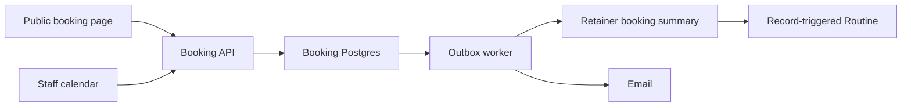

# Booking extension

Status: proposal. This spec defines one general-purpose Booking extension for
Retainer. V1 covers staff scheduling and public self-booking. V2 expands the
same booking model and adds integrations.

## 1. Architecture

Booking is a first-party [standalone extension](../standalone-apps.md) with
its own web app, API, Postgres database and background worker. It owns booking
types, availability rules, reservations, and the public and staff experiences.
Retainer owns People and CRM records. Booking writes a summary through the
reviewed installation grant so Retainer users can see bookings on contact
records and Routines can react to them.

The booking database is authoritative for times, assignments and status.
Staff and guests use the same reservation commands. Retainer's generic
Calendar view can display the summary. Dragging a summary in that view
changes a CRM field and has no effect on the reservation. Surface a staff
link to open the live booking, and label its CRM fields as a summary.

This spec uses Booking-owned resource schedules. A shared Calendar primitive
can be introduced independently. The same applies to standalone extension
commands and events. V1 uses the existing Retainer extension and Routine
contracts. [Extension tools](extensions-tools.md), [Routines](routines.md)

## 2. V1 experience

| Surface | Must-have behavior |
| --- | --- |
| Workspace setup | An owner connects the Retainer workspace, sets a time zone, invites schedulers, creates resources, and defines when they can be booked. The owner can preview and publish each booking type or pause new public bookings. |
| Staff calendar | Day and week views with resource and booking-type filters. Staff can see hours and blocks, find a slot, book for a guest, reschedule or cancel, and view the booking's history. |
| Public booking page | One shareable URL per published booking type, such as `/book/acme/intro-call`. Show the duration, time zone and available starts. Collect name and email. Confirm immediately if all required resources are still available. Offer refreshed alternatives on conflict. |
| Guest confirmation and management | Show confirmation after commit and email the time and a private link. From that link a guest can view, move or cancel their booking within policy. Staff can manage it separately. Guests can book without Retainer accounts. |
| Retainer contact record | Show the booking summary and a link to open it in Booking. Staff can link a guest to a Person. Unmatched bookings remain visible to staff in Booking and can be linked later. |
| Delivery and sync status | Staff can see confirmation emails and CRM writes that need attention and retry a failed delivery. |

Each workspace can publish several links. Booking types can share resources.
A 30-minute intro call can use any one eligible host. A room hire can book a
room on its own. A dental visit can claim a dentist and chair together. A
second public page for the same chair cannot sell an overlapping slot.

## 3. V1 model and rules

| Entity | Minimum contract |
| --- | --- |
| Booking workspace | Stable internal ID, public slug, IANA time zone, staff membership, and one binding to an approved Retainer workspace and installation. |
| Resource | A host, room, or asset, with a stable ID and independent occupancy. A host may have a staff account. A physical resource can be booked without a host. |
| Resource schedule | Weekly working windows, dated replacements or closures, and manual blocks. V1 uses the workspace time zone for all resource schedules. |
| Booking type | Stable ID and public slug, title, fixed duration, slot interval, one required resource and an optional second. Each requirement names a resource or an eligible pool. A type also sets buffers, minimum notice, booking horizon and guest change cutoff. |
| Booking | Stable ID, monotonic version, confirmed or cancelled state, guest contact details, optional Retainer Person ID, scheduled interval, committed assignments, and policy snapshot. Audit entries record who changed what and when. |
| Resource claim | The occupied interval for one resource, including its buffers. Enforce exclusivity across all booking types in the workspace. |

- A dated replacement takes precedence over weekly hours. A closure or
  manual block removes capacity. A candidate fits only when each required
  resource is working and free for its own occupied interval. When several
  assignments fit, prefer the configured resource order and use a stable
  tie-breaker. The two requirements must resolve to distinct resources.
- Store instants in UTC. Generate slots in the workspace zone and show the
  displayed time zone on every guest screen and email. V1 skips ambiguous
  or nonexistent local start times at daylight-saving transitions.
- Public availability enforces minimum notice and the booking horizon.
  Guest moves and cancellations enforce the cutoff on the current booking.
  Snapshot the guest change policy and duration when the booking is made. A
  move keeps the duration and checks current hours, resource eligibility,
  buffers, and availability.
- Staff can book or move outside notice and horizon with an audit reason.
  All channels enforce working hours and hard capacity. Staff can edit
  schedules explicitly when the clinic or business changes its hours.
  Show existing bookings affected by closure or schedule edits. Preserve
  those bookings and let staff move or cancel them. The change blocks
  conflicting new reservations from its commit onward.
- Pausing a type closes its public page to new bookings. Existing guest
  links keep view and cancellation access. A guest can reschedule only
  when the type accepts bookings, with staff handling exceptions.
- V1 books at form submission. The selected slot is a candidate while the
  guest enters their details. Expiring holds arrive in V2 for flows such as
  payment or longer intake.

## 4. V1 API and consistency

The app exposes the same domain operations to the staff and public surfaces,
with authorization and response fields appropriate to each caller.

| Operation | Behavior |
| --- | --- |
| `findSlots` | Given the booking type and a bounded date range, return start times and the display zone. The public response carries candidate times and public labels. |
| `book` | Accept a start, guest details and a request key. Re-evaluate policy under the current configuration and select eligible resource assignments. Confirm all claims together. Return the saved booking or a conflict that lets the caller refresh availability. |
| `moveBooking` | Accept a booking ID, expected version, new start and request key. Replace old claims and advance the version in one transaction. On conflict, retain the original booking. |
| `cancelBooking` | Accept a booking ID, expected version and request key. Release its claims and write the cancellation once. A retry with the same key returns the prior result. |
| `getBooking` | Return the live booking. Guest access is scoped to one booking. Staff access is scoped to their Booking workspace. |

Booking and scheduling configuration changes must use a common locking or
version-check protocol so a selection cannot commit under stale rules.
Acquire resource locks in a stable order when several are needed. Enforce
exclusive time claims in Postgres with half-open ranges and an overlap
constraint keyed by workspace and resource. Remove cancelled claims from
the active set. Move operations replace claims inside the transaction.
The constraint applies even when overlapping candidates have different
start times.

Scope request keys to workspace, authorized caller or public session, and
operation. Store the request digest and final result with the transaction.
Reject same-key requests with a different payload. An authorized retry with
the same key receives the durable result. Stale edit versions return the
current authorized state for refresh rather than overwriting someone else's
change.

Commit a lifecycle event and outbox work with each successful mutation.
A confirmation email or CRM outage can delay those effects while Booking
continues to treat the reservation as confirmed. Workers retry and
reconcile using stable operation IDs. Deliver CRM updates in version order
per booking, and skip older summaries when a newer version supersedes
them. Send notifications for the current version and handle ambiguous
provider outcomes idempotently where the provider supports it. Surface
delivery failures to staff.

## 5. V1 access, installation and CRM

- **Staff identity.** Booking authenticates staff to its own workspace.
  Booking owners manage configuration, staff grants and the Retainer
  connection. Schedulers manage bookings. The Retainer installation token
  is a server credential, and Booking staff authority comes from app
  membership. Bootstrap requires a signed-in Booking owner to complete
  Retainer's existing workspace-admin consent. Bind the returned workspace
  and installation to the initiating Booking workspace using OAuth state
  and the authenticated connection. Reconnect may replace credentials for
  the established binding. Connecting a different Retainer workspace
  requires a new Booking workspace or explicit migration.
- **Guest access.** Public routes expose published settings and available
  times. Verify a staff session or a booking-scoped capability on every
  management request. Guest links use high-entropy, revocable tokens, stored
  as hashes, with an expiry and rotation when reissued. A browser exchanges
  its link for a booking-scoped session. Keep tokens out of logs, referrers
  and CRM fields. Rate-limit public searches, booking submissions and link
  redemption. Guests can view their own booking and submit changes through
  that capability.
- **CRM summary.** Use the schema engine and reviewed installation to
  contribute a Booking object or map to a compatible Appointment object.
  Upsert the summary by a unique booking ID so replay cannot create a
  second CRM record. Include times, lifecycle status, type, approved labels,
  an optional Person relation, and a staff manage link
  that requires sign-in. Use usual field assertions and the installation's
  actor for CRM writes. Staff select an existing Person only when authorized
  to use the CRM connection. V1 leaves public bookings unmatched until
  staff confirm a link. Guest email entry alone cannot link a booking to
  someone else's CRM record.
- **Visibility and lifecycle.** Project only fields suitable for the
  workspace-wide audience of the reviewed grant. Keep private guest data
  in Booking and give staff export and erasure controls there. Staff
  deletion workflows must coordinate removal or anonymization of linked
  summaries and queued copies. On credential revocation, halt CRM work,
  flag the disconnect, and keep existing bookings manageable in Booking.
  The Booking owner can pause public links separately. Resume projection
  only after a verified reconnection to the same workspace.
- **Routines.** V1 Routines can create prep or follow-up tasks from projected
  record changes. Required confirmations and transactional notices run from
  the Booking outbox. Booking correctness and guest confirmation are
  independent of Routine timing.

Ship the pilot with a Booking service, its Postgres store, a worker, email
delivery and a registered standalone installation. Keep database migrations,
backups and recovery under Booking's operational ownership. A self-hosted
Retainer connects a separately running Booking app through the applicable
standalone credential path. The pilot does not require a Booking container
in Retainer's base Compose deployment.

## 6. V2 additions

V2 features build on the booking IDs, resource scopes and domain commands
from V1. The first additions can ship independently. Add the checkout flow
only after the hold and expiry behavior has been verified.

| Area | Extensions to V1 |
| --- | --- |
| Holds and approval | Add a short, bounded hold with expiry and one-time conversion to a booking. Apply the same resource locks to holds and bookings. Expire conflicting holds under those locks before admission. Add staff approval with an explicit capacity policy for pending requests. |
| Payments | Accept deposits, full payment, or package entitlements during a hold. Verify provider callbacks, deduplicate effects, and reconcile late payments, cancellations and refunds. A late callback cannot reclaim an expired slot. |
| Availability and assignment | Add resource-specific time zones, fair or weighted host routing, larger role combinations, and multi-day bookings. An external calendar connector can supply busy-only intervals with freshness. Treat a slot as unknown when a required source is stale. Suppress unknown slots on public pages and show the cause to staff. |
| Calendar sync and shared Calendar | Add Google or Outlook invite delivery and reconciliation, with a policy for external edits. When a shared Calendar contract exists, publish Booking entries and consume authorized availability from other sources. Keep the final capacity check in Booking. |
| Complex bookings | Add group sessions with concurrent seat limits, recurring series with explicit partial or all-or-none booking, and multi-service visits with resource claims per segment. |
| Waitlists and disruptions | Match people by preferences, expiry and priority. Start with a staff shortlist, then add expiring offers and automatic backfill. Claim a freed slot through the regular booking command. |
| Guest and staff surfaces | Add an optional workspace directory, embeds, branding, locale and custom domains. Add configurable intake, guest verification and matching, branch roles, check-in or pickup, and utilization reporting. |
| Communications | Add durable appointment-relative reminders, two-way confirmation and more messaging channels. Rescheduling and cancellation invalidate obsolete reminders. |
| Agent and extension interoperability | Expose scoped typed commands and lifecycle events with the appropriate authorization and caller attribution. A reusable bridge for standalone extension tools would let a Retainer agent or Routine call these commands. Direct event subscriptions can follow when consumers need better guarantees than CRM projection provides. Payment, calendar and door-access partners can use Booking's API and signed webhooks. |

## 7. Acceptance criteria

Run concurrency and persistence tests against real Postgres and exercise the
staff, guest and CRM paths end to end.

- A workspace can publish two booking types on distinct URLs that share a
  resource. Both show their own rules. A booking through either removes
  the overlapping time from both. Validate a host-only call, room-only hire
  and two-resource appointment.
- Competing staff and guest requests with different start times cannot
  overlap on one resource. If a two-resource operation fails, it leaves
  neither claim behind. A failed move keeps both original claims. Schedule
  edits and booking commits cannot race past a newly committed block.
- Replays after a response is lost return the original result. Stale moves
  and cancellation edits are rejected. Date overrides and daylight-saving
  boundaries produce the documented availability.
- A guest can book, receive confirmation, move and cancel without a
  Retainer account. Another workspace, another guest, and an expired
  capability cannot read or change that booking. Public responses contain
  no private schedule details or Retainer credentials.
- A CRM outage after booking preserves the reservation. Recovery writes
  one current summary with the correct Person link if one exists.
  Revoking the grant stops CRM effects. Staff can still manage the booking.
- V2 additions extend these tests with hold expiration and late checkout,
  duplicate provider callbacks, concurrent last-seat claims, external
  calendar staleness, and reminder cancellation or rescheduling.

Background research: [booking feature inventory and precedents](../research/clinic-booking-features.md)
and [RapidOne feature mapping](../research/rapid-image-features.md).
