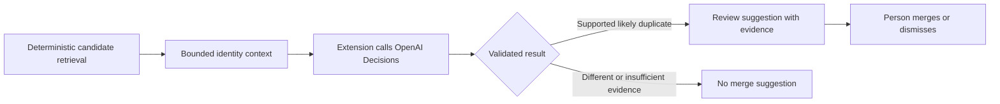

# Duplicate record classification

Status: proposed, 2026-11-16. OpenAI Decisions API selected; the spike below
must finish before production implementation. This document specifies the
upgrade, not a completed spike, measured result or deployed feature.

## 1. Start with an API spike

Build a small, repeatable local harness that calls OpenAI directly with
synthetic record pairs. Do this before extending the model proxy, changing
the database or building the extension. Use an existing operator-supplied
OpenAI credential; never commit credentials or create one automatically.
Keep the spike separate from production workers and CRM writes.

The spike must answer:

- Does our account have access to `POST /v1/decisions` and the documented
  `gpt-6-luna` model? Record the actual request and response shapes, SDK
  support, question names, probabilities, confidence and refusals.
- Can one request judge identity and independently assess evidence? Compare
  a single identity question with identity plus narrowly scoped evidence
  questions. Questions in one request do not consume each other's answers.
- Can we produce a useful, evidence-backed explanation using typed answers
  and templates, without a second text-generation call?
- How much do provenance, historical identity facts and relationships help
  compared with fields alone? Run these as separate context variants.
- How stable are results when the pair order changes or the request repeats?
  Exercise missing fields, conflicting sources, long/truncated context and
  instructions embedded in record text. Record contradictory answer patterns.
- What are measured p50/p95 latency, input usage and cost per evaluated pair?
  Check multiple questions' billing, caching eligibility and actual cache hits;
  do not assume that adding questions or repeated context is free.
- How are timeouts, rate limits, provider errors, refusals and invalid responses
  handled? Simulate failures at the HTTP boundary; report which happened live.

Use at least 50 labeled duplicate pairs and 150 labeled nonduplicate pairs,
including the Fijoya/Wiz pattern: distinct websites and distinct full LinkedIn
company URLs, with only `linkedin.com` in common. Include aliases, Hebrew and
English names, transliteration, rebrands, subsidiaries, acquisitions, shared
offices/phones, common names, stale enrichment and sparse records. Reserve a
held-out portion before prompt tuning. Synthetic cases establish feasibility,
not accuracy on Team8's real data. Any later real-data evaluation is a bounded,
read-only export with workspace authorization and no fixture commit.

Deliver the harness, sanitized fixtures, versioned questions, raw typed results
for synthetic cases, a short report and the chosen production configuration.
Report precision, recall, abstention, explanation correctness, order sensitivity
and performance by case type. Count an unsupported positive explanation as a
failure even when the overall label is right. Include both retrieval coverage
and classification quality; a classifier cannot recover pairs never retrieved.

**Exit gate:** the API works with our account; the known social-host false
positive is rejected; explanations identify verifiable evidence; and the
report selects context limits, questions, threshold, timeouts, retry limits,
run/spend budgets and model version policy. If results are inadequate, revise
this spec with findings before production work. Do not silently substitute a
different provider or a text-generation endpoint.

## 2. Problem and intended behavior

Today's consolidator directly creates merge suggestions when records of one
entity object share an email, phone or link hostname, or have sufficiently
similar names. Every `links` field contributes a domain identifier. Thus
distinct LinkedIn profile URLs can match solely on `linkedin.com`. The full
URLs are stored correctly; their displayed hostname and derived matching
identifier conceal the difference. Conflicting identity fields do not veto
the current heuristic.

Replace that direct recommendation with:

Judge whether two records represent the same real-world entity. Related
companies are not necessarily the same company; a subsidiary or acquisition
does not by itself justify merging. A shared investor, portfolio tag, meeting,
employer or social platform is not identity evidence. Missing information is
not a disagreement. Prefer abstention to speculative merge recommendations.

Only a user actor can merge. Classifications never change field values, merge
records, accept suggestions or override human decisions. Events remain outside
record deduplication. Exact duplicate-fact consolidation stays unchanged.

## 3. Retrieve candidates without recommending them

Keep retrieval deterministic, workspace-scoped and limited to live records of
the same entity object. Use normalized emails/phones, conservatively normalized
full URLs and similar names. Include useful historical identifiers where
available. Avoid all-pairs model calls and embeddings.

Stop using a shared hostname from arbitrary links as sufficient candidate
evidence. Distinct LinkedIn profile paths must remain distinct; a social site
root is not a company identity. Preserve meaningful URL paths and query values;
normalize host casing, equivalent scheme/root forms and known tracking noise
conservatively. Cover profile URLs, website roots and meaningful query-based
identities in tests. Do not change search or general lookup normalization merely
to fix merge matching: give candidate retrieval its own identity comparison.

Store the retrieval trigger separately from the eventual explanation. It is
an untrusted heuristic, not a conclusion the classifier should agree with.
Run bounded incremental scans and an initial backfill. Exhausting a batch must
not advance the cursor past unprocessed candidates.

## 4. Identity context

Build a pair context from existing retrieval components, not an unfiltered
dump of the workspace. Include the following in priority order, with stable
references to the underlying records, fields, assertions or source excerpts:

| Context | Purpose |
| --- | --- |
| Object/field definitions and both records' values | Explain the schema; retain complete URLs, identifiers and missing-value distinctions. |
| Identity-field provenance and observation dates | Distinguish human/integration values, enrichment guesses and stale identifiers; source type alone is not proof. |
| Sourced identity facts and relevant field history | Establish aliases, former names, rebrands, previous domains and explicit identity statements. |
| A bounded set of direct relationships | Corroborate identity with founders, employers, parent entities, locations or other schema-defined relations. |
| Relevant event excerpts | Supply explicit identity evidence, with dates and source links, instead of whole transcripts. |
| Shared workspace identity guidance | Explain existing record granularity and company/person conventions; never read private personal memory. |
| Existing decision on the exact pair | Respect human decisions and distinguish prior machine judgments. |

Deduplicate copied evidence and retain its common origin: five enrichments from
one source are not five independent confirmations. Shared relationships are
weak corroboration unless the evidence actually establishes identity.

Use deterministic selection and a hard input budget chosen by the spike. Keep
identity fields first, disclose omitted sections to the classifier, and return
insufficient evidence when truncation prevents a reliable judgment. Recent does
not always mean relevant. No external research or live URL fetching in v1.

## 5. Classification and explanations

Use a `choice` question with three outcomes:

- `same_entity`: sufficient evidence of the same real-world entity.
- `different_entities`: affirmative evidence of distinct entities.
- `insufficient_evidence`: identity cannot be established from the input.

Ask independent, observable evidence questions against the same context, such
as whether a profile identity matches, a sourced rebrand explains the names,
or sources explicitly describe separate entities. Exact matches and conflicts
that code can establish should be computed deterministically. For semantic
evidence, supply bounded evidence references as allowed choices, including
`none`; validate selected references and access before publication.

The application decides whether to show a suggestion using the selected
probability threshold, sufficient supporting evidence, and absence of unresolved
strong conflicts. Do not treat the API's separate `confidence` value as measured
accuracy. Calibrate the publication rule with labeled pairs. Independent answers
may disagree: inconsistent results abstain rather than publishing a rationale
that contradicts the identity decision. Refusal/error is not `different_entities`.

Render concise explanations from validated evidence and fixed templates. Show
support, meaningful conflicts and links to the full values/source excerpts in
both the review card and merge dialog. This is a checkable justification, not
a claim to reveal the model's internal reasoning. Do not publish a positive
suggestion with only a probability or a generic “similar records” explanation.

Examples (illustrative, not measured model outputs):

- “Same LinkedIn company profile and website; names differ slightly.”
- “The cited source identifies Beta as Acme's former name; website matches.”
- Internal rejection: “Different websites and LinkedIn profiles; only the social
  platform hostname matches.”

Do not add a separate prose-generation model in v1. If typed evidence cannot
support adequate explanations, the spike must report that limitation.

## 6. Runtime and deterministic core boundary

Implement the judgment in a first-party deduplication extension using existing
scheduled jobs. The extension reads authorized candidates/context and submits
typed assessments through a narrow API. Core owns candidate retrieval, access
checks, state validation, review publication and the existing merge operation;
core never calls the model. Do not grant the extension human merge authority or
reuse ordinary field assertions to store classification results.

Add OpenAI Decisions support to the extension model proxy, with a server-owned
OpenAI key and explicit provider routing. Preserve existing Anthropic calls and
credentials. Forward only the needed Decisions surface; retain model-token,
installation-generation, capability-grant and usage-attribution checks. The
key never enters extension code. Access approval must disclose that the
extension sends bounded CRM context to OpenAI. This is one OpenAI integration,
not a general model-routing framework.

Provider calls run outside database transactions and record locks. Bounded
retries apply to transient failures; refusal/invalid input requires diagnosis.
Account for every attempt's usage and uncertain charges after timeouts. Limit
work per run and spend per workspace; missing credentials, exhausted budgets
and provider outages leave work deferred, with an actionable failure state.
They never fall back to publishing heuristic-only suggestions.

## 7. Assessment lifecycle and data contracts

Maintain one canonical sorted pair per workspace, with machine assessments
separate from the human review lifecycle. Persist outcome/distribution, evidence
references, model identifier, question/context/policy versions, input digest,
evaluation time and publication state. Store usage separately using existing
attribution where possible. Avoid durable copies of entire model inputs.

The input digest covers the schema and all selected evidence, including related
records, source revisions and omission markers. Relevant changes invalidate the
assessment; changes to identity facts and relationships must trigger reassessment
even when neither record's own fields changed. A version upgrade also invalidates
machine assessments. Unchanged inputs reuse an assessment without another call.

Before publishing, core verifies current workspace/installation authority, both
records' liveness, exact input freshness and evidence access. A slow or retried
result cannot publish after a record changes, is merged/deleted, the installation
is disabled, or a person dismisses the pair. Test these races concurrently.

Human “not duplicates” remains authoritative and suppresses that pair across
model upgrades. Machine `different_entities` and abstention are reconsidered
when relevant inputs change. Distinguish explicit human dismissal from automatic
closure caused by deletion/merge. Stale pending suggestions disappear until
revalidated; their old explanations must not accompany new record values.

Expose the decision and evidence consistently in REST/SDK review responses and
the web UI. Validate evidence under current access rules on read. Source deletion,
privacy erasure and workspace deletion must remove/invalidate affected evidence,
cached assessments and explanations. Treat text inside records as data, never
as classifier instructions; omit payloads and credentials from operational logs.

## 8. Delivery and rollout

1. **Spike:** publish the report and update this spec with measured choices.
2. **Platform:** implement candidate/assessment APIs, lifecycle and OpenAI proxy
   support, schema migrations generated with `pnpm db:generate`, and the bundle.
3. **Review UX:** add sourced explanations, full identity URL visibility and
   matching API/SDK contracts. Preserve manual merge and human approval.
4. **Shadow evaluation:** run the new flow without creating visible suggestions.
   Evaluate a held-out set with at least 100 duplicates and 300 nonduplicates,
   including approved real-workspace cases. Proposed launch gate: zero published
   false positives among those negatives, at least 80% end-to-end duplicate
   coverage among those positives, and no unsupported published explanations.
   Report sample uncertainty; these results do not prove a production error rate.
5. **Team8 pilot, then broader enablement:** use explicit extension access approval.
   Reclassify legacy pending suggestions before showing them in the upgraded flow;
   preserve accepted merges and human dismissals. Report legacy pending counts,
   reclassified outcomes, deferred work and pilot feedback.

While a workspace uses the new flow, the old consolidator must stop directly
publishing merge suggestions. Workspaces without the extension retain corrected
deterministic behavior, clearly identified as heuristic suggestions. Disabling
the extension hides its pending recommendations and stops new evaluations; it
does not silently reactivate old suggestions. Manual merging remains available.

Product code, migrations, extension, API/SDK and UI changes live in Retainer.
Hosted secret wiring, model-function permissions/network configuration and deploy
operations live in `Tamloot-cc/retainer-cloud`; inspect both repos during
implementation. Self-hosting remains Docker Compose, with an optional OpenAI
credential and documented enablement. Update architecture, model-call spec,
self-hosting and API docs when the implementation lands, not as if it exists now.

## 9. Verification and deliberate deferrals

Use unit tests for URL identity, bounded context, response validation, evidence
templates and policy thresholds; real-Postgres integration tests for tenant
isolation, invalidation, lifecycle and concurrent publication/dismissal races;
HTTP tests for credential-derived actors and evidence access; web tests for
review and merge explanations. Mock OpenAI at its HTTP boundary in CI. Run
extension/model-proxy Docker tests and hosted smoke checks for the shipped path.

Track retrieval counts/coverage, classifier outcomes, deferrals, stale results,
human acceptance/dismissal, latency, tokens and spend by workspace/model/version.
Human feedback is a signal, not automatically complete ground truth. Do not
show a numeric “accuracy” badge derived from model probability.

Deferred: automatic merges, external enrichment during classification, embeddings,
training/fine-tuning, multi-provider selection, generated prose explanations and
a separate user queue for uncertain pairs. Uncertainty stays out of the merge
inbox; operators can inspect its status and evidence without treating it as a
permanent rejection.

## References

Current behavior: `packages/server/src/records/derive.ts`,
`packages/server/src/worker/consolidate.ts`, `packages/server/src/reads/review.ts`,
`packages/server/src/retrieval/context.ts`, `packages/server/src/records/merge.ts`.
Architecture: [§4.2–4.3](../../ARCHITECTURE.md),
[model calls in extensions](extensions-model-calls.md),
[extension runtime](extensions.md).

API documentation checked 2026-11-16:
[Decisions guide](https://developers.openai.com/api/docs/guides/decisions),
[request/response reference](https://developers.openai.com/api/reference/resources/decisions/methods/create).
The documented endpoint uses `gpt-6-luna`, returns typed answers rather than
written explanations, and lists uncached input at $0.10/million tokens with
uncharged output. At 2,000 total input tokens/pair, 100,000 evaluations cost
approximately $20 before caching, retries or regional premiums. Treat these
as dated planning figures; verify access, usage and billing in the spike.
