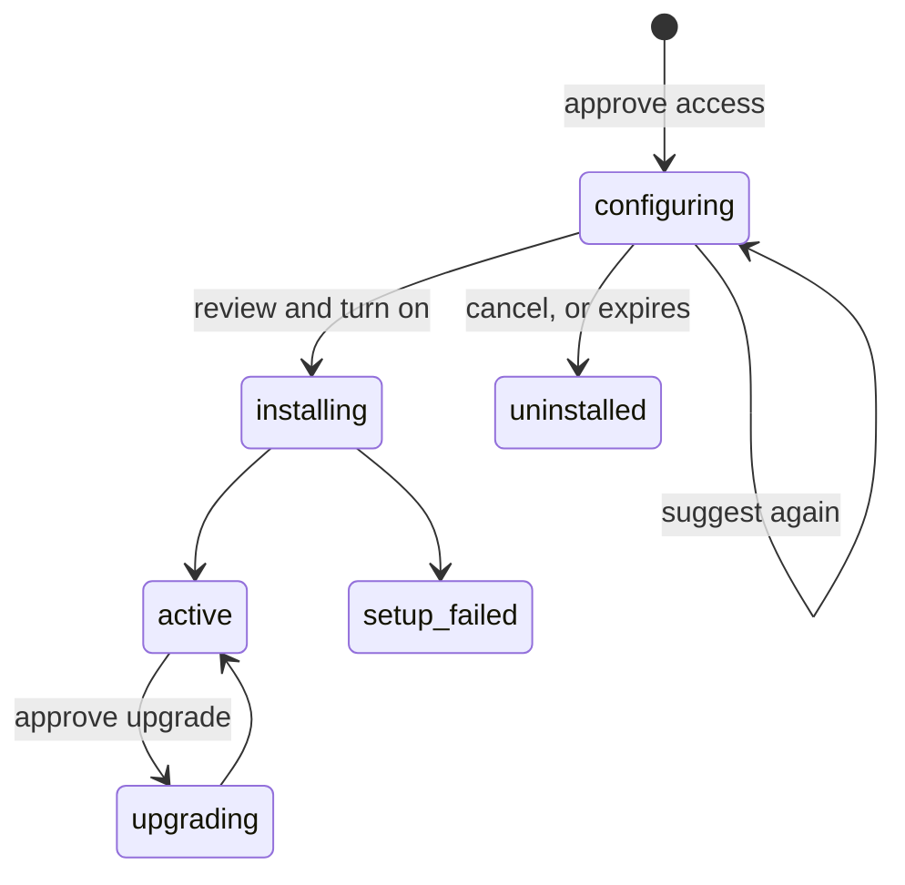

# Extension installation in two steps

Status: implementation, 2026-11-14. Amends [extensions.md](extensions.md) §7
(installation lifecycle), §8 (what lifecycle functions may read) and §9.1
(admission). Replaces the draft runs in
[extensions-model-calls.md](extensions-model-calls.md) §4 and the enrichment
draft in its §6.1. Line references are to `main` at `b3666e3`.

An extension can run its own code before the admin approves its schema, to
suggest how it should be set up: the field mapping, settings, or anything else
the install form asks for. Installation becomes two approvals:

1. **Approve access.** The admin approves what the extension may read and use:
   workspace read access, its secrets, model access. The installation is
   created in a new `configuring` state. Nothing is added to the schema, no
   trigger fires and nothing can be written.
2. **Configure.** The release's `configure` function runs as an ordinary run
   with a read-only token. It may do anything with that access: sample
   records, call a model, run an agent. It saves suggestions.
3. **Review and turn on.** The admin reviews the install form, prefilled with
   the suggestions, and approves. The schema additions, write access and
   triggers commit together; `install` runs setup as today.

A release without a `configure` function installs exactly as today, with one
approval.

The same function suggests changes on reviewed upgrades, for example where a
new enrichment output should go (§5), and on request from the Field mapping
tab.

## 1. Why this design

Today no extension code runs before approval: the install form's mapping
defaults are fixed in the manifest (`defaultChoices`,
`packages/web/src/routes/extensions/mapping.tsx:65`), and the `install`
function cannot read records (`extensions.md:459`).

Considered:

- **Draft run** (model-calls spec §4): a one-off run with a temporary read
  token before any installation exists. It needs a new table, token type,
  admission path and consent rule, all outside the run machinery we have. It is
  a second way to run code, used only for suggestions.
- **Install with nothing mapped, then propose a mapping change.** The fewest new
  concepts, but the admin finishes "installing" and the extension does nothing
  until a second step they may not notice. It also needs the read rule change.
- **Code in the admin's browser.** Not sandboxed, acts as the admin, and would
  put model keys in the browser. Rejected.

Two approvals reuse installations, jobs, run tokens, scopes and fencing.
Secret-broker admission and worker discovery also gain the configure class;
upgrade secrets remain staged until final approval. The admin grants read access explicitly before any code
reads data, which is the consent model the draft run had to invent.

## 2. Manifest

A new lifecycle trigger:

```ts
z.strictObject({ kind: z.literal('configure') })
```

added to the trigger union (`packages/extension/src/index.ts:84`). Rules,
checked when the manifest is validated:

- At most one `configure` function per release.
- Its `scopes` must be `['read']`. It may declare `secrets` and model access
  (model-calls spec §3.1).
- Its timeout follows §9.1 (120 s default, 300 s maximum). The admin is waiting,
  so a bundle should aim for well under a minute.
- A release with a `configure` function must declare at least one thing it can
  suggest: a `mapping` or settings.

Adding, removing or changing a `configure` function changes the release
contract (`releaseContract`, `packages/server/src/extensions/auto-upgrade.ts:36`),
so such a release is never upgraded automatically.

### 2.1 Invocation input

Server-defined, like `install`'s `{previousVersion}`:

```ts
{
  reason: 'install' | 'upgrade' | 'requested',
  previousVersion: string | null, // the installed release on 'upgrade', else null
  newOutputs: string[],           // output keys with no stored binding
}
```

On a first install every output is new. On an upgrade, `newOutputs` lists the
outputs the installed mapping doesn't have. On `requested` (the admin asked from
the Field mapping tab) it lists outputs currently skipped.

### 2.2 Saving suggestions

The run result stays `{status, code?}` (§9.1). Suggestions are saved through a
new runtime endpoint, admitted like the other runtime endpoints with the run
token:

```
PUT /v1/extensions/:id/runtime/suggestions
{
  mapping?: Record<OutputKey, ExtensionMappingChoice & { reason?: string }>,
  settings?: Record<string, unknown>
}
```

- At most 64 KiB. `reason` is at most 500 characters, shown to the admin
  under the output's row.
- `mapping` keys must be declared outputs, and each choice must parse as
  `mappingChoicesSchema`. Anything else is `400 invalid_suggestions`.
- `settings` may name only non-secret settings and must match their schema.
  Secrets can't be suggested.
- Whether a suggested field exists and fits is not checked here. The schema can
  change before the admin looks, so the suggestions are resolved against the
  current schema each time they are read (§6.2).
- Suggestions become visible only after that run succeeds; failed or incomplete
  results never prefill a form. Each retry clears the prior attempt's saved
  values before executing again. The newest-run slot is assigned when enqueueing,
  before the first save. A later save from the same run replaces the earlier one. A save from a run
  that is no longer the newest configure run for that installation and release
  returns `409 stale_suggestions`.

### 2.3 What `configure` may not do

Configure must not create durable provider resources. Provider credentials may
have broader authority than the Retainer token; release review must check that
configure makes only repeatable read/test calls. Provider setup belongs to install.

The run token carries `read` only, so record writes and mapped writes are
refused as for any read-only function. In addition, for a `configure` run:

- **No child jobs.** Today a read-only function may checkpoint a child `job`
  that runs with that function's own scopes (`extensions.md` §8). A child of
  `configure` would run with write scopes before anything was approved, so
  `extensionCheckpoint` with children returns `403 permission_error`.
- **No KV writes.** On an upgrade, KV belongs to the installed release's
  running code (§5). Reads are allowed.
- **No webhook registration, source verification or secret writes.** Those are
  setup, and setup runs after turn-on.

## 3. States



`configuring` is new; the other states and their rules are unchanged.

While `configuring`:

- The installation stores the release, settings, secrets and the access grant:
  `granted_scopes = ['read']`, the requested actor, and model access if the
  release declares it.
- It has no schema contributions, views, mapping, schedules, webhook bindings
  or connections.
- No trigger fires. The change dispatcher, schedules, routes and webhooks
  already act only for `active` installations
  (`packages/server/src/extension-runtime/queue.ts:137`); a test pins this.
- Only `configure` jobs are admitted (§4).
- The extension's card reads "Waiting for your review".

## 4. First install

### 4.1 Approve access

Preview and commit keep their endpoints (`POST /v1/extensions/preview`,
`POST /v1/extensions`; `packages/server/src/api/routes/extensions.ts:136`).
For a release with `configure` and no installation:

- The request carries settings and pending secret references, and no
  `mapping`. An explicit `accessOnly: true` selects the same plan for upgrades.
- The preview shows the access only: the scopes, the actor, the secrets, model
  access and the sharing consent. It plans no schema operations. Its plan
  digest covers those.
- Commit creates the installation in `configuring` and queues a `configure`
  job with `reason: 'install'`. It does not queue `install`.

Only a human admin can commit, as today. Agent and admin keys can preview.

### 4.2 Configure

The job runs like any other. Admission (`extension-runtime/admission.ts:60`)
gains one more class next to `ordinary`, `setup` and `cleanup`:

```ts
const configure =
  job.trigger_kind === 'configure' &&
  (installation.state === 'configuring' || installation.state === 'active');
```

The token's scopes are `['read']` intersected with the function's.

Outcomes:

- **Succeeded:** the suggestions it saved (possibly none) are ready.
- **Retry:** normal backoff. The form keeps showing "Preparing suggestions…".
- **Failed, or retries exhausted:** the form opens with the manifest defaults
  and a notice: "Suggestions aren't available: <reason>." Nothing else fails;
  the admin can fill the form by hand.

"Suggest again" queues another `configure` job. At most one `configure` job per
installation and release is queued or running; asking again while one runs
returns that job.

### 4.3 Review and turn on

The admin reviews the full install form: settings, the mapping prefilled from
the suggestions, and what will be added. Preview and commit use a new route for
an installation in `configuring`:

```
POST /v1/extensions/:id/turn-on
```

Same body as an upgrade commit (`commitInputSchema`), with `turnOn: true` and
the reviewed plan digest. Preview uses the existing preview endpoint with the
same flag and installation ID; operation flags are covered by the digest. The commit runs under the same locks as `commitPlan`
(`packages/server/src/extensions/service.ts:787`):

- Applies the schema additions, views and mapping.
- Raises `granted_scopes` to what the release requests.
- Moves the installation to `installing`, advances its generation (fencing a
  `configure` run still in flight; its later saves get `stale_suggestions`),
  and queues `install` with `previousVersion: null`.
- Deletes the installation's suggestions.

**P1 — pin first-install consent.** Turn-on must use the release digest approved
at the access step. A newer release requires cancelling and starting again.
This keeps access, settings, secrets and executable code covered by the same
consent; a catalog update cannot silently broaden it.

### 4.4 Cancel and expiry

- **Cancel** (the admin, from the card or the setup page): `configuring` goes
  straight to `uninstalled`. There is nothing to clean up at a provider, so no
  `uninstall` run. Secrets, KV and suggestions are deleted.
- **Expiry:** an installation still `configuring` after **14 days** is
  cancelled the same way by the system actor, from the scheduler pass that
  runs automatic upgrades. The duration is a proposal (§11).

## 5. Upgrades

### 5.1 Automatic upgrades: unchanged

An automatic upgrade still happens only when the new release changes code alone
(`auto-upgrade.ts:52`). It runs `install` with `previousVersion`
(`service.ts:978`), never `configure`, and never adds access. There is nothing
to suggest when nothing an admin approves has changed.

### 5.2 Reviewed upgrades

When an upgrade is held, the installation stays `active` on its current
release, and every run uses that release's code until the admin approves.
Every referenced release stays deployed (`extensions.md` §9.1), so the new
release's code is available meanwhile.

When the admin opens a held upgrade to a release with `configure`:

1. **Access check.** The server compares the target release's requested access
   (actor, scopes, secrets, model access) with the installation's grant.
   - Same or less: go on.
   - More: the admin approves the new access first (§5.3). The installation
     keeps its current grant until the upgrade commits.
2. **Configure.** The web app calls `POST /v1/extensions/:id/configure` with the
   target `version`. The server queues a `configure` job **pinned to the target
   release's digest**, with `reason: 'upgrade'`, `previousVersion` and
   `newOutputs`. The token carries `read` only, as on first install.
3. **Review.** The upgrade's Map fields step opens with the suggestions for the
   new outputs. Today they start as Skip (`choicesFromView`, `mapping.tsx:72`).
   Outputs that already have a binding keep it unless the suggestion changes it,
   and every change is shown as one.
4. **Commit.** The existing upgrade commit (`POST /v1/extensions/:id/upgrade`)
   adopts the release, queues `install` with `previousVersion`, and deletes the
   suggestions. This is where a bundle starts any backfill for new outputs.

### 5.3 Approving more access before an upgrade

```
POST /v1/extensions/:id/access   { version, planDigest }
```

A human admin approves the target release's access without adopting it. The
approval is stored per installation and release digest; it lets `configure` for
that release read the secrets it declares (new required secrets come with this
request as pending secret references) and is consumed by the upgrade commit.
Until then, ordinary runs keep the installed release's grant.

**P1 — isolate target credentials.** The approval retains pending-secret references
and target settings; it never adopts or replaces active secrets. Only the admitted
configure job can read those pending secrets. The broker independently rechecks
job identity, fence, deadline, target approval and declared secret names while
holding the admission locks. Final upgrade adopts them atomically. Expired pending
references require restaging and a fresh access review. Target secrets cannot
replace existing credentials through this flow; reconnect remains separate.
The web flow may request explicit access approval even when the grant is unchanged.

### 5.4 Admission across releases

Today a job runs only when its release digest is the installation's
(`admission.ts:34`, `queue.ts:883` and `:1412`). The one exception: a
`configure` job may carry another digest when

- the installation is `active`,
- that digest is a release the admin is reviewing as an upgrade, and
- its access is covered by the current grant or approved under §5.3.

**P1 — enforce the exception throughout execution.** Discovery filters on the
job's target digest, not just the installation's digest. Claim, token issuance,
API admission, broker admission, lease renewal and completion all check the
same target approval and generation. Configure failures do not degrade the
active installation's health. Retrying an older configure job is refused: request
new suggestions instead, preserving newest-run ownership.

The token is bound to that digest and to `read`. Nothing else may run code from
a release the installation hasn't adopted.

### 5.5 On request

The Field mapping tab of an active installation gets "Suggest mapping" when its
release has `configure`. It queues `configure` with `reason: 'requested'` on the
installed release, and the suggestions prefill the existing mapping change flow
(`POST /v1/extensions/:id/mapping`).

## 6. Data and API

### 6.1 Tables

Through `packages/server/src/db/schema.ts` and `pnpm db:generate`:

- `extension_installations.state` accepts `configuring`.
- **`extension_suggestions`**: `workspace_id`, `installation_id`,
  `release_digest`, `job_id`, `reason`, `mapping jsonb`, `settings jsonb`,
  `created_at`. One row per installation and release digest; RLS by workspace
  like the other extension tables. Deleted when that release is adopted, the
  review is cancelled, or the installation is uninstalled.
- **`extension_access_approvals`**: `workspace_id`, `installation_id`,
  `release_digest`, `generation`, `settings_revision`, `scopes`, `actor`,
  `secret_refs`, target `settings`, `approved_by`, `approved_at`. Consumed
  by the upgrade commit; deleted with the installation.

### 6.2 Endpoints

| Route                                           | Who                       | What                                                     |
| ----------------------------------------------- | ------------------------- | -------------------------------------------------------- |
| `POST /v1/extensions/preview`, `/v1/extensions` | as today                  | Access plan and commit for a release with `configure`    |
| `POST /v1/extensions/:id/configure`             | human admin               | Queue `configure` (`{version?}`, default installed)      |
| `DELETE /v1/extensions/:id/suggestions?version=` | human admin | Cancel a target review and revoke its configure approval |
| `GET /v1/extensions/:id/suggestions?version=`   | `read`                    | Job status and suggestions, resolved against the schema  |
| `POST /v1/extensions/:id/turn-on`               | human admin               | Review and turn on a `configuring` installation          |
| `POST /v1/extensions/:id/access`                | human admin               | Approve more access before a reviewed upgrade            |
| `DELETE /v1/extensions/:id` while configuring   | human admin               | Cancel                                                   |
| `PUT /v1/extensions/:id/runtime/suggestions`    | the `configure` run token | Save suggestions                                         |

`GET …/suggestions` returns `{status: 'queued' | 'running' | 'ready' | 'failed',
code?, mapping?, settings?, issues}`. `issues` comes from `resolveMapping` in
review mode (`packages/server/src/extensions/mapping.ts:63`) against the
current schema, keyed by output, with the reasons the web app already
translates (`REASONS`, `mapping.tsx:86`). A suggestion with an issue is shown
with it, never dropped.

MCP: `list_extensions` and `get_extension` show `configuring` and the installed
release's latest `suggestionsStatus` (`queued`, `running`, `ready`, `failed`). No new tools.

## 7. Web app

The setup page from #88 (`packages/web/src/routes/extensions/setup.tsx`) shows
only the steps a release needs. For a release with `configure`:

**First install:** Connect → Approve access → Preparing suggestions → Map
fields → Review and turn on.

- "Approve access" lists what the extension may read and use, in plain words,
  and approves with one button.
- "Preparing suggestions…" polls `GET …/suggestions`. It offers "Skip
  suggestions", which goes to Map fields with the manifest defaults while the
  run finishes in the background.
- Map fields shows each suggested row with a "Suggested" badge and its reason.
  The admin can change any row. "Suggest again" queues another run.
- Leaving midway is fine: the card shows "Waiting for your review" and reopens
  the flow at the right step.

**Reviewed upgrade:** (Approve access, only if more) → Preparing suggestions →
Map fields → Review and approve.

**Field mapping tab:** "Suggest mapping" (§5.5).

FRONTEND.md §5.9 describes the step flow; update it with these steps.

## 8. Enrichment

A new release of the company enrichment bundle adds the configure and backfill
handlers below. Model-backed field selection depends on the separately proposed
model-calls platform, including its operator key and provider disclosure. Until
that ships, configure checks the Exa key and suggests exact compatible API-name
matches, otherwise Create or Skip, with reasons. It sends no CRM samples to a model.
This installation change does not ship or enable the separate model proxy.

Once model access ships, the configure handler can replace that deterministic
selection with the sampling strategy below without changing this lifecycle:

- **`configure`**: reads the Exa key and makes the same test call as `setup`, so
  a wrong key shows before the review. Then samples up to 20 companies and,
  for each candidate field (`compatibleFields`), its label, type and up to five
  sample values; asks a model which field each output should go to, or to
  create or skip; saves the mapping with a reason per output. How it asks the
  model is the bundle's choice; model access follows the model-calls spec.
- **`backfill`** (a `job` function, `read` and `write`, mapped writes): fills
  newly mapped outputs on companies already enriched, in pages, fill-only.
- **`setup`** queues `backfill` when `previousVersion` is set and the
  installation's mapping has outputs the previous release didn't have.

The Exa lookup in `enrich` is unchanged by this spec.

### 8.1 Privacy of suggestions

**P1 — erase copied CRM content.** Suggestions and explanations are untrusted
extension output and may contain sampled record values. A workspace erasure clears
all its saved suggestions and fences live runs through the existing privacy
machinery. They are never treated as content-free telemetry. Runs cannot restore
a cleared suggestion slot; the admin can request fresh suggestions afterward.

## 9. Rule changes in other docs

- `extensions.md` §7: the states list gains `configuring`, and the install
  steps gain the access approval and configure run for releases that declare
  one.
- `extensions.md:459`: "Lifecycle functions … cannot read CRM records before
  activation" gains "except `configure`, with read access the admin approved".
- `extensions.md` §8: the child-job rule gains the `configure` exception
  (§2.3).
- `extensions.md` §9.1: admission across releases (§5.4).
- `extensions-model-calls.md` §4 and §6.1: replaced by this spec.

## 10. Tests

Unit and integration against real Postgres, each test file on its own cloned
database:

- A `configuring` installation fires no change, schedule, route or webhook
  trigger, and admits only `configure` jobs.
- A `configure` token can read; record writes, mapped writes, KV writes, child
  jobs, webhook registration, source verification and secret writes are
  refused.
- Suggestions: shape validation, size limit, settings limited to non-secret
  ones, `stale_suggestions` from a superseded run, issues resolved against a
  schema changed after the save.
- Turn-on applies schema, mapping and scopes atomically, fences a running
  `configure`, and queues `install`. A stale plan returns `409 stale_plan`.
- Cancel and expiry leave nothing behind: no secrets, KV, suggestions or jobs.
- Automatic upgrades never queue `configure`. A release that adds `configure`
  is held.
- Cross-release admission: a `configure` job for the reviewed target digest runs
  with `read`; any other job with a foreign digest is refused; a target that
  asks for more access needs §5.3 first; ordinary runs keep the installed
  release's code and grant during the review.
- Concurrency: two "Suggest again" requests at once leave one job; turn-on
  racing a running `configure` fences the run; an upgrade commit racing a
  `configure` for its target fences it too.
- A release without `configure` installs with one approval, as today.
- Playwright (`pnpm test:web`): first install with suggestions, skip
  suggestions, leave and resume, and a reviewed upgrade that suggests a new
  output.

## 11. Delivery sequence

1. Platform: the trigger, `configuring`, admission classes, the suggestions
   endpoint and table, turn-on, cancel and expiry. A test fixture bundle with a
   `configure` function.
2. Reviewed upgrades: access approvals, cross-release admission.
3. Web app: the setup and upgrade steps, the Field mapping button.
4. Enrichment release (§8).
5. Docs: §9's updates, FRONTEND.md, and `extensions-model-calls.md` §4/§6.1
   marked replaced.

## 12. Open questions

- **Expiry:** 14 days from access approval, renewed only by a new installation attempt.
- **Long configure work:** v1 allows no child jobs (§2.3). If a bundle needs
  more than one run, allow children that keep `configure`'s restrictions.
- **Extension-initiated suggestions:** an extension noticing a new workspace
  field and suggesting it without a release or a request. The suggestions table
  already fits; only the trigger is missing. Later.
- **Model key:** which option the model-calls spec settles on (proxy, full
  proxy, or the key as a platform secret) doesn't change this spec.


## 13. Implementation verification

P1 review changes: pin first-install consent to its exact digest; isolate staged
upgrade secrets and target settings; enforce target-release admission throughout
worker and broker execution; publish successful suggestions only; clear copied
suggestions on erasure. No P0 finding.

The configure lifecycle, target access approval and cancellation, runtime suggestion
API, MCP status, web steps, expiry, and enrichment configure/backfill ship together.
Model-backed field selection remains dependent on the separately proposed model
platform; the shipped enrichment selector uses exact compatible API-name matches.

Validation: build, TypeScript checks, lint/layer checks, the real-Postgres server
suite (`vitest run --maxWorkers=4`), web unit tests, the full 74-test Playwright
suite plus the on-request mapping scenario, and `pnpm test:docker` (sandbox,
extension lifecycle and file storage). Tests use synthetic provider responses;
no real Exa key or model request is part of validation.
