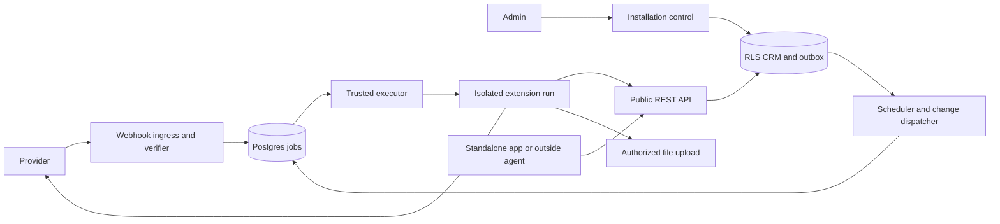

# Retainer extensions

Status: implementation in progress; control, isolated execution, lifecycle, management UI, file storage, managed sources and commit-ordered change dispatch implemented; provider delivery, last-contact and launch remain. Date: 2026-11-11.
See [implementation progress](extensions-implementation.md) for completed and outstanding work.

This spec replaces the exported **Retainer Extensions** proposal supplied as
`Retainer Extensions (1).html` (the [original artifact](https://claude.ai/artifact/LYCoHUAtziuj1dQM7ZYbFy)).
The exported document was read in full. Decisions below preserve its product
scope while correcting its security, consistency and lifecycle assumptions.

## 1. Decision and scope

Build a first-party extension platform. Retainer owns installations, grants,
triggers, durable jobs, schema and CRM provenance. Provider-specific functions
run outside the API process and database network. Standalone products such as
Tamloot and a forms builder run their own services and use the same installation
and grant model through the public API. Retainer never invokes a language model;
model-driven linking and extraction remain external agents.

For example, Granola sends a notification, Retainer verifies and durably accepts
it, and a worker invokes the installed Granola function. That function fetches
the note, uploads its transcript and imports a source revision. Retainer matches
attendees and stores assertions. An outside agent can subsequently read the
change feed and derive tasks. No agent needs to run for ingestion to continue.

V1 includes first-party hosted functions, standalone app connections, workspace
connections, schema contributions and saved views, generated settings forms,
secret storage, installation KV, files, webhooks, schedules, record-change
triggers, a public change feed, and run inspection/retry. Only Tamloot-published,
release-bundled packages are executable. Third-party uploads, npm installation,
custom screens, personal connections, callable MCP functions, guides, dependency
resolution, and a marketplace are deferred. These are delivery phases of one
v1, not a claim that all primitives exist already.

## 2. Critical evaluation of the proposal

| Finding                                                                     | Severity and consequence                                                                                                                                  | Resolution                                                                                                                             |
| --------------------------------------------------------------------------- | --------------------------------------------------------------------------------------------------------------------------------------------------------- | -------------------------------------------------------------------------------------------------------------------------------------- |
| The manifest chooses `integration` versus `agent`.                          | High: package input would choose assertion precedence and could impersonate a more authoritative writer.                                                  | A reviewed registration permits an actor class; installation approval grants it; credentials enforce it. Never `user` or `system`.     |
| Repeated `logEvent` is described as updating an edited note.                | High: current code returns `event_conflict` when initial values differ. Even a direct edit would leave derived assertions/facts citing obsolete evidence. | Add an explicit source-revision import operation; keep ordinary `logEvent` semantics. See §10.                                         |
| Erasure is said to need nothing beyond suppressed emails.                   | High: transcripts, queued payloads, KV, files and provider identities can retain or recreate erased content.                                              | Extend erasure to every new store and suppress source identity across revisions/reinstallation.                                        |
| Existing Postgres scheduling is described as a reusable job queue.          | High delivery risk: today's worker schedules consolidator passes; it has no general leased extension jobs, acknowledgements or retry state.               | Build those primitives explicitly in Postgres.                                                                                         |
| A container without the database network is treated as the sandbox.         | High: it does not by itself isolate runs, credentials, host access or metadata endpoints.                                                                 | Separate the trusted launcher from fresh execution containers and enforce resource/network limits. First-party trust remains explicit. |
| A server-route function can find arbitrary installations and read their KV. | High: a public webhook creates a cross-workspace capability.                                                                                              | Narrow routing to one server-selected candidate; expose only its verification secret to a bounded verifier.                            |
| Skipping own writes is the loop protection.                                 | Medium: A → B → A still loops, and retries can emit duplicate jobs.                                                                                       | Server-propagated causation chain, deduplication and depth limit.                                                                      |
| Cursor moves after work is enqueued.                                        | High if enqueue is not durable/atomic: crashes lose notes or advance past failed pages.                                                                   | Transactional page checkpoint plus durable child jobs, bounded overlap, visible unresolved failures.                                   |
| Existing OAuth is assumed sufficient for standalone apps.                   | High: existing OAuth is person-bound, agent-ranked, and restricted to the MCP audience.                                                                   | Add explicit installation grants and REST resource support; preserve existing MCP consent semantics.                                   |
| Files stay out of assertion history.                                        | Incorrect as stated: file bytes should stay out, but references must retain provenance and historical meaning.                                            | Store immutable references in assertions; manage bytes through authorized storage.                                                     |
| SDK/runner MIT licensing is said to reproduce Twenty's license exception.   | Unsupported legal conclusion.                                                                                                                             | Keep package boundaries; make no equivalence claim. Third-party distribution policy is outside this spec.                              |

The proposal's strongest choices remain: one installation per workspace/account,
API-only writes, no model inside Retainer, deterministic ingestion, explicit
workspace sharing, first-party distribution, and reuse of schema universal IDs.
Do not reduce this to agents polling APIs or copy Twenty's entire UI/AI platform.

## 3. Reference implementation and current baseline

Reviewed local source snapshots, not live deployment or latest upstream:

- Retainer: `563ad361246a2c3c271b9df99c31248d45bc1083`.
- Twenty: `a5065176feed4ed0ec1149a64b66d8d7992884b2`.
- retainer-cloud: `da8a26eeb502d5d5cef2339312f41a2accd850a2`.

Retainer evidence: [schema engine](../../packages/server/src/schema-engine/engine.ts),
[templates](../../packages/server/src/templates/apply.ts),
[events](../../packages/server/src/memory/events.ts),
[OAuth](../../packages/server/src/auth/oauth-token.ts),
[worker](../../packages/server/src/worker/index.ts),
[suppression](../../packages/server/src/privacy/suppression.ts),
[idempotency](../../packages/server/src/idempotency.ts), and
[architecture](../../ARCHITECTURE.md). In particular, schema `owner` currently
means system/workspace/agent, and request idempotency expires after 24 hours.
Neither is sufficient as extension ownership or permanent source deduplication.

Twenty paths below are relative to the reference checkout:

| Evidence                                                                                                                                        | What to adopt or distinguish                                                                                                                                                                                                   |
| ----------------------------------------------------------------------------------------------------------------------------------------------- | ------------------------------------------------------------------------------------------------------------------------------------------------------------------------------------------------------------------------------ |
| `packages/twenty-server/src/engine/core-modules/application/application.entity.ts`                                                              | Registration versus workspace installation; stable universal identity and installed version.                                                                                                                                   |
| `packages/twenty-server/src/engine/core-modules/application/application-manifest/application-manifest-apply.service.ts`                         | Shared apply pipeline and version persistence after successful synchronization. Its optional inference of deletion from omission is not adopted.                                                                               |
| `packages/twenty-server/src/engine/core-modules/application/application-manifest/utils/preserve-application-local-metadata-state.util.ts`       | Preserve workspace-local overrides and activation state. Retainer starts with explicit conflicts rather than a general override engine.                                                                                        |
| `packages/twenty-shared/src/application/manifestType.ts`                                                                                        | Declarative manifest with stable entities. Functions, screens, AI and workflow entries demonstrate the much larger scope we are not copying wholesale.                                                                         |
| `packages/twenty-server/src/engine/core-modules/application/application-manifest/services/application-uninstall.service.ts`                     | Hooks need retry/completion bookkeeping and cannot be a prerequisite for access revocation.                                                                                                                                    |
| `packages/twenty-apps/public/granola/src/logic-functions/granola-webhook-resolver.ts`                                                           | The actual resolver uses a registration query parameter and server KV to locate a workspace; it forwards signature headers to the target. The proposal's `webhook-id` account lookup is illustrative, not this implementation. |
| `packages/twenty-apps/public/granola/src/logic-functions/granola-sync-note.ts` and `utils/sync-granola-note-to-call-recording-or-throw.util.ts` | Fetch externally, then upsert a call recording with transcript content. Retainer needs different provenance and revision semantics.                                                                                            |

Cloud evidence: `README.md`, `infra/aws/functions.tf`, `api.tf`, `schedule.tf`,
`build.sh`, and `deploy.sh`. API/consolidator/ops have isolated networking;
control has outbound networking. Functions currently share a deployment package
and a VPC execution role. The extension executor, restricted execution roles,
file storage, routing and scheduling described here are new work. The existing
build targets Node 24 on Lambda; extension compatibility must follow the actual
runtime rather than assuming the development Node version.

## 4. Architecture and trust boundaries



The server interprets validated JSON manifests; it never evaluates package
`define*` calls. The build runs those calls and bundles handlers. Registration
maps immutable function IDs/digests to predeployed executables. Requests cannot
supply a file path, image, command, module URL or Lambda ARN to execute.

The executor is trusted infrastructure and can dispatch across workspaces.
Extension code receives authority for exactly one installation/run. Do not
pretend the trusted coordinator needs no cross-workspace authority; constrain
its discovery to due job IDs, and claim/load each job inside its RLS workspace.
The resolver is a separately bounded ingress capability, not an ordinary run
with access to all installations.

## 5. Contract and identity

`@retainer/extension` exports `defineExtension`, `defineFunction`, and
`defineView`; these are build-time helpers producing a strict JSON manifest.
The SDK, types and runner import no AGPL server implementation.

Illustrative manifest (UUIDs below must be allocated permanently before shipping):

```json
{
  "manifestVersion": 1,
  "universalId": "2c4b6917-70c6-423d-a773-8b4757a25e83",
  "name": "granola",
  "version": "1.0.0",
  "execution": "hosted",
  "protocolVersion": 1,
  "requestedActor": "integration",
  "scopes": ["read", "write"],
  "connection": "workspace",
  "createPeople": true,
  "onSourceDelete": "keep",
  "settings": {
    "apiKey": { "type": "string", "secret": true, "required": true }
  },
  "schema": [],
  "views": [],
  "functions": [
    {
      "universalId": "64d5d722-e6f8-42bd-ad34-f522632473c0",
      "name": "sync-note",
      "trigger": { "kind": "job" },
      "inputSchema": {
        "type": "object",
        "properties": { "noteId": { "type": "string", "maxLength": 500 } },
        "required": ["noteId"],
        "additionalProperties": false
      },
      "timeoutSeconds": 120
    }
  ]
}
```

Required release metadata outside this example: package SHA-256, supported server
version range, runtime version, descriptions, settings labels, and handler digest
for each function. Registration is an operator/release action, not a workspace
API. Reject unknown manifest versions, entry kinds, duplicate IDs, unresolved
references, unsupported settings/schema types and mutable same-version digests.
Reject executable settings defaults and remote code references. Maximum manifest
size is 1 MiB; settings JSON 64 KiB excluding separately stored secrets.

Each function has one trigger: `install`, `uninstall`, `route`, `serverRoute`,
`schedule`, `change`, or `job`. Only `job` handlers are directly enqueueable by
other handlers; lifecycle and public verifier functions cannot be invoked through
the generic enqueue API. Future `tool` support is a new capability, not an unknown
kind silently accepted today. Input schemas use a bounded JSON Schema subset;
reject remote references and enforce size/depth limits.

Registration identity is stable across releases; installation identity is stable
across disable/re-enable. V1 supports one installation per registration/workspace,
with one connected source account. Replacing the account requires disconnect and
explicit reconnect, retaining a separate source-account namespace. Credentials,
source identities and retained data never follow a mutable display name.

## 6. Persistence and ownership

All new workspace tables have workspace RLS, composite workspace foreign keys
where applicable, and access through `retainer_app`; secrets use a separate broker
role with no ordinary read grants. Generate migrations from Drizzle.

| Store                  | Essential data and constraints                                                                                                                                                                                      |
| ---------------------- | ------------------------------------------------------------------------------------------------------------------------------------------------------------------------------------------------------------------- |
| Registrations/releases | Global reviewed identity, actor ceiling, immutable manifest/digests, allowed executables, protocol/runtime range; no workspace-editable publisher metadata.                                                         |
| Installations          | Workspace, registration, installed release, desired release, state, generation, granted scopes/actor, settings, mapping, installer actor/user, source-account namespace, last error; unique workspace/registration. |
| Contributions          | Installation, element kind, universal ID, actual object/field/view ID and last applied definition; unique managing installation per element. References to shared elements are bindings, not ownership.             |
| Grants                 | Installation/generation, scopes, credential hash or OAuth consent/client reference, expiry and revocation. No plaintext bearer tokens.                                                                              |
| Secrets/connections    | Encrypted value, key version, installation, provider, refresh revision and status. Separate from KV and settings responses.                                                                                         |
| KV                     | Installation/key, bounded JSON value, revision for compare-and-set. 64 KiB/value, 1 MiB/installation default. No transcripts, credentials or arbitrary record copies.                                               |
| Jobs/attempts          | Workspace, installation/generation, release/function ID, input, dedupe key, causation, status, lease owner/fence/deadline, attempt, available time, outcome. Unique installation/generation/dedupe key.             |
| Webhook receipts       | Route/account binding, delivery identity/digest, accepted time, job ID; unique binding/delivery ID. Payload retention bounded and erased with its source.                                                           |
| Schedule state         | Installation/function, next due time, last scheduled occurrence; unique job key per scheduled UTC instant.                                                                                                          |
| Change outbox/feed     | Workspace commit-ordered position, operation, record ID, changed field keys, origin installation, cause chain; no before/after record bodies.                                                                       |
| Source items/revisions | Stable account-scoped external identity, current revision/event, provider ordering marker, content digest and suppression identity. Revision uniqueness is durable, not the request-idempotency TTL.                |
| Files/references       | Workspace, immutable opaque ID, storage key, checksum, media type, byte length, upload state/expiry, reference edges and deletion state.                                                                            |

Global lock order is deployment lock → privacy lock → schema lock → installation
lock → source/connection identity locks → sorted record locks → feed counter.
Use shared/exclusive modes appropriate to the operation, skip unused locks, and
never acquire an earlier lock while holding a later one. In particular, runtime
writes acquire schema before installation; lifecycle code must not hold the
installation lock and then enter the schema engine. Network calls occur outside
these transactions. Operations spanning multiple installations lock their IDs in
sorted order. Test these orders under concurrent revocation, import and upgrade.

Keep schema `owner` semantics; extension association is separate metadata. All
schema contributions pass through `runSchemaChange`, never direct metadata SQL.
Shared `conversation.transcript` ships as a base `files` field with a fixed
universal ID. An extension-specific prefix improves readability but grants no
ownership and cannot prevent identity collisions by itself.

## 7. Installation and schema lifecycle

An admin with a human actor reviews schema additions, views, workspace-wide data
access, requested actor class, source sharing, provider permissions and settings.
In key mode, an existing user/admin key can perform this role. Agent/admin keys
can preview; they cannot approve an installation or increase a grant. This is
an extension lifecycle rule, not a change to general additive schema behavior.

1. Preview validates the pinned manifest, mapping and existing schema under the
   schema lock. Return a plan digest tied to schema version, installation
   generation, release digest and non-secret settings digest. Secret inputs use
   opaque pending-secret references, never plaintext in the plan or logs.
2. Commit rechecks authorization and the plan under the exclusive schema lock,
   then installation lock. Stale plans return `409 stale_plan` with a new preview
   required. Schema, views, contributions, installation and initial lifecycle
   job commit atomically. A failed validation leaves none partially applied.
3. State becomes `installing`; the install job validates credentials, registers
   the webhook idempotently, establishes account binding and enqueues backfill.
   Successful setup makes it `active`. Failure becomes `setup_failed` and exposes
   a retry; the schema remains installed and is reported as such.
4. Provider effects are a saga, not part of the database transaction. Use a stable
   subscription key, discover/reuse prior subscriptions after timeouts, and record
   cleanup work. Never assume retry means the provider did nothing.

States: `installing`, `active`, `setup_failed`, `disabled`, `upgrading`,
`uninstalling`, `uninstalled`. Connection health (`ok`, `needs_reconnect`,
`degraded`) is separate; transient failures do not repeatedly reinstall schema.

V1 upgrade is additive schema plus new code/settings/views. Omission does not
delete. Existing structural changes, removals and incompatible mappings return
`409 upgrade_conflict`; make a new field and perform an explicit migration through
the existing schema engine. User-edited labels/views are preserved; conflicting
publisher changes are reported, not overwritten. A deprecated element stays
deprecated. Do not silently adopt unrelated fields with matching names.

Upgrade disables new triggers, increments generation, fences old runs, and waits
for admitted database writes to finish before applying the new release. Validate
all changes before atomically switching the installed release. Jobs waiting for
old code are cancelled/rebuilt by catch-up; keep their diagnostic history. No
automatic schema rollback: failed new setup stays disabled on the installed
release, with retry or a separately validated compatible code rollback. Rollback
never drops new fields or assertions. No release automatically increases scopes.

Disable revokes runs and stops scheduling immediately. Uninstall additionally
queues restricted provider cleanup, removes secrets after cleanup or a 24-hour
cleanup deadline, and retains records, assertions, source identity/tombstones,
schema and views. Cleanup failure must not restore data access. A cleanup token
can use only the old provider connection and lifecycle acknowledgement, never CRM
writes. Explicit data/schema deletion is a separate normal Retainer operation.
Reinstall reuses surviving schema bindings and suppression namespace; it cannot
resurrect forgotten sources or silently reset user customizations.

## 8. Authorization, actors and secret handling

A run token contains issuer, audience, expiry (at most five minutes), installation,
workspace, generation, run/attempt ID, fence, function ID and granted scopes. The
server resolves actor identity/class from the registration and installed grant;
token claims are checked against that state. The manifest's actor is only a
request. Enrichment registrations permit `agent`; authoritative source adapters
may permit `integration`; neither receives human approval powers. A user-triggered
run remains an extension actor, with `triggeredBy` attribution separately stored.

Effective scopes are the intersection of registration ceiling, approved install,
function needs and credential. Runtime grants have `read`/`write` only in v1;
schema changes use lifecycle control. Platform operations (KV, enqueue, files,
connections) require explicit installation-bound capabilities. All writes still
use assertions and existing precedence. Never accept Actor, workspace, generation
or causation overrides from payloads.

A run has no `Caller.person` and cannot read personal memory. V1 permissions are
workspace-wide within the existing scopes; install UI must say so. A mapping or
list of watched fields is not a data-access restriction. The installer is audit
metadata, not an impersonated user; a workspace grant survives their departure
until an admin disconnects it. User-owned provider credentials cannot be presented
as organization-owned without explicit sharing consent.

Installation access is rechecked inside each transaction. Take the installation
lock shared for admitted runtime writes and exclusively for revocation. After
disable returns, no old run can commit a new write; in-flight writes either
committed before revocation or were refused. Check generation/fence before
idempotency replay and before file authorization. Refresh run tokens only through
the trusted executor while its lease is live, never from an extension-held
refresh token. Already issued short-lived storage URLs have a bounded revocation
window (§11), which the UI/documentation must distinguish from API revocation.

Standalone apps get an explicit workspace installation OAuth grant with REST
resource audience and registration-bound actor. Do not widen existing MCP tokens
or their scopes implicitly. Existing person-bound MCP OAuth remains agent-ranked
and retains its existing membership semantics. Accounts-mode consent must bind
installation, client, workspace and grant generation; recheck revocation on every
request. Key-mode standalone apps use a separate revocable installation key.
Authorization-code flows use state, PKCE and exact registered redirects; provider
OAuth connection management is separate from Retainer access authorization.

Encrypt provider tokens/settings with authenticated encryption and associated
workspace/installation/key-name data. Keys stay outside the database; retain key
versions for rotation. Refresh under a per-connection lock, persist rotating
refresh tokens atomically, and mark `needs_reconnect` on terminal errors. Do not
log secrets or return them to admin reads. Give a run only its own requested
secret; redact provider response bodies from error logs. KV is not a secret store.

## 9. Execution, jobs and triggers

### 9.1 Executor protocol and isolation

Protocol v1 invocation: `{protocolVersion, runId, attempt, installationId,
releaseDigest, functionId, input, apiOrigin, runToken, deadline}`. The driver
receives the executable mapping from the trusted registry, not this JSON.
Result is `{status: 'succeeded'|'retry'|'failed', code?, retryAfterSeconds?}` with a
bounded diagnostics string. API-origin and protocol compatibility are validated
before launching. No arbitrary serialized exceptions, environment dump or secret
return values. Timeout is 120 seconds by default, hard maximum 300; longer work
must paginate. Inputs/outputs are at most 64 KiB.

Hosted: separate immutable Lambda versions for first-party bundles, outside the
DB VPC, with dedicated execution roles permitting only required logging. No DB
credentials, deployment credentials, instance secrets or S3-wide permissions.
Use signed upload URLs for file bytes. An egress-capable trusted executor in the
VPC claims jobs and invokes only registered function versions; it has narrowly
scoped invocation and signing permissions. This is a new runtime, not the API
function acquiring outbound internet access.

Self-hosted: Compose includes a trusted launcher and fresh runner container per
invocation. Only the launcher controls container creation; extension containers
never mount the Docker socket, host paths or DB network. Drop capabilities, run
non-root, read-only root FS plus bounded tmpfs, enforce CPU/memory/PID/time limits,
and destroy the container after every run. The launcher accepts registered
bundle IDs only. Its host-level privilege is documented; a separate service and
socket boundary are required, not a promise that arbitrary container execution is
safe. Deny host/private/link-local destinations except the configured public API
endpoint, including metadata endpoints. Validate DNS/redirect destinations at the
egress boundary. Hosted public-network functions still have their own execution
credentials, so least-privilege IAM is mandatory.

Only reviewed first-party code is supported. This is not a third-party hostile
code sandbox certification. Logs, tmp files, warm process globals and environment
must not carry one installation's data into another run.

### 9.2 Queue and scheduler

Postgres jobs use short `FOR UPDATE SKIP LOCKED` claim transactions, a 60-second
renewable lease, heartbeat every 20 seconds and monotonic fencing token. Do not
hold DB transactions over network execution. Expired leases can be reclaimed;
only the current fence may acknowledge or write using a run token. Delivery is
at least once. External side effects still need provider idempotency because
lease fencing cannot undo a request already sent to a provider.

Default concurrency is one active run per installation; workspace and instance
caps plus fair scheduling prevent a backfill starving other installations.
Default budget is 60 writes/minute per installation, within the workspace limit;
return `429` with retry guidance rather than dropping work. Queued-job quota is
10,000/installation; enqueue and checkpoint fail together at capacity.

Retry transient network/429/5xx errors with jittered exponential delay (30 seconds
base, one-hour cap), maximum ten attempts or 24 hours. Respect bounded
`RetryLater`/provider retry-after hints. Invalid inputs, revoked grants and schema
conflicts are terminal. Failed jobs remain visible and can be replayed by an
admin after fixing the cause. Retain minimal run diagnostics for 30 days; retain
source dedupe independent of run retention. Payloads are source IDs, not notes or
transcripts. Child enqueue dedupe is bound to installation and business operation,
not a random attempt ID.

One scheduler tick per minute transactionally locks due schedule rows, inserts
jobs keyed by `(installation, function, scheduled UTC instant)`, then advances
`nextDueAt`. UTC-only cron in v1; missed ticks coalesce to one catch-up job, not
thousands of historical invocations. Multiple scheduler instances must produce
one occurrence. Disabled installations never accumulate schedule jobs.

### 9.3 Webhooks

Two routes: `/extensions/hooks/:registration/:route` and
`/extensions/hooks/installations/:opaqueBinding/:route`. The first uses a
registered provider-specific account locator; the second already identifies a
candidate installation. Provider-supplied identifiers are routing hints, never
authorization. Account binding is verified during setup and unique within the
registration/provider subscription namespace. Reject ambiguous bindings.

Verification consumes exact raw bytes, required headers, timestamp/replay checks
and one candidate's secret. It has no CRM token or installation enumeration/KV
API. Run provider verifier code in the bounded verifier runtime, not the API
process; ingress gives it only the candidate verification material and enforces a
five-second budget. Provider challenges are explicit registered handlers with no
CRM access. Generic verifier results cannot choose a second workspace.

After successful verification, atomically record the delivery and enqueue its
job, then answer 202. Duplicate authenticated deliveries answer 202 with no new
job. Persistence unavailable means 503, never a false acknowledgement. Reject bad
signatures with 401, oversized bodies with 413 (256 KiB default), and rate-limit
before invoking the verifier. Retain receipt dedupe for seven days; source
idempotency remains permanent. Routes must follow provider-specific signature
contracts; the example header names are not a universal protocol.

### 9.4 Change feed and loop prevention

Record transactions append an outbox row only when effective values, links,
visibility or lifecycle state change; assertion-review changes have a separate
operation kind. Watched fields are permanent keys resolved from manifest UUIDs,
not mutable names. Include deletion, merge, retraction and source-revision events. An event-type
move emits an old-type tombstone and new-type creation in the same transaction,
so handlers watching either type can recompute.
Personal memory is excluded from the workspace feed in v1.

Use a per-workspace feed counter locked at the end of the write transaction;
allocate positions and commit while holding it. This serializes publication
briefly and prevents a slow lower sequence from committing after a consumer has
passed it. A bare global sequence is not a commit-order cursor. No code acquires
new record locks after the feed lock. One change plus its trigger jobs is durably
linked through dispatcher checkpoints; never rely on in-process notifications.

`GET /v1/changes?after=<opaqueCursor>&limit=100` and `list_changes` return IDs,
operation, changed keys, origin, next cursor and `headCursor`. Read scope required; authorize
referenced records at read time. Tombstones contain only authorized minimal IDs.
Retention is 30 days; expired cursors return `410 cursor_expired` with a rescan
instruction, never silent truncation. Capture `headCursor` from a fresh page
before scanning current records, then replay after that cursor; writes during
the scan are replayed and handlers tolerate overlap. Agents persist their own cursors; this is
not delivery acknowledgement or exactly-once extraction.

Cause metadata is server-derived from the triggering job/run and propagated to
writes and child jobs. Skip any installation already in the chain; cap depth at
8 and count blocked matches. Direct self-writes are expected and do not degrade
connection health; a multi-installation repeat/depth breach records
`trigger_cycle_blocked`. This stops A → B → A as well as direct
self-triggering. Coalesce duplicate `(installation,function,changePosition)` jobs.
Accepted trigger jobs retain only the authorized minimal change metadata, so
public-feed pruning cannot strand accepted work. Erasure scrubs those copies and
fences every live run; all installation KV is cleared because operational values
may indirectly derive from erased records. Preserve unrelated durable jobs and
keep immutable backfill bounds in job input. A dispatcher that has fallen behind
retention stops with degraded `cursor_expired`; it never advances past the gap.
Disable, rescan and re-enable only through the reviewed adapter catch-up path.

Handlers read current data and recompute deterministically, tolerating duplicate
or superseded changes. Last-contact recomputes from surviving events, including
retraction/deletion; it cannot just retain the maximum timestamp ever seen.

## 10. Source ingestion, edits and deletion

Do not change `logEvent` into an upsert. Add `sync_source_event` (REST
`POST /v1/extensions/:installation/source-events`) for managed imports. Require
write scope plus installation match. Input contains stable source account/item
ID, optional normalized content digest assertion, provider revision/order marker when available,
expected current revision, event body, and ready file references. Return
`{sourceItemId, revisionId, eventId, created, unchanged, previousEventId?}`.
The normalized import body is:

```ts
type SourceEventImport = {
  sourceItemId: string; // local identity reserved under the verified source account
  contentDigest?: string; // checked against the server's canonical digest when supplied
  providerRevision?: string;
  expectedRevisionId: string | null; // null means create only
  event: {
    type: string; // event type universal UUID from the release-pinned binding
    occurredAt: string;
    title: string;
    summary?: string;
    fields?: Record<string, unknown>; // resolved permanent field keys
    participants?: Array<{ email: string; name?: string; contacted?: boolean }>;
    about?: string[];
  };
};
```

Setup binds an account through `/source/verify`, callable only by the registered
isolated install verifier for the live generation. Normal credentials cannot
attest provider identities. Activation refuses missing verification. Account
replacement requires a human disconnect, generation revocation and setup again;
retained data stays in its former namespace. Releases pin provider name, identity
strategy, verifier function, ingestion job functions, event type UUIDs and revision
ordering. An account-scoped provider must return a stable provider account ID.
A reviewed `global-resource` strategy is allowed only when provider resource IDs
have a stable provider-wide namespace; it makes no claim to verify an account ID
that the provider does not expose. Neither strategy uses a mutable display name,
credential hash or installation ID as the durable source namespace. Provider
credential ownership and explicit Retainer workspace-sharing approval remain
separate checks. Granola's account-verification/sharing adapter remains a delivery
requirement; a global namespace alone does not satisfy it.

Before enqueueing ingestion, reserve `{sourceAccountId, externalId}` through
`POST /v1/extensions/:id/source-items`. Jobs carry only the returned local
`sourceItemId`; queue admission validates it against the current binding. The
registered ingestion job may read the provider ID, stage participant emails with
`/source-items/:item/prepare`, and upload files bound to that item. Staging is
required for each job attempt before issuing an upload URL, so erasure can find
pending transcripts even before the first event revision exists. Staged emails
are suppression-checked and erased with the source. A source job cannot import
another item's evidence or attach another item's uploads.

The server returns its canonical content digest, including normalized fields and
file metadata/checksums rather than transient upload IDs. Re-uploading identical
bytes does not alone create a new evidence revision. Permanent receipts retain
provider-revision results independently of request-idempotency expiration.

The adapter declares how provider revisions compare, or explicitly declares them
opaque; the server cannot lexically order arbitrary provider strings. Persist the
comparison strategy in the reviewed registration, not as request-supplied code.
A repeated identical revision returns its original result. A stale expected
revision is `409 source_revision_conflict`; the adapter must refetch current
provider state before retrying. Older comparable provider versions are ignored
with an explicit `stale` outcome, not silently made current. Providers without
ordering markers use serialized per-item fetch jobs and optimistic revision
checks; never infer ordering from webhook arrival time.

**Decision: stable source item, immutable evidence revisions.** Each substantive
edit creates a new event revision linked to the same source item, rather than
rewriting evidence already cited. In one transaction, under privacy/schema/source
and sorted record locks, import the new event, mark the former revision superseded,
retract its derived assertions/facts through the existing source-retraction rules,
and move the source item's current pointer. Preserve historical event/revision
links and return invalidated-derived counts. An outside agent can process the new
revision. Human-authored values without that source are untouched; derived claims
that cite the old evidence follow the documented retraction semantics even if a
human previously accepted them. Surface this in history.

Default activity/context presents the current revision once; explicit history
shows prior revisions and supersession, with old citations still resolving.
`occurredAt` is when the meeting happened, not its edit time. Participant changes
are represented by the new revision, not `logEvent`'s additive-link retry behavior.
Map source identity to `(registration, stable provider account, external ID)`
or `(registration, reviewed provider-wide namespace, external ID)` for a
global-resource provider; keep it across reinstall. This is a deliberate change from the proposal's promise
of the same event ID on edit and must ship before claiming edited-note sync works.

`onSourceDelete` is a requested policy shown at install. `keep` retains the current
evidence and records source unavailability; `retract` soft-retracts current source
evidence and its derivatives through normal rules. Neither hard-erases data or
allows deleting unrelated events. A transient 404/permission error is not proof
of deletion; require a verified deletion signal or provider-defined definitive
lookup. Deleted/retracted identities are not silently recreated on future sync.
The item's ingestion job reports transient unavailability separately from a
deletion backed by a provider event or definitive lookup. `keep` preserves the
current evidence; `retract` runs the normal event/derived-claim retraction path.
Ordinary record deletion also marks the current managed item retracted. Direct
field/participant editing of managed revisions is refused; the UI shows their
current or superseded status and preserves explicit historical reads.

Catch-up starts 31 days back for Granola, with explicit larger backfills. A page
transaction enqueues all item jobs and commits its checkpoint together. Advance
the scan watermark only after all pages are durably enumerated; failed child jobs
remain tracked independently and keep the sync status degraded. Use a fixed
upper watermark and an overlap window when the provider permits bounded queries;
otherwise rescan an overlapping window with durable dedupe. Display both last
successful scan and unresolved item failures; scan completion is not import
completion. Recover webhook gaps by polling, including private self-hosted servers
without public webhook ingress.

Create-people policy: `never` default, `contacted_first`, or `everyone`, with a
standard visible setting. Enforce it server-side for the managed participant
operation, not merely in the SDK. `contacted_first` needs explicit provider
evidence of outbound contact/organizer identity, not presence on an attendee list.
Always respect suppression, ambiguous matches and phone-only matching limits.
Because v1 `write` is coarse, this is trusted first-party behavior, not a general
restriction against a malicious app using ordinary record writes.

## 11. Files and privacy

Add a `files` field type to shared types, validators, schema engine, SDK, REST/MCP,
assertion handling, web rendering and erasure. A value is a bounded list of opaque
immutable file IDs, with display metadata obtained through authorized reads.
Bytes never enter JSONB, assertion values, search indexes, job payloads or logs.
File references do enter assertions and history. Shared transcript fields do not
imply concatenating different sources: normal whole-field precedence applies;
multiple attachments belong to the event revision that supplied them.

Flow: create upload intent → signed upload → finalize → attach reference in a
normal assertion/import transaction. Finalize checks object existence, expected
length/checksum/media type and ownership. Pending objects cannot be referenced;
clients cannot select another installation's upload intent or another workspace's
file ID. Default maximum file size 25 MiB; enforce workspace storage quota when
reserving an intent. Upload URL expires after five minutes, unattached intents
expire after 24 hours. Orphan collection checks live and retained historical
references before deleting bytes.

Hosted bytes use a private S3 bucket; Compose uses a dedicated file service/volume
with the same intent API. Storage adapters and product endpoints live in the open
repo. Signed downloads last at most 60 seconds and are issued only after current
record visibility checks. Force attachment disposition for unsafe content and
never execute uploaded HTML/SVG. Do not serve public stable URLs or fetch arbitrary
remote URLs on behalf of a client. The UI shows transcript download/open; full-text
transcript search and streaming media are deferred.

Erasure first removes authorization and reference visibility in the DB transaction,
then durable deletion jobs remove objects and their retained storage versions.
Erasure must also prevent a previously signed or already-started upload from
recreating content. Immutable conditional uploads and an opaque zero-byte object
barrier may be used; remove all content-bearing retained versions and preserve
the barrier through concurrent retries. The barrier contains no filename or
source identity. The maximum previously issued download window is 60 seconds. Do not declare
physical erasure complete until storage deletion succeeds; expose pending/failure
status. Shared references require explicit ownership tracking: preserve a blob
only if an independent authorized source legitimately retains it, otherwise erase
all copies/derivatives associated with the erased source. Do not deduplicate bytes
across workspaces in v1.

`forget` must include source revisions, file references/bytes, queued webhook/job
payloads, provider identity mappings, feed derivatives and sensitive diagnostics.
Use stable HMAC source-identity tombstones so a new revision or reinstall cannot
bypass erasure; retain no raw forgotten identity in operational logs. Reads and
imports acquire existing privacy locks. Ordinary KV is restricted to operational
cursors/IDs; documented source-linked state must be deleted during forget. Arbitrary
personal-data caching in KV is unsupported. Account/workspace purge cleans every
new table and file namespace; remote provider deletion is a separate product
operation and must never be implied by local erasure.

For managed sources, erasure expands to every revision of each affected item and
staged participant ownership before collecting files. It removes provider IDs,
ordering markers, content digests, receipts and staged emails; keeps only an
opaque erased item and keyed identity tombstone; clears the affected installation's
KV; and advances its generation to fence fetched in-memory content. Erased-source
jobs are cancelled and redacted. Unrelated durable jobs are retained/requeued under
the new generation. Backfill jobs must retain their non-sensitive requested date
bounds independently of resettable KV cursors, so privacy recovery cannot silently
shrink a requested scan. A setup interrupted by erasure requires setup retry.

## 12. Public interfaces and user experience

Use existing error envelopes with `code`, message and structured details. Runtime
installation ID must match the credential; cross-workspace references return 404.
Lifecycle endpoints require human admin plus the existing schema scope where
schema changes occur. Read-only preview may be available to schema-capable agents.

| Interface                                                                             | Contract                                                                                                                           |
| ------------------------------------------------------------------------------------- | ---------------------------------------------------------------------------------------------------------------------------------- |
| `GET /v1/extensions/catalog`                                                          | Bundled compatible releases/capabilities; no secrets.                                                                              |
| `GET /v1/extensions` and `GET /v1/extensions/:id`                                     | Installed state, release, grants, health, settings with secret-presence flags, contributions and sync status.                      |
| `POST /v1/extensions/preview`                                                         | Registration/release, mappings and settings references → plan digest, schema/view diff, grant changes, warnings/conflicts.         |
| `POST /v1/extensions`                                                                 | Commit install using plan digest and idempotency key → installation and lifecycle job.                                             |
| `POST /v1/extensions/:id/upgrade`                                                     | Commit an upgrade preview; no implicit permission increase.                                                                        |
| `POST /v1/extensions/:id/disable`, `/enable`, `/uninstall`                            | Generation-fenced lifecycle transitions; enable validates connection and mappings.                                                 |
| `PATCH /v1/extensions/:id/settings`                                                   | Expected settings revision, validated settings/secret references; credential/account changes require reconnect and fence old jobs. |
| `GET /v1/extensions/:id/runs`, `POST /v1/extensions/:id/runs/:run/retry`              | Paginated redacted diagnostics and admin retry; no raw provider bodies.                                                            |
| `POST /v1/extensions/:id/source-events`                                               | Revision-aware managed source import (§10).                                                                                        |
| `POST /v1/files/uploads`, `POST /v1/files/:id/finalize`, `GET /v1/files/:id/download` | Intent/finalize/authorized download; attachment references remain ordinary record writes.                                          |
| `GET /v1/changes`                                                                     | Cursor-based workspace feed (§9.4).                                                                                                |

Installation-scoped runtime endpoints provide KV get/CAS, enqueue/checkpoint,
connection retrieval and file intents; reject admin credentials where a run-only
capability is required. Lifecycle requests use durable receipts tied to request
hash/install generation, not only the generic 24-hour idempotency cache.

MCP v1 exposes `list_extensions`, `get_extension`, `preview_extension`,
`list_extension_runs`, `list_changes`, and `sync_source_event` for appropriately
bound credentials. Human approvals occur through settings/admin interfaces;
agents cannot approve via an MCP tool. SDK methods mirror REST. App-provided tools
and model-facing instructions remain deferred.

Important errors: `unsupported_manifest`, `incompatible_runtime`, `stale_plan`,
`schema_binding_conflict`, `upgrade_conflict`, `grant_required`,
`installation_disabled`, `lease_expired`, `source_revision_conflict`,
`source_suppressed`, `connection_required`, `quota_exceeded`, `cursor_expired`.
Schema errors identify field keys/UUIDs and conflicting properties; never discard
unmapped values. Runtime errors never include secrets or invisible record data.

Extensions page: catalog → review → configure/connect → setup progress → active.
Display workspace-sharing consent, actor authority in plain language, created
schema/views, create-people and source-deletion policies. Distinguish configured,
connected, scan completed, imports completed and failed items. Offer disable,
reconnect, retry and uninstall with clear retention wording. Saved views use the
existing view service and reference stable object/field identities; user edits
survive upgrades. No extension-supplied React executes in v1.

## 13. Repository layout and deployment

The open repository owns all product code: contracts/SDK, first-party extensions,
runner/launcher protocol, services, file adapters, web UI, Lambda entry points,
Compose configuration, tests and this spec. Suggested modules:

- Foundation: grant/run types and verification support, persistence primitives.
- Core: source revisions, file-reference invariants, privacy integration, outbox
  publication within record transactions. Core must not import extension control.
- Features: source import orchestration and file/read services using core rules.
- Admin: `extensions` installation/contribution service, calling schema and views.
- Interfaces: webhook ingress, runtime endpoints, executor/scheduler and broker.
- Entry: Docker roles and Lambda entry points. Add all modules to layer checks.

The private `retainer-cloud` repo owns Terraform, bucket/IAM/networking, deployment
artifacts and workflow wiring, encryption/signing key configuration, alarms,
provider client registrations, billing and external hosted agents. It does not
own source code for product Lambda handlers or first-party integrations. Keep
SDK/web/runner packages MIT and server modules AGPL under current boundaries;
do not copy Twenty source or make legal promises about arbitrary extension code.

Cloud changes must add dedicated executor/verifier/execution roles and packaging;
do not reuse the current shared function role for extension code. Add explicit
webhook routing and file-signing support without giving the isolated API internet
access. Broker/runtime control endpoints must also work in key mode and must not
be accidentally disabled by the existing accounts-only control function flag.
Use a dedicated runtime control entry point rather than conflating it with login.

Build manifests and artifacts from the same main commit; deploy immutable function
versions before advertising compatible catalog releases. No cloud API creates
arbitrary functions from workspace input. Extend existing migration-status,
maintenance routing, stop/start lists and deploy locks to ingress, dispatchers,
file workers and executions. During a stopped migration, webhook ingress returns
503 before acknowledgement; paused jobs recover afterward. Revoke/drain old run
leases before incompatible migrations, and refuse dispatch across incompatible
protocol versions. Include runner compatibility in Compose health checks and
cloud preflight. Breaking migrations remain allowed with explicit stopped rollout;
failed preflight leaves the old service intact and failed migration leaves workers
stopped. A code rollback must check schema/protocol compatibility first.

## 14. Delivery sequence and acceptance

1. **Control foundation:** registrations, manifests, install/preview, contributions,
   saved views, grants, settings/secrets, RLS, SDK and UI. No trigger activation.
2. **Execution:** leased queue, scheduler, drivers, runtime broker, webhook verifier,
   fencing, limits and lifecycle sagas. Demonstrate a deterministic fixture adapter.
3. **Ingestion safety:** files, source revisions, participant policy, suppression
   and erasure across new stores. Do not launch Granola before these pass.
4. **Reactive integrations:** transactional outbox/public feed, causation guards,
   last-contact; Granola backfill/webhook/edit/reconnect/uninstall scenarios.
5. **Standalone and hosted launch:** installation OAuth for REST, Tamloot contract
   test, cloud deployment/rollback tests, operational runbooks and full UI checks.

Every phase includes unit, real-Postgres integration, API and agent scenarios;
UI changes also use a fresh `pnpm build` before Playwright. Each test file has a
fresh database. Add these required adversarial cases, not only happy paths:

| Area           | Required evidence                                                                                                                                                                                         |
| -------------- | --------------------------------------------------------------------------------------------------------------------------------------------------------------------------------------------------------- |
| Install/schema | Concurrent installs create one installation; stale preview races schema edit; collision rolls back schema/views/install together; deprecated field remains deprecated; user-edited view survives upgrade. |
| Authorization  | Manifest cannot choose user/system actor; runtime cannot escalate scope or touch another installation; personal memory inaccessible; standalone REST token cannot widen MCP consent.                      |
| Revocation     | Disable races a write, replay, lease renewal and upload-finalize; no old API write commits after disable returns; cleanup cannot write CRM.                                                               |
| Jobs           | Crash before/after provider call; lost acknowledgement; expired worker resumes after lease takeover; child enqueue/checkpoint atomicity; queue quota leaves cursor unchanged.                             |
| Webhooks       | Forged account hint, ambiguous binding, bad raw-body signature, replay, duplicate delivery, verifier timeout and DB outage; 202 only follows durable acceptance.                                          |
| Changes        | Concurrent transaction commits cannot be skipped by a cursor; dispatcher crash replays safely; A → B → A blocked; removed/merged records and field renames handled; private rows absent.                  |
| Imports        | Same revision concurrent twice creates one event; edit retires old evidence/derivatives atomically; older fetched version cannot win; suppressed source never returns after reinstall.                    |
| Files/privacy  | Cross-workspace IDs and forged finalize rejected; unattached upload collected; historical references retained; forget racing import/download/worker; storage deletion failures remain visible.            |
| Lifecycle      | Timeout after subscription creation does not duplicate hooks; uninstall works while provider is down; reconnect fences old account; rollback preserves data.                                              |
| Deployment     | Main artifact/digest match, incompatible runner rejected, stopped migration fences all writers, worker recovery after outage, narrow IAM and no DB access from execution.                                 |

Definition of done: an admin installs Granola, safely imports history and edits,
receives and recovers missed notifications, inspects/retries failures, disables
all further writes, uninstalls without deleting CRM data, and erases a source
without later reimport. Demonstrate this in Compose and hosted staging, plus a
standalone app grant and deterministic last-contact trigger. No production or
runtime implementation is implied by completion of this document.
