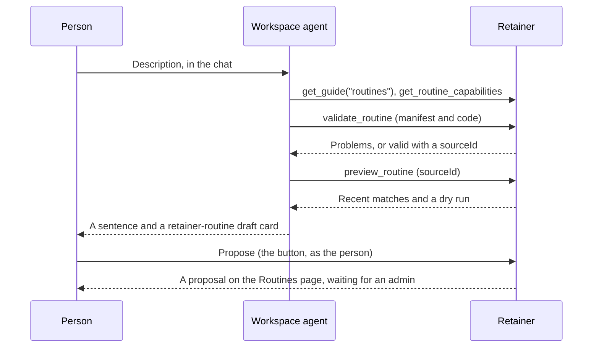

# Routines built in the chat: spec

Status: **proposed**, 2026-11-28. Written after Views shipped in the chat
(#218), as [chat-builds.md](chat-builds.md) §5.1 planned. It applies the
shared pattern of that document to Routines: a person describes a routine
to the workspace agent, sees a checked draft with a dry run, and proposes
it with a button. The chat becomes the only place in the web app where a
routine is made or changed.

It builds on [routines.md](routines.md) (the routine, its builder contract
and approval), [agent.md](agent.md) (the workspace agent) and the chat
pieces Dashboards and Views made to share (chat blocks, the draft card,
guides read on demand).

If accepted this spec amends:

- `routines.md` §5.1 (one builder contract, no built-in builder; the check
  and the preview answer a `sourceId`; a proposal may name one; no notice
  before a dry run in the chat, §5.4 here), §5.3
  (repair is **Edit with the agent**), §6.3 and §4.6 (dry runs stop at half
  the daily model cap) and §11.4 (the `build` run, its route and the
  describe box are removed).
- `chat-builds.md` §3 and §5.1 (the fence and the card as decided here).
- `agent.md` §6.6 (the web chat's first message names the routines guide),
  §8.1 (a new tool group, `retainer.routines`) and §11 (the note in §8
  here).
- `FRONTEND.md` (the Routines page without its text box; the routine draft
  card).
- `docs/rest-api.md` (`sourceId` on validate, preview and propose; the
  draft route; `POST /v1/routines/build` removed).

Reviewed by Codex on 2026-11-28; its findings are worked in (the draft
route binds a preview to its source and runs the full static check, a
draft lasts 7 days, how a card knows it was proposed, the wording of the
counts, the notice, and what removing the builder leaves in the
database).

What does not change: a routine is a manifest and TypeScript code, only an
admin approves, nothing runs before approval, a routine writes as an
agent, and Retainer's core never calls a model. An agent connected over
MCP builds routines exactly as it does today.

## 1. The idea on one page

A person writes in the chat: "when a deal moves to Won, create a task for
its owner to send a thank-you note within two days". The agent reads the
routines guide and the workspace's capabilities, writes the manifest and
the code, checks them and dry-runs them on recent deals. It answers with a
sentence and a draft card:

- the routine's name and the description it will be saved with;
- **Retainer's facts**: when it fires, the `if`, the tools it may call,
  whether it calls a model, that it writes as an agent;
- **the agent's summary** and its report (what the description asked for
  that the routine does not do), labelled as the agent's;
- **the dry run**: how many recent changes would have matched, and what
  the code tried on up to five of those records;
- the code, behind a link.

"Only for deals over $10k" gives a new draft. **Propose** saves it as a
proposal. An admin reviews, tests and approves it on the Routines page, as
today.



What is better than the text box it replaces:

- **The agent can ask.** A description that reads two ways (`unclear`)
  becomes a question, not a guess or a refusal.
- **The person can refine.** Today a wrong proposal means rewriting the
  whole description and waiting for a new build.
- **The agent knows the workspace.** It can look at records, views and
  existing routines before drafting; the built-in builder sees only the
  capabilities and the description.
- **One way to build** views, dashboards and routines.

## 2. Decided and proposed

Decided in `chat-builds.md` (2026-11-27), restated:

- The chat is the only way in. The Routines page links to a plain chat.
- The person keeps, with a button. In the chat no tool proposes.
- The agent runs the dry run once, while drafting. Opening the card never
  starts one.
- The card can show and propose a draft that matched no recent record.
- The text box goes once the chat passes the routine eval.

Proposed here, for the product owner:

1. **The fence names a source by ID; it does not carry the code** (§4).
2. **Approval stays on the Routines page.** The card proposes and links
   there, for admins too (§5.3).
3. **Dry runs stop at half the daily model cap**, whoever starts them. No
   separate pool for chats (§7).
4. **The built-in builder is deleted in the same PR**, after the eval
   (§9). No transition period in the product: there are no users to carry
   over.
5. **Repair becomes Edit with the agent** (§6).

## 3. The agent

### 3.1 Tools

A new tool group, `retainer.routines`, in every chat on a server where
routines are enabled:

| Tool                       | In the chat | Notes                                                              |
| -------------------------- | ----------- | ------------------------------------------------------------------ |
| `get_routine_capabilities` | Yes         | Facts: objects, fields, tools and their status, limits, SDK types  |
| `validate_routine`         | Yes         | Answers `sourceId` when the static check passes (§4.1)             |
| `get_routine_job`          | Yes         | A check that outlasts one call is polled here                      |
| `preview_routine`          | Yes         | Takes `sourceId`, or a manifest and code as today                  |
| `get_routine_preview`      | Yes         | The dry runs and what each tried                                   |
| `list_routines`            | Yes         | To find a routine before making a near copy, and to edit one       |
| `get_routine`              | Yes         | The versions, with manifest, code, facts and report                |
| `propose_routine`          | **No**      | The Propose button proposes (`chat-builds.md` rule 1)              |

- The tools match the MCP tools in name and behaviour, as every agent tool
  does (`agent.md` §8.1). They run with the person's access: a dry run
  reads what the person can read.
- The group is for chats only. A task started by a routine
  (`retainer.ai.agent`) cannot list it: a routine does not build routines.
- A chat's tools are fixed when it is created (`agent.md` §8.3), so chats
  opened before this ships do not get the group.
- No chat tool approves, tests, pauses or archives. Those stay with an
  admin on the Routines page.

### 3.2 The routines guide

`get_guide("routines")` exists today as a short note on building from a
view. It becomes the full guide. Its text is the built-in builder's
prompt (`runner/src/routine-builder.ts`: the manifest format, the rules
for the code, when to set `oncePerRecord`), moved to `mcp/guides.ts`, plus
what the chat adds:

- **Routine, or something else.** A routine is a standing instruction that
  acts later, on its own. A question gets an answer. A one-off change
  ("mark these five deals as lost") is done now with the write tools. A
  list to work through is a view.
- **Find before making.** Call `list_routines`. If a routine already does
  the job, say so; if one is close, draft a new version of it (§6).
- **Start from facts.** Call `get_routine_capabilities` before writing.
  Never answer from memory what the workspace has.
- **Ask when unclear.** If the description reads more than one way and the
  readings would act differently, ask one short question before drafting.
  Do not ask about what a draft can show.
- **Say no early.** If the verdict is `not_possible`, answer in words with
  each gap and what would fix it, and no draft. If `partial`, draft what is
  possible and list the gaps in the report.
- **Check, then preview once.** `validate_routine` until it passes, then
  `preview_routine` once with the `sourceId`, then `get_routine_preview`
  until it is done. Read the dry run: a run that failed, or that tried
  nothing where it should have acted, is a reason to fix the code and
  check again. Do not preview again unless the manifest or the code
  changed.
- **Write the description for the record.** The description is saved with
  the routine as the lasting statement of intent (`routines.md` §5.3). In
  a chat it is the agent's faithful summary of everything the person
  asked for across the conversation, in the person's terms. The card
  shows it.
- **Building from a view**: the existing note, unchanged (`views.md` §8).
- **The draft format** (§4.2), and that the person proposes and an admin
  approves: never say a routine is active.

**Web chats.** The line the server adds to a web chat's first message
gains the third guide: "…which can show dashboards, views and routine
drafts; read get_guide("dashboards"), get_guide("views") or
get_guide("routines") before drafting one." The routines part is left out
on a server without routines. One line, so the base prompt and its cache
stay shared.

### 3.3 The model

The built-in builder runs on `RETAINER_ROUTINE_MODEL` (Claude Opus 5.5).
The chat agent runs on Claude Sonnet 5.5 at medium effort (`agent.md`
§3.4), and that does not change for routines: one model per chat. Whether
Sonnet writes routines as well as the builder does is what the eval of §9
decides before the builder is removed. `RETAINER_ROUTINE_MODEL` stays as
the model for a routine's own `ai.generate` calls.

The agent's own requests count against the agent's limits (`agent.md`
§10), not the routine model cap. Only the dry run's model calls count
there (§7).

## 4. The draft

### 4.1 A checked source has an ID

`validate_routine` and `preview_routine` already save what they check as
a row of `routine_sources`, keyed by a hash of the manifest and the code.
Today the ID stays inside the server. Three small changes make it the
handle for a draft:

- `validate_routine` and `preview_routine` answer **`sourceId`** whenever
  the static check passes.
- `preview_routine` and `POST /v1/routines` (propose) accept
  **`sourceId`** in place of `manifest` and `code`. So the agent sends the
  code once, and the card never sends it at all.
- **`GET /v1/routines/drafts/:sourceId?preview=<id>`** (`read`) answers
  everything the card shows that only Retainer may state:
  - the manifest, the code and Retainer's facts (the fixed code that
    words a version's facts);
  - **the check, as Propose would run it**: the static check of the
    manifest against the workspace now (objects, fields, tools and their
    connections, the model), then whether the source has a passed
    type-check for the current types. It answers `ok` or the problems.
    It reads; it queues no sandbox job;
  - the trigger's count now (§5.1);
  - the dry runs of `preview`, **only if they are runs of this source**.
    A preview of another source, or of another workspace, is refused
    (`preview_mismatch`), so a fence cannot pair one routine's code with
    another's successful dry run;
  - the proposals made from this source: each one's routine, version,
    name, description, summary, status and who proposed it.

No new table: `chat-builds.md` §5 keeps each feature's drafts in its own
tables, and for a routine that is `routine_sources` and `routine_runs`.
A source is workspace content, readable with `read` as proposals are.

**A draft lasts 7 days.** Retention clears a finished run's output after
7 days and deletes the run after 30 (`worker/routines.ts`). A check's
result and a dry run's results are run output, so after 7 days the source
no longer counts as checked and its dry run is empty; this is true of
`propose_routine` today. The spec keeps that rather than add a second
retention rule: a routine nobody proposed within a week is checked again
before it is proposed. A source no version uses is deleted after 30 days.
§5.2 says what the card shows in each case.

### 4.2 The fence

The agent answers with a `retainer-routine` fence holding JSON:

```retainer-routine
{
  "source": "5f0c…",
  "preview": "a41e…",
  "name": "Thank-you task for won deals",
  "description": "When a deal moves to Won, create a task for its owner to send a thank-you note within two days.",
  "summary": "Creates one task for the deal's owner, due two days after the deal is won.",
  "report": { "verdict": "full", "gaps": [] }
}
```

| Key           | Required | Meaning                                                                             |
| ------------- | -------- | ----------------------------------------------------------------------------------- |
| `source`      | Yes      | The `sourceId` of the checked manifest and code                                     |
| `preview`     | Yes      | The `previewId` of the dry run, or `null` when the preview had nothing to run on    |
| `name`        | Yes      | The routine's name                                                                  |
| `description` | Yes      | The statement of intent saved with the routine (§3.2)                               |
| `summary`     | Yes      | One sentence on what the code does, the agent's                                     |
| `report`      | Yes      | The verdict (`full` or `partial`) and the gaps, with the fixed gap codes            |
| `routine`     | No       | The routine this is a new version of (§6)                                           |

These are a `propose_routine` input with `sourceId` for the manifest and
the code, plus `preview`. The text limits are that input's.

- **Everything Retainer vouches for comes from Retainer.** The fence
  carries only what the agent wrote: the name, the description, the
  summary and the report. The facts, the code, the match count and the
  dry run are read by the card from the IDs. A fence cannot make the card
  show facts the manifest does not have.
- **A change is a whole new draft**, as with views. Any change to the
  manifest or the code is a new source, checked and previewed again. A
  change to the name or the summary alone reuses the source and the
  preview.
- **No fence for `not_possible`.** The answer is words (§3.2). Nothing is
  saved, as today.
- An unfinished or malformed fence, or one naming a source the card cannot
  load, shows as a notice in the card's place, never as raw JSON.

## 5. The card

`retainer-routine` joins the chat block map (`chat-blocks.tsx`), drawn in
the draft card (`draft-card.tsx`). The parts are the ones the Routines
page's review already has (`routines/version.tsx`, `routines/dry-run.tsx`),
reused:

### 5.1 What it shows

1. **The name and the description.**
2. **Retainer's facts**, from the draft route: the trigger in words (a
   schedule as "every weekday at 08:30"), the `if`, `oncePerRecord`, the
   expiry, the tools with each one's effect, whether it calls a model or
   starts agent tasks, and that it writes as an agent.
3. **The agent's summary and report**, labelled "written by the agent".
   A `partial` report lists each gap and what would fix it.
4. **The count**, from the draft route, as of now and worded by trigger:
   - a record trigger: "N changes in the last 30 days matched the
     trigger" (before the `if`, which is how the preview counts);
   - a schedule: "One tick reaches N records now";
   - a manual routine: no count. Its button runs when someone presses it.
5. **The dry run**, the stored one:
   - Each dry-run record with what the code tried, in order: writes, tool
     calls (reported, not made) and model answers. A failed run shows why.
   - The two standing limits, in one line: records are read as they are
     today, and a model can answer differently next time.
   - When it ran, when that is more than a day ago.
   - With `preview: null`: "No dry run: the preview found no record to
     run on. An admin can test it on a record before approving." This is
     apart from the count, which can be above zero (the matching records
     may be deleted since). The draft can still be proposed.
   - After 7 days: "The dry run's results are no longer kept."
6. **The code**, collapsed, with a diff from the active version when the
   draft names a routine.

The card reads the stored preview. It never calls `preview_routine`
(`chat-builds.md` §3): a dry run calls the model and counts against the
cap, so reopening a chat must cost nothing. While the agent is still
answering, the dry runs are already finished, since the guide has the
agent wait for them.

### 5.2 The check on opening

When the card opens it reads the draft route, whose check is the one
Propose runs (§4.1). The states, in the order the card tests them:

| The draft route answers                    | The card shows                                                                                  |
| ------------------------------------------ | ----------------------------------------------------------------------------------------------- |
| A proposal that matches this card (§5.3)   | "Proposed", with **Open**. No check is needed                                                   |
| Not found (the source is deleted)          | "This draft has expired. Ask the agent to draft it again."                                      |
| Static problems                            | The problems ("the tool `send_email` is no longer connected"), no Propose                       |
| No passed type-check for the current types | "This draft needs a fresh check: it is over a week old, or the workspace changed." No Propose   |
| `ok`                                       | The buttons                                                                                     |

In the two states without Propose, the person asks the agent to check the
draft again, which gives a new draft. The card does not start a check
itself: a check is a sandbox job, and the agent is what fixes a failure.

Propose runs the same check on the server, as it does today. A draft that
stopped passing between opening and pressing is refused (`422
invalid_routine` with the problems, or `409 not_validated`), and the card
moves to the matching state above.

### 5.3 Keep

| Draft                 | Button                  | What it does                                                           |
| --------------------- | ----------------------- | ---------------------------------------------------------------------- |
| New                   | **Propose**             | `POST /v1/routines` with `sourceId`, name, description, summary, report |
| Names a routine (§6)  | **Propose new version** | The same with `routineId`; the active version keeps running            |

- **Proposed as the person**, with their session, not as the agent: the
  button is the person's act (`chat-builds.md` rule 1). It needs `write`,
  as proposing does today. A person with read access sees the draft and a
  line saying who can propose.
- **After proposing** the card shows "Proposed. Nothing runs until an
  admin approves it." and **Open**, the proposal on the Routines page.
- **A reopened card knows it was proposed** when the draft route lists a
  proposal from its source with the same target routine, name,
  description and summary. The source alone is not enough: it is a hash
  of the manifest and the code, so a later draft that changed only the
  name shares it, and so can a draft for another routine.
- **Duplicates.** The button is disabled while a Propose is in flight.
  Two tabs pressing at once can still make two proposals; an admin
  rejects one. Accepted, rather than a uniqueness rule on proposals.
- **Approval stays on the Routines page**, for an admin too. Approving is
  where the test run, the confirmation, the diff and the count of
  discarded runs live (`routines.md` §5.3), and a second copy of that in a
  chat card would drift. For an admin the link reads **Review and
  approve**. The cost is one click.
- A `partial` draft is proposed like any other; the review shows the
  gaps.

### 5.4 No notice before the dry run

`routines.md` §5.1 has the build screen say, before the person starts,
that a dry run sends record content to the model provider. In the chat
there is no such moment: the agent previews while it drafts. This spec
drops that notice for the chat. The person is already talking to a model
that reads their records, on the same provider and Retainer's own key,
and a dry run sends nothing the chat's own reads do not. An MCP agent's
dry run is unchanged.

## 6. Editing and repair

- **Edit with the agent** on a routine's page replaces "Build a new
  version" and its text box. It opens a new chat whose first message
  carries the routine's ID and, when it is paused, why ("needs
  attention: the field `stage` was removed"). The agent reads it with
  `get_routine` and drafts with `"routine": "<id>"`.
- **In any chat**, "change the won-deal routine to skip deals under $10k"
  works the same way: `list_routines`, `get_routine`, a draft naming the
  routine.
- **The draft is a new proposal.** The active version runs on until an
  admin approves the new one (`routines.md` §5.3). The card's code shows
  the diff. The description is rewritten to state the whole intent after
  the change, not the change alone, since it is what the next edit starts
  from.
- **Repair.** A routine that paused because the workspace changed is
  repaired by the same button: the agent translates the saved description
  against the current capabilities. `routines.md` §5.3 said "the builder
  can translate it again"; this is how.

## 7. Dry runs and the daily model cap

`chat-builds.md` §5.1 left open whether dry runs started from a chat need
their own share of the daily routine model cap (1,000 calls a workspace,
`routines.md` §6.3), so that a long chat cannot use up what live routines
need.

What changes on its own: the built-in builder's calls (up to three model
requests a build) leave the cap, because the chat agent's requests are
counted by the agent's limits instead. What remains is the dry run: up to
five records, each up to 50 model calls, for a routine whose code calls a
model. A chat with many redrafts of such a routine could spend hundreds.

Proposed, one rule and no second pool:

- **A dry run's model call is refused once the workspace has used half the
  day's cap** (500 by default; half of
  `RETAINER_ROUTINE_MODEL_CALLS_PER_DAY`). The check is one comparison in
  the step that already reserves the call. Live runs and test runs keep
  the whole cap.
- That dry run ends as `budget_exhausted`, as a run at the full cap does.
  The card shows "Today's model budget for dry runs is used up", and the
  draft can still be proposed and tested by an admin.
- The rule covers every dry run, from the chat or from an MCP agent. They
  compete for the same thing.
- The guide's "preview once" (§3.2) is what keeps ordinary chats far from
  the limit.

## 8. What goes, what stays

Removed, in the PR that ships this, after the eval (§9):

- The describe box on the Routines page and on a routine's page
  (`routines/describe.tsx`). The list page gets a **New routine** link
  that opens a plain chat (`chat-builds.md` §2); a routine's page gets
  **Edit with the agent**.
- `POST /v1/routines/build`, the runner's internal
  `/routines/runtime/build/check` and `/routines/runtime/build/propose`,
  the code that queues and runs a `build` run, and
  `runner/src/routine-builder.ts`. Its guide text lives on as the routines
  guide.
- **The database keeps `build`** as an allowed run mode and trigger kind
  (`db/schema.ts`). Nothing produces it any more. Removing the value needs
  a migration, and a migration alone is a long hosted deploy with the API
  in maintenance; it goes with the next migration that touches
  `routine_runs`.

Stays as it is:

- **MCP agents.** `get_routine_capabilities`, `validate_routine`,
  `preview_routine` and `propose_routine` over MCP, with the routines
  guide now complete for them too. Their proposal still waits for an
  admin. The link that would let an MCP client show the card is left for
  later (`chat-builds.md` §6).
- **The Routines page**: the review, approve, reject, test, pause,
  resume, archive, held runs and run history.
- **A server without the workspace agent.** The agent needs a model key
  and its runtime (`agent.md` §13); so did the builder. There the Routines
  page says that routines are built by an agent connected over MCP, with
  a link to the guide.

A note for `agent.md` §11 (hidden instructions). The built-in builder
read only the capabilities and the description. The chat agent may have
read record content an outsider wrote, such as an incoming email, before
it drafts. Such text could steer what the routine does. The existing
structure is the answer, with nothing added: the person presses Propose,
an admin approves, Retainer's facts are generated from the manifest by
fixed code, tools are limited to the manifest's list, and the code is
there to read. The guide tells the agent to build only what the person
asked for in the chat.

## 9. Delivery

One PR:

1. **Server**: `sourceId` on the validate and preview answers and as an
   input to preview and propose; the draft route; the dry-run half-cap;
   the full routines guide; the `retainer.routines` agent tool group; the
   web chat line.
2. **Web**: the `retainer-routine` block and card; **New routine** and
   **Edit with the agent**; the Routines page without the describe box.
3. **Removal**: the build route, run mode and builder.
4. **Docs**: the amendments listed at the top.

No schema migration: `routine_sources`, `routine_runs` and
`routine_versions` already hold everything. So the hosted deploy has no
maintenance window.

**The eval gates the removal.** `packages/server/scripts/routine-eval.ts`,
beside `dashboard-eval.ts` and `view-eval.ts`, runs each case twice: with
the built-in builder as it is on main, and with the chat agent on the
branch. Cases:

- the possible examples of `routines.md` §9.1, one for each trigger kind,
  and the worked example of §9.4;
- one that needs a model call, one that calls an installed tool, one that
  starts an agent task;
- a `partial` case (a tool whose account is not connected) and a
  `not_possible` case (blocking a save);
- a description that says "only once per deal" (`oncePerRecord` in the
  manifest);
- an unclear description (the chat asks; the builder guesses or refuses);
- an edit of an existing routine, and a routine built from a view;
- requests that are not routines: a question, a one-off change.

It passes when every chat draft validates, the verdicts and gap codes are
right, and a person reading both finds the chat's routines at least as
good as the builder's on every case. If Sonnet falls short, the guide is
improved first; the PR does not merge with a worse builder.

### 9.1 Acceptance tests

- **Unit**: a fence parses into a propose body; a fence with unknown keys,
  a missing key or a `not_possible` verdict is refused; the card's states
  (§5.2, and no preview, results no longer kept, read-only) from the
  draft route's answer; a proposal from the same source under another
  name does not mark the card as proposed.
- **Integration (Postgres)**:
  - `validate_routine` and `preview_routine` answer `sourceId`; preview
    and propose by `sourceId` behave as with the manifest and code; a
    `sourceId` from another workspace is not found.
  - The draft route answers facts, the check, the count and proposals;
    reading it queues no run. It reports a static problem after a tool is
    disconnected, refuses a preview of another source, and after the
    7-day retention answers no passed check and empty dry runs.
  - Propose by `sourceId` after a schema change that breaks the code is
    refused as `not_validated`.
  - A dry run's model call is refused at half the cap while a live run's
    is not; two dry-run calls racing for the last slot under the half
    take it once (the reservation is atomic, so this test runs them
    concurrently).
  - The agent tool group: each tool runs with the person's access; a chat
    for a read-only person can check and preview; `propose_routine` is
    not a chat tool; a task cannot list the group.
  - `POST /v1/routines/build` is gone.
- **End to end (Playwright)**, with a stubbed agent stream: a draft
  renders its facts, summary, report and dry run; a draft with
  `preview: null` shows the no-matches line and can be proposed; Propose
  creates a proposal as the person and the card links to it; reopening
  the chat shows it as proposed; a draft naming a routine shows the diff
  and proposes a new version; a draft whose check no longer holds shows
  no Propose; **Edit with the agent** opens a chat with the routine;
  opening a card starts no dry run.

## 10. Limits

| Limit                                 | Value                                   |
| ------------------------------------- | --------------------------------------- |
| Dry-run records in a preview          | 5 (unchanged)                           |
| Model calls dry runs may use in a day | Half the workspace's daily routine cap  |
| A draft nobody proposed               | Proposable for 7 days; deleted after 30 |
| Name, description, summary, report    | `propose_routine`'s limits (unchanged)  |

Not in this spec:

- Approving, testing or pausing from the chat.
- A preview on records the person picks. The dry run takes the most
  recent matches; an admin's test run picks a record.
- Counting `not_possible` requests. The builder's run recorded their gap
  codes; a chat's refusal is only in the chat. Proposals still record the
  gaps of `partial` routines.
- MCP clients showing the card (`chat-builds.md` §6).

## 11. Open questions

1. **Half the cap for dry runs** (§7): the right share, or should dry
   runs have a count of their own? Recommended: half, one rule.
2. **Approve from the card for admins** (§5.3). Recommended: no; the
   Routines page is where a routine is tested and approved.
3. **Removing the builder in the same PR** (§8), given the eval passes.
   Recommended: yes.
4. **Sonnet for drafting** (§3.3). If the eval shows a gap the guide
   cannot close, the choice is between a higher effort for chats that
   read the routines guide and keeping the builder as a tool the chat
   calls. Recommended: decide only if the eval fails.
