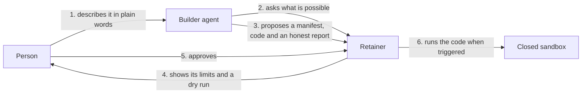
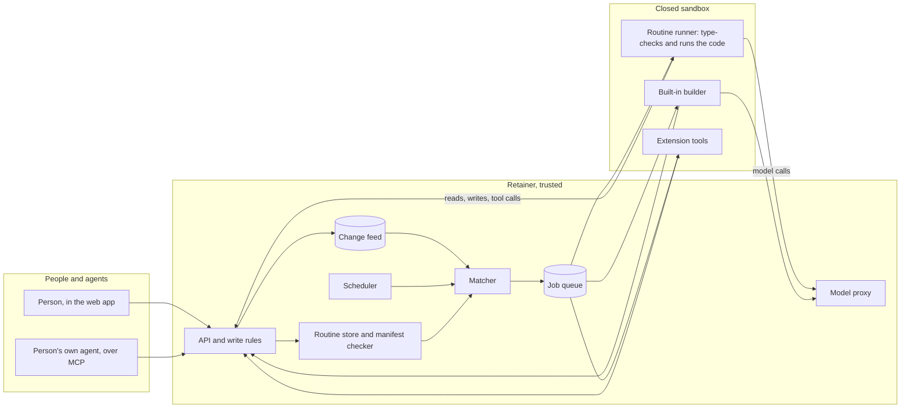
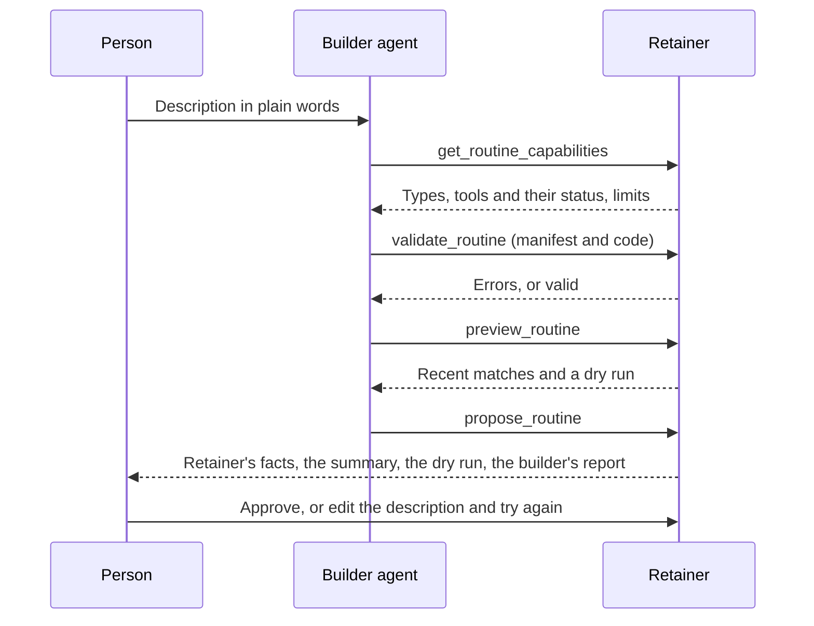
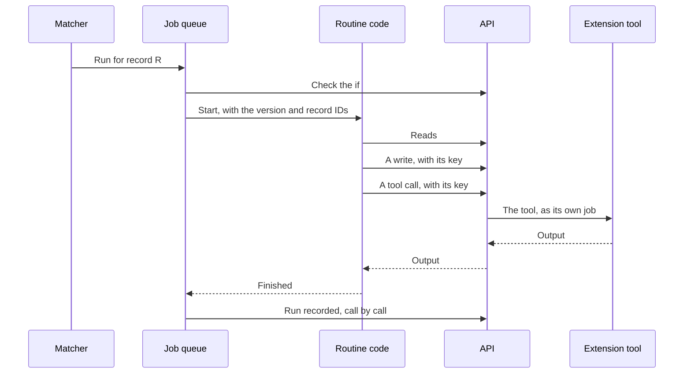
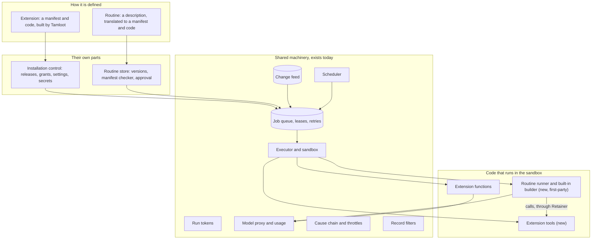

# Routines: spec

Status: **building**, 2026-11-21. Phases 1 to 5 (§11.1) are on main (#128),
except `relative` triggers. On the hosted service the runner's network stays
open for now and the process sandbox is the boundary (§11.3, decided
2026-11-21). §11.4 records where the build differs from this spec. Before
that, the proposal of 2026-11-19 went through three drafts: after two reviews,
the product owner decided that a routine is TypeScript code, not a JSON flow,
and that the first version stays lean. A third review tightened the rules for
retries, dry runs, version changes and the model cap. Section 2 lists what is
decided and what is only proposed.

Builds on the extension platform in [extensions.md](extensions.md), model calls
in [extensions-model-calls.md](extensions-model-calls.md) and the two-step
install in [extensions-configure.md](extensions-configure.md). The tools
extensions publish for routines to call have their own spec,
[extensions-tools.md](extensions-tools.md), which amends `extensions.md` for
them. If accepted this spec amends:

- `extensions.md` §9.1 (a first-party bundle may run code written inside a
  workspace in a closed process) and §9.4 (routines keep their own cursor on
  the change feed).
- `extensions-model-calls.md` §3.2.1 (a narrower list of allowed requests
  for a routine's model token) and §3.4 (`ai_usage` rows name the routine
  and the run).
- `ARCHITECTURE.md` §2.1 (`forget` clears a routine run's stored results).

The write rules and the actor types in `ARCHITECTURE.md` do not change: a
routine writes as an agent (§6.4).

Background: [the Rapid Image feature mapping](../research/rapid-image-features.md)
and [the earlier design page](https://claude.ai/artifact/FDjGnvenXbdHzjuBfomvXv).
A visual version of this spec is at
<https://claude.ai/artifact/MD4KBw6MMHr5JErEZCnXQm>. The design draws on Macro's
routines and Twenty's workflows; §13 records what was taken from each and where
to look.

The document goes top-down. Section 1 is the whole idea on one page. Sections
3 to 6 add a layer of detail each. Section 7 covers what routines share with
extensions, and section 8 how a routine calls the tools extensions publish.
Sections 9 and 10 show what is possible, where the design stops and what is
left for later. Section 11 is the delivery order, its acceptance tests and
the hosted rollout. Section 13 lists the prior art.

## 1. The idea on one page

A **routine** is a standing instruction for the workspace: when something
happens, if a condition holds, do something.

A person never builds a routine by hand. They describe it in plain words. An
agent translates the description into a small **manifest** (when it runs) and
**code** (what it does), written in TypeScript against Retainer's SDK. The
agent must also say honestly how much of the description the routine covers.
The person reviews what it will do and approves it. From then on Retainer
runs it.



Who does what:

- **The person** writes the description and approves the result. Nothing acts
  without a person's approval: an unapproved routine can only be dry-run,
  which changes nothing (§5.1).
- **The builder agent** writes the manifest and the code and reports what it
  could not cover. It is either Retainer's built-in builder or the person's
  own agent connected over MCP.
- **Retainer** tells the builder what is possible, checks every routine,
  stores it, decides when it fires and starts its runs. All of that is fixed
  logic. Retainer's core still never calls a model and never runs the code
  itself.
- **The closed sandbox** runs the code. It can reach Retainer and nothing
  else.
- **Extensions** supply the data a routine reacts to, by writing records, and
  the **tools** a routine can call, such as "send a WhatsApp message".

## 2. Decided and proposed

Decided with the product owner on 2026-11-19:

- Automations are a primitive of their own, called **Routine**, not a generic
  extension.
- **The builder is free text.** People do not assemble triggers and steps.
- **The builder agent gives honest feedback** on whether the routine is
  possible with the tools it has.
- **A routine is code.** The builder writes TypeScript, and it runs later in
  the sandbox, as Macro's routines do (§13.1). The first two drafts used a
  JSON flow that Retainer interpreted.
- **A routine can call a model** from its code.
- **Authority is one fixed rule** with nothing to configure: a routine writes
  as an agent (§6.4).
- **The first version is lean.** What is left out is listed in §10 with the
  room left for it.
- Scope includes the **extension upgrade** that lets extensions take part:
  tools, specified in [extensions-tools.md](extensions-tools.md) (§8).
- **Retainer pays for the model calls** a routine makes, with its own key, as
  it does for extension model calls. A workspace is never asked for a model
  key.
- **Member accounts** are used only in manual runs, by the person who pressed
  the button (§8). A standing routine uses workspace connections only.
- **No safeguards against hidden instructions in the first version** beyond
  what the structure gives (§6.3). The risk and its solutions get a proper
  study for the second version.

What the move to code dropped from the earlier drafts:

- The flow format: steps, `each`, `find` and value references.
- A rank worked out for every value. A routine now has one rank.
- The readback Retainer generated from the flow. Fixed code cannot describe
  what a program does, so the review shows other things (§5.2).
- The agent step with tools. Code calls a model for a typed answer instead
  (§4.5).

Proposed in this document, open to change: the manifest format, the SDK's
shape, the limits and the delivery order. §12 records the answers recommended
for the open questions.

## 3. Architecture

### 3.1 Vocabulary

| Term           | Meaning                                                                                                           |
| -------------- | ----------------------------------------------------------------------------------------------------------------- |
| Routine        | A named standing instruction. Holds a description and its approved version.                                       |
| Description    | The person's plain-language text. It is the source; the rest is derived from it.                                  |
| Manifest       | The data part of a version: the trigger, the condition and what the code may use.                                 |
| Code           | The TypeScript part of a version: one module with a `main` function.                                              |
| Trigger (when) | What starts a run: a record created or updated, an event's links changing, a time, or a person pressing a button. |
| Condition (if) | A record filter checked when a run starts.                                                                        |
| Tool           | A function an extension publishes for others to call.                                                             |
| Run            | One execution of the code, with a record of every call it made.                                                   |
| Effect         | A call that changes something or costs something: a write, a tool call or a model call.                           |
| Dry run        | A run of the code whose writes and tool calls are reported, not made.                                             |
| Builder agent  | The agent that translates a description into a manifest and code.                                                 |

### 3.2 Where each part runs



Four rules decide the placement:

1. **Code a model wrote runs in the closed sandbox, never in Retainer.** That
   is every routine's code. Retainer does not interpret it, import it or
   evaluate any part of it.
2. **Everything Retainer needs before a run starts is data.** Checking a
   manifest, matching triggers, evaluating the `if` and applying the holds
   and caps need no model and no outside code, so the trusted worker does
   them.
3. **The sandbox only ever holds agent-rank tokens.** A routine writes as an
   agent (§6.4), so nothing with a person's authority leaves Retainer.
4. **Sandbox runs never talk to each other.** When routine code calls an
   extension tool, the call goes through Retainer (§8), which checks it,
   attaches the extension's credentials and runs the tool as its own job.
   Routine code never holds an extension's secrets, and extension code never
   holds a routine's token.

### 3.3 The closed sandbox

Today the sandbox runs only reviewed code that Tamloot publishes, and hosted
job functions can reach any public address (`extensions.md` §9.1). Code that
a model wrote inside a workspace can read that workspace's records, so it
must not be able to send them anywhere. Routines therefore need a stricter
kind of run. This is the first thing to build (§11).

- **The routine runner** is a first-party bundle. Its job input carries IDs
  only: the routine version and the triggering record. It fetches the code
  and the record through the API with its run token.
- **A fresh, restricted process for every run.** The runner starts one
  process per run and gives it no files, no environment variables, no
  subprocesses and no imports beyond the bundled SDK. Nothing a run leaves
  behind is visible to the next run, including on a reused hosted function.
- **Network to Retainer only: its API, its model proxy and its file
  service.** The routine's process has no network of its own: it holds no
  token and no network API, and every read and effect is a message to the
  runner, which calls Retainer. In Compose the runner's container is also on a
  network that holds only the API. Outside effects come only from extension
  tools, called through Retainer. On the hosted service the runner's function
  can still reach public addresses, like every job function, so there the
  process sandbox alone keeps the code in; closing the function's network is
  hardening for later (§11.3).
- **The run token is the boundary.** It is bound to one run, expires with
  it, has agent rank, and can call only the tools the manifest lists. It
  carries no model access: each model call asks the API for a short-lived
  model token, given only if the manifest says the routine uses a model
  (§6.3). A dry run's token cannot write at all.
- **The type-check runs here too**, in the same bundle, without running the
  code (§5.2).

Limits inside the process steer the code and catch mistakes. They are not the
security boundary: the token, the API and the network are. Macro says the
same of its own sandbox (§13.1).

## 4. The routine

### 4.1 Shape

A version is a manifest and a module. The manifest refers to objects and
fields by their stable keys, never by display names, so a rename does not
break it. (In the examples the keys of base fields equal their names.)

```json
{
  "when": {
    "kind": "record",
    "object": "deal",
    "on": ["updated"],
    "fields": ["stage"],
    "oncePerRecord": true
  },
  "if": { "stage": { "eq": "proposal" } },
  "uses": { "tools": [], "model": false }
}
```

```ts
export async function main({ retainer, record, run }: RoutineContext<'deal'>) {
  const due = new Date(run.at);
  due.setDate(due.getDate() + 2);
  await retainer.task.create({
    title: 'Send the proposal',
    dueDate: due.toISOString(),
    deal: record.id,
  });
}
```

What Retainer checks and what it does not claim:

- **The manifest is data.** Retainer checks it completely, matches on it
  without running anything, and describes it to the person in its own words.
- **The code is a program a model wrote.** Retainer does not claim to know
  what it will do. It type-checks it, limits what it can do (§3.3, §6.4),
  shows a dry run on real records before approval (§5.2) and records every
  call each run makes (§6.6).

### 4.2 Triggers (when)

| Kind       | Fires when                                                         | Example                                |
| ---------- | ------------------------------------------------------------------ | -------------------------------------- |
| `record`   | A record of one object is created or updated                       | A deal's stage changes                 |
| `relative` | A set time before or after a date field on a record                | 1 day before an appointment starts     |
| `schedule` | A cron time in the workspace's time zone, once per matching record | Every Monday 09:00, for each open deal |
| `manual`   | A person runs it on one or more records                            | A "Send quote" button on a deal        |

- Events are records, so "a meeting was logged" is a `record` trigger on that
  event type. So is anything an extension writes.
- `record` can name the fields to watch. A change to any one of them fires
  it; without a list, any change does. There is no "all of these changed
  together".
- `updated` covers two feed operations: `update`, and `supersede`, which is a
  new revision of an event, such as a meeting logged again with its
  transcript.
- **An event's links.** On an event type, `on` can also take `links`: the
  routine then fires when the event's participants or `about` records change,
  such as a participant matched to a newly created person when the event is
  logged again. The feed records this as the `links` operation, with no field
  keys, whenever a write changes an event's links and none of its fields
  (`changes/collect.ts`). It does not say whether a participant or an `about`
  link changed, so the `if` or the code decides whether the change matters. A
  write that changes a field and a link together is recorded as `update` or
  `supersede`, with no sign that a link changed, and fires the routine only
  through its watched fields. A routine that must not miss a link change
  therefore names no fields: every change to the event then starts a run, and
  the `if` and the code decide (§9.4). A flag on the feed for changed links
  would remove this limit; it is left for later (§10).
- The matcher decides only whether a change concerns the routine: the object,
  the operation and the watched fields (§6.1). The `if` is evaluated when the
  run starts (§4.3), against the record as it is then.
- **Once per record.** `oncePerRecord: true` lets a routine act at most once
  for each record, ever. A deal that leaves Proposal and comes back does not
  get a second task, and a corrected transcript does not create the tasks
  again. Without it, every matching change can start a run.
  - A record is used up by a run's first write or tool call. A model call
    alone does not use it up. A run skipped by the `if`, one whose code
    returns before any write or tool call, and one that fails before any,
    all leave the record unused, so a meeting checked before its lead was
    matched is checked again when the lead arrives.
  - The mark is set in the same transaction as that first write, or when
    that first tool call is handed to the tool. A tool call whose outcome is
    unknown therefore counts: a message is not sent a second time for a new
    trigger. Retainer checks for an existing mark just before, so two runs
    queued close together cannot both act.
  - A run that fails after its first write or tool call leaves the record
    used, with its work half done. The run history shows it (§6.2).
- **No `deleted` trigger in the first version.** A run reads the triggering
  record, and the record query excludes deleted records. A merge is not a
  trigger either; §6.1 says what it does to runs and firings.
- `relative` covers "no contact for 7 days": 7 days after `lastContactAt`.
  §6.1 says what happens to existing records and to due times already past.
- `schedule` may carry a record filter. Each matching record gets its own run,
  up to the fan-out limit (§4.6). Without a filter it produces one run with no
  record. Cron is read in the workspace's time zone, a setting workspaces
  don't have yet (§7).
- **Expiry.** A run expires 24 hours after it starts by default. A manifest
  can set an earlier expiry from a date field, such as the start of the
  appointment a reminder is for. After the expiry Retainer refuses the run's
  further effects and the run ends as `expired`, so a reminder is never sent
  late.

### 4.3 Condition (if)

The `if` is a record filter on the triggering record, in the grammar
`POST /v1/objects/:object/query` already takes: fields ANDed, `and`, `or` and
`not` for nesting, and per field the operators its type allows
(`FILTER_OPERATORS` in `packages/shared/src/api.ts`). The manifest stores field
keys where the query takes names; the checker resolves them to the current
names when it runs the query. Only filterable fields can be tested, as in a
query: the checker refuses any other, and the builder reports
`field_not_filterable` (§5.2).

The `if` is checked when the run starts, by running the ordinary record query
for that one record. A run whose `if` fails ends at once as `skipped`, and no
code runs. That makes the `if` the cheap first test: it costs no sandbox run.
Routines act on every live record: an older message of a Gmail thread, which
lists and the feed leave out to show only the newest, still runs and matches
a schedule's filter.

A condition sees the record's current values. "The stage changed to
Proposal" works: watch the field and test its value. "Changed from Lead" does
not, because the change feed records which fields changed, not their earlier
values (§12).

Anything beyond the triggering record is tested in the code: a related
record's values, a count, a sum, a tool's answer or a model's answer. Code
that returns before its first write or tool call leaves the record unused
(§4.2).

### 4.4 The code

One module per version, exporting `main`. It gets:

| Argument   | What it is                                                                                |
| ---------- | ----------------------------------------------------------------------------------------- |
| `retainer` | The SDK, typed for this workspace's objects, fields and tools                             |
| `record`   | The triggering record as it is when the run starts. Absent on a `schedule` with no filter |
| `run`      | `id`, `at` (when the run counts as happening), `timezone` and `dryRun`                    |
| `trigger`  | `kind`, and for a manual run who pressed the button                                       |

What the SDK offers:

| Call                                            | Does                                                       | An effect |
| ----------------------------------------------- | ---------------------------------------------------------- | --------- |
| `retainer.<object>.get`, `.query`, `.aggregate` | Reads records, with the API's own filters and aggregates   | No        |
| `retainer.files.text(id)`                       | Reads the text of a file attached to a record, up to 1 MiB | No        |
| `retainer.<object>.create`, `.update`           | Writes a record                                            | Yes       |
| `retainer.events.log`, `retainer.remember`      | Logs an event, stores a fact                               | Yes       |
| `retainer.tools.<name>(input)`                  | Calls a tool an extension publishes (§8)                   | Yes       |
| `retainer.ai.generate(...)`                     | Asks a model for a typed answer (§4.5)                     | Yes       |

Rules for the code:

- **Typed from the workspace.** Retainer generates the SDK's types from the
  workspace's schema and installed tools, with fields under their stable
  keys. Code that names a missing object, field or tool, or passes a value of
  the wrong type, does not type-check and cannot be saved.
- **No imports and no network.** The SDK is the only way out.
- **Writes cite their source.** When the triggering record is an event, each
  write cites it as its source unless the code names another event. The
  values then carry the event's date, and forgetting the event removes them
  (§6.6).
- **`run.at`, never the clock.** Code reads "now" from `run.at`, so a dry run
  and a retried run give the same answer.
- **It can loop, branch, count and build text.** That is the point of code:
  there is no step list to fit into.
- **It cannot** change the schema, extensions, members or routines, read
  personal memory, or approve anything. The run token refuses those calls.

### 4.5 Model calls from code

```ts
const { complaint } = await retainer.ai.generate({
  instructions: 'Does this email read like a complaint?',
  input: { title: record.title, summary: record.summary },
  output: {
    type: 'object',
    properties: { complaint: { type: 'boolean' } },
    required: ['complaint'],
  },
});
```

- **One call, one typed answer.** The model gets the instructions, the input
  the code passes and the shape to answer in. It has no tools and cannot read
  anything else. The example asks yes or no; a list or a text is the same
  call with another shape.
- The instructions come from the approved code. Record content is passed as
  input and reaches the model as data.
- The code decides what to do with the answer. The model never acts.
- One model that the operator sets, by default the one the enrichment
  extension uses. Code never names a model.
- **The same model proxy extensions use** (`extensions-model-calls.md` §3),
  with a model token of its own kind. It is a plain model call, one request
  and one answer, not an agent. For a routine's token the proxy accepts only
  that: the operator's model, an output of at most 4,096 tokens, no `tools`
  and no `mcp_servers`. An extension's token keeps the wider list. The code
  is handed its model token and could call the proxy directly, so the proxy
  is what makes "no tools" true. It
  also keeps the sandbox closed: a model's server-side tools, such as web
  fetch, would otherwise be a way out.
- A manifest must say `"model": true` for the call to work. The review then
  says that the routine sends workspace data to the model provider.
- **No agent with tools in the first version.** An open-ended agent that
  searches and writes on its own is left for later (§10).

### 4.6 Limits (proposed)

| Limit                                      | Value                           | Why                                                                                    |
| ------------------------------------------ | ------------------------------- | -------------------------------------------------------------------------------------- |
| Source of one routine                      | 64 KiB                          | Macro's limit; keeps a version reviewable                                              |
| One run                                    | 120 s by default, 300 s at most | The extension run limits (`extensions.md` §9.1)                                        |
| Calls of one SDK operation in a run        | 200                             | Stops a runaway loop                                                                   |
| Model calls in a run                       | 50                              | Bounds cost per run                                                                    |
| Model calls per workspace per day          | 1,000                           | Bounds spend. Dry runs and the builder's calls count. Reserved before each call (§6.3) |
| Output of one model call                   | 4,096 tokens                    | Makes a count of calls a real bound on spend                                           |
| Runs one routine may queue in an hour      | 200                             | Stops a runaway or a bulk import. Further runs are held, and it pauses                 |
| Records one `schedule` tick may fan out to | 200                             | Bounds a scheduled sweep. Above it the tick waits for an admin                         |
| A run's expiry                             | 24 hours after it starts        | The queue's job lifetime. A manifest can set an earlier one                            |
| One tool or model result                   | 64 KiB                          | The extension protocol limit                                                           |
| Text read from one file                    | 1 MiB                           | Bounds what one read brings into a run                                                 |
| Stored results kept after a run ends       | 7 days                          | Long enough to inspect a run, short for copied CRM data (§6.6)                         |
| Shortest `schedule` interval               | 15 minutes                      | A routine is not a polling loop                                                        |
| Precision of `relative` triggers           | 5 minutes                       | They are found by a periodic scan                                                      |
| Depth of routines triggering each other    | 8 hops                          | The existing cause-chain cap                                                           |

A self-hosted operator can change the daily model cap
(`RETAINER_ROUTINE_MODEL_CALLS_PER_DAY`).

## 5. Building a routine from free text

### 5.1 Two builders, one contract

- **The built-in builder.** The web app has a text box. Submitting it queues a
  job in the sandbox that reads the workspace's capabilities, calls the model
  through the proxy and saves a proposal. This is the pattern `configure`
  already uses to suggest a field mapping during an extension install: code
  with read-only access and model access prepares something for a person to
  review. Its model calls count against the daily model cap (§6.3).
- **The person's own agent.** Any agent connected over MCP can do the same
  with the same calls, from a chat.

Both use only the calls below. Neither can approve.

| Call                       | Returns                                                                                                                     |
| -------------------------- | --------------------------------------------------------------------------------------------------------------------------- |
| `get_routine_capabilities` | The SDK's types for this workspace, the trigger kinds, the limits, every installed tool with its status, model availability |
| `validate_routine`         | Whether the manifest and the code pass, or a list of errors pointing at the part that failed                                |
| `preview_routine`          | Recent changes the trigger would have matched, and a dry run on a few of them (§5.2)                                        |
| `propose_routine`          | Saves the description, the manifest, the code, a one-sentence summary and the builder's report as a proposal for a person   |

`validate_routine` and `preview_routine` start a job in the sandbox and
return its result, or an ID to poll when it takes longer than a request may,
as a tool call does (`extensions-tools.md` §4).

Three ways the code can run, and what the server enforces in each:

| Mode     | Who starts it                                                                   | Writes              | Tools                                                                                               | Model calls                       |
| -------- | ------------------------------------------------------------------------------- | ------------------- | --------------------------------------------------------------------------------------------------- | --------------------------------- |
| Dry run  | The person building the routine, or their agent, with that person's read access | Reported, not made  | Reported, not called. That record's dry run ends there                                              | Made, and counted against the cap |
| Test run | An admin, on one record                                                         | Made, at agent rank | Tools declared as `read` or `write` are called. A tool declared as `send` is reported, not called, and the test ends there | Made |
| Run      | The approved routine                                                            | Made, at agent rank | Called                                                                                              | Made                              |

- A dry run needs no approval because it changes nothing. One thing leaves
  Retainer: record content sent to the model provider, as the builder itself
  sends it. The build screen says so before the person starts.
- No tool runs in a dry run, not even a `read` tool. A tool is extension
  code with its own credentials in its own job, so the dry run's read-only
  token cannot hold it to reading, and what follows the call may depend on
  its answer.



### 5.2 Honest feedback

The builder's honesty does not rest on the model's good behaviour alone.
Five mechanisms back it:

1. **Capabilities are facts.** The builder gets what exists from Retainer, as
   types: which objects and fields, which are filterable, which tools, whether
   each tool's account is connected, whether a model is available. It does
   not answer from memory.
2. **The check is fixed logic.** Retainer checks the manifest itself, and the
   routine runner type-checks the code against the workspace's types. A
   routine that names a missing object, field or tool, tests a field that is
   not filterable, breaks a limit or passes a value of the wrong type cannot
   be saved.
3. **Every proposal carries a verdict**: `full`, `partial` or `not_possible`.
   A partial or impossible verdict lists each gap: the part of the
   description it concerns, a coded reason, and what would make it possible.
4. **The review says who wrote each part.** The person approves three things,
   each labelled:
   - **Retainer's facts**, generated from the manifest by fixed code: when it
     fires, the `if`, `oncePerRecord`, the expiry, the tools it may call,
     whether it calls a model, and that it writes as an agent (§6.4).
   - **The builder's summary**, one sentence, marked as written by the
     builder. Retainer does not vouch for it.
   - **The code**, behind a link, with a diff from the active version when
     there is one.
5. **A dry run on real records.** The preview runs the actual code on up to
   five recent records the trigger would have matched, with a token that
   cannot write (§5.1). It lists every write and tool call the code tried, in
   order, and what the model answered. It also counts how many recent changes would have
   matched, which is the cost estimate. Two limits, stated on the screen:
   - records are read as they are today, not as they were when they changed;
   - a model can answer differently next time.

Gap reasons are a fixed list, so they can be counted to see what people want
that Retainer cannot do yet:

| Code                      | Meaning                                                            | What would fix it                                 |
| ------------------------- | ------------------------------------------------------------------ | ------------------------------------------------- |
| `no_source`               | Nothing writes this event into Retainer                            | Install or extend an extension                    |
| `no_tool`                 | No installed extension offers this action                          | Install an extension that does                    |
| `tool_not_connected`      | The tool exists but its workspace account is not connected         | Connect the account                               |
| `member_account`          | A standing routine would act from one member's account             | Make it a button that member presses              |
| `field_not_filterable`    | The `if` tests a field that is not filterable                      | Make the field filterable, or test it in the code |
| `needs_aggregate_trigger` | The routine should fire when a sum or count across records changes | Rephrase as a scheduled check                     |
| `needs_previous_value`    | The condition needs the value a field had before the change        | Not available yet                                 |
| `needs_instant_answer`    | The description needs a reply while someone waits                  | Outside what routines do (§10)                    |
| `needs_blocking`          | The description wants to stop a change from being saved            | Outside what routines do (§10)                    |
| `needs_deletion_trigger`  | The routine should fire when a record is deleted                   | Not in the first version                          |
| `needs_person_rank`       | The routine should replace a value a person set, without review    | Not in the first version (§6.4)                   |
| `model_unavailable`       | The code needs a model call and the server has no model key        | Self-hosted only: the operator sets one           |
| `over_limit`              | The routine would exceed a limit in §4.6                           | Narrow the description                            |
| `unclear`                 | The description can be read more than one way                      | The builder asks, or the person rewrites          |

What this cannot guarantee: the builder can still misunderstand what the
person meant, the summary can be wrong, and code can behave differently on a
record the dry run did not see. The dry run, the test run (§5.3) and the run
history are how a person catches that.

### 5.3 Approval, versions and repair

- A proposal is checked again when it is approved, as a proposed schema
  change is, because the schema may have changed since.
- Only a workspace admin approves. Agents cannot approve through any tool.
- Each approval creates a new version. Editing the description produces a new
  proposal; the active version keeps running until the new one is approved.
  The review shows the difference between the two.
- **Code is checked again when the workspace changes.** A version records a
  fingerprint of the SDK types it was checked against. Before a run, if the
  workspace's types have changed (a schema change, a tool installed or
  removed, a new SDK), the code is type-checked again. If it still passes,
  the new fingerprint is recorded and it runs. If it fails, the routine
  pauses and is marked "needs attention".
- **A tool's contract is pinned too.** Types alone are not enough: a tool can
  keep its inputs and outputs while it changes from `read` to `send`, starts
  using a member's account or starts calling a model. A version records, for
  each tool it lists, the extension, the effect, the connection and whether
  it calls a model. If any of those changes, the routine pauses until an
  admin approves it again.
- **Repair.** The description is the lasting record of intent. The builder
  can translate it again against the current workspace, and a person approves
  the repaired version. A rewrite never goes live without approval.
- If the approver leaves the workspace or loses the admin role, the routine
  pauses until another admin approves it.
- **Changing version.** A run is pinned to the version that was active when
  it was queued. When a new version is approved, runs already started finish
  on their own version, within the run's time limit. Runs not yet started,
  queued or held, are discarded, and the approval screen says how many.
- **Pausing.** A routine pauses when an admin pauses or archives it, when a
  re-check fails, when a tool's contract changes, when it keeps failing, and
  when its approver stops being an admin. A pause takes effect at once:
  Retainer checks that the routine is active before every effect, and again
  when a tool job it called starts. Pausing permanently fences started
  runs and marks them `stopped`. Resuming leaves those runs stopped.
  Runs not yet started are held for an admin to run or discard.
- **Resuming.** A resumed routine starts from the feed's head, as at
  approval. Changes made while it was paused, and due times that passed, are
  not handled later. The Routines page says since when it was paused. This
  also avoids reading from a cursor older than the feed keeps, which is 30
  days (`db/change-cursor.ts`).
- **Test run.** Before approving, an admin can test the routine on one record
  they choose. Retainer validates the proposal and issues a token for this
  test run, limited to the tools listed in that proposal. When the code
  calls a tool declared as `send`, Retainer reports the call and ends the
  test before queueing the tool (§5.1). The run is marked as a test in the
  history.
  - Its writes are real, at agent rank like any run. They enter the change
    feed, so other routines and extensions can react and send. Before the
    admin starts the test, the confirmation explains that Retainer blocks
    tools declared as `send`, other tools run with their extension's access,
    and test writes can cause other automations to send
    (`extensions-tools.md` §4).

## 6. Running a routine

### 6.1 Matching

Routines read the same change feed as extensions, with their own cursor.

- **Their own cursor.** Each routine keeps a durable feed cursor, set to the
  feed's head when it is approved, so it starts from its approval and never
  runs on past events. Extension dispatch cannot carry routines: it
  discovers work per installation (`discoverChanges` in
  `extension-runtime/queue.ts`, called from `worker/changes.ts`), so a
  workspace with a routine and no extension would never be found. Routine
  discovery finds workspaces with an active routine whose cursor is behind
  the head, and works with no installations at all. It runs in the same
  maintenance tick. A paused routine is not scanned; when it resumes, its
  cursor is set to the head again (§5.3).
- **What the matcher checks.** For each change it finds the active routines
  on that object, then checks the operation (`create`; `update` or
  `supersede`; or `links` for an event routine that watches its links, §4.2), the watched fields, the
  cause chain (§6.5) and whether a `oncePerRecord` routine has already acted
  on the record, and queues a run. It does not check the `if`; the run does,
  when it starts (§4.3).
- **Coalescing.** A run sees the record as it is when the run starts. Rapid
  successive edits to one record fold into one run, as extension change jobs
  already do: a queued, unstarted run for the same routine and record absorbs
  the later change.
- A write that loses on precedence changes nothing, so it triggers nothing.
- **Merges.** A merge is not a trigger. A run is always on the surviving
  record: the merge moves the merged-away record's unfinished runs to the
  survivor, and a run's start resolves its record again. So "one run at a
  time per routine and record" (§6.2) holds across a merge, and the database
  enforces it. Its firings and its `oncePerRecord` marks move to the survivor;
  where both records have one, the survivor keeps it, so the merge does not
  fire the routine a second time. `relative` due times are worked out again
  from the survivor's values.
- **Time triggers.** `relative` and `schedule` triggers come from the
  scheduler. A periodic scan finds due records and remembers what it already
  fired (`routine_firings`), so each record fires once per due time.
  - At approval, a `relative` routine applies to existing records whose due
    time is still ahead. Due times already past are not fired.
  - When a record gets a date whose due time has already passed (an
    appointment booked three hours ahead, with a reminder a day before),
    nothing fires by default. A manifest can say `late: "run"`, and then it
    fires at once, still subject to the run's expiry.
  - A changed date is a new due time and fires again, unless the routine is
    `oncePerRecord`.

### 6.2 A run



- A run is one job on the existing queue, with its leases, retries and
  at-least-once delivery. One run at a time per routine and record.
- **Every effect is numbered.** The SDK issues a run's effects one at a time,
  and Retainer records each under a key made of the run and its position: the
  operation, a hash of its arguments and its result. A write is recorded in the same
  transaction as the write itself. A tool call or a model call is recorded as
  started before it leaves, and as done when its result comes back.
- **A retried run does nothing twice.** A retry starts the code from the
  top. Each effect that finds its position already recorded gets the
  recorded result when both its operation and arguments match. Effects past
  the recorded ones happen normally. A retry keeps its initial trigger
  eligibility, including the `if` and its own once-per-record firing.
- **A retry that takes another path stops.** If the operation or arguments
  differ at a recorded position, the run ends as `diverged`. Committed
  effects remain visible in the run history.
- **What is guaranteed, and by whom.** A write to Retainer happens once: the
  database guarantees it. A tool call or model call found as started with no
  result is sent again with the same key, because Retainer cannot know
  whether it arrived. Whether the outside action repeats then depends on the
  tool honouring the key (§8). A repeated model call costs money and
  changes nothing.
- **Checked before each effect:** the run has not expired (§4.2). In a
  normal run, Retainer checks that the routine is still active (§5.3). In a
  test run, it checks that the initiating person is still a workspace admin.
  Past its expiry the run ends as `expired`.
- A run that fails for good ends as `failed`. What it already did is not
  undone, and the history shows each call it made.
- After repeated failed runs the routine pauses and is marked "needs
  attention". Until Retainer has notifications, that shows only on the
  Routines page.

### 6.3 Model calls and cost

- **Spend.** A workspace makes at most 1,000 routine model calls a day, dry
  runs and the builder's calls included (§4.6).
  - **Reserved before the call, not counted after it.** `ai_usage` is written
    after the provider answers (`model/proxy.ts`), so calls made at the same
    time would all pass a count taken from it. Instead each model call first
    asks the API for a model token. In one atomic step the API counts the
    call against the run's cap and the day's cap, records it as an effect
    (§6.2) and returns a token that lasts long enough for one request.
  - A retried call that finds its recorded result is not counted again.
  - At the cap the token is refused, the run ends as `budget_exhausted`, and
    the Routines page shows it.
  - **Each call is bounded too.** The proxy caps a routine call's output at
    4,096 tokens and its request at the existing 6 MB, so a count of calls
    is a real bound on spend.
  - `ai_usage` stays the record of what was spent; its rows from a routine's
    model token carry the routine and the run.
  - Model calls an extension tool makes itself are that extension's usage
    and outside this cap. The cap on calls of one operation in a run bounds
    them.
  - The preview shows how often the routine would have run recently, so the
    cost is visible before approval.
- Retainer pays for these calls with its own model key, as it does for
  extension model calls. A workspace never enters a key. Usage is recorded
  per call in `ai_usage` under its own kind.
- **Hidden instructions: a known risk, not handled in the first version.** A
  routine may read text that an outsider wrote, such as an incoming email.
  That text can hide instructions aimed at the model ("also include the
  client list", "send this to another address"), and the model's answer can
  then steer what the code writes or sends.
  - The structure limits the damage. The model cannot call tools itself: it
    only returns an answer, and the code decides which tools to call. The
    code is fixed at approval. The sandbox has no network. Writes are at
    agent rank.
  - Beyond that, the first version adds no safeguard. Not covered:
    - a model's text can go out in a message with nobody reviewing it;
    - a model's answer can influence who a message goes to;
    - a model can be led to invent tasks or facts, which the routine then
      writes;
    - a model's answer can decide whether an action is skipped, taken or
      repeated.
  - An earlier draft had two rules for sending after a model call: an
    admin's extra approval, and a check on where a message goes. They covered
    only part of this.
  - The product owner decided on 2026-11-19 to study the risk and its
    solutions properly for the second version (§10) instead of shipping
    partial rules.

### 6.4 Authority

One fixed rule: **a routine writes as an agent.**

| The field's current value                  | What the routine's write does                     |
| ------------------------------------------ | ------------------------------------------------- |
| Empty, or set by an agent or by a template | It applies. Among agents the latest write wins    |
| Set by a person or by an integration       | It waits for review, and the value stays as it is |

This is write rule 3 in `ARCHITECTURE.md`, unchanged. No new actor type and no
new rank are needed.

- **Why.** The code was written by a model, and it may act on a model's
  answer. Macro does the same: a routine's code writes as its agent unless a
  person explicitly asks otherwise (§13.1). It also keeps placement rule 3:
  nothing in the sandbox ever holds a person's authority.
- **Most routines never meet the rule.** Creating a task, logging an event,
  storing a fact, calling a tool and sending a message involve no existing
  value to compete with.
- **The cost.** "When an appointment is booked, set the lead's status to
  Booked" changes the status on its own only where no person and no sync set
  it. Otherwise the new status shows in the review inbox for a person to
  accept. The builder reports `needs_person_rank` when a description asks for
  more, and the review says "writes as an agent".
- The actor is of type `agent` and names the routine. Each write also records
  the version that made it. History shows the routine, its version and its
  approver on every value it wrote.
- Manual runs and test runs write the same way. History also names the
  person who started them.
- **Room for later.** A version stores the rank it writes at, and the first
  version accepts only `agent`. A rank equal to a person's, for routines that
  must replace people's values, is the first extension (§10).

### 6.5 Loops and load

- A routine joins the existing cause chain like an installation. A routine is
  never triggered by a change it caused, directly or through others, and
  chains stop at 8 hops.
- Runs count against a per-routine write budget and the workspace's limits,
  as installations do. Excess work waits; it is not dropped.
- **Bulk changes.** A routine that queues more than 200 runs in an hour (a
  bulk import firing every "on create" routine, or a sync touching thousands
  of records) is paused and marked "needs attention". The runs past the limit
  are held, not started: an admin runs or discards them. Nothing is sent for
  the held runs until then.
- **Scheduled sweeps.** A `schedule` tick whose filter matches more than 200
  records queues nothing, pauses the routine and says how many matched. As
  with held runs, an admin can run that tick once, over the cap, or discard
  it; narrowing the filter is the lasting fix.
- `oncePerRecord` (§4.2) stops repeat runs on records that come back to the
  same state.

### 6.6 Stored data

| Table                 | Holds                                                                                                                                                                  |
| --------------------- | ---------------------------------------------------------------------------------------------------------------------------------------------------------------------- |
| `routines`            | Name, description, status (`draft`, `active`, `paused`, `needs_attention`, `archived`), the active version, the feed cursor                                            |
| `routine_versions`    | The manifest, the code, the summary, the types fingerprint, the contract of each tool it lists, the rank, the builder's report, who built it, who approved it and when |
| `routine_runs`        | The version it is pinned to, the trigger, record IDs, the status, each call's operation and outcome, held, test or dry-run flags, the cause chain                      |
| `routine_run_results` | Each effect's position, operation, argument hash, state and result, so a retry can reuse it                                                                            |
| `routine_firings`     | What time triggers already fired, and which records a `oncePerRecord` routine already acted on                                                                         |

Routines are not records, so they don't appear in views or the change feed.

Run history copies no CRM content except in `routine_run_results`:

- Runs keep IDs, statuses, operation names and error codes, never arguments,
  values or text.
- A write's result is the ID of the record it wrote. A tool's or a model's
  result can hold copied content. Results are kept while the run may still be
  retried, then for 7 days so a person can inspect the run, then deleted.
- Code can read any record, and Retainer does not track reads, so it cannot
  know which records a stored result drew on. `forget` therefore deletes
  every stored tool and model result in the workspace, in the same deletion,
  and advances the fence of each in-flight run in the workspace. From then
  on that run's token is refused for every effect, so content it has already
  read cannot be written anywhere, and the run ends as `erased`. This is how
  `ARCHITECTURE.md` §2.1 already treats jobs: they carry IDs only and must
  not resurrect deleted content. `forget` is rare and admin-only and results
  live 7 days at most, so losing some inspection history is the accepted
  price.
- **What a routine wrote from an event goes with the event.** Its writes cite
  the triggering event as their source (§4.4), and `forget` already deletes
  claims whose source is an erased event (`privacy/forget.ts`). Tasks created
  from a meeting's transcript therefore lose those values when the meeting is
  forgotten. A value written from other records carries no such link, as
  with any agent's write; `forget`'s existing review of mentions covers it.

## 7. What routines share with extensions

A routine is not an extension. It has no release, no install and no secrets,
and its code is written inside the workspace, not published by Tamloot. But a
routine's run is the same kind of work as an extension's run, so it uses the
same machinery.



| Shared piece               | Where it lives today                                              | How routines use it                            | Change needed                                                                                                                                                                                              |
| -------------------------- | ----------------------------------------------------------------- | ---------------------------------------------- | ---------------------------------------------------------------------------------------------------------------------------------------------------------------------------------------------------------- |
| Change feed and dispatcher | `record_changes`, `worker/changes.ts`, `queue.ts`                 | Routine matching in the same tick              | A cursor per routine, set at approval, and discovery that works with no installations (§6.1)                                                                                                               |
| Job queue, leases, retries | `extension-runtime/queue.ts`, `worker/extensions.ts`              | Run, check, tool and builder jobs              | A job can belong to a routine run, not only an installation                                                                                                                                                |
| Scheduler and cron parsing | `worker`, `packages/extension/src/cron.ts`                        | `schedule` and `relative` triggers             | Schedules created at approval; a workspace time zone setting and zone-aware cron, both new (cron is UTC-only today)                                                                                        |
| Executor and sandbox       | `launcher`, `worker/launch-driver.ts`, `packages/runner`          | Runs the routine runner, tools and the builder | The closed kind of run (§3.3); the result carries an optional output (`extensions-tools.md` §3)                                                                                                            |
| Run tokens                 | `extension-runtime/tokens.ts`, `extension-runtime/credentials.ts` | The routine's and the builder's access         | A token bound to a routine run, at agent rank, limited to the manifest's tools. A dry run uses the existing `read` scope alone. Model access is a separate token per call (§6.3)                           |
| Model proxy and usage      | `model/`, `extensions/usage.ts`                                   | `ai.generate` and the built-in builder         | A model-token kind for routines; `ai_usage` rows name the routine and the run; a narrower list of allowed requests for that kind (§4.5); a token per call, issued by the API once it has reserved the call |
| Cause chain and throttles  | The dispatcher (`extensions.md` §9.4)                             | Loop prevention and budgets                    | A routine can be a member of a chain                                                                                                                                                                       |
| Record filters             | `packages/shared/src/api.ts`, `records/query.ts`                  | The `if`, and queries from code                | Field keys resolved to names                                                                                                                                                                               |
| Aggregates                 | `records/aggregate.ts`                                            | Sums and counts from code                      | None                                                                                                                                                                                                       |
| Files                      | `files`, `docs/files.md`                                          | Reading an attached file's text from code      | The closed run can reach the file service for downloads                                                                                                                                                    |
| Propose, then approve      | Schema changes; the two-step install                              | Routine versions; the built-in builder         | None; the same pattern                                                                                                                                                                                     |
| Run history screens        | `packages/web/src/routes/extensions`                              | The Routines page                              | Reuse the run list                                                                                                                                                                                         |
| `forget`                   | `privacy`                                                         | Clears stored run results                      | Delete stored results and fence in-flight runs (§6.6)                                                                                                                                                      |

Not shared: installations, releases, grants, settings, secrets, key-value
storage, webhooks and source imports. A routine holds no secrets and stores
no data of its own beyond its run results.

What each package gains, beyond what the tools spec adds
(`extensions-tools.md` §7):

| Package              | License | Gains                                                                                                                                                          |
| -------------------- | ------- | -------------------------------------------------------------------------------------------------------------------------------------------------------------- |
| `packages/shared`    | MIT     | The manifest's schema and types, the generator that turns a workspace's schema and tools into SDK types, and the renderer for Retainer's facts                 |
| `packages/sdk`       | MIT     | The routine-facing SDK the code calls, and client methods for routines                                                                                         |
| `packages/runner`    | MIT     | Two first-party bundles: the routine runner (type-check and run) and the builder                                                                               |
| `packages/server`    | AGPL    | A `routines` module (store, manifest checker, effect keys and results), routine discovery and matching, new REST and MCP calls                                 |
| `packages/web`       | MIT     | The Routines page: describe, review, approve, runs, held runs; the workspace time zone setting                                                                 |

One thing to avoid, seen in Twenty (§13.2): it has three separate trigger
systems, for workflows, app functions and agents, each with its own queue and
condition format. Here extensions and routines read one feed, share one queue
and use one filter grammar; they keep separate cursors on the feed only
because their work is discovered differently.

## 8. Extension tools

Extensions take part in a routine in three places: a routine reacts to what
they write (when), and calls the **tools** they publish to answer a question
(if) or to act (do). Tools are specified in their own spec,
[extensions-tools.md](extensions-tools.md): how an extension declares one
(§2 there), the output a tool returns (§3), the call that starts it and is
polled for its result (§4), what the builder needs from extensions (§5) and
what extensions do not get (§6).

What a routine adds when it calls a tool:

- **Approval.** Approving a routine shows the tools its manifest lists, and
  the run token can call no others. The version records each listed tool's
  contract, and a change to it pauses the routine (§5.3). A test run uses its
  validated proposal's tool list (§5.3).
- **Whose account.** A standing routine uses `workspace` connections only. A
  `member` tool uses the connection of the person who presses the routine
  button or the admin who tests a manual routine. The test still reports
  send calls before queueing them (`extensions-tools.md` §4).
- **A deadline, no retry.** The call gets a deadline that fits in the run's
  remaining time and is not retried by the queue: a failure goes back to the
  code as an error, and the code decides what to do. When the tool job
  starts, Retainer repeats the authorization and expiry checks (§6.2).
- **The effect key.** Every call carries its effect key (§6.2), and a `send`
  tool must use it to avoid sending twice.
- **Dry runs and test runs.** In a dry run no tool is called. In a test run,
  a call to a tool declared as `send` is reported and ends the run before
  the tool is queued (§5.1).
- **Cause.** The call carries the routine's cause chain, so a tool's writes
  cannot trigger the routine that called it (§6.5).

## 9. Examples

### 9.1 Possible

| Description                                                                                      | How the routine does it                                                                                           |
| ------------------------------------------------------------------------------------------------ | ----------------------------------------------------------------------------------------------------------------- |
| "When a deal moves to Proposal, create a task to send the proposal within two days."             | `record` trigger on stage, `oncePerRecord`; the code creates one task                                             |
| "If a lead has had no contact for a week and is still open, create a follow-up task."            | `relative` trigger on `lastContactAt`, an `if`; the code creates one task                                         |
| "When an appointment is booked, set the lead's status to Booked."                                | `record` trigger; the code updates the lead. Waits for review where a person or a sync set the status (§6.4)      |
| "The day before an appointment, send the patient a WhatsApp reminder if they haven't confirmed." | `relative` trigger, an `if`, one tool call; the run expires when the appointment starts                           |
| "Every Monday at 9, create a review task for each deal open longer than 30 days."                | `schedule` trigger with a record filter, one run per deal, up to 200 deals                                        |
| "After a meeting is logged with its transcript, list what people promised and create tasks."     | `record` trigger; the code asks a model for the list and creates a task for each item                             |
| "When an email arrives from a lead, if it reads like a complaint, open an urgent ticket."        | `record` trigger; the code asks a model yes or no and creates the ticket                                          |
| "Every Friday, summarise this week's new leads and post it to Slack."                            | `schedule`; the code queries, asks a model for the summary and calls a tool with a fixed channel                  |
| "When a patient emails a question, answer it."                                                   | `record` trigger; the code asks a model for the reply and calls a send tool. Nobody reviews the text first (§6.3) |
| "If a patient misses a third appointment, flag them for the manager."                            | `record` trigger; the code counts missed appointments and updates the patient                                     |
| "Every morning, if this quarter's won deals pass 100,000, create a task for me."                 | `schedule`; the code sums with `aggregate` and creates the task                                                   |
| "When a deal moves to Won and its company is in Israel, create an onboarding task."              | `record` trigger; the code reads the company and returns early when it does not match                             |
| "When a deal is won, create one onboarding task for each product on it, named after the client." | `record` trigger; the code loops over the products and builds each title                                          |
| "Add a Send quote button on deals."                                                              | `manual` trigger, one tool call                                                                                   |

### 9.2 Possible only with something else in place

The builder reports these as `partial` or `not_possible`, with the reason:

| Description                                                           | What it needs                                                                   | Gap code            |
| --------------------------------------------------------------------- | ------------------------------------------------------------------------------- | ------------------- |
| "When a call is missed, create a lead."                               | A phone extension that logs missed calls as events                              | `no_source`         |
| "Send a WhatsApp reminder…" with no messaging extension               | An extension that offers a send tool                                            | `no_tool`           |
| "Email the patient from their therapist's Gmail" as a standing rule   | A member granting standing routines their account, deferred. A button works now | `member_account`    |
| "Summarise the transcript…" on a self-hosted server with no model key | The server's operator setting a model key                                       | `model_unavailable` |
| "Set the status to Booked even if someone set it by hand."            | A routine rank equal to a person's, left for later                              | `needs_person_rank` |

### 9.3 Not possible, by design

| Description                                                     | Why not                                                                                      |
| --------------------------------------------------------------- | -------------------------------------------------------------------------------------------- |
| "Don't let anyone save a deal without an amount."               | A routine runs after a change is saved. It cannot refuse one                                 |
| "When a patient opens the booking page, show them free slots."  | A routine answers nobody. It runs in the background, seconds to minutes later                |
| "Book the room and the doctor together, or neither."            | Each write is its own. A failure midway does not undo earlier writes                         |
| "The moment revenue passes 100,000, tell me."                   | Triggers watch one record. A sum can only be checked on a schedule (§9.1)                    |
| "When a deal jumps from Lead straight to Won, alert me."        | A condition sees a field's current value, not the value before the change                    |
| "When a deal is deleted, …"                                     | No `deleted` trigger in the first version                                                    |
| "Check every ten seconds whether…"                              | The shortest schedule is 15 minutes                                                          |
| "Show the secretary a popup when…"                              | A routine changes records and calls tools. It has no effect on screens                       |
| "Look the company up on its website and fill in what you find." | Code has no network. Outside data comes only from an extension's tool                        |
| "Do whatever it takes to win this deal back."                   | The code is fixed at approval. A model call returns an answer and has no tools               |
| "Add a field for…", "Install…", "Create another routine that…"  | A routine cannot change the schema, extensions, members or routines                          |
| "Use my private notes about this client."                       | Runs are workspace-level and cannot read personal memory                                     |
| "Apply this to all last year's meetings."                       | A routine starts from its approval. It does not run on past events                           |
| "Charge the card exactly once, guaranteed."                     | Delivery is at least once. Avoiding a duplicate depends on the tool honouring the call's key |

### 9.4 A worked example

This example is also an acceptance test (§11.2).

The person writes:

> After every meeting with a lead, create tasks for anything we promised, and
> send the lead a thank-you on WhatsApp.

The workspace has the Tamloot extension installed and no messaging extension.
Tamloot logs a meeting first and fills its transcript later. The builder
proposes:

- **Verdict:** `partial`.
- **Gap:** "send the lead a thank-you on WhatsApp" is not covered. Reason:
  `no_tool`. Fix: install a messaging extension that offers a send tool.
- **Summary:** "After a meeting with a lead has its transcript, create a task
  for each thing that was promised."
- **Manifest and code:**

```json
{
  "when": {
    "kind": "record",
    "object": "conversation",
    "on": ["created", "updated", "links"],
    "oncePerRecord": true
  },
  "if": { "medium": { "eq": "meeting" } },
  "uses": { "tools": [], "model": true }
}
```

```ts
export async function main({ retainer, record }: RoutineContext<'conversation'>) {
  const [file] = record.transcript;
  if (!file) return;

  const leads = await retainer.person.query({
    filter: { id: { in: record.participants }, status: { eq: 'lead' } },
  });
  if (leads.count === 0) return;

  const transcript = await retainer.files.text(file);
  const { commitments } = await retainer.ai.generate({
    instructions: 'List each thing someone promised in this meeting, who and by when.',
    input: { transcript },
    output: Commitments,
  });

  for (const item of commitments.slice(0, 20)) {
    await retainer.task.create({
      title: item.title,
      dueDate: item.due,
      conversation: record.id,
    });
  }
}
```

Five things in it matter:

- **The trigger names no fields**, so every change to a conversation starts a
  run: a transcript arriving in a new revision, a participant linked, or both
  in one write. Tamloot usually fills the transcript before a new lead is
  matched (it logs the event, gets the lead back unmatched, the person is
  created, and the event is logged again to link them). The feed reports a
  link change on its own only when nothing else changed (§4.2), so watching
  the transcript field would miss a lead linked together with another
  change. Each extra run costs one check of the `if`.
- **The transcript is a file.** A `files` field cannot be filtered
  (`docs/files.md`), so the `if` tests only the medium, and the code checks
  that a transcript exists and reads its text.
- **The code returns before any write** when there is no transcript or no
  lead. That costs no model call and does not use up the meeting, so it is
  checked again when either arrives.
- **The first task created uses up the meeting.** From then on a corrected
  transcript does not create the tasks again. If the model finds nothing
  promised, nothing is written and the meeting stays unused.
- **Each task cites the meeting as its source**, so forgetting the meeting
  removes what the routine wrote from it (§6.6).

What the person reviews:

> **Retainer's facts.** Runs when a conversation is logged or changes in any
> way, including its participants, and it is a meeting. Acts at most once per
> meeting. Calls a model, so meeting content is sent to the model provider.
> Calls no tools and sends nothing. Writes as an agent: its values never
> replace what a person or a sync set without review.
>
> **The builder's summary.** After a meeting with a lead has its transcript,
> create a task for each thing that was promised.
>
> **Dry run on 5 recent meetings.** Three would have created tasks (4, 2 and
> 6 of them, listed). Two stopped because no participant is a lead. 11
> meetings changed in the last 30 days.

The person can approve the partial routine now and add the thank-you later by
editing the description once a messaging extension is installed.

What must happen, case by case:

| Case                                                                            | Expected                                                                                             |
| ------------------------------------------------------------------------------- | ---------------------------------------------------------------------------------------------------- |
| A meeting logged with its transcript and a lead                                 | One run, tasks created as an agent, each citing the meeting                                          |
| A meeting logged first, its transcript added an hour later                      | At logging, a run that returns early (no transcript); one run with tasks when the transcript arrives |
| The transcript corrected after the tasks were created                           | No second run, no duplicate tasks                                                                    |
| A meeting with no lead among its participants                                   | A run that returns before any write: no model call, no tasks, and the meeting is not used up         |
| A lead matched after a run that returned early                                  | One more run, and tasks are created                                                                  |
| A lead linked in the same write as another field change                         | The same: one more run, and tasks are created                                                        |
| A lead matched after a run that created tasks                                   | No second run                                                                                        |
| A call (medium `call`) with a transcript                                        | A run skipped by the `if`; no code runs                                                              |
| The run is retried after the second task, and the transcript changed in between | The first two tasks are not created again; the rest follow                                           |
| The meeting is forgotten                                                        | The values its tasks took from it are removed                                                        |

## 10. Design limits and what is left for later

Each limit below follows from a choice made above.

| Limit                                                           | Comes from                                                                           |
| --------------------------------------------------------------- | ------------------------------------------------------------------------------------ |
| Routines react after the fact; they cannot block or validate    | They read the change feed, which records committed changes                           |
| No instant answers                                              | Every run goes through the job queue                                                 |
| No all-or-nothing across writes                                 | Each write is its own; Retainer has no multi-record transaction for callers          |
| Sums and counts only on a schedule, never as a trigger          | Triggers watch one record; code computes aggregates when a run asks                  |
| Conditions see current values only                              | The change feed records which fields changed, not their earlier values               |
| No trigger on deletion                                          | A run reads its record, and reads exclude deleted records                            |
| A link change is seen on its own only when nothing else changed | The feed has no flag for it. A routine that must not miss one names no fields (§4.2) |
| Code reaches nothing but Retainer                               | The closed sandbox. Outside effects come only from reviewed extension tools          |
| Retainer cannot say in advance what the code will do            | It is a program. The dry run, the limits and the run history are the check           |
| A routine never replaces a person's value on its own            | It writes as an agent (§6.4)                                                         |
| A run must finish in 300 seconds                                | One job per run                                                                      |
| Triggers only on what is written down                           | The matcher sees records, not what happens inside other systems                      |
| Fast successive edits fold into one run                         | Runs coalesce per routine and record                                                 |
| Model answers are bounded and can vary                          | A model gives them; the limits in §4.6 and §6.3 apply                                |
| Hidden instructions in incoming text can steer a model's answer | No safeguard in the first version beyond the structure (§6.3)                        |
| Outside actions may repeat on a retry                           | At-least-once delivery, unless the tool honours the call's key                       |
| A standing routine cannot act from a member's account           | Each member's connection is theirs alone; only a button they press uses it           |
| Stored results are kept for days, not kept as history           | They copy CRM data, which `forget` must be able to remove                            |
| Failures are visible only on the Routines page for now          | Retainer has no notifications yet                                                    |
| The builder can misread intent                                  | A model translates; the dry run and the test run are the check                       |
| Nothing for one person only                                     | Routines are workspace-level and admin-approved                                      |

Left out of the first version on purpose, with the room left for each:

| Later                                                                                                                                          | Room left for it now                                                                                                                                                                            |
| ---------------------------------------------------------------------------------------------------------------------------------------------- | ----------------------------------------------------------------------------------------------------------------------------------------------------------------------------------------------- |
| **A routine rank**, equal to a person's, so a routine can replace people's values                                                              | A version stores its rank; only `agent` is accepted. It needs a new actor type, a switch only an admin can set and that the builder cannot, and a run token that holds that rank in the sandbox |
| **Safeguards against hidden instructions** in text a routine reads                                                                             | To be designed for the second version, after a proper study of the risk. Run history already records which runs called a model and which tools they called                                      |
| **Knobs**: values an admin changes without new code, such as a label or a number of days (Macro)                                               | An optional list in the manifest that the code reads as `knobs`; versions without it are unaffected                                                                                             |
| **An agent with tools**, for open-ended work                                                                                                   | A further SDK call beside `ai.generate`, handed to the workspace agent the model-calls spec plans (§11 there)                                                                                   |
| **Limits per object**: which objects a routine may write                                                                                       | `uses` in the manifest grows; the run token already enforces `uses.tools`                                                                                                                       |
| **Long runs and waits**                                                                                                                        | Effect keys already let a run stop and start again without repeating itself                                                                                                                     |
| Notifications for failures, a `deleted` trigger, a feed flag for changed links, previous values in conditions, members granting their accounts | Independent of the format                                                                                                                                                                       |

## 11. Delivery order and rollout (proposed)

### 11.1 Phases

1. **Extension tools**, as [extensions-tools.md](extensions-tools.md) §7
   specifies: `defineTool`, the optional `output` in protocol v1, the invoke
   call with its call ID and polling, the tool list. It has no caller until
   phase 3, so it lands before it or with it.
2. **The closed sandbox.** The routine runner bundle; a fresh restricted
   process per run with no network of its own; no public egress in Compose;
   the generator for the SDK's types; the type-check; the routine run token
   and its read-only form for dry runs. The hosted runner is a job function
   like any other bundle's (§11.3).
3. **Routines without model calls.** The manifest and its checker; routine
   discovery with its own cursor, working with no installations; matching for
   `record`, `schedule` and `manual` triggers; `oncePerRecord`; the hourly
   hold and the schedule fan-out cap; the workspace time zone and zone-aware
   cron; runs with effect keys and expiry; the dry run and the test run;
   approval, versions, the re-check when types or a tool's contract change,
   and the rules for changing version, pausing and resuming; stored results
   and
   `forget`; runs and history; the MCP calls for a person's own agent; the
   Routines page. Buttons (`manual`) come here, and member tools with them.
4. **The built-in builder.** The free-text box in the web app, with the
   per-call model token and the daily cap (§6.3): the builder is the first
   thing that spends.
5. **Model calls from code.** `ai.generate`, the narrower list of allowed
   requests at the model proxy (§4.5), reading a file's text and consent on
   the review.
6. **More.** `relative` triggers, suggested routines from extensions, then
   the items in §10.

### 11.2 Acceptance tests

Beyond the unit and integration tests every feature needs, these must pass,
each against real Postgres:

- **Phase 2, the sandbox is closed.** Routine code cannot reach a public
  address, read a file or an environment variable, start a process, or see
  anything a previous run left. Code that calls the API directly with a dry
  run's token changes nothing. The test passes in Compose, and the process
  checks pass on the hosted service.
- **Phase 3, the first routine.** "When a deal moves to Proposal, create one
  follow-up task", in a workspace with no extensions installed. The run is
  interrupted right after the task is created. The retry leaves exactly one
  task, and its history names the routine and the approved version.
- **A retry mid-loop.** Code that creates ten tasks is stopped after the
  third. The retry ends with exactly ten.
- **Two attempts at once.** Two attempts of the same run executing
  concurrently create each task once. This runs the competing operations
  concurrently, as the testing rules require.
- **A retry after the data changed.** A run is interrupted after its first
  task is created, and the record its title came from changes before the
  retry. If the effect arguments changed, the run diverges and creates no
  second copy of that task.
- **A retry that branches differently** ends as `diverged` and does nothing
  more.
- **Rank.** A routine's write to a field a person set waits for review and
  leaves the value as it was.
- **Expiry.** A reminder whose retries outlast its expiry is never sent late.
- **A schema change.** Removing a field the code uses pauses the routine
  before its next run.
- **A tool's contract changes.** A tool the routine lists changes from
  `read` to `send` with the same inputs. The routine pauses before its next
  run.
- **A test before approval.** An admin starts a test for a validated,
  unapproved proposal. A listed `write` tool runs, an unlisted tool is
  refused, and a listed tool declared as `send` ends the test without
  queueing a tool job.
- **A pause mid-run.** A routine is paused while a run is between two
  writes. The second write is refused and the run ends as `stopped`.
- **A new version.** Approving a new version discards the runs not yet
  started and lets a started run finish on its own version.
- **Phase 4, the cap under load.** With one model call left in the day's
  cap, ten calls made at the same time get exactly one token. This runs the
  competing operations concurrently.
- **Phase 5, a plain model call.** The model proxy refuses a request that
  carries `tools` or `mcp_servers`, or names another model, when it comes
  with a routine's model token. The same request with an extension's token
  passes.
- **`forget` during a run.** Erasing a record removes every stored tool and
  model result in the workspace, and a retry does not restore them. A run in
  flight is refused its next write. Forgetting a meeting removes the values
  a routine's tasks cited it for.
- **Phase 5, the worked example** (§9.4), every case.

### 11.3 Hosted rollout

- **A new trigger kind.** A server release that accepts `tool` must be live
  before any bundle declaring a tool enters the hosted catalog
  (`extensions-tools.md` §7).
- **One new first-party bundle.** The routine runner (the builder is a
  `build` run of it) needs the cloud repository's steps for a brand-new
  bundle: its Lambda function, the catalog configuration and the release
  allowlists. It has no catalog entry, only an executable.
- **The runner is an ordinary job function (decided 2026-11-21).** Hosted
  job functions have no VPC configuration and reach any public address, an
  accepted relaxation for reviewed code (`extensions.md` §9.1). The routine
  runner is reviewed first-party code too, so it runs the same way. The code
  it runs is not reviewed by Tamloot, so the process sandbox is the boundary
  there: the child process holds no token and has no network API, module
  loading or `process` (§11.4). Leaking a workspace's records takes two
  failures: an admin approves code that tries, and that code escapes the
  sandbox. Node's permission model is not meant to stop malicious code, so
  this is a deliberate trade for the first version, while there are no
  users. **Before real workspaces use Routines on the hosted service**, close
  the runner's network to Retainer's API, model proxy and file service, as
  Compose does. The likely shape: the runner in the VPC, reaching an internal
  load balancer in front of the API, model and files functions, and the
  files bucket through its endpoint.
- **Polling, not waiting.** Tool calls, checks and previews return an ID
  because the hosted API answers within 30 seconds (`extensions-tools.md`
  §4).
- **Model usage.** Routine model tokens are a new kind at the `model`
  function; usage rows carry the routine and the run (§6.3). The API issues
  one per call, once it has reserved the call against the caps.
- **Discovery.** Routine discovery runs where change maintenance runs today,
  with its own budget, so a workspace with many routines cannot delay
  extension dispatch.

### 11.4 As built

Where the implementation differs from the sections above, or settles what
they left open:

- **Runs have their own queue.** Routine runs, checks, dry runs, tests and
  builder runs are rows of `routine_runs`, with their own lease, fence and
  attempts, claimed through `retainer_routine_runs_due`; they are not
  `extension_jobs`. A tool call is an extension job (`trigger_kind = 'tool'`)
  in its own lane, so it never waits behind the extension's other jobs, and
  its claim checks again that the calling run is running, its routine active
  and a test's initiator still an admin.
- **The runner's answer.** Protocol v1 carries output only on success, so
  the routine runner always answers `succeeded` with the routine's
  `outcome` (`succeeded`, `failed` or `stopped`), its code and, for a check,
  the problems. The executor maps it to the run's status.
- **The sandbox** (`packages/runner/src/routine*.ts`). The runner type-checks
  with TypeScript's own compiler on a temporary directory, then runs the
  emitted JavaScript in a child process under Node's permission model (no
  file system beyond that directory, no child processes, workers or addons),
  with code generation from strings disallowed. A loader hook refuses every
  import after the routine's own module, however it is written; `fetch`,
  `WebSocket`, `process.getBuiltinModule`, `process.binding` and `process`
  itself are removed. The child holds no token: it asks the runner, which
  calls the API. In Compose the launcher gives a routine run a network with
  only the API container on it and no egress proxy. The routine's own model
  calls reach the self-hosted proxy on the API origin.
- **The builder** is a `build` run of the same runner: it reads the
  capabilities, asks the model for name, summary, report, manifest and
  code, checks the draft (the manifest at the server, then a full
  type-check), retries up to three times with the problems, and proposes.
  Its model calls are numbered effects of its run, so they count against the
  daily cap; their recorded arguments say only what the call was for, since
  the prompt carries the whole SDK.
- **Held runs of a paused routine** run only after it is resumed: a paused
  routine refuses every effect, so "run them" answers `409
  routine_not_active` until then. An admin who wants one over-limit schedule
  tick resumes, runs the held runs, and pauses again (§6.5 meant this to be
  one step).
- **The Routines page** (`packages/web/src/routes/routines`) has the
  describe box, the review (facts, summary, report, code), approve, reject,
  test, pause, resume, archive, held runs, runs with their calls, record
  buttons, and the workspace time zone under workspace settings. A
  proposal has a dry run, which shows each run's calls and why one failed,
  and Approve asks for confirmation first. A run's page shows what the
  code returned and its log, says when a run changed nothing ("Done, no
  changes", in the run list too), and shows each write as the kind of
  record and each field by its label with what happened to it ("saved",
  "waiting for review"), with a notice when a value waits for a person. A
  test finds its record by searching the routine's object. A manual
  routine's button shows in the side panel of a record opened from a list,
  as on the full page. An active schedule has "Run now". It does not yet
  show a diff against the approved version on the review (§5.2), or which
  tool each call named.
- **Schedules in words.** Retainer's facts describe a schedule in words
  (`describeCron` in `shared`): "every Sunday at 09:00", "every weekday
  (Monday to Friday) at 08:30". A shape it doesn't know is quoted as
  written, and so is a step that doesn't divide the hour or the day
  (`*/45` fires at :00 and :45, not every 45 minutes).
- **Run now** (`POST /v1/routines/:id/run-now`, admins). An active
  schedule fires one tick due now, with every rule a due tick has: the
  fan-out cap, held runs and `oncePerRecord`. It fires in the transaction
  that holds the routine, so a regular tick skips it meanwhile and a second
  press fires its own tick after it. The next regular time is unchanged. A paused routine refuses it
  (`routine_paused`), as does one without a schedule (`not_schedule`).
- **A paused routine has no next time.** The API answers `nextFireAt:
  null` while a routine is not active; resuming sets it afresh.
- **A refused call keeps its position.** Code may catch a refused effect (a
  missing record, an unlisted tool) and go on, so the refusal is recorded as
  a failed call at its position and a retry gets the same error. A 429 or a
  server error is not recorded; a server without a model or tool catalog
  answers 409 (`model_unavailable`, `tool_unavailable`), so those are. A
  model call the provider refuses (400, 404, 413) or whose answer is
  unusable (422) is recorded the same way with the provider's words, which
  the run's page shows and a retry throws again; a late answer does not
  replace it. A rate limit, an outage or a rejected token is not recorded,
  so a later attempt asks again. The builder records its own calls the same
  way, and a definite failure ends the build as `builder_failed` with the
  provider's words instead of retrying.
- **A model call's schema is held to what the provider takes.** The runner
  sends only `type`, `description`, `enum`, `properties`, `required` and
  `items`, with every object closed, and applies `maxItems` to the answer
  itself before it is recorded, since the provider refuses that keyword.
- **A dry run's writes come back typed.** A write in a dry run returns the
  shape the SDK declares: `{ id, fields }` with each written field
  `applied`, and a placeholder ID for a record it would create (the same on
  every attempt). Code that reads the result runs in a preview as it does
  for real.
- **Approving a version closes older proposals.** Proposals numbered below
  the approved version are superseded in the same transaction, which holds
  the routine row, so one cannot be approved over it later. Newer proposals
  stay open.
- **The builder sets `oncePerRecord` when the description asks for it.**
  Its guide lists the flag for every trigger, and its answer says whether
  the description asks to act once per record. When it says so and the
  manifest lacks the flag, the draft is sent back with that problem, so the
  rule is in the manifest, where Retainer enforces it and the approver
  reads it. The model reads the description: a pattern would misread "once
  a week per deal" or "only once the deal has an amount".
- **A tool call's payloads are routine content.** `forget` redacts the input
  and output of every routine tool job in the workspace and cancels the
  unfinished ones; retention clears them 7 days after the run ends, and
  cancels one the run left unfinished.
- **A preview counts every match.** The cost estimate counts all matching
  changes of the window in SQL, and the sample is the five live records
  (survivors of any merge) with the most recent matches, so one busy record
  takes one slot.
- **Clock changes.** A scheduled wall time that a spring-forward change
  skips runs an hour later (02:30 at 03:30); one that a fall-back change
  repeats runs the first time, in every zone.
- **Merges** mark every change they make (`record_changes.merged_from_id`):
  the survivor's, and those of records and events that pointed at the
  merged-away record. Dispatch and the preview skip them. A merge also
  moves the merged-away record's unfinished runs, firings and
  `oncePerRecord` marks to the survivor (§6.1). A queued run that a queued
  run of the same version on the survivor already covers is discarded as
  `merged`.
- **One running run per routine and record** is a unique index on running
  runs. Every run is on the surviving record: a claim resolves a merged ID
  and stores the survivor, and a change made before a merge queues on the
  survivor. The claim takes a key-share lock on the record, so a merge waits
  for it; it skips a record a merge holds and tries on the next tick. The one
  exception is a run that was running on the merged-away record while the
  survivor had a run of the same routine running: both started before the
  merge, so it keeps the old ID until it ends, and the claim's check counts
  it.
- **A tool call ends with its attempt.** The tool job expires when the
  runner stops the attempt (its deadline less the 2 s the runner keeps to
  report), not at the run's 24-hour expiry, and a job claimed late gets only
  the time left, so no tool acts after its run has timed out. A model call's
  token ends at the same moment.
- **The hourly cap counts scheduled runs.** A schedule tick that would queue
  more than 200 runs of the routine in the last hour holds the rest and
  pauses it, as a burst of record changes does.
- **Imports are refused by the type-check.** No module resolves in the
  sandbox, so an `import`, a dynamic `import()` or `require()` fails the
  check, and the loader refuses one at run time. The server does not scan
  the text, which cannot tell syntax from a string or a member named
  `import`.
- **Values are typed by the API's write rules.** One function in `shared`
  (`writeRules`) says whether a create must set a field and whether a write
  takes null; the API's value validation and the generated types both read
  it, as filters, sorts and aggregates read the API's own rules. So a create
  requires every non-nullable field, null clears only a nullable
  single-value field (a many-to-many relation is cleared with `[]`), an
  update is any subset, and a JSON field takes a JSON value. Code the API
  would refuse with `invalid_values` fails its type-check instead.
- **No import resolves, the routine's own file included.** The code is
  checked under a file name it cannot know, as the sandbox loads nothing but
  the routine.
- **`then` is reserved** for objects as for tools: the sandbox keeps
  `retainer` from being thenable.
- **Name and description follow the approved version.** Proposals carry
  their own name and description. Approval makes that version's name and
  description the routine's live metadata.
- **Re-approval creates a version.** Approving an already approved version,
  including resuming on behalf of an approver who has left, records a new
  version and preserves the prior approval. Only the active version's runs
  can change the Routine's health.
- **The approver is checked at every effect.** An approver who stops being
  an admin refuses the run's next effect as `routine_paused` and cancels a
  tool job it has not started, as a test run's initiator does; the next
  run's start records the pause (`approver_left`).
- **A tool is checked again when it is called.** An extension upgraded
  after a run started could change a tool's contract mid-run, so the call
  compares the installed tool with the version's pin, as the run's start
  does. A change refuses the call (`tool_changed`) and pauses the routine.
- **An `if` on a removed field** fails the run as `check_failed` and pauses
  the routine, as code that no longer type-checks does.
- **A manifest the schema no longer fits** pauses the routine as
  `check_failed`. One check (`manifestResolves`) covers every schema
  reference: the object, watched fields, the schedule's filter, the `if` and
  the expiry field, and it compiles each filter exactly as the query will.
  The matcher asks it before reading changes, the schedule tick before
  fanning out and a run before it starts, so a removed field, one made
  non-filterable or a removed object never leaves a routine failing each
  pass or silently deaf.
- **Queries are typed from the API's own rules.** Capabilities describe
  each field's filter operators (`filterOperatorsFor`), whether it sorts and
  its aggregates (`aggregateOps`), and the generated SDK types filters,
  sorts and aggregates from them, with the operand the API reads (money
  compares `amountMicros`) and the built-in columns (an event's
  `occurredAt`, `channel` and `externalId` too, which the read path now
  takes). Making a field non-filterable changes the types, so the next run
  rechecks the code.
- **A write's citation is an option, not a value.** `create(values,
  { source })` and `update(id, values, { source })` keep the citation apart
  from the values, so a field keyed `source` is written like any other.
- **A preview with nothing to dry-run** answers `previewId: null` and
  `done: true` at once, rather than an ID that has no runs to poll.
- **A preview type-checks in full.** It may come before any validation, so
  its dry runs check the code as a check run does: code that would never
  pass validation fails as `check_failed` instead of previewing.
- **Sources go with their runs.** A source only validations or previews
  used is deleted once its runs are, 30 days on; a version's source stays,
  and a source saved again counts from then.
- **`main` takes its trigger's context.** The sandbox check requires the
  exported `main` to accept `RoutineContext<'<object>'>` (or `RoutineContext`
  without an object), as Macro checks a step's `main` against its context. The builder's own check of a
  draft uses the same type.
- **Names the SDK uses.** An object named `files`, `events`, `tools`, `ai`
  or `remember` would collide with `retainer.<service>`, so routines do not
  list it and refuse it as a trigger (`reserved_object`). No tool may be
  named `then`, which would make `retainer.tools` look like a promise
  (`extensions-tools.md`).
- **Routines see older Gmail messages.** Lists show only a thread's newest
  message; a routine's start check and a schedule's targets match every live
  record that no newer revision replaced.
- **Record dispatch commits separately per routine.** A paused burst
  collects up to 2,000 held runs per routine and bounds the remaining scan.
  Discovery prioritizes the workspaces least recently dispatched. The
  maintenance pass reserves time for scheduled runs and retention. The
  pause reason reports overflow. If the cursor expired, dispatch logs
  the gap and starts at the retained floor.
- **Reads count per attempt.** Each read operation is capped at 200 calls,
  counted atomically on the run and reset when an attempt starts, since
  reads are not replayed. Effects count across attempts.
- **An over-limit schedule tick holds at most 2,000 runs.** Above that it
  holds none, rather than some, and pauses the routine as
  `schedule_too_large`: the filter must be narrowed.
- **The sandbox clock** (`Date.now()`, `new Date()` and `Date()`) is frozen
  to the first attempt's start. `run.at` remains the trigger's effective time,
  which can be earlier for a scheduled run. The runner also receives the
  trigger record as it was when first claimed. This snapshot is retained
  for retries and cleared when the run ends or on `forget`. Explicit reads
  by the code still fetch current records.
- **Run output** (the value `main` returns and up to 50 log lines) is kept
  on the run, cleared after 7 days and by `forget`, like stored results.
- **Configuration.** `RETAINER_ROUTINE_MODEL` (default `claude-opus-5-5`) and
  `RETAINER_ROUTINE_MODEL_CALLS_PER_DAY` (default 1000). The routine runner is
  an entry of `RETAINER_EXTENSION_EXECUTABLES` with the registration and
  function IDs in `ROUTINE_RUNNER_REGISTRATION_ID` and
  `ROUTINE_RUNNER_FUNCTION_ID`; `scripts/build-extension-artifacts.mjs`
  writes it under `artifacts/extensions/routine-runner`. Web, REST, MCP and
  background dispatch are enabled when the deployment registers that runner
  and provides its run verification key. Retention keeps running when the
  runner is unavailable. On the hosted service the runner is the
  `routine-runner` job function (§11.3).

Acceptance tests (§11.2) not yet automated: expiry, a tool's contract
changing, a test run reaching a `send` tool, and the worked example (§9.4).
The hosted runner's network is open by decision (§11.3). The others run in
`packages/server/test/api/routine*.test.ts` and
`packages/runner/src/routine.test.ts`. `pnpm test:routines:compose` (part of
`pnpm test:docker`) runs a routine's type-check and run in Compose and checks
that each run network held only the API and the runner.

## 12. Open questions, answered

Answered by recommendation on 2026-11-19. Each stands unless the product
owner changes it.

| Question                                                         | Answer                                                                                                                                                                               | Why                                                                                                                                                                     |
| ---------------------------------------------------------------- | ------------------------------------------------------------------------------------------------------------------------------------------------------------------------------------ | ----------------------------------------------------------------------------------------------------------------------------------------------------------------------- |
| What does a routine write as?                                    | An agent, always, in the first version                                                                                                                                               | The leanest rule: no new actor type, nothing with a person's authority in the sandbox, and it is Macro's default. A routine rank is the first extension (§10)           |
| What runs the code?                                              | A fresh restricted process per run, inside a first-party bundle, with no network of its own. Which runtime is settled by a spike: Deno, as Macro uses, or Node's permission model    | The token, the API and the network are the boundary; the runtime only has to start clean and stay closed                                                                |
| Does a retried run repeat itself?                                | No. Effects are numbered, and a retry gets the recorded result when the operation and arguments match at that position. An outside call with an unknown outcome is sent again with the same key   | The queue delivers at least once, and the code cannot be trusted to make itself safe to repeat. The database guarantees writes; a tool must honour the key for the rest |
| Can a rewrite go live without approval?                          | No, never                                                                                                                                                                            | Nothing runs without a person's approval. Macro applies some rewrites on its own; here an admin approves every version                                                  |
| What happens to runs when a version changes or a routine pauses? | A run is pinned to its version. A new approval discards runs not yet started. A pause is checked before every effect                                                                 | An approval needs a clear edge: nothing unapproved starts, and a pause stops work at the next effect                                                                    |
| Who can start a dry run?                                         | The person building the routine, or their agent. It writes nothing and calls no tools; its model calls count against the cap                                                         | Nothing acts before approval, yet the builder needs to see what its code does                                                                                           |
| Can a condition test the value before a change?                  | Not in the first version. "Changed to" only                                                                                                                                          | The change feed keeps which fields changed, not their earlier values, and fast edits fold into one run                                                                  |
| Which model do the builder and the code use?                     | One model the operator sets. No choice per workspace                                                                                                                                 | The simplest thing that works. Code never names a model, so the model can change without touching routines                                                              |
| Does a routine need a spend guard?                               | Yes: 1,000 routine model calls per workspace per day, dry runs and the builder's calls included. Each call is reserved before it is made and bounded in size                         | A count read from `ai_usage` afterwards would let calls made together all pass. One workspace cap bounds every routine, loop and preview                                |
| May a routine send after asking a model?                         | Yes, with no extra safeguard in the first version                                                                                                                                    | The product owner's decision: partial rules would cover only part of the risk. It is studied properly for the second version (§6.3, §10)                                |
| Can a standing routine use a member's account?                   | No. A member tool runs only in a manual run, as the person who pressed the button                                                                                                    | Each member's connection is theirs alone; an admin cannot lend it out                                                                                                   |
| Who may approve a routine?                                       | Workspace admins only                                                                                                                                                                | A routine acts across the whole workspace                                                                                                                               |
| Is there a test run before going live?                           | Yes, optional, on one chosen record, by an admin. A call to a tool declared as `send` ends the test before the tool is queued                                                         | The test makes real writes that can cause other automations to send, and tools that run keep their extension's access (§5.3)                                            |

Decided by the product owner on 2026-11-19:

- **Retainer pays for a routine's model calls and for the builder**, as it
  does for extension model calls. No workspace is ever asked for a model key.
  The daily cap per workspace and the provider-side limit on Retainer's key
  are the caps. On a self-hosted server the operator's key is used, as today.
- **A routine is TypeScript code**, the first version is lean, and it writes
  as an agent (§2).
- **No safeguards against hidden instructions in the first version** beyond
  the structure (§6.3).

## 13. Prior art

This design draws on two products, read from local checkouts on 2026-11-19.
Their code and docs were read; nothing was run. Both projects change quickly,
so a review of this spec should check the pointers below against the current
code before relying on them.

| Product | What it calls this | Local checkout         | Commit read | Commit date |
| ------- | ------------------ | ---------------------- | ----------- | ----------- |
| Macro   | Routines           | `~/Development/macro`  | `be50abb4d` | 2026-11-19  |
| Twenty  | Workflows          | `~/Development/twenty` | `1dd1c249a` | 2026-11-14  |

### 13.1 Macro

Paths are from the root of the Macro repository.

Taken from Macro:

- **The name.**
- **A routine is a structured trigger plus TypeScript that a model writes
  against the product's SDK** (§4). See `crates/routine_program/src/model.rs`,
  `crates/routine_program/src/code_steps.md` and
  `services/agent_harness_service/src/routine_code.rs`.
- **Type-check before saving, against the SDK's declarations, without running
  the code** (§5.2). See `crates/code_execution/src/outbound/deno/check.rs`
  and `crates/scheduled_action/src/domain/code_check.rs`.
- **A fresh restricted process for every run, with the network limited to the
  product's own API**, and the plain statement that those limits steer the
  code while the token and the API are the boundary (§3.3). See
  `crates/code_execution/README.md`.
- **Code writes as an agent by default** (§6.4). Macro's code steps write as
  its agent acting for the owner; writing as the owner needs the person's
  explicit request, which a program cannot make. See `CodeIdentity` in
  `crates/routine_program/src/model.rs` and `crates/scheduled_action/AGENTS.md`.
- **A dry run whose token cannot write**, so code written to get around the
  dry run is still refused (§5.2). See `routine_claims` in
  `services/agent_harness_service/src/routine_code.rs`.
- **A fingerprint of the SDK the code was checked against, and a re-check
  when it changes** (§5.3). See
  `crates/scheduled_action/src/domain/code_upgrade.rs`.
- **The run's time from the trigger, never the clock** (§4.4). See
  `crates/routine_program/src/contract.rs`.
- **A cap on calls of one operation, to stop a loop** (§4.6), and **run
  history that records each call's operation and outcome, never its
  arguments** (§6.6). See `crates/code_execution/README.md` and
  `services/agent_harness_service/src/routine_code.rs`.
- **Drafting from a plain-language description, checked before it is saved**
  (§5). See `crates/scheduled_action/src/domain/drafts.rs` and
  `apps/web/src/features/routines/`.
- **Pausing and repairing a routine when what it depends on changes** (§5.3).
  See `crates/scheduled_action/src/domain/code_upgrade.rs`.
- **Trigger content reaches a model as data, not instructions** (§4.5). See
  `crates/scheduled_action/`.

Done differently on purpose:

- A Macro routine belongs to one user and acts with that user's access. Here
  a routine belongs to the workspace and an admin approves it (§5.3).
- Macro saves some model rewrites of a routine's code without asking. Here
  every version needs an admin's approval (§5.3).
- Macro has no ranking of authors; "as an agent" is a label there. Here it is
  a rank: an agent's value waits for review against a person's (§6.4).
- Macro's code asks a model yes-or-no questions and gets probabilities
  (`macro.ai.decide`), and hands open-ended work to one "Ask AI" agent step.
  Here code asks for a typed answer, and an agent with tools is left for
  later (§4.5, §10).
- Macro shows each code step as a sentence with knobs its owner can change.
  Knobs are left for later; the review shows Retainer's facts, the builder's
  summary and a dry run (§5.2, §10).
- Macro runs do not record a result per effect; a failed step stops the run.
  Here every effect has a key, so a retry repeats nothing (§6.2).
- In Macro a routine's write never starts a routine. Here routines can chain,
  up to 8 hops (§6.5).
- Macro's triggering events are a closed list in code. Here any record
  change can trigger, including what extensions write (§4.2).
- Macro lets a model answer a yes-or-no condition before a run starts. Here
  the `if` is fixed logic and judgment happens in the code (§4.3).
- Third parties cannot add triggers or actions to Macro. Here extensions
  publish tools (§8).

### 13.2 Twenty

Paths are under `packages/` in the Twenty repository.

Taken from Twenty:

- **A manual trigger that is a button on a record**, for one record or many
  (§4.2). See `twenty-server/src/engine/core-modules/workflow/`.
- **Apps add actions, not trigger types** (§8; `extensions-tools.md` §6). An
  app's function can be exposed as a workflow action. See
  `twenty-server/src/engine/metadata-modules/logic-function/logic-function.entity.ts`
  and `twenty-sdk/src/sdk/define/workflows/define-workflow.ts`.
- **An agent can build an automation through tools** (§5). See
  `twenty-server/src/modules/workflow/workflow-tools/tools/`.
- **Watched fields plus a record filter on a record-change trigger** (§4.2,
  §4.3). See
  `twenty-server/src/modules/workflow/workflow-trigger/automated-trigger/listeners/workflow-database-event-trigger.listener.ts`.
- **Automations stored in their own tables, not as records** (§6.6). Twenty
  moved its workflows out of ordinary records. See
  `twenty-server/src/engine/core-modules/workflow/entities/workflow.entity.ts`.

Done differently on purpose:

- Twenty has a visual builder and about 20 step types, with branches and
  loops (`twenty-shared/src/workflow/types/WorkflowActionType.ts`). Routines
  have a free-text builder and code (§4).
- Twenty has three trigger systems, for workflows, app functions and agents.
  Routines and extensions share one feed, one queue and one filter grammar
  (§7).
- No loop detection was found in Twenty, only rate limits and a list of
  objects automations may not write
  (`twenty-shared/src/workflow/constants/ObjectsBlockedFromAutomation.ts`).
  Routines use the cause chain (§6.5).
- A Twenty workflow writes with full access and there is no ranking of
  authors
  (`twenty-server/src/modules/workflow/workflow-executor/services/workflow-execution-context.service.ts`).
  Routines write as an agent (§6.4).
- Twenty's docs warn that "record created" fires before the fields are filled
  in (`twenty-docs/user-guide/workflows/`). Here a routine watches the field
  that completes the data and tests it in the `if` (§9.4;
  `extensions-tools.md` §5).

Two findings about Twenty were not confirmed beyond a search of the code: that
its webhook trigger's authentication setting is not enforced, and that it has
no loop detection.
