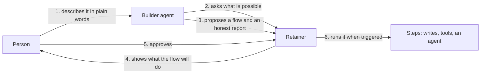
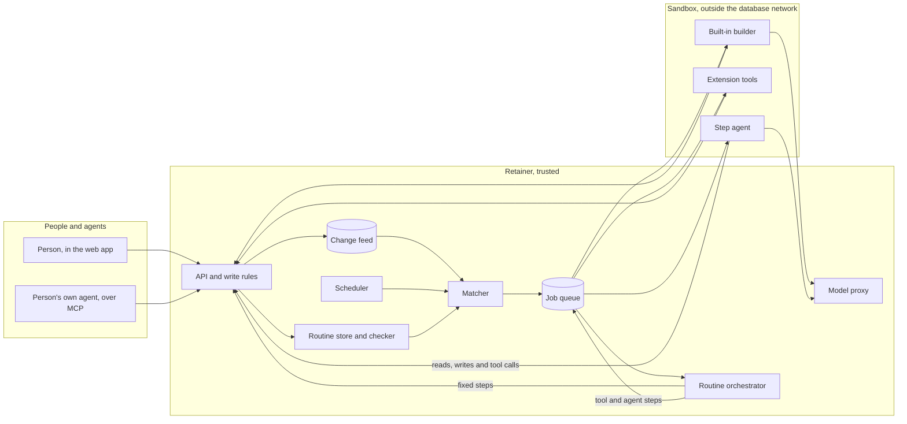
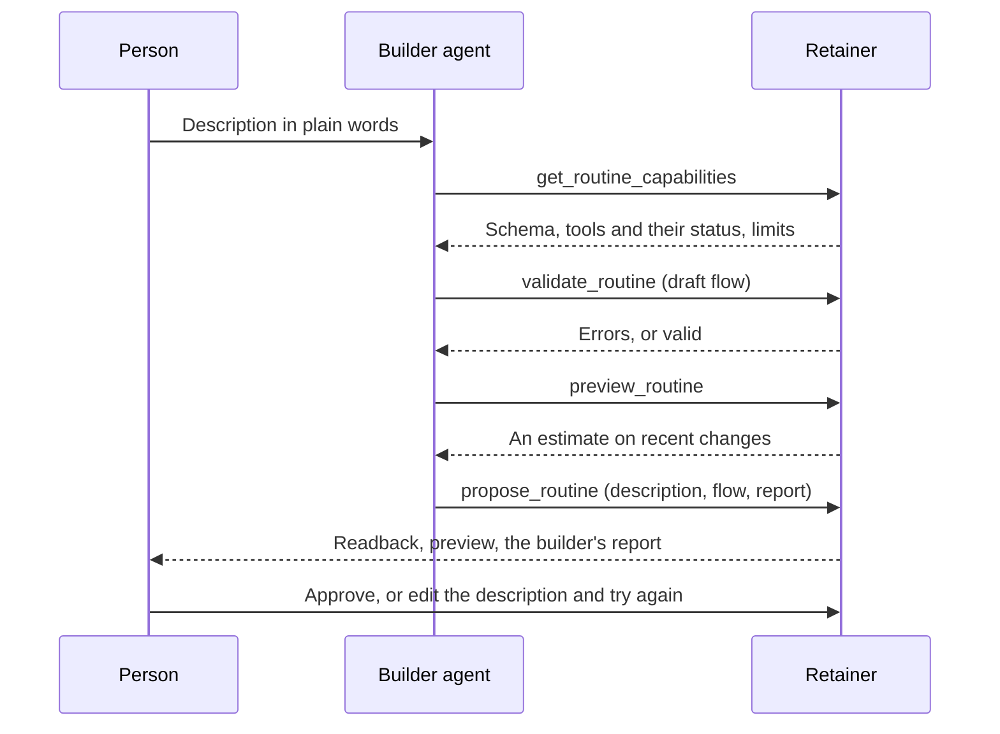
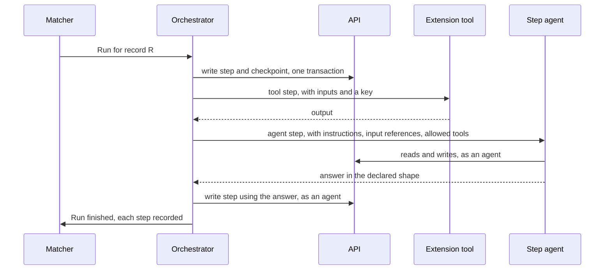
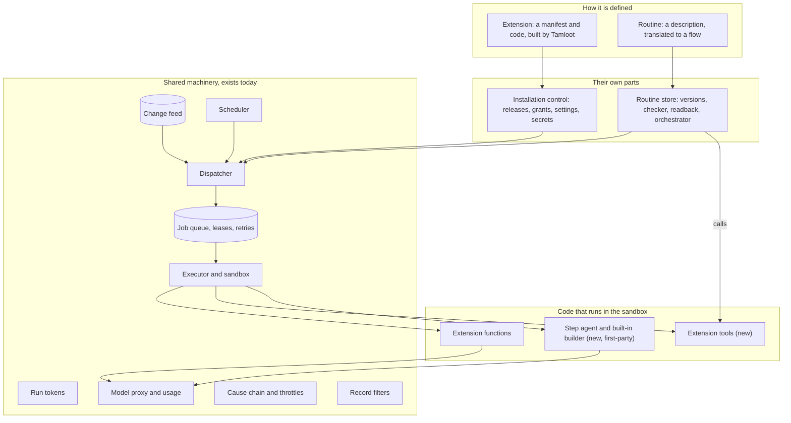

# Routines: spec

Status: **proposal**, 2026-11-19, revised the same day after two reviews. Not
accepted and not built. Section 2 lists what is decided, what the review
changed and what is only proposed.

Builds on the extension platform in [extensions.md](extensions.md), model calls
in [extensions-model-calls.md](extensions-model-calls.md) and the two-step
install in [extensions-configure.md](extensions-configure.md). If accepted it
amends:

- `extensions.md` §5 (a new `tool` trigger), §9.1 (the run result gains an
  optional output) and §9.4 (routines keep their own cursor on the change
  feed), and §12 (tools an agent can call).
- `extensions-model-calls.md` §3.4 (`ai_usage` rows name the routine run and
  step).
- `ARCHITECTURE.md`: the Actor section in §1.1 and
  `packages/shared/src/actor.ts` (a fifth actor type, `routine`), write rule 2
  (who a routine writes as, and the rank a copied value keeps), write rule 3
  (an agent's value against a routine's waits for review) and §2.1 (`forget`
  clears routine run outputs).

Background: [the Rapid Image feature mapping](../research/rapid-image-features.md)
and [the earlier design page](https://claude.ai/artifact/FDjGnvenXbdHzjuBfomvXv).
A visual version of the first draft is at
<https://claude.ai/artifact/MD4KBw6MMHr5JErEZCnXQm>; it predates the review and
is out of date. The design draws on Twenty's workflows and Macro's routines;
§13 records what was taken from each and where to look.

The document goes top-down. Section 1 is the whole idea on one page. Sections
3 to 6 add a layer of detail each. Sections 7 and 8 cover what routines share
with extensions and what extensions must gain. Sections 9 and 10 show what is
possible and where the design stops. Section 11 is the delivery order, its
acceptance tests and the hosted rollout. Section 13 lists the prior art.

## 1. The idea on one page

A **routine** is a standing instruction for the workspace: when something
happens, if a condition holds, do something.

A person never builds a routine by hand. They describe it in plain words. An
agent translates the description into a **flow**, the structured form Retainer
can check and run. The agent must also say honestly how much of the
description the flow covers. The person reads back what the flow will do and
approves it. From then on Retainer runs it.



Who does what:

- **The person** writes the description and approves the result. Nothing runs
  without a person's approval.
- **The builder agent** translates the description into a flow and reports
  what it could not cover. It is either Retainer's built-in builder or the
  person's own agent connected over MCP.
- **Retainer** tells the builder what is possible, checks every flow, stores
  it, decides when it fires and runs its steps. All of that is fixed logic.
  Retainer's core still never calls a model.
- **Extensions** supply the data a routine reacts to, by writing records, and
  the **tools** a routine can call, such as "send a WhatsApp message".
- **An agent** can perform a step inside a flow, for work that needs
  judgment, such as reading a transcript.

## 2. Decided and proposed

Decided with the product owner on 2026-11-19:

- Automations are a primitive of their own, called **Routine**, not a generic
  extension.
- **The builder is free text.** People do not assemble triggers and steps.
- **The builder agent gives honest feedback** on whether the flow is possible
  with the tools it has.
- **A routine can include an agent or model call** as one of its steps.
- **Authority is one fixed rule** with nothing to configure (§6.4).
- Scope includes the **extension upgrade** that lets extensions take part in
  the when, the if and the do (§8).
- **Retainer pays for the model calls** a routine makes, with its own key, as
  it does for extension model calls. A workspace is never asked for a model
  key.

Changed after review, approved by the product owner on 2026-11-19:

- **The authority rule** is still one fixed rule. Literals in the flow get
  the routine's rank; a value copied from a record or a tool keeps its
  source's rank; anything an agent step or a model-calling tool decided (the
  value, the target, the `each` list or a condition) is agent-made.
  Workspace data that only decides whether or where a write happens does not
  lower its rank (§6.4). The first draft gave every non-agent value the
  routine's rank.
- **The spend guard** is a daily cap per workspace on agent step executions,
  builder submissions included, read from `ai_usage` (§4.6, §6.3). The first
  draft capped runs per routine, which left the number of routines, agent
  steps per run and `each` items unbounded.
- **Member accounts** are used only in manual runs, by the person who pressed
  the button (§8.3). A standing routine uses workspace connections only.
- **An agent step whose text is sent** gets only its declared inputs and no
  read tools (§6.3).

Proposed in this document, open to change: the flow format, the limits, which
agent performs agent steps first and the delivery order. §12 records the
answers recommended for the open questions.

## 3. Architecture

### 3.1 Vocabulary

| Term           | Meaning                                                                                                           |
| -------------- | ----------------------------------------------------------------------------------------------------------------- |
| Routine        | A named standing instruction. Holds a description and its approved flow.                                          |
| Description    | The person's plain-language text. It is the source; the flow is derived from it.                                  |
| Flow           | The structured form: one trigger, an optional condition, a list of steps.                                         |
| Trigger (when) | What starts a run: a record created or updated, an event's links changing, a time, or a person pressing a button. |
| Condition (if) | A record filter checked when a run starts. Steps can carry their own condition too.                               |
| Step (do)      | One action: write a record, find records, call a tool, or ask an agent.                                           |
| Tool           | A function an extension publishes for others to call.                                                             |
| Run            | One execution of a flow, with a record of what each step did.                                                     |
| Builder agent  | The agent that translates a description into a flow.                                                              |
| Step agent     | The agent that performs an agent step during a run.                                                               |

### 3.2 Where each part runs



Four rules decide the placement:

1. **Anything that calls a model runs in the sandbox.** That is the built-in
   builder and the step agent. Both reach the model only through the model
   proxy and reach records only through the API, with a token limited to
   their job. This is the placement the model-calls spec already chose for
   code that reads outside content.
2. **Anything deterministic runs in Retainer.** Checking a flow, matching
   triggers, evaluating conditions and performing fixed steps need no model
   and no outside code, so the trusted worker does them.
3. **Writes with a person's authority never leave Retainer.** The
   orchestrator performs them itself. The sandbox only ever holds tokens with
   an agent's rank (§6.4).
4. **Sandbox runs never talk to each other.** Extension tools, the step agent
   and the builder use the sandbox that extension functions use today, but
   each run is separate and holds only its own token. When the step agent
   uses an extension tool, the call goes through Retainer (§8.3), which checks
   it, attaches the extension's credentials and runs the tool as its own job.
   The step agent never holds an extension's secrets, and extension code never
   holds the step agent's token.

## 4. The flow

### 4.1 Shape

A flow is a JSON document. It refers to objects and fields by their stable
keys, never by display names, so a rename does not break it. (In the examples
the keys of base fields equal their names.)

```json
{
  "when": {
    "kind": "record",
    "object": "deal",
    "on": ["updated"],
    "fields": ["stage"],
    "oncePerRecord": true
  },
  "if": { "stage": { "eq": "proposal" } },
  "do": [
    {
      "id": "followUp",
      "kind": "write",
      "action": "create",
      "object": "task",
      "values": {
        "title": "Send the proposal",
        "dueDate": "{{now + 2d}}",
        "deal": "{{record.id}}"
      }
    }
  ]
}
```

The flow is not code. That is deliberate: Retainer can check it completely
before it runs, describe it back in plain words, and run it without trusting
anything a model wrote.

### 4.2 Triggers (when)

| Kind       | Fires when                                                         | Example                                |
| ---------- | ------------------------------------------------------------------ | -------------------------------------- |
| `record`   | A record of one object is created or updated                       | A deal's stage changes                 |
| `relative` | A set time before or after a date field on a record                | 1 day before an appointment starts     |
| `schedule` | A cron time in the workspace's time zone, once per matching record | Every Monday 09:00, for each open deal |
| `manual`   | A person runs it on one or more records                            | A "Send quote" button on a deal        |

- Events are records, so "a meeting was logged" is a `record` trigger on that
  event type. So is anything an extension writes.
- `record` can name the fields to watch. A change to any one of them fires
  it; without a list, any change does. There is no "all of these changed
  together".
- **An event's links.** On an event type, `on` can also take `links`: the
  routine then fires when the event's participants or `about` records change,
  such as a participant matched to a newly created person when the event is
  logged again. The feed records this as the `links` operation, with no field
  keys, whenever a write changes an event's links and none of its fields
  (`changes/collect.ts`). It does not say whether a participant or an `about`
  link changed, so the routine's `if` or a guard decides whether the change
  matters. A write that changes a field and a link together is recorded as
  `update`, and fires the routine only through its watched fields.
- The matcher decides only whether a change concerns the routine: the object,
  the operation and the watched fields (§6.1). The `if` is evaluated when the
  run starts (§4.3), against the record as it is then.
- "Field A changed and field B equals x" is a watched field plus a condition:
  A goes in the watch list and B in the `if`. The `if` can test any number of
  fields, so a value set a moment after A changed still counts.
- **Once per record.** `oncePerRecord: true` lets a routine run at most once
  for each record, ever. A deal that leaves Proposal and comes back does not
  get a second task, and a corrected transcript does not create the tasks
  again. The readback says so. Without it, every matching change can start a
  run.
  - A run counts only once it performs its first step with an effect: a
    write, a tool call or an agent step. A `find` has none. A run skipped by
    the `if`, or one that ends at a guard before doing anything, does not use
    up the record, so a meeting checked before its lead was matched is checked
    again when the lead arrives.
  - The mark is set in the same transaction that records that first step as
    started, and the run checks for an existing mark just before it, so two
    runs queued close together cannot both act.
- **No `deleted` trigger in the first version.** A run reads the triggering
  record, and the record query excludes deleted records, so neither the `if`
  nor `{{record.…}}` would work. A merge is not a trigger either; §6.1 says
  what it does to runs and firings.
- `relative` covers "no contact for 7 days": 7 days after `lastContactAt`.
  §6.1 says what happens to existing records and to due times already past.
- `schedule` may carry a record filter. Each matching record gets its own run,
  up to the fan-out limit (§4.6). Without a filter it produces one run with no
  record. Cron is read in the workspace's time zone, a setting workspaces
  don't have yet (§7).

### 4.3 Conditions (if)

The routine's `if` is a record filter on the triggering record, in the grammar
`POST /v1/objects/:object/query` already takes: fields ANDed, `and`, `or` and
`not` for nesting, and per field the operators its type allows
(`FILTER_OPERATORS` in `packages/shared/src/api.ts`). The flow stores field
keys where the query takes names; the checker resolves them to the current
names when it runs the query. Only filterable fields can be tested, as in a
query: the checker refuses any other, and the builder reports
`field_not_filterable` (§5.2).

The `if` is checked when the run starts, by running the ordinary record query
for that one record. A run whose `if` fails ends at once as `skipped`, with no
steps.

A condition sees the record's current values. "The stage changed to
Proposal" works: watch the field and test its value. "Changed from Lead" does
not, because the change feed records which fields changed, not their earlier
values (§12).

Each step may carry its own `if`. A step's condition tests the results of
earlier steps: how many records a `find` returned, an aggregate it computed,
what a read-only tool answered, or what an agent decided. That is how a
routine branches. These values are JSON in the run's state, not records, so
step conditions need a small evaluator of their own in `packages/shared`. It
takes the same grammar and the same operators per type, and a test runs it
and the query compiler on the same inputs so the two cannot drift.

**Conditions on related records.** The routine's `if` tests only the
triggering record, but a related record can be tested with a `find` and a
guarded step. A filter's `id` column takes `eq` and `in`, so "when a deal
moves to Won and its company is in Israel" is a `find` on company where `id`
equals `{{record.company}}` and the country matches, then steps guarded on its
count. An event's matched participants and `about` records work the same way
(`{{record.participants}}`, `{{record.about}}`, §4.5). Such a guard decides
only whether a write happens, so it does not lower the write's rank (§6.4).
The builder reports `needs_related_condition` only for what no `find` can
reach, such as a participant who is not a record in the workspace.

### 4.4 Steps (do)

| Kind    | Does                                                           | Runs in     | Calls a model         |
| ------- | -------------------------------------------------------------- | ----------- | --------------------- |
| `write` | Creates or updates a record, logs an event, or stores a fact   | Retainer    | No                    |
| `find`  | Queries records and returns them with a count, or an aggregate | Retainer    | No                    |
| `tool`  | Calls a tool an extension publishes                            | The sandbox | Only if the tool does |
| `agent` | Gives an agent instructions, inputs and a set of tools         | The sandbox | Yes                   |

- A step can repeat over a list from an earlier step with `each`, up to a
  fixed number of items. The list is saved in the run's state before the
  first item runs, so a restart works through the same list (§6.2).
- A `find` returns records (with their IDs and the fields the flow names) and
  a count, or aggregates through the existing aggregate call
  (`records/aggregate.ts`): `sum`, `avg`, `min`, `max`, `countUnique` and the
  emptiness counts, optionally grouped by a select field.
- An `agent` step names the tools the agent may use and the shape of the
  answer it must return. Later steps use that answer like any other value.
- Every step carries an expiry (§6.2): a step not started by then is skipped
  as `expired`.
- A `wait` step (pause for a time, then continue) is planned for a later
  phase (§11).

An agent step:

```json
{
  "id": "read",
  "kind": "agent",
  "instructions": "List each thing someone promised to do in this meeting, who promised it and by when.",
  "input": { "meeting": "{{record.id}}" },
  "tools": ["get_context"],
  "output": {
    "type": "object",
    "properties": {
      "commitments": {
        "type": "array",
        "items": {
          "type": "object",
          "properties": {
            "title": { "type": "string" },
            "owner": { "type": "string" },
            "due": { "type": "string" }
          }
        }
      }
    }
  }
}
```

Inputs pass by reference, never by value: a record ID, a field of the
triggering record, or an earlier step's output. The job carries the
references; the step agent reads what they point to through the API with its
run token. A transcript therefore never travels inside the 64 KiB job input,
and nothing copied from a record sits in the queue (§6.6).

### 4.5 Values

Values in a step are literals or references in double braces: the triggering
record (`{{record.id}}`, `{{record.name}}`, and for an event the record IDs
of its matched participants and `about` records, `{{record.participants}}`
and `{{record.about}}`), an earlier step's output
(`{{read.commitments}}`), the current `each` item (`{{item.title}}`), the run
(`{{run.startedAt}}`) and simple dates (`{{now + 2d}}`). There are no
formulas, string functions or arithmetic beyond date offsets.

Where a value comes from decides the rank it is written with (§6.4), so the
checker records the source of every reference.

### 4.6 Limits (proposed)

| Limit                                       | Value                           | Why                                                                                 |
| ------------------------------------------- | ------------------------------- | ----------------------------------------------------------------------------------- |
| Steps in a flow                             | 20                              | Keeps the readback short enough to review                                           |
| Agent steps in a flow                       | 3                               | Bounds cost per run                                                                 |
| Agent step executions per workspace per day | 500                             | Bounds spend. Each `each` item and each builder submission counts as one            |
| Runs one routine may queue in an hour       | 200                             | Stops a runaway or a bulk import. Further runs are held, and it pauses              |
| Records one `schedule` tick may fan out to  | 200                             | Bounds a scheduled sweep. Above it the tick waits for an admin to run or discard it |
| Items in one `each`                         | 50                              | Bounds fan-out inside a run                                                         |
| Records one `find` returns                  | 200                             | Same reason                                                                         |
| One tool or agent step                      | 120 s by default, 300 s at most | The extension run limits (`extensions.md` §9.1)                                     |
| A step's expiry                             | 24 hours after the run starts   | The queue's job lifetime. A flow can set an earlier one, such as a date field       |
| Output of one step                          | 64 KiB                          | The extension protocol limit                                                        |
| Step outputs kept after a run ends          | 7 days                          | Long enough to inspect a run, short for copied CRM data (§6.6)                      |
| Shortest `schedule` interval                | 15 minutes                      | A routine is not a polling loop                                                     |
| Precision of `relative` triggers            | 5 minutes                       | They are found by a periodic scan                                                   |
| Depth of routines triggering each other     | 8 hops                          | The existing cause-chain cap                                                        |

A self-hosted operator can change the daily agent cap
(`RETAINER_ROUTINE_AGENT_STEPS_PER_DAY`).

## 5. Building a routine from free text

### 5.1 Two builders, one contract

- **The built-in builder.** The web app has a text box. Submitting it queues a
  job in the sandbox that reads the workspace's capabilities, calls the model
  through the proxy and saves a proposal. This is the pattern `configure`
  already uses to suggest a field mapping during an extension install: code
  with read-only access and model access prepares something for a person to
  review. Each submission counts against the daily agent cap (§4.6).
- **The person's own agent.** Any agent connected over MCP can do the same
  with the same calls, from a chat.

Both use only the calls below. Neither can approve.

| Call                       | Returns                                                                                              |
| -------------------------- | ---------------------------------------------------------------------------------------------------- |
| `get_routine_capabilities` | Trigger and step kinds, limits, the schema, every installed tool with its status, model availability |
| `validate_routine`         | Whether a flow is valid, or a list of coded errors pointing at the part that failed                  |
| `preview_routine`          | Recent changes that could have triggered it, and what each step would likely have done (§5.2)        |
| `propose_routine`          | Saves the description, the flow and the builder's report as a proposal for a person                  |



### 5.2 Honest feedback

The builder's honesty does not rest on the model's good behaviour alone.
Five mechanisms back it:

1. **Capabilities are facts.** The builder gets the list of what exists from
   Retainer: which objects and fields (and which are filterable), which
   tools, whether each tool's account is connected, whether a model is
   available. It does not answer from memory.
2. **Validation is fixed logic.** Retainer refuses any flow that names a
   missing object, field or tool, tests a field that is not filterable, breaks
   a limit, or passes a value of the wrong type. The builder cannot save a
   flow that would not run.
3. **Every proposal carries a verdict**: `full`, `partial` or `not_possible`.
   A partial or impossible verdict lists each gap: the part of the
   description it concerns, a coded reason, and what would make it possible.
4. **Retainer writes the readback, not the builder.** The plain-language
   summary the person approves is generated from the flow by fixed code. If
   the builder misread the description, the readback shows what the flow
   really does. Fixed code cannot paraphrase, so the readback:
   - quotes each agent step's instructions word for word;
   - states the rank of every write (§6.4), which is known when the version
     is checked: "as the routine, replacing a person's value", "as an agent,
     waiting for review where a person set the field", or, for a copied
     value, "with the rank of the value it copies";
   - says, for a field the routine sets at its own rank, that a sync from an
     integration will no longer change it;
   - names the schedule fan-out cap, `oncePerRecord`, each step's expiry and
     any sending of agent-written text;
   - for a new version of an approved routine, shows what changed from the
     active version, part by part.
5. **A preview on recent history, presented as an estimate.** The change feed
   keeps which fields changed, not their earlier values, so Retainer cannot
   replay the last 30 days. The preview shows:
   - the recent changes the trigger would have matched (object, operation and
     watched fields), and how many there were, which is also the cost
     estimate;
   - for each, the `if` and the fixed steps evaluated against the record's
     values today, labelled as such;
   - what each tool step would call, or the tool's own dry run if it has
     one;
   - agent steps shown, not run, and every later condition, target or value
     that depends on one marked "unknown until the agent runs".
   The approval screen calls it an estimate, never a replay.

Gap reasons are a fixed list, so they can be counted to see what people want
that Retainer cannot do yet:

| Code                      | Meaning                                                                 | What would fix it                         |
| ------------------------- | ----------------------------------------------------------------------- | ----------------------------------------- |
| `no_source`               | Nothing writes this event into Retainer                                 | Install or extend an extension            |
| `no_tool`                 | No installed extension offers this action                               | Install an extension that does            |
| `tool_not_connected`      | The tool exists but its workspace account is not connected              | Connect the account                       |
| `member_account`          | A standing routine would act from one member's account                  | Make it a button that member presses      |
| `field_not_filterable`    | The condition tests a field that is not filterable                      | Make the field filterable (schema change) |
| `needs_related_condition` | The condition needs data no `find` can reach from the triggering record | Not available yet                         |
| `needs_aggregate_trigger` | The routine should fire when a sum or count across records changes      | Rephrase as a scheduled check             |
| `needs_previous_value`    | The condition needs the value a field had before the change             | Not available yet                         |
| `needs_instant_answer`    | The description needs a reply while someone waits                       | Outside what routines do (§10)            |
| `needs_blocking`          | The description wants to stop a change from being saved                 | Outside what routines do (§10)            |
| `needs_deletion_trigger`  | The routine should fire when a record is deleted                        | Not in the first version                  |
| `model_unavailable`       | The flow needs an agent step and the server has no model key            | Self-hosted only: the operator sets one   |
| `over_limit`              | The flow would exceed a limit in §4.6                                   | Narrow the description                    |
| `unclear`                 | The description can be read more than one way                           | The builder asks, or the person rewrites  |

What this cannot guarantee: the builder can still misunderstand what the
person meant, and an agent step's quality cannot be checked in advance. The
readback and the preview are how a person catches both.

### 5.3 Approval, versions and repair

- A proposal is checked again when it is approved, as a proposed schema
  change is, because the schema may have changed since.
- Only a workspace admin approves. Agents cannot approve through any tool.
- Each approval creates a new version. Editing the description produces a new
  proposal; the active version keeps running until the new one is approved.
  The readback shows the difference between the two (§5.2).
- The description is the lasting record of intent. If a field or tool the
  flow uses is removed, Retainer pauses the routine and marks it "needs
  attention". The builder can translate the description again against the
  current workspace, and the person approves the repaired flow.
- If the approver leaves the workspace or loses the admin role, the routine
  pauses until another admin approves it.
- **Test run.** Before approving, an admin can test the routine on one record
  they choose. Everything runs for real except `send` tools, which only report
  what they would send. The run is marked as a test in the history.
  - Only an admin can start one, and its fixed writes are written as that
    admin, a `user`, not as the routine: the version is not approved yet.
  - Its writes are real. They can replace a live value, and they enter the
    change feed, so other routines and extensions react to them, and some of
    those may send. The confirmation lists the writes the test will make and
    says so before the admin starts it.

## 6. Running a routine

### 6.1 Matching

Routines read the same change feed as extensions, with their own cursor.

- **Their own cursor.** Each routine keeps a durable feed cursor, set to the
  feed's head when it is approved, so it starts from its approval and never
  runs on past events. Extension dispatch cannot carry routines: it
  discovers work per installation (`discoverChanges` in
  `extension-runtime/queue.ts`, called from `worker/changes.ts`), so a
  workspace with a routine and no extension would never be found. Routine
  discovery finds workspaces with an active routine whose cursor is behind
  the head, and works with no installations at all. It runs in the same
  maintenance tick.
- **What the matcher checks.** For each change it finds the active routines
  on that object, then checks the operation (`create`, `update`, or `links`
  for an event routine that watches its links, §4.2), the watched fields, the
  cause chain (§6.5) and whether a `oncePerRecord` routine has already acted
  on the record, and queues a run. It does not check the `if`; the run does,
  when it starts (§4.3). The once-mark is set by the run at its first step
  with an effect, not by the matcher, and the run checks it again there.
- **Coalescing.** A run sees the record as it is when the run starts. Rapid
  successive edits to one record fold into one run, as extension change jobs
  already do: a queued, unstarted run for the same routine and record absorbs
  the later change.
- A write that loses on precedence changes nothing, so it triggers nothing.
- **Merges.** A merge is not a trigger. A queued run on the merged-away
  record runs on the survivor, because reads of a merged record return the
  survivor. Its firings and its `oncePerRecord` marks move to the survivor;
  where both records have one, the survivor keeps it, so the merge does not
  fire the routine a second time. `relative` due times are worked out again
  from the survivor's values.
- **Time triggers.** `relative` and `schedule` triggers come from the
  scheduler. A periodic scan finds due records and remembers what it already
  fired (`routine_firings`), so each record fires once per due time.
  - At approval, a `relative` routine applies to existing records whose due
    time is still ahead. Due times already past are not fired.
  - When a record gets a date whose due time has already passed (an
    appointment booked three hours ahead, with a reminder a day before),
    nothing fires by default. A flow can say `late: "run"`, and then it fires
    at once, still subject to its steps' expiry: a reminder whose expiry is
    the appointment never arrives after it.
  - A changed date is a new due time and fires again, unless the routine is
    `oncePerRecord`.

### 6.2 A run



- The orchestrator performs steps in order and saves the run's state after
  each one, so a restart resumes at the next step.
- **A fixed write and its checkpoint commit in one transaction**, so a crash
  right after a successful write cannot repeat it.
- **An `each` list is saved before its first item runs**, and the checkpoint
  records each finished item, so a restart mid-loop resumes at the next item
  of the same list.
- One run at a time per routine and record.
- Tool and agent steps are jobs on the existing queue, with its leases,
  retries and at-least-once delivery. Each call carries a key made from the
  run, the step and the `each` item, so a tool can refuse a duplicate without
  refusing the other items.
- **Expiry.** Every step carries an expiry, 24 hours after the run started by
  default. A flow can set an earlier one from a date, such as the start of the
  appointment a reminder is for. A step not started by its expiry, including
  one waiting for a retry, is skipped as `expired` and ends the run.
- A step that fails for good ends the run. Earlier steps are not undone.
- After repeated failed runs the routine pauses and is marked "needs
  attention". Until Retainer has notifications, that shows only on the
  Routines page.

### 6.3 Agent steps

- **First version:** the step agent is a first-party function in the sandbox.
  It runs a tool loop through the model proxy inside one job, so a step has
  at most 300 seconds. Running an agent loop inside a run is something
  extension code can already do.
- **Later:** the step is handed to the workspace agent that the model-calls
  spec plans (§11 there). It runs as a series of short jobs, so the time
  limit goes away. Connections that belong to one member, such as their
  Gmail, stay out of standing routines (§8.3).
- The agent gets the instructions, its declared inputs (by reference, §4.4)
  and only the tools the flow lists. Those are Retainer's own tools (search,
  read context, write a record, log an event) and extension tools.
- Record content reaches the agent as data. The step's instructions come only
  from the approved flow.
- **Agent-written text that is sent.** An agent step cannot call `send` tools
  itself. Its text can still be sent by a later `tool` step, with the admin's
  explicit allowance at approval; the readback then says "sends text written
  by an agent without review". Fixing the recipient alone is not enough: if
  the sender of an incoming email is the attacker, hidden instructions could
  make the agent search other records and put them in the reply. So an agent
  step whose output feeds a `send` tool:
  - gets a token that reads only its declared inputs, and no tools at all;
  - may supply only the inputs the tool does not mark as destinations
    (`destinations` in `defineTool`, §8.1). The flow fixes every destination,
    and the checker refuses a flow where agent output reaches one.

  Hidden instructions in incoming text can then change the wording, but not
  where it goes or what other data it carries.
- The built-in builder and the step agent use one model that the operator
  sets, by default the one the enrichment extension uses. A workspace cannot
  choose its own in the first version, and a flow never names a model.
- **Spend.** A workspace runs at most 500 agent step executions a day,
  builder submissions included (§4.6). The count comes from `ai_usage`, whose
  rows from a routine's model token carry the routine, run, step and item.
  Before an agent step starts, the orchestrator counts the day's executions;
  at the cap the step is not started, the run ends as `budget_exhausted`, and
  the Routines page shows it. The preview shows how often the routine would
  have run recently, so the cost is visible before approval.
- Retainer pays for these calls with its own model key, as it does for
  extension model calls. A workspace never enters a key. Usage is recorded per
  call in `ai_usage` under its own kind. The approval screen says that an
  agent step sends workspace data to the model provider.

### 6.4 Authority

One fixed rule: **a write has the routine's rank unless an agent decided it
or its value is copied from something ranked lower.**

| Source                                                                                                                     | Effect on the write's rank                                         |
| -------------------------------------------------------------------------------------------------------------------------- | ------------------------------------------------------------------ |
| A literal in the flow, a date offset, the triggering record's ID                                                           | The routine's (equal to `user`)                                    |
| A value copied from a record                                                                                               | The rank of the actor whose value won there, at most the routine's |
| A value copied from the output of a tool that calls no model                                                               | `integration`, the extension's own rank                            |
| An agent step or a model-calling tool in this run deciding the value, the target, the `each` list or a condition           | `agent`                                                            |
| Workspace data deciding only whether or where: the routine's `if`, a step `if` over a `find`, a relation naming the target | No change                                                          |

| Resulting rank | Written as                               | Against a value a person set |
| -------------- | ---------------------------------------- | ---------------------------- |
| Routine        | The routine, on its approver's authority | The latest write wins        |
| Integration    | The routine, at `integration` rank       | The person's value stands    |
| Agent          | The routine, at `agent` rank             | It waits for review          |

- An approved routine is a standing instruction from a person. What the
  person approved word for word, its literals, shares fields with people: a
  later manual edit beats the routine, and a later run beats the edit.
- A value copied from a record keeps its source's rank, and never more than
  the routine's: a person's value copied elsewhere is written at the
  routine's rank, an agent's at `agent` rank. A `system` value, from a seed
  or a template, is written at `agent` rank, the lowest a routine writes.
- An agent's judgment keeps today's protection however it reaches a write.
  Passing its output through a fixed `write`, a no-model tool or a `find`
  does not upgrade it. A guarded write whose condition reads an agent's
  answer is agent-made even when its value is a literal, and so is a write
  whose target or `each` list an agent chose.
- **Workspace data that decides whether or where does not lower the rank.**
  The routine's `if` is part of the when: "stage changed to Proposal" is a
  watched field plus an `if`, and the trigger itself does not count either.
  Most values in a workspace are written by agents and integrations; if they
  lowered the rank by deciding whether a routine acts, "when an appointment
  is booked, set the lead's status to Booked" would stop replacing a person's
  value whenever the booking came from an extension, and the rank would
  change from run to run.
- **One static guard for an agent's writes read back.** After an agent step
  that has a write tool, every later condition and every value read from
  records in that flow counts as agent-made, because the agent may have
  written what a later `find` or condition reads.
- Everything except a copied value's rank is known when the version is
  checked, shown in the readback and fixed for that version. The rank of a
  value copied from a record is looked up when the run writes, from the
  winning assertion's actor at that moment. The readback says "with the rank
  of the value it copies" for those writes.
- A manual run writes as the person who pressed the button.
- A routine's writes use a new actor type, `routine`, whose rank equals
  `user`, and the actor names the routine and its version. They are not
  recorded as `user`, because no person typed the value. Writes at a lower
  rank use the `integration` or `agent` actor type with the same routine
  actor ID.
- `routine` outranks `integration`: a field a routine sets at its own rank is
  no longer changed by a sync until a person or a later run changes it. The
  readback says so (§5.2).
- `routine` outranks `agent`, so an agent's value never replaces a routine's
  value without review either. Write rule 3 counts a routine's value as a
  person's.
- History shows the routine and its approver on every value it wrote.

### 6.5 Loops and load

- A routine joins the existing cause chain like an installation. A routine is
  never triggered by a change it caused, directly or through others, and
  chains stop at 8 hops.
- Runs count against a per-routine write budget and the workspace's limits,
  as installations do. Excess work waits; it is not dropped.
- **Bulk changes.** A routine that queues more than 200 runs in an hour (a
  bulk import firing every "on create" routine, or a sync touching thousands
  of records) is paused and marked "needs attention". The runs past the limit
  are held, not started: an admin runs or discards them. Nothing is sent for
  the held runs until then.
- **Scheduled sweeps.** A `schedule` tick whose filter matches more than 200
  records queues nothing, pauses the routine and says how many matched. As
  with held runs, an admin can run that tick once, over the cap, or discard
  it; narrowing the filter is the lasting fix. The readback names the cap.
- `oncePerRecord` (§4.2) stops repeat runs on records that come back to the
  same state.

### 6.6 Stored data

| Table                 | Holds                                                                                                                       |
| --------------------- | --------------------------------------------------------------------------------------------------------------------------- |
| `routines`            | Name, description, status (`draft`, `active`, `paused`, `needs_attention`, `archived`), the active version, the feed cursor |
| `routine_versions`    | The flow, the builder's report, who built it, who approved it and when                                                      |
| `routine_runs`        | The trigger, record IDs, each step's status, counts and error code, held or test flags, the cause chain                     |
| `routine_run_outputs` | Step outputs and `each` lists while the run needs them, the records each is known to depend on, and whether it is open      |
| `routine_firings`     | What time triggers already fired, and which records a `oncePerRecord` routine already ran for                               |

Routines are not records, so they don't appear in views or the change feed.

Run history copies no CRM content except in `routine_run_outputs`:

- Runs keep IDs, statuses, counts and error codes, never values or text.
- A step's output is kept while the run may still need it to resume or to
  feed a later step, then for 7 days so a person can inspect the run, then
  deleted.
- Each output lists the records Retainer already knows it depends on: the
  triggering record, its input references and every record a `find`
  returned.
- An output from a step that could read beyond its declared inputs, an agent
  step with read tools or a tool with read scope, is marked **open**: Retainer
  does not know every record it saw. Reads are not tracked; that would touch
  every read path and be sound only if none were missed.
- `forget` deletes every output that lists the record it erases, and every
  open output in the workspace, in the same deletion. It advances the fence
  of each in-flight run that still needs a deleted output. A retry with the
  old fence cannot write the output back; the run ends as `erased`. This is
  how `ARCHITECTURE.md` §2.1 already treats jobs: they carry IDs only and must
  not resurrect deleted content. `forget` is rare and admin-only and outputs
  live 7 days at most, so losing some inspection history is the accepted
  price.

## 7. What routines share with extensions

A routine is not an extension. It has no release, no manifest and no install.
But a routine's run is the same kind of work as an extension's run, so it
uses the same machinery.



| Shared piece               | Where it lives today                                              | How routines use it                        | Change needed                                                                                                       |
| -------------------------- | ----------------------------------------------------------------- | ------------------------------------------ | ------------------------------------------------------------------------------------------------------------------- |
| Change feed and dispatcher | `record_changes`, `worker/changes.ts`, `queue.ts`                 | Routine matching in the same tick          | A cursor per routine, set at approval, and discovery that works with no installations (§6.1)                        |
| Job queue, leases, retries | `extension-runtime/queue.ts`, `worker/extensions.ts`              | Tool, agent and builder jobs               | A job can belong to a routine run, not only an installation; keys per run, step and item; step expiry               |
| Scheduler and cron parsing | `worker`, `packages/extension/src/cron.ts`                        | `schedule` and `relative` triggers         | Schedules created at approval; a workspace time zone setting and zone-aware cron, both new (cron is UTC-only today) |
| Executor and sandbox       | `launcher`, `worker/launch-driver.ts`, `packages/runner`          | Runs tools, the step agent and the builder | The result carries an optional output (§8.2)                                                                        |
| Run tokens                 | `extension-runtime/tokens.ts`, `extension-runtime/credentials.ts` | The step agent's and the builder's access  | A token bound to a routine run, at agent rank; a token limited to declared inputs (§6.3)                            |
| Model proxy and usage      | `model/`, `extensions/usage.ts`                                   | Agent steps and the built-in builder       | A model-token kind for routines; `ai_usage` rows name the routine, run, step and item                               |
| Cause chain and throttles  | The dispatcher (`extensions.md` §9.4)                             | Loop prevention and budgets                | A routine can be a member of a chain                                                                                |
| Record filters             | `packages/shared/src/api.ts`, `records/query.ts`                  | The routine's `if`                         | Field keys resolved to names; a small evaluator for step conditions in `packages/shared` (§4.3)                     |
| Aggregates                 | `records/aggregate.ts`                                            | A `find` that sums or counts               | None                                                                                                                |
| Propose, then approve      | Schema changes; the two-step install                              | Routine versions; the built-in builder     | None; the same pattern                                                                                              |
| Run history screens        | `packages/web/src/routes/extensions`                              | The Routines page                          | Reuse the run list                                                                                                  |
| `forget`                   | `privacy`                                                         | Clears routine run outputs                 | Delete dependent outputs and fence in-flight runs (§6.6)                                                            |

Not shared: installations, releases, grants, settings, secrets, key-value
storage, webhooks and source imports. A routine holds no secrets and stores
no data of its own beyond its run outputs.

What each package gains:

| Package              | License | Gains                                                                                                                                                                                  |
| -------------------- | ------- | -------------------------------------------------------------------------------------------------------------------------------------------------------------------------------------- |
| `packages/shared`    | MIT     | The flow's schema and types, the readback renderer and the step-condition evaluator, so the web app and SDK use the same code as the server                                            |
| `packages/extension` | MIT     | `defineTool`, the `tool` trigger, and the run result's optional output                                                                                                                 |
| `packages/runner`    | MIT     | Tool dispatch, plus two first-party functions: the step agent and the builder                                                                                                          |
| `packages/server`    | AGPL    | A `routines` module (store, checker), routine discovery and matching, the orchestrator in the worker, tool invocation in the runtime, the `routine` actor type, new REST and MCP calls |
| `packages/sdk`       | MIT     | Client methods for routines and for calling a tool                                                                                                                                     |
| `packages/web`       | MIT     | The Routines page: describe, review, approve, runs, held runs; the workspace time zone setting                                                                                         |

One thing to avoid, seen in Twenty (§13): it has three separate trigger
systems, for workflows, app functions and agents, each with its own queue and
condition format. Here extensions and routines read one feed, share one queue
and use one filter grammar; they keep separate cursors on the feed only
because their work is discovered differently.

## 8. The extension upgrade

Extensions take part in a routine in three places:

- **When.** No change. Whatever an extension writes is a record, and a
  routine can react to it.
- **If.** A read-only tool can answer a question, such as "is this address
  deliverable", for a step's condition.
- **Do.** A tool performs an action, such as sending a message.

So the upgrade is one new capability, **tools**, and what it needs around it.

### 8.1 Declaring a tool

A tool is a function with the new `tool` trigger. `extensions.md` §5 already
reserves this as a future kind.

```ts
import { defineTool } from '@retainer/extension';

export const sendWhatsApp = defineTool({
  universalId: '…',
  name: 'send_whatsapp_message',
  title: 'Send a WhatsApp message',
  description: 'Sends one WhatsApp message to a person from the clinic number.',
  effect: 'send',
  inputSchema: {
    type: 'object',
    properties: {
      person: { type: 'string', description: 'Record ID of the recipient' },
      text: { type: 'string', maxLength: 1000 },
    },
    required: ['person', 'text'],
    additionalProperties: false,
  },
  destinations: ['person'],
  outputSchema: {
    type: 'object',
    properties: { messageId: { type: 'string' } },
  },
  connection: 'workspace',
  supportsDryRun: true,
  secrets: ['apiToken'],
  scopes: ['read', 'write'],
});
```

| Field                         | Purpose                                                                                                    |
| ----------------------------- | ---------------------------------------------------------------------------------------------------------- |
| `name`, `title`               | How flows and people refer to it                                                                           |
| `description`                 | Written for an agent: what it does and when to use it                                                      |
| `effect`                      | `read` (answers a question), `write` (changes Retainer records only) or `send` (acts outside Retainer)     |
| `inputSchema`, `outputSchema` | Checked by Retainer on the way in and out                                                                  |
| `destinations`                | For `send` tools: the inputs that say where the action goes. Agent output may never reach them (§6.3)      |
| `connection`                  | `workspace`, or `member` when the tool uses one person's account; a `member` tool runs only in manual runs |
| `supportsDryRun`              | The tool can say what it would do without doing it, for previews and test runs                             |
| `uses`                        | Declares a model call, as functions do today. Its output then counts as agent-made (§6.4)                  |

The checker refuses a `send` tool that declares no destinations.

### 8.2 The run result carries an output

Today a function's result is only a status: `succeeded`, `retry` or `failed`.
A tool has to return data, so the protocol v1 result gains an optional
`output`, checked against the tool's `outputSchema` and held to the existing
64 KiB limit. It is an optional field in protocol v1, the way the invocation
gained `model` (`extensions-model-calls.md` §3.2), not a new protocol
version; every bundle is rebuilt with the new schema.

### 8.3 Calling a tool

One runtime call starts a tool and returns a call ID; the caller polls it for
the status and the output. A tool may run for 120 seconds, and the hosted API
answers every request within 30, so the call cannot hold a request open.
Three kinds of caller use it:

| Caller            | How                                        | When                 |
| ----------------- | ------------------------------------------ | -------------------- |
| A routine         | A `tool` step, or a step agent's tool call | With routines        |
| A person          | A button on a record                       | With manual triggers |
| A connected agent | An MCP tool                                | Later                |

What the platform adds around the call:

- **Approval.** Installing an extension shows the tools it offers. Approving a
  routine shows the tools that routine calls.
- **Whose account.** A standing routine uses `workspace` connections only. A
  `member` tool runs only in a manual run, acting as the person who pressed
  the button, with that person's own connection. The member comes from the
  credential of the person who pressed, never from the caller's payload, and
  Retainer checks again when the queued call executes that the person is
  still a member, the connection is still theirs and live, and the tool is
  still installed. An admin's approval never lets a routine act from another
  member's account, as each member's connection is theirs alone
  (`extensions-tamloot-connect.md` §14, item 2). A member granting a standing
  routine use of their account is deferred.
- **Calls from an agent step.** The call gets a deadline that fits in the
  step's remaining time and is not retried by the queue: a failure goes back
  to the agent as an error, and the agent decides what to do.
- **Duplicates.** Every call carries a key from its caller: for a routine,
  the run, the step and the `each` item. Delivery is at least once, so a
  `send` tool must use the key to avoid sending twice.
- **Cause.** The call carries the cause chain, so a tool's writes cannot
  trigger the routine that called it.
- **Its own lane.** Installations run one job at a time by default. Tool
  calls need a separate allowance, or a busy routine would wait behind an
  extension's sync.

### 8.4 What the builder needs from extensions

- **A tool list with status.** `get_routine_capabilities` reports each tool,
  whether its extension is healthy and whether its account is connected.
- **Good descriptions.** Tools and contributed fields need descriptions
  written for an agent. They are what the builder and the step agent read.
- **A way to tell data is complete.** Extensions that bring data in stages
  (a meeting first, its transcript later) should write something a condition
  can test, such as the transcript field being filled.
- **Optional: suggested routines.** An extension may ship routine
  descriptions, such as "after a Tamloot meeting, create a follow-up task".
  They install switched off and go through the same builder and approval.

### 8.5 What extensions do not get

- No new trigger kinds for routines. Extensions make something automatable by
  writing it down as a record or a field.
- No way to approve, edit or start a routine on their own.

## 9. Examples

### 9.1 Possible

| Description                                                                                      | How the flow does it                                                                                         |
| ------------------------------------------------------------------------------------------------ | ------------------------------------------------------------------------------------------------------------ |
| "When a deal moves to Proposal, create a task to send the proposal within two days."             | `record` trigger on stage, `oncePerRecord`, one `write`                                                      |
| "If a lead has had no contact for a week and is still open, create a follow-up task."            | `relative` trigger on `lastContactAt`, an `if`, one `write`                                                  |
| "When an appointment is booked, set the lead's status to Booked."                                | `record` trigger, one `write` of a literal at the routine's rank. Overwrites a person's value: latest wins   |
| "The day before an appointment, send the patient a WhatsApp reminder if they haven't confirmed." | `relative` trigger, an `if`, a `tool` step that expires when the appointment starts                          |
| "Every Monday at 9, create a review task for each deal open longer than 30 days."                | `schedule` trigger with a record filter, one `write` per deal, up to 200 deals                               |
| "After a meeting is logged with its transcript, list what people promised and create tasks."     | `record` trigger, an `agent` step, a `write` with `each`, made as an agent                                   |
| "When an email arrives from a lead, if it reads like a complaint, open an urgent ticket."        | `record` trigger, an `agent` step that classifies, a guarded `write`, made as an agent because it decided it |
| "Every Friday, summarise this week's new leads and post it to Slack."                            | `schedule`, a `find`, an `agent` step with no read tools, a `tool` step to a fixed channel                   |
| "If a patient misses a third appointment, flag them for the manager."                            | `record` trigger, a `find` that counts, a guarded `write` at the routine's rank                              |
| "Every morning, if this quarter's won deals pass 100,000, create a task for me."                 | `schedule`, a `find` with a `sum`, a guarded `write` at the routine's rank                                   |
| "When a deal moves to Won and its company is in Israel, create an onboarding task."              | `record` trigger, a `find` on the company by ID, a `write` guarded on its count (§4.3)                       |
| "Add a Send quote button on deals."                                                              | `manual` trigger, a `tool` step                                                                              |

### 9.2 Possible only with something else in place

The builder reports these as `partial` or `not_possible`, with the reason:

| Description                                                           | What it needs                                                                   | Gap code                  |
| --------------------------------------------------------------------- | ------------------------------------------------------------------------------- | ------------------------- |
| "When a call is missed, create a lead."                               | A phone extension that logs missed calls as events                              | `no_source`               |
| "Send a WhatsApp reminder…" with no messaging extension               | An extension that offers a send tool                                            | `no_tool`                 |
| "Email the patient from their therapist's Gmail" as a standing rule   | A member granting standing routines their account, deferred. A button works now | `member_account`          |
| "…and reply to the patient automatically."                            | The admin allowing agent-written text to be sent. The flow fixes the recipient  | Reported in the readback  |
| "Summarise the transcript…" on a self-hosted server with no model key | The server's operator setting a model key                                       | `model_unavailable`       |
| "Only when a guest we don't know yet attends…"                        | A participant who is not a record can't be found; only matched ones can         | `needs_related_condition` |

### 9.3 Not possible, by design

| Description                                                    | Why not                                                                                      |
| -------------------------------------------------------------- | -------------------------------------------------------------------------------------------- |
| "Don't let anyone save a deal without an amount."              | A routine runs after a change is saved. It cannot refuse one                                 |
| "When a patient opens the booking page, show them free slots." | A routine answers nobody. It runs in the background, seconds to minutes later                |
| "Book the room and the doctor together, or neither."           | Steps are separate writes. A failure midway does not undo earlier steps                      |
| "The moment revenue passes 100,000, tell me."                  | Triggers watch one record. A sum can only be checked on a schedule (§9.1)                    |
| "When a deal jumps from Lead straight to Won, alert me."       | A condition sees a field's current value, not the value before the change                    |
| "When a deal is deleted, …"                                    | No `deleted` trigger in the first version                                                    |
| "Check every ten seconds whether…"                             | The shortest schedule is 15 minutes                                                          |
| "Show the secretary a popup when…"                             | A routine changes records and calls tools. It has no effect on screens                       |
| "Do whatever it takes to win this deal back."                  | An agent step has fixed instructions, a fixed set of tools and a time limit                  |
| "Add a field for…", "Install…", "Create another routine that…" | A routine cannot change the schema, extensions, members or routines                          |
| "Use my private notes about this client."                      | Runs are workspace-level and cannot read personal memory                                     |
| "Apply this to all last year's meetings."                      | A routine starts from its approval. It does not run on past events                           |
| "Charge the card exactly once, guaranteed."                    | Delivery is at least once. Avoiding a duplicate depends on the tool honouring the call's key |
| "Have the agent update the status no matter who set it."       | Anything an agent decided is agent-made and waits for review when a person set the field     |
| "If the agent thinks it's a complaint, set the status anyway." | Same: a write guarded by an agent's answer is agent-made, even when its value is a literal   |

### 9.4 A worked example

This example is also an acceptance test (§11.2).

The person writes:

> After every meeting with a lead, create tasks for anything we promised, and
> send the lead a thank-you on WhatsApp.

The workspace has the Tamloot extension installed and no messaging extension.
Tamloot logs a meeting first and fills its transcript later. The builder
proposes:

- **Verdict:** `partial`.
- **Flow:**
  - Trigger: `record` on conversations, on create, on updates to the
    transcript field and on `links`, `oncePerRecord`. Watching the links
    matters: Tamloot usually fills the transcript before a new lead is
    matched (it logs the event, gets the lead back unmatched, the person is
    created, and the event is logged again to link them).
  - `if`: medium is `meeting` and the transcript is not empty.
  - A `find` on person where `id` is in `{{record.participants}}` and the
    status is Lead, returning a count.
  - An `agent` step, guarded on that count being above zero, with the
    meeting's ID as input and `get_context` as its only tool, returning the
    list of commitments. The guard comes before the agent, so a meeting with
    no lead costs no model call.
  - A `write` step that creates one task per commitment, with `each`.
- **Gap:** "send the lead a thank-you on WhatsApp" is not covered. Reason:
  `no_tool`. Fix: install a messaging extension that offers a send tool.

Retainer's readback, generated from the flow:

> When a meeting is logged, its transcript changes or its participants
> change, and it is a meeting with a transcript: if at least one of its
> participants is a person whose status is Lead, an agent is given the
> meeting and these instructions, word for word: "List each thing someone
> promised to do in this meeting, who promised it and by when." Then a task
> is created for each item it returns, up to 50. The tasks are created as an
> agent, so they never replace a value a person set. This happens at most
> once per meeting: once the agent has run, a corrected transcript or a new
> participant does not run it again. A meeting stopped because it had no
> transcript or no lead yet is checked again when those change. It sends
> meeting content to the model provider.

The preview shows the meetings from the last 30 days that would have matched,
with each lead check evaluated on today's participants and the steps after
the agent marked unknown. The person can approve the partial routine now and
add the thank-you later by editing the description once a messaging
extension is installed.

What must happen, case by case:

| Case                                                        | Expected                                                                                               |
| ----------------------------------------------------------- | ------------------------------------------------------------------------------------------------------ |
| A meeting logged with its transcript and a lead             | One run, tasks created as an agent                                                                     |
| A meeting logged first, its transcript filled an hour later | Nothing at logging (the `if` fails); one run with tasks when the transcript arrives                    |
| The transcript corrected after the tasks were created       | No second run, no duplicate tasks                                                                      |
| A meeting with no lead among its participants               | A run that ends at the guard after the `find`: no agent step, no tasks, and the meeting is not used up |
| A lead matched after a run that stopped at the guard        | One more run, and tasks are created                                                                    |
| A lead matched after a run that created tasks               | No second run                                                                                          |
| A call (medium `call`) with a transcript                    | No run                                                                                                 |

## 10. Design limits

Each limit below follows from a choice made above.

| Limit                                                        | Comes from                                                                       |
| ------------------------------------------------------------ | -------------------------------------------------------------------------------- |
| Routines react after the fact; they cannot block or validate | They read the change feed, which records committed changes                       |
| No instant answers                                           | Every run goes through the job queue                                             |
| No all-or-nothing across steps                               | Each step is its own write; Retainer has no multi-record transaction for callers |
| Sums and counts only on a schedule, never as a trigger       | Triggers watch one record; a `find` computes aggregates when a run asks          |
| Related records are tested by a `find`, not in the `if`      | The `if` is a query on that one record; a `find` reaches others by ID            |
| Conditions see current values only                           | The change feed records which fields changed, not their earlier values           |
| No trigger on deletion                                       | A run reads its record, and reads exclude deleted records                        |
| No arbitrary code or web requests                            | The flow is data. Outside effects come only from reviewed extension tools        |
| Triggers only on what is written down                        | The matcher sees records, not what happens inside other systems                  |
| Fast successive edits fold into one run                      | Runs coalesce per routine and record                                             |
| Agent steps are bounded and can vary                         | A model performs them; the limits in §4.6 and §6.3 apply                         |
| Agent-made values do not override people automatically       | The authority rule (§6.4)                                                        |
| Outside actions may repeat on a retry                        | At-least-once delivery                                                           |
| A standing routine cannot act from a member's account        | Each member's connection is theirs alone; only a button they press uses it       |
| Run outputs are kept for days, not kept as history           | They copy CRM data, which `forget` must be able to remove                        |
| Failures are visible only on the Routines page for now       | Retainer has no notifications yet                                                |
| The builder can misread intent                               | A model translates; the readback and preview are the check                       |
| Nothing for one person only                                  | Routines are workspace-level and admin-approved                                  |

Things that are limits today and could be lifted later, in rough order of
value: notifications for failures, `wait` steps for sequences, the workspace
agent for longer agent steps, conditions on related records, a `deleted`
trigger, members granting their accounts to standing routines, and code steps
written by an agent. Code steps need the sandbox to run code written inside a
workspace; today it runs only code Tamloot publishes, with open access to
public addresses, so that trust model has to change first.

## 11. Delivery order and rollout (proposed)

### 11.1 Phases

1. **Extension tools.** `defineTool` with `destinations`, the optional
   `output` in protocol v1, the invoke call with its call ID and polling, the
   tool list. It has no caller until phase 2, so it lands before phase 2 or
   with it.
2. **Routines without agent steps.** The flow format, checker and readback;
   routine discovery with its own cursor, working with no installations;
   matching for `record`, `schedule` and `manual` triggers; `oncePerRecord`;
   the hourly hold and the schedule fan-out cap; the workspace time zone and
   zone-aware cron; `write`, `find` and `tool` steps, with checkpoints, keys
   per item and step expiry; the `routine` actor type; run outputs and
   `forget`; runs and history; the test run; the MCP calls for a person's own
   agent; the Routines page. Buttons (`manual`) come here, so phase 1's tools
   have a caller, and member tools with them.
3. **The built-in builder and preview.** The free-text box in the web app.
4. **Agent steps.** The step agent, the agent-rank token and the token
   limited to declared inputs, the daily cap per workspace, consent on the
   approval screen, the allowance to send agent-written text.
5. **More triggers and steps.** `relative` triggers, `wait` steps, suggested
   routines from extensions.

### 11.2 Acceptance tests

Beyond the unit and integration tests every feature needs, these must pass,
each against real Postgres:

- **Phase 2, the first routine.** "When a deal moves to Proposal, create one
  follow-up task", in a workspace with no extensions installed. The run is
  interrupted right after the task is created. Recovery leaves exactly one
  task, and its history names the approved version and the `routine` actor.
- **A restart mid-loop.** A run stopped after item 3 of a 10-item `each`
  resumes at item 4 of the same saved list, and every item's call has its own
  key.
- **A crash right after a successful write.** The write and its checkpoint
  are one transaction, so the step is not repeated. This runs the competing
  operations concurrently, as the testing rules require.
- **Expiry.** A reminder step whose retries outlast its expiry is skipped,
  never sent late.
- **`forget` during a run.** Erasing a record that a `find` returned removes
  the run's output and a retry does not restore it. Erasing any record also
  removes every open output in the workspace, including an agent step's
  output that never listed it.
- **Phase 4, the worked example** (§9.4), all seven cases.

### 11.3 Hosted rollout

- **A new trigger kind.** `tool` is a trigger kind no hosted bundle has used.
  The hosted server refuses a catalog with a kind it does not list
  (`extensionServices` in `extension-control/configuration.ts`), and on
  2026-11-15 that took production down when `connect` was added. A server
  release that accepts `tool` must be live before any bundle declaring a tool
  enters the hosted catalog.
- **Two new first-party bundles.** The step agent and the builder are new
  bundles. Each needs the cloud repository's steps for a brand-new bundle:
  its Lambda function, the catalog configuration and the release allowlists.
- **Polling, not waiting.** Tool calls return a call ID because the hosted
  API answers within 30 seconds (§8.3).
- **Model usage.** Routine model tokens are a new kind at the `model`
  function; usage rows carry the routine, run, step and item (§6.3).
- **Discovery.** Routine discovery runs where change maintenance runs today,
  with its own budget, so a workspace with many routines cannot delay
  extension dispatch.

## 12. Open questions, answered

Answered by recommendation on 2026-11-19, and revised after review the same
day. Each stands unless the product owner changes it.

| Question                                        | Answer                                                                                                                                                                                                                                 | Why                                                                                                                                                                                                                                              |
| ----------------------------------------------- | -------------------------------------------------------------------------------------------------------------------------------------------------------------------------------------------------------------------------------------- | ------------------------------------------------------------------------------------------------------------------------------------------------------------------------------------------------------------------------------------------------ |
| How are a routine's fixed writes recorded?      | A new actor type, `routine`, ranked with `user`. Copied values keep their source's rank; anything an agent step or model-calling tool decided is agent-made. Workspace data that only decides whether or where does not lower the rank | No person typed the value, so `user` would be untrue. Equal rank gives "latest write wins" with the existing ranking code. An agent's judgment must not gain a person's rank, but conditions over data agents wrote must not strip the routine's |
| Can a condition test the value before a change? | Not in the first version. "Changed to" only                                                                                                                                                                                            | The change feed keeps which fields changed, not their earlier values, and fast edits fold into one run. The builder reports `needs_previous_value`                                                                                               |
| Which model do the builder and step agent use?  | One model the operator sets. No choice per workspace                                                                                                                                                                                   | The simplest thing that works. A flow never names a model, so the model can change without touching routines                                                                                                                                     |
| Does a routine need a spend guard?              | Yes: 500 agent step executions per workspace per day, builder submissions included, counted from `ai_usage`. Changed from 200 runs per routine on 2026-11-19                                                                           | A per-routine cap left the number of routines, agent steps and `each` items unbounded. One workspace cap bounds all of them                                                                                                                      |
| May agent-written text be sent without review?  | Yes, with the admin's explicit allowance. That agent step gets only its declared inputs and no tools, and agent output can never reach a tool's destinations                                                                           | Hidden instructions in incoming text can change wording, not the destination or what data the message carries                                                                                                                                    |
| Can a standing routine use a member's account?  | No. A member tool runs only in a manual run, as the person who pressed the button. Granting it to standing routines is deferred                                                                                                        | Each member's connection is theirs alone; an admin cannot lend it out                                                                                                                                                                            |
| Who may approve a routine?                      | Workspace admins only                                                                                                                                                                                                                  | A routine writes with a person's rank across the whole workspace                                                                                                                                                                                 |
| Is there a test run before going live?          | Yes, optional, on one chosen record, by an admin, written as that admin, with `send` tools in dry run. The confirmation lists the writes and warns that others react                                                                   | The readback and preview show intent. A test shows the real result, and its writes are real                                                                                                                                                      |

Decided by the product owner on 2026-11-19:

- **Retainer pays for agent steps and for the builder**, as it does for
  extension model calls. No workspace is ever asked for a model key. The
  daily cap per workspace and the provider-side limit on Retainer's key are
  the caps. On a self-hosted server the operator's key is used, as today.
- **The review's changes** to the authority rule, the spend guard, member
  accounts and sending agent-written text (§2) were approved the same day.

## 13. Prior art

This design draws on two products, read from local checkouts on 2026-11-19.
Their code and docs were read; nothing was run. Both projects change quickly,
so a review of this spec should check the pointers below against the current
code before relying on them.

| Product | What it calls this | Local checkout         | Commit read | Commit date |
| ------- | ------------------ | ---------------------- | ----------- | ----------- |
| Twenty  | Workflows          | `~/Development/twenty` | `1dd1c249a` | 2026-11-14  |
| Macro   | Routines           | `~/Development/macro`  | `be50abb4d` | 2026-11-19  |

### 13.1 Twenty

Paths are under `packages/` in the Twenty repository.

Taken from Twenty:

- **A manual trigger that is a button on a record**, for one record or many
  (§4.2). See `twenty-server/src/engine/core-modules/workflow/`.
- **Apps add actions, not trigger types** (§8, §8.5). An app's function can be
  exposed as a workflow action. See
  `twenty-server/src/engine/metadata-modules/logic-function/logic-function.entity.ts`
  and `twenty-sdk/src/sdk/define/workflows/define-workflow.ts`.
- **An agent can build an automation through tools** (§5). See
  `twenty-server/src/modules/workflow/workflow-tools/tools/`.
- **Watched fields plus a record filter on a record-change trigger** (§4.2,
  §4.3). See
  `twenty-server/src/modules/workflow/workflow-trigger/automated-trigger/listeners/workflow-database-event-trigger.listener.ts`.
- **Automations stored in their own tables, not as records** (§6.6). Twenty
  moved its workflows out of ordinary records. See
  `twenty-server/src/engine/core-modules/workflow/entities/workflow.entity.ts`.

Done differently on purpose:

- Twenty has a visual builder and about 20 step types, with branches and
  loops (`twenty-shared/src/workflow/types/WorkflowActionType.ts`). Routines
  have a free-text builder and four step kinds (§4.4).
- Twenty has three trigger systems, for workflows, app functions and agents.
  Routines and extensions share one feed, one queue and one filter grammar
  (§7).
- No loop detection was found in Twenty, only rate limits and a list of
  objects automations may not write
  (`twenty-shared/src/workflow/constants/ObjectsBlockedFromAutomation.ts`).
  Routines use the cause chain (§6.5).
- A Twenty workflow writes with full access and there is no ranking of
  authors
  (`twenty-server/src/modules/workflow/workflow-executor/services/workflow-execution-context.service.ts`).
  Routines follow the authority rule (§6.4).
- Twenty's docs warn that "record created" fires before the fields are filled
  in (`twenty-docs/user-guide/workflows/`). Here a routine watches the field
  that completes the data and tests it in the `if` (§8.4, §9.4).

### 13.2 Macro

Paths are from the root of the Macro repository.

Taken from Macro:

- **The name.**
- **A structured trigger followed by steps, where a step is either fixed or
  performed by an agent** (§4). See `crates/routine_program/src/model.rs` and
  `crates/scheduled_action/src/domain/event_trigger.rs`.
- **Drafting from a plain-language description, checked before it is saved**
  (§5). See `docs/agent-guide/ai-chat.md` and
  `apps/web/src/features/routines/`.
- **Fixed steps where they can do the job, an agent only for open-ended
  work** (§4.4, §6.3). Stated in `docs/agent-guide/ai-chat.md`.
- **What a model wrote cannot act with a person's identity until a person
  reviews it** (§6.4). See `crates/scheduled_action/AGENTS.md` and
  `crates/scheduled_action/src/domain/code_upgrade.rs`.
- **Pausing and repairing a routine when what it depends on changes** (§5.3).
  Same file.
- **Limits on steps and time** (§4.6). See
  `crates/routine_program/src/validate.rs`.
- **Trigger content reaches the agent as data, not instructions** (§6.3). See
  `crates/scheduled_action/`.

Done differently on purpose:

- Macro's steps are TypeScript that a model writes
  (`services/agent_harness_service/src/routine_code.rs`). Here the flow is
  data, and code steps are left for later (§4.1, §10).
- A Macro routine belongs to one user and acts as that user. Here a routine
  belongs to the workspace and an admin approves it (§5.3).
- In Macro only a person's action can trigger a routine, so one routine never
  triggers another. Here routines can chain, up to 8 hops (§6.5).
- Macro's triggering events are a closed list in code. Here any record
  change can trigger, including what extensions write (§4.2).
- Macro lets a model answer a yes-or-no condition before a run. Here the
  condition is fixed logic and judgment belongs to an agent step (§4.3).
- Third parties cannot add triggers or actions to Macro. Here extensions
  publish tools (§8).

Two findings about Twenty were not confirmed beyond a search of the code: that
its webhook trigger's authentication setting is not enforced, and that it has
no loop detection.
