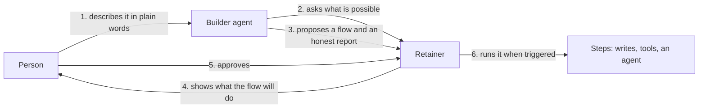
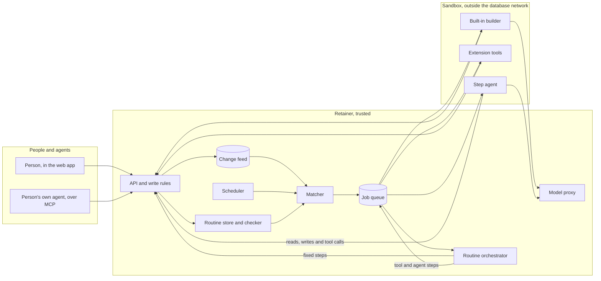
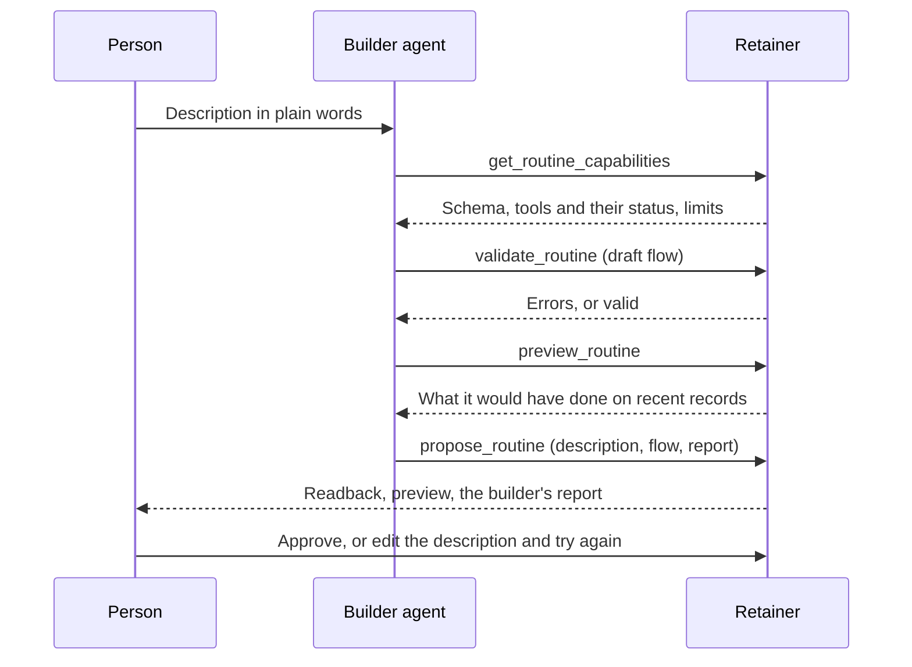
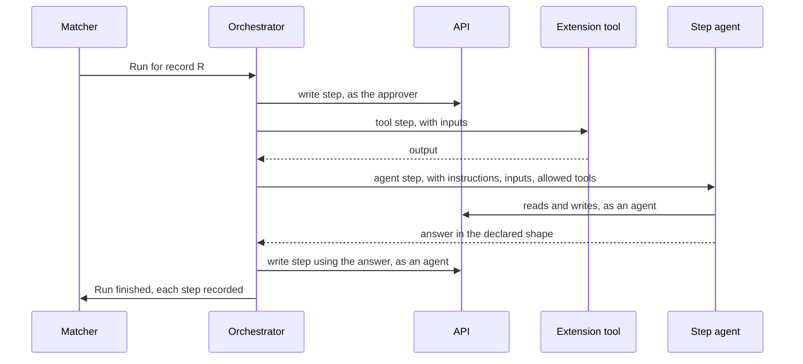
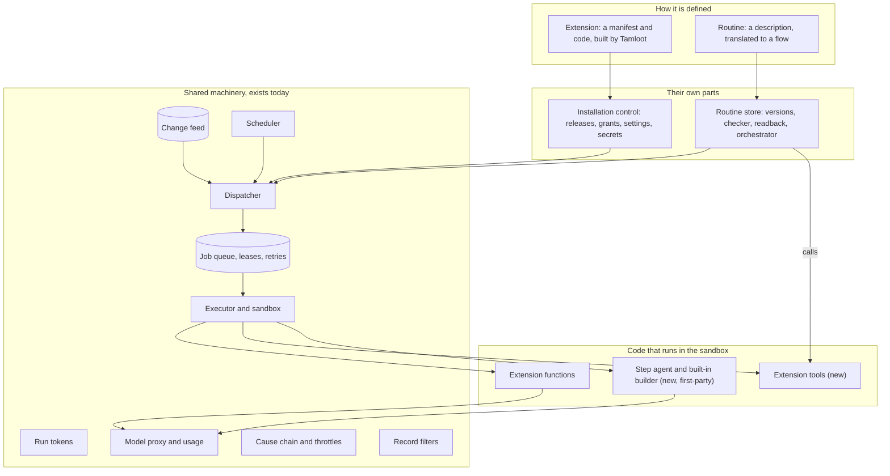

# Routines: spec

Status: **proposal**, 2026-11-19. Not accepted and not built. Section 2 lists
what is already decided and what is only proposed.

Builds on the extension platform in [extensions.md](extensions.md), model calls
in [extensions-model-calls.md](extensions-model-calls.md) and the two-step
install in [extensions-configure.md](extensions-configure.md). If accepted it
amends `extensions.md` §5 (a new `tool` trigger), §9.1 (the run result gains an
output) and §12 (tools an agent can call), and write rule 2 in
`ARCHITECTURE.md` (who a routine writes as). Background:
[the Rapid Image feature mapping](../research/rapid-image-features.md) and
[the earlier design page](https://claude.ai/artifact/FDjGnvenXbdHzjuBfomvXv).
A visual version of this spec is at
<https://claude.ai/artifact/MD4KBw6MMHr5JErEZCnXQm>.

The document goes top-down. Section 1 is the whole idea on one page. Sections
3 to 6 add a layer of detail each. Sections 7 and 8 cover what routines share
with extensions and what extensions must gain. Sections 9 and 10 show what is
possible and where the design stops.

## 1. The idea on one page

A **routine** is a standing instruction for the workspace: when something
happens, if a condition holds, do something.

A person never builds a routine by hand. They describe it in plain words. An
agent translates the description into a **flow**, the structured form Retainer
can check and run. The agent must also say honestly how much of the
description the flow covers. The person reads back what the flow will do and
approves it. From then on Retainer runs it.



Who does what:

- **The person** writes the description and approves the result. Nothing runs
  without a person's approval.
- **The builder agent** translates the description into a flow and reports
  what it could not cover. It is either Retainer's built-in builder or the
  person's own agent connected over MCP.
- **Retainer** tells the builder what is possible, checks every flow, stores
  it, decides when it fires and runs its steps. All of that is fixed logic.
  Retainer's core still never calls a model.
- **Extensions** supply the data a routine reacts to, by writing records, and
  the **tools** a routine can call, such as "send a WhatsApp message".
- **An agent** can perform a step inside a flow, for work that needs
  judgment, such as reading a transcript.

## 2. Decided and proposed

Decided with the product owner on 2026-11-19:

- Automations are a primitive of their own, called **Routine**, not a generic
  extension.
- **The builder is free text.** People do not assemble triggers and steps.
- **The builder agent gives honest feedback** on whether the flow is possible
  with the tools it has.
- **A routine can include an agent or model call** as one of its steps.
- **Authority is one fixed rule** with nothing to configure (§6.4).
- Scope includes the **extension upgrade** that lets extensions take part in
  the when, the if and the do (§8).
- **Retainer pays for the model calls** a routine makes, with its own key, as
  it does for extension model calls. A workspace is never asked for a model
  key.

Proposed in this document, open to change: the flow format, the limits, which
agent performs agent steps first and the delivery order. §12 records the
answers recommended for the open questions.

## 3. Architecture

### 3.1 Vocabulary

| Term           | Meaning                                                                               |
| -------------- | ------------------------------------------------------------------------------------- |
| Routine        | A named standing instruction. Holds a description and its approved flow.              |
| Description    | The person's plain-language text. It is the source; the flow is derived from it.      |
| Flow           | The structured form: one trigger, an optional condition, a list of steps.             |
| Trigger (when) | What starts a run: a record change, a time, or a person pressing a button.            |
| Condition (if) | A record filter checked before a run starts. Steps can carry their own condition too. |
| Step (do)      | One action: write a record, find records, call a tool, or ask an agent.               |
| Tool           | A function an extension publishes for others to call.                                 |
| Run            | One execution of a flow, with a record of what each step did.                         |
| Builder agent  | The agent that translates a description into a flow.                                  |
| Step agent     | The agent that performs an agent step during a run.                                   |

### 3.2 Where each part runs



Four rules decide the placement:

1. **Anything that calls a model runs in the sandbox.** That is the built-in
   builder and the step agent. Both reach the model only through the model
   proxy and reach records only through the API, with a token limited to
   their job. This is the placement the model-calls spec already chose for
   code that reads outside content.
2. **Anything deterministic runs in Retainer.** Checking a flow, matching
   triggers, evaluating conditions and performing fixed steps need no model
   and no outside code, so the trusted worker does them.
3. **Writes with a person's authority never leave Retainer.** The
   orchestrator performs them itself. The sandbox only ever holds tokens with
   an agent's rank (§6.4).
4. **Sandbox runs never talk to each other.** Extension tools, the step agent
   and the builder use the sandbox that extension functions use today, but
   each run is separate and holds only its own token. When the step agent
   uses an extension tool, the call goes through Retainer (§8.3), which checks
   it, attaches the extension's credentials and runs the tool as its own job.
   The step agent never holds an extension's secrets, and extension code never
   holds the step agent's token.

## 4. The flow

### 4.1 Shape

A flow is a JSON document. It refers to objects and fields by their stable
keys, never by display names, so a rename does not break it.

```json
{
  "when": { "kind": "record", "object": "deal", "on": ["updated"], "fields": ["stage"] },
  "if": { "all": [{ "field": "stage", "op": "eq", "value": "proposal" }] },
  "do": [
    {
      "id": "followUp",
      "kind": "write",
      "action": "create",
      "object": "task",
      "values": {
        "title": "Send the proposal to {{record.name}}",
        "dueDate": "{{now + 2d}}",
        "deal": "{{record.id}}"
      }
    }
  ]
}
```

The flow is not code. That is deliberate: Retainer can check it completely
before it runs, describe it back in plain words, and run it without trusting
anything a model wrote.

### 4.2 Triggers (when)

| Kind       | Fires when                                                         | Example                                |
| ---------- | ------------------------------------------------------------------ | -------------------------------------- |
| `record`   | A record of one object is created, updated or deleted              | A deal's stage changes                 |
| `relative` | A set time before or after a date field on a record                | 1 day before an appointment starts     |
| `schedule` | A cron time in the workspace's time zone, once per matching record | Every Monday 09:00, for each open deal |
| `manual`   | A person runs it on one or more records                            | A "Send quote" button on a deal        |

- Events are records, so "a meeting was logged" is a `record` trigger on that
  event type. So is anything an extension writes.
- `record` can name the fields to watch. A change to any one of them fires
  it; without a list, any change does. There is no "all of these changed
  together".
- "Field A changed and field B equals x" is a watched field plus a condition:
  A goes in the watch list and B in the `if` (§4.3). The `if` can test any
  number of fields, and it sees the record as it is when the run starts, so a
  value set a moment after A changed still counts.
- `relative` covers "no contact for 7 days": 7 days after `lastContactAt`.
- `schedule` may carry a record filter. Each matching record gets its own run.
  Without a filter it produces one run with no record.

### 4.3 Conditions (if)

The routine's `if` is a record filter on the triggering record, using the
operators the record query already has. Retainer checks it before a run
exists, by running the ordinary record query for that one record. There is no
second filter engine.

A condition sees the record's current values. "The stage changed to
Proposal" works: watch the field and test its value. "Changed from Lead" does
not, because the change feed records which fields changed, not their earlier
values (§12).

Each step may carry its own `if`. A step's condition can also use the results
of earlier steps: how many records a `find` returned, what a read-only tool
answered, or what an agent decided. That is how a routine branches.

### 4.4 Steps (do)

| Kind    | Does                                                         | Runs in     | Calls a model         |
| ------- | ------------------------------------------------------------ | ----------- | --------------------- |
| `write` | Creates or updates a record, logs an event, or stores a fact | Retainer    | No                    |
| `find`  | Queries records and returns them with a count                | Retainer    | No                    |
| `tool`  | Calls a tool an extension publishes                          | The sandbox | Only if the tool does |
| `agent` | Gives an agent instructions, inputs and a set of tools       | The sandbox | Yes                   |

- A step can repeat over a list from an earlier step with `each`, up to a
  fixed number of items.
- An `agent` step names the tools the agent may use and the shape of the
  answer it must return. Later steps use that answer like any other value.
- A `wait` step (pause for a time, then continue) is planned for a later
  phase (§11).

An agent step:

```json
{
  "id": "read",
  "kind": "agent",
  "instructions": "List each thing someone promised to do in this meeting, who promised it and by when.",
  "input": { "meeting": "{{record}}" },
  "tools": ["get_context"],
  "output": {
    "type": "object",
    "properties": {
      "commitments": {
        "type": "array",
        "items": {
          "type": "object",
          "properties": {
            "title": { "type": "string" },
            "owner": { "type": "string" },
            "due": { "type": "string" }
          }
        }
      }
    }
  }
}
```

### 4.5 Values

Values in a step are literals or references in double braces: the triggering
record (`{{record.name}}`), an earlier step's output (`{{read.commitments}}`),
the run (`{{run.startedAt}}`) and simple dates (`{{now + 2d}}`). There are no
formulas, string functions or arithmetic beyond date offsets.

### 4.6 Limits (proposed)

| Limit                                        | Value                           | Why                                                       |
| -------------------------------------------- | ------------------------------- | --------------------------------------------------------- |
| Steps in a flow                              | 20                              | Keeps the readback short enough to review                 |
| Agent steps in a flow                        | 3                               | Bounds cost per run                                       |
| Runs with an agent step, per routine per day | 200                             | Bounds spend. Further runs that day are skipped and shown |
| Items in one `each`                          | 50                              | Bounds fan-out inside a run                               |
| Records one `find` returns                   | 200                             | Same reason                                               |
| One tool or agent step                       | 120 s by default, 300 s at most | The extension run limits (`extensions.md` §9.1)           |
| Output of one step                           | 64 KiB                          | The extension protocol limit                              |
| Shortest `schedule` interval                 | 15 minutes                      | A routine is not a polling loop                           |
| Precision of `relative` triggers             | 5 minutes                       | They are found by a periodic scan                         |
| Depth of routines triggering each other      | 8 hops                          | The existing cause-chain cap                              |

## 5. Building a routine from free text

### 5.1 Two builders, one contract

- **The built-in builder.** The web app has a text box. Submitting it queues a
  job in the sandbox that reads the workspace's capabilities, calls the model
  through the proxy and saves a proposal. This is the pattern `configure`
  already uses to suggest a field mapping during an extension install: code
  with read-only access and model access prepares something for a person to
  review.
- **The person's own agent.** Any agent connected over MCP can do the same
  with the same calls, from a chat.

Both use only the calls below. Neither can approve.

| Call                       | Returns                                                                                              |
| -------------------------- | ---------------------------------------------------------------------------------------------------- |
| `get_routine_capabilities` | Trigger and step kinds, limits, the schema, every installed tool with its status, model availability |
| `validate_routine`         | Whether a flow is valid, or a list of coded errors pointing at the part that failed                  |
| `preview_routine`          | Which recent records would have triggered it, and what each step would have done                     |
| `propose_routine`          | Saves the description, the flow and the builder's report as a proposal for a person                  |



### 5.2 Honest feedback

The builder's honesty does not rest on the model's good behaviour alone.
Five mechanisms back it:

1. **Capabilities are facts.** The builder gets the list of what exists from
   Retainer: which objects and fields, which tools, whether each tool's
   account is connected, whether a model is available. It does not answer
   from memory.
2. **Validation is fixed logic.** Retainer refuses any flow that names a
   missing object, field or tool, breaks a limit, or passes a value of the
   wrong type. The builder cannot save a flow that would not run.
3. **Every proposal carries a verdict**: `full`, `partial` or `not_possible`.
   A partial or impossible verdict lists each gap: the part of the
   description it concerns, a coded reason, and what would make it possible.
4. **Retainer writes the readback, not the builder.** The plain-language
   summary the person approves is generated from the flow by fixed code. If
   the builder misread the description, the readback shows what the flow
   really does.
5. **Preview on real history.** The person sees which records from the last
   30 days would have triggered the routine and what each step would have
   done. Fixed steps are simulated. Tool steps show the call they would make,
   or the tool's own dry run if it has one. Agent steps are shown, not run.

Gap reasons are a fixed list, so they can be counted to see what people want
that Retainer cannot do yet:

| Code                   | Meaning                                                      | What would fix it                        |
| ---------------------- | ------------------------------------------------------------ | ---------------------------------------- |
| `no_source`            | Nothing writes this event into Retainer                      | Install or extend an extension           |
| `no_tool`              | No installed extension offers this action                    | Install an extension that does           |
| `tool_not_connected`   | The tool exists but its account is not connected             | Connect the account                      |
| `needs_aggregate`      | The condition needs a sum or average across records          | Not available yet                        |
| `needs_previous_value` | The condition needs the value a field had before the change  | Not available yet                        |
| `needs_instant_answer` | The description needs a reply while someone waits            | Outside what routines do (§10)           |
| `needs_blocking`       | The description wants to stop a change from being saved      | Outside what routines do (§10)           |
| `model_unavailable`    | The flow needs an agent step and the server has no model key | Self-hosted only: the operator sets one  |
| `over_limit`           | The flow would exceed a limit in §4.6                        | Narrow the description                   |
| `unclear`              | The description can be read more than one way                | The builder asks, or the person rewrites |

What this cannot guarantee: the builder can still misunderstand what the
person meant, and an agent step's quality cannot be checked in advance. The
readback and the preview are how a person catches both.

### 5.3 Approval, versions and repair

- A proposal is checked again when it is approved, as a proposed schema
  change is, because the schema may have changed since.
- Only a workspace admin approves. Agents cannot approve through any tool.
- Each approval creates a new version. Editing the description produces a new
  proposal; the active version keeps running until the new one is approved.
- The description is the lasting record of intent. If a field or tool the
  flow uses is removed, Retainer pauses the routine and marks it "needs
  attention". The builder can translate the description again against the
  current workspace, and the person approves the repaired flow.
- If the approver leaves the workspace or loses the admin role, the routine
  pauses until another admin approves it.
- Before approving, the person can test the routine on one record they
  choose. Everything runs for real except `send` tools, which only report what
  they would send. The run is marked as a test in the history.

## 6. Running a routine

### 6.1 Matching

The dispatcher that already turns record changes into extension jobs also
matches routines, in the same pass over the change feed. For each change it
finds the active routines watching that object, checks the watched fields and
the `if`, and queues a run.

- A run sees the record as it is when the run starts. Rapid successive edits
  to one record fold into one run, as extension change jobs already do.
- A write that loses on precedence changes nothing, so it triggers nothing.
- `relative` and `schedule` triggers come from the scheduler. A periodic scan
  finds due records and remembers what it already fired, so each record fires
  once per due time.
- A routine starts from its approval. It does not run on past events.

### 6.2 A run



- The orchestrator performs steps in order and saves the run's state after
  each one, so a restart resumes at the next step.
- One run at a time per routine and record.
- Tool and agent steps are jobs on the existing queue, with its leases,
  retries and at-least-once delivery. Each call carries a key made from the
  run and the step, so a tool can refuse a duplicate.
- A step that fails for good ends the run. Earlier steps are not undone.
- After repeated failed runs the routine pauses and is marked "needs
  attention". Until Retainer has notifications, that shows only on the
  Routines page.

### 6.3 Agent steps

- **First version:** the step agent is a first-party function in the sandbox.
  It runs a tool loop through the model proxy inside one job, so a step has
  at most 300 seconds. Running an agent loop inside a run is something
  extension code can already do.
- **Later:** the step is handed to the workspace agent that the model-calls
  spec plans (§11 there). It runs as a series of short jobs, so the time
  limit goes away, and it can use connections such as a member's Gmail.
- The agent gets the instructions, the declared inputs and only the tools the
  flow lists. Those are Retainer's own tools (search, read context, write a
  record, log an event) and extension tools.
- Record content reaches the agent as data. The step's instructions come only
  from the approved flow.
- An agent step cannot call `send` tools itself. Text an agent wrote can
  still be sent by a later `tool` step: the flow fixes the tool and the
  recipient, and the agent supplies only the text. That needs the admin's
  explicit allowance at approval, and the readback says "sends text written
  by an agent without review". An agent that reads an incoming email
  therefore cannot be steered into choosing where a message goes.
- The built-in builder and the step agent use one model that the operator
  sets, by default the one the enrichment extension uses. A workspace cannot
  choose its own in the first version, and a flow never names a model.
- A routine runs its agent steps at most 200 times a day (§4.6). The preview
  shows how often the routine would have run in the last 30 days, so the cost
  is visible before approval.
- Retainer pays for these calls with its own model key, as it does for
  extension model calls. A workspace never enters a key. Usage is recorded per
  call in `ai_usage` under its own kind. The approval screen says that an agent step sends workspace
  data to the model provider.

### 6.4 Authority

One fixed rule. Authority follows where a value came from:

| The value comes from                                     | It is written as                         | Against a value a person set |
| -------------------------------------------------------- | ---------------------------------------- | ---------------------------- |
| The flow itself, a record, or a tool that calls no model | The routine, on its approver's authority | The latest write wins        |
| An agent step, or a tool that calls a model              | An agent                                 | It waits for review          |

- An approved routine is a standing instruction from a person. Its fixed
  writes share fields with people: a later manual edit beats the routine, and
  a later run beats the edit.
- An agent's output is a judgment, so it keeps today's protection. Passing it
  through a fixed `write` step does not upgrade it.
- Which case applies is worked out from the flow when it is checked, shown in
  the readback, and fixed for that version. Nothing is decided at run time.
- A manual run writes as the person who pressed the button.
- A routine's fixed writes use a new author type, `routine`, with the same
  rank as `user`. Within one rank the latest write wins, which gives the rule
  above. They are not recorded as `user`, because no person typed the value.
- `routine` outranks `agent`, so an agent's value never replaces a routine's
  value without review either.
- History shows the routine and its approver on every value it wrote.

### 6.5 Loops and load

- A routine joins the existing cause chain like an installation. A routine is
  never triggered by a change it caused, directly or through others, and
  chains stop at 8 hops.
- Runs count against a per-routine write budget and the workspace's limits,
  as installations do. Excess work waits; it is not dropped.

### 6.6 Stored data

| Table              | Holds                                                                                                      |
| ------------------ | ---------------------------------------------------------------------------------------------------------- |
| `routines`         | Name, description, status (`draft`, `active`, `paused`, `needs_attention`, `archived`), the active version |
| `routine_versions` | The flow, the builder's report, who built it, who approved it and when                                     |
| `routine_runs`     | The trigger, the record, each step's status, output and error, the cause chain                             |
| `routine_firings`  | What time-based triggers already fired, so nothing fires twice                                             |

Routines are not records, so they don't appear in views or the change feed.

## 7. What routines share with extensions

A routine is not an extension. It has no release, no manifest and no install.
But a routine's run is the same kind of work as an extension's run, so it
uses the same machinery.



| Shared piece               | Where it lives today                                     | How routines use it                        | Change needed                                               |
| -------------------------- | -------------------------------------------------------- | ------------------------------------------ | ----------------------------------------------------------- |
| Change feed and dispatcher | `changes`, `worker/changes.ts`                           | Routine matching runs in the same pass     | Match routines beside extension triggers                    |
| Job queue, leases, retries | `extension-runtime/queue.ts`, `worker/extensions.ts`     | Tool, agent and builder jobs               | A job can belong to a routine run, not only an installation |
| Scheduler and cron parsing | `worker`, `packages/extension/src/cron.ts`               | `schedule` and `relative` triggers         | Schedules created at approval, not from a manifest          |
| Executor and sandbox       | `launcher`, `worker/launch-driver.ts`, `packages/runner` | Runs tools, the step agent and the builder | The result carries an output (§8.2)                         |
| Run tokens                 | `extension-runtime/tokens.ts`, `credentials.ts`          | The step agent's and the builder's access  | A token bound to a routine run, at agent rank               |
| Model proxy and usage      | `model/`, `extensions/usage.ts`                          | Agent steps and the built-in builder       | A model-token kind for routines                             |
| Cause chain and throttles  | The dispatcher (`extensions.md` §9.4)                    | Loop prevention and budgets                | A routine can be a member of a chain                        |
| Record filters             | `packages/shared/src/api.ts`, `reads`                    | The `if`                                   | None                                                        |
| Propose, then approve      | Schema changes; the two-step install                     | Routine versions; the built-in builder     | None; the same pattern                                      |
| Run history screens        | `packages/web/src/routes/extensions`                     | The Routines page                          | Reuse the run list                                          |

Not shared: installations, releases, grants, settings, secrets, key-value
storage, webhooks and source imports. A routine holds no secrets and stores
no data of its own.

What each package gains:

| Package              | License | Gains                                                                                                                                                            |
| -------------------- | ------- | ---------------------------------------------------------------------------------------------------------------------------------------------------------------- |
| `packages/shared`    | MIT     | The flow's schema and types, and the readback renderer, so the web app and SDK use the same code as the server                                                   |
| `packages/extension` | MIT     | `defineTool`, the `tool` trigger, and the run result's output                                                                                                    |
| `packages/runner`    | MIT     | Tool dispatch, plus two first-party functions: the step agent and the builder                                                                                    |
| `packages/server`    | AGPL    | A `routines` module (store, checker), routine matching in the dispatcher, the orchestrator in the worker, tool invocation in the runtime, new REST and MCP calls |
| `packages/sdk`       | MIT     | Client methods for routines and for calling a tool                                                                                                               |
| `packages/web`       | MIT     | The Routines page: describe, review, approve, runs                                                                                                               |

One thing to avoid, seen in Twenty: it has three separate trigger systems, for
workflows, app functions and agents, each with its own queue and condition
format. Here there is one feed, one dispatcher, one queue and one filter
format for both extensions and routines.

## 8. The extension upgrade

Extensions take part in a routine in three places:

- **When.** No change. Whatever an extension writes is a record, and a
  routine can react to it.
- **If.** A read-only tool can answer a question, such as "is this address
  deliverable", for a step's condition.
- **Do.** A tool performs an action, such as sending a message.

So the upgrade is one new capability, **tools**, and what it needs around it.

### 8.1 Declaring a tool

A tool is a function with the new `tool` trigger. `extensions.md` §5 already
reserves this as a future kind.

```ts
import { defineTool } from '@retainer/extension';

export const sendWhatsApp = defineTool({
  universalId: '…',
  name: 'send_whatsapp_message',
  title: 'Send a WhatsApp message',
  description: 'Sends one WhatsApp message to a person from the clinic number.',
  effect: 'send',
  inputSchema: {
    type: 'object',
    properties: {
      person: { type: 'string', description: 'Record ID of the recipient' },
      text: { type: 'string', maxLength: 1000 },
    },
    required: ['person', 'text'],
    additionalProperties: false,
  },
  outputSchema: {
    type: 'object',
    properties: { messageId: { type: 'string' } },
  },
  connection: 'workspace',
  supportsDryRun: true,
  secrets: ['apiToken'],
  scopes: ['read', 'write'],
});
```

| Field                         | Purpose                                                                                                |
| ----------------------------- | ------------------------------------------------------------------------------------------------------ |
| `name`, `title`               | How flows and people refer to it                                                                       |
| `description`                 | Written for an agent: what it does and when to use it                                                  |
| `effect`                      | `read` (answers a question), `write` (changes Retainer records only) or `send` (acts outside Retainer) |
| `inputSchema`, `outputSchema` | Checked by Retainer on the way in and out                                                              |
| `connection`                  | `workspace`, or `member` when the tool uses one person's account                                       |
| `supportsDryRun`              | The tool can say what it would do without doing it, for previews                                       |
| `uses`                        | Declares a model call, as functions do today. Its output then counts as agent-made (§6.4)              |

### 8.2 The run result carries an output

Today a function's result is only a status: `succeeded`, `retry` or `failed`.
A tool has to return data, so the executor protocol gains an optional
`output`, checked against the tool's `outputSchema` and held to the existing
64 KiB limit. This is a new protocol version.

### 8.3 Calling a tool

One runtime call invokes a tool and returns its output. Three kinds of
caller use it:

| Caller            | How                                        | When                 |
| ----------------- | ------------------------------------------ | -------------------- |
| A routine         | A `tool` step, or a step agent's tool call | With routines        |
| A person          | A button on a record                       | With manual triggers |
| A connected agent | An MCP tool                                | Later                |

What the platform adds around the call:

- **Approval.** Installing an extension shows the tools it offers. Approving a
  routine shows the tools that routine calls.
- **Whose account.** A `member` tool takes the member to act for. Retainer
  resolves that member's connection; the caller never sees its credentials.
- **Duplicates.** Every call carries a key from its caller. Delivery is at
  least once, so a `send` tool must use the key to avoid sending twice.
- **Cause.** The call carries the cause chain, so a tool's writes cannot
  trigger the routine that called it.
- **Its own lane.** Installations run one job at a time by default. Tool
  calls need a separate allowance, or a busy routine would wait behind an
  extension's sync.

### 8.4 What the builder needs from extensions

- **A tool list with status.** `get_routine_capabilities` reports each tool,
  whether its extension is healthy and whether its account is connected.
- **Good descriptions.** Tools and contributed fields need descriptions
  written for an agent. They are what the builder and the step agent read.
- **A way to tell data is complete.** Extensions that bring data in stages
  (a meeting first, its transcript later) should write something a condition
  can test, such as the transcript field being filled.
- **Optional: suggested routines.** An extension may ship routine
  descriptions, such as "after a Tamloot meeting, create a follow-up task".
  They install switched off and go through the same builder and approval.

### 8.5 What extensions do not get

- No new trigger kinds for routines. Extensions make something automatable by
  writing it down as a record or a field.
- No way to approve, edit or start a routine on their own.

## 9. Examples

### 9.1 Possible

| Description                                                                                      | How the flow does it                                                    |
| ------------------------------------------------------------------------------------------------ | ----------------------------------------------------------------------- |
| "When a deal moves to Proposal, create a task to send the proposal within two days."             | `record` trigger on stage, one `write`                                  |
| "If a lead has had no contact for a week and is still open, create a follow-up task."            | `relative` trigger on `lastContactAt`, an `if`, one `write`             |
| "When an appointment is booked, set the lead's status to Booked."                                | `record` trigger, one `write`. Overwrites a person's value: latest wins |
| "The day before an appointment, send the patient a WhatsApp reminder if they haven't confirmed." | `relative` trigger, an `if`, a `tool` step                              |
| "Every Monday at 9, create a review task for each deal open longer than 30 days."                | `schedule` trigger with a record filter, one `write` per deal           |
| "After a meeting is logged with its transcript, list what people promised and create tasks."     | `record` trigger, an `agent` step, a `write` with `each`                |
| "When an email arrives from a lead, if it reads like a complaint, open an urgent ticket."        | `record` trigger, an `agent` step that classifies, a guarded `write`    |
| "Every Friday, summarise this week's new leads and post it to Slack."                            | `schedule`, a `find`, an `agent` step, a `tool` step                    |
| "If a patient misses a third appointment, flag them for the manager."                            | `record` trigger, a `find` that counts, a guarded `write`               |
| "Add a Send quote button on deals."                                                              | `manual` trigger, a `tool` step                                         |

### 9.2 Possible only with something else in place

The builder reports these as `partial` or `not_possible`, with the reason:

| Description                                                           | What it needs                                                                  | Gap code                 |
| --------------------------------------------------------------------- | ------------------------------------------------------------------------------ | ------------------------ |
| "When a call is missed, create a lead."                               | A phone extension that logs missed calls as events                             | `no_source`              |
| "Send a WhatsApp reminder…" with no messaging extension               | An extension that offers a send tool                                           | `no_tool`                |
| "Email the patient from their therapist's Gmail."                     | That member's Gmail connected                                                  | `tool_not_connected`     |
| "…and reply to the patient automatically."                            | The admin allowing agent-written text to be sent. The flow fixes the recipient | Reported in the readback |
| "Summarise the transcript…" on a self-hosted server with no model key | The server's operator setting a model key                                      | `model_unavailable`      |

### 9.3 Not possible, by design

| Description                                                    | Why not                                                                                      |
| -------------------------------------------------------------- | -------------------------------------------------------------------------------------------- |
| "Don't let anyone save a deal without an amount."              | A routine runs after a change is saved. It cannot refuse one                                 |
| "When a patient opens the booking page, show them free slots." | A routine answers nobody. It runs in the background, seconds to minutes later                |
| "Book the room and the doctor together, or neither."           | Steps are separate writes. A failure midway does not undo earlier steps                      |
| "If this quarter's revenue passes 100,000, tell me."           | Needs a sum across records. Conditions see one record, or a count of up to 200               |
| "When a deal jumps from Lead straight to Won, alert me."       | A condition sees a field's current value, not the value before the change                    |
| "Check every ten seconds whether…"                             | The shortest schedule is 15 minutes                                                          |
| "Show the secretary a popup when…"                             | A routine changes records and calls tools. It has no effect on screens                       |
| "Do whatever it takes to win this deal back."                  | An agent step has fixed instructions, a fixed set of tools and a time limit                  |
| "Add a field for…", "Install…", "Create another routine that…" | A routine cannot change the schema, extensions, members or routines                          |
| "Use my private notes about this client."                      | Runs are workspace-level and cannot read personal memory                                     |
| "Apply this to all last year's meetings."                      | A routine starts from its approval. It does not run on past events                           |
| "Charge the card exactly once, guaranteed."                    | Delivery is at least once. Avoiding a duplicate depends on the tool honouring the call's key |
| "Have the agent update the status no matter who set it."       | An agent-made value waits for review when a person set the field                             |

### 9.4 A worked example

The person writes:

> After every meeting with a lead, create tasks for anything we promised, and
> send the lead a thank-you on WhatsApp.

The workspace has the Tamloot extension installed and no messaging extension.
The builder proposes:

- **Verdict:** `partial`.
- **Flow:** a `record` trigger on new conversations with medium `meeting`
  whose transcript is present; an `agent` step that lists commitments; a
  `write` step that creates one task per commitment.
- **Gap:** "send the lead a thank-you on WhatsApp" is not covered. Reason:
  `no_tool`. Fix: install a messaging extension that offers a send tool.

Retainer's readback, generated from the flow:

> When a meeting is logged and its transcript is present: an agent reads the
> meeting and lists what was promised. Then a task is created for each item,
> up to 50. The tasks are created as an agent, so they never replace a value
> a person set. This routine sends meeting content to the model provider.

The preview shows the 6 meetings from the last 30 days that would have
triggered it. The person can approve the partial routine now and add the
thank-you later by editing the description once a messaging extension is
installed.

## 10. Design limits

Each limit below follows from a choice made above.

| Limit                                                        | Comes from                                                                       |
| ------------------------------------------------------------ | -------------------------------------------------------------------------------- |
| Routines react after the fact; they cannot block or validate | They read the change feed, which records committed changes                       |
| No instant answers                                           | Every run goes through the job queue                                             |
| No all-or-nothing across steps                               | Each step is its own write; Retainer has no multi-record transaction for callers |
| One record, or a bounded list, at a time                     | No aggregates in the query API                                                   |
| Conditions see current values only                           | The change feed records which fields changed, not their earlier values           |
| No arbitrary code or web requests                            | The flow is data. Outside effects come only from reviewed extension tools        |
| Triggers only on what is written down                        | The matcher sees records, not what happens inside other systems                  |
| Fast successive edits fold into one run                      | Change jobs coalesce per record                                                  |
| Agent steps are bounded and can vary                         | A model performs them; the limits in §4.6 and §6.3 apply                         |
| Agent-made values do not override people automatically       | The authority rule (§6.4)                                                        |
| Outside actions may repeat on a retry                        | At-least-once delivery                                                           |
| Failures are visible only on the Routines page for now       | Retainer has no notifications yet                                                |
| The builder can misread intent                               | A model translates; the readback and preview are the check                       |
| Nothing for one person only                                  | Routines are workspace-level and admin-approved                                  |

Things that are limits today and could be lifted later, in rough order of
value: notifications for failures, `wait` steps for sequences, the workspace
agent for longer agent steps, aggregates in conditions, and code steps written
by an agent. Code steps need the sandbox to run code written inside a
workspace; today it runs only code Tamloot publishes, with open access to
public addresses, so that trust model has to change first.

## 11. Delivery order (proposed)

1. **Extension tools.** `defineTool`, the protocol output, the invoke call,
   the tool list. Useful on its own for buttons.
2. **Routines without agent steps.** The flow format, checker, readback,
   matcher for `record` and `schedule`, `write`, `find` and `tool` steps, runs
   and history, the MCP calls for a person's own agent, the Routines page.
3. **The built-in builder and preview.** The free-text box in the web app.
4. **Agent steps.** The step agent, the agent-rank token, consent on the
   approval screen.
5. **More triggers and steps.** `relative` and `manual` triggers, `wait`
   steps, suggested routines from extensions.

## 12. Open questions, answered

Answered by recommendation on 2026-11-19. Each stands unless the product owner
changes it.

| Question                                        | Answer                                                                                                          | Why                                                                                                                                                |
| ----------------------------------------------- | --------------------------------------------------------------------------------------------------------------- | -------------------------------------------------------------------------------------------------------------------------------------------------- |
| How are a routine's fixed writes recorded?      | A new author type, `routine`, ranked with `user`                                                                | No person typed the value, so `user` would be untrue. Equal rank gives "latest write wins" with the existing ranking code                          |
| Can a condition test the value before a change? | Not in the first version. "Changed to" only                                                                     | The change feed keeps which fields changed, not their earlier values, and fast edits fold into one run. The builder reports `needs_previous_value` |
| Which model do the builder and step agent use?  | One model the operator sets. No choice per workspace                                                            | The simplest thing that works. A flow never names a model, so the model can change without touching routines                                       |
| Does a routine need a spend guard?              | Yes: 200 runs with an agent step per routine per day                                                            | Bounds a runaway routine. The preview shows the expected frequency before approval                                                                 |
| May agent-written text be sent without review?  | Yes, with the admin's explicit allowance. The agent never holds a `send` tool, and the flow fixes the recipient | Useful replies stay possible. Hidden instructions in incoming text can change wording, not the destination                                         |
| Who may approve a routine?                      | Workspace admins only                                                                                           | A routine writes with a person's rank across the whole workspace                                                                                   |
| Is there a test run before going live?          | Yes, optional, on one chosen record, with `send` tools in dry run                                               | The readback and preview show intent. A test shows the real result                                                                                 |

Decided by the product owner on 2026-11-19:

- **Retainer pays for agent steps and for the builder**, as it does for
  extension model calls. No workspace is ever asked for a model key. The
  200-a-day guard and the provider-side limit on Retainer's key are the caps.
  On a self-hosted server the operator's key is used, as today.
